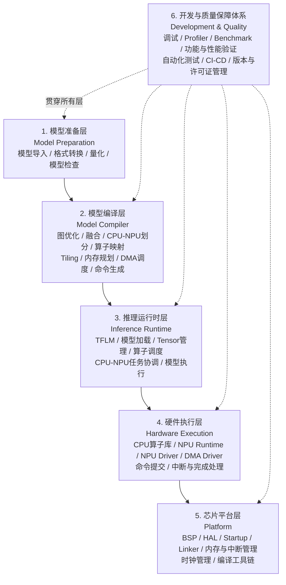
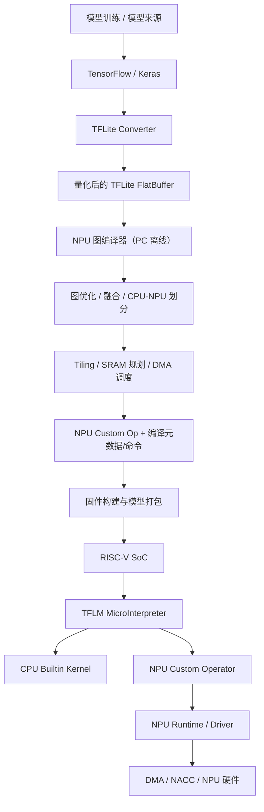
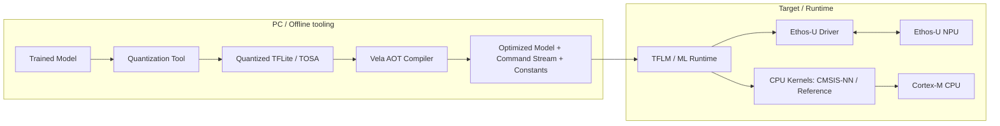
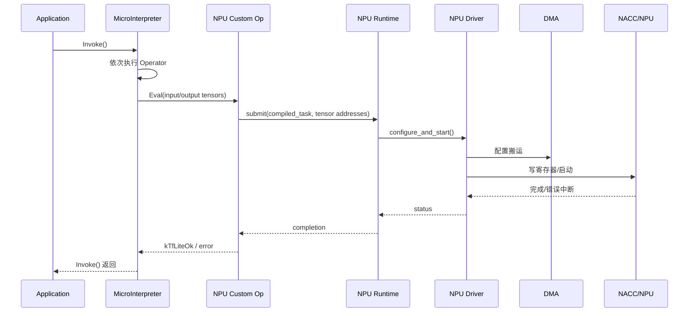

## 目标

本 Wiki 用于系统梳理 NPU 软件栈的架构、关键模块、实现方法、验证流程和工程化管理。目标平台是自研 RISC-V SoC + 固定功能 NPU，重点参考 Arm Ethos-U 软件生态，并结合 TFLM、Vela、NPU Driver、CPU 算子库等实际项目开展分析。

NPU 软件栈的核心任务是：将训练完成的神经网络模型转换为目标 NPU 能够执行的任务，并在芯片上协调 CPU、NPU、DMA 和存储资源，最终实现正确、高效、可维护的端侧推理。

## NPU 软件栈六层架构

通过分析竞品的软件实现，发现可以将整个NPU 软件栈划分为六个层次。

### 模型准备层（Model Preparation）

**解决的问题：如何把训练模型变成适合端侧部署的标准模型？**

- 模型来源与导入：TensorFlow/Keras 等训练框架；
- 模型格式转换：SavedModel/Keras 到 TFLite；
- 模型量化：PTQ、QAT、INT8、per-channel quantization；
- 模型检查：算子、Tensor shape、dtype、量化参数和模型版本；
- 模型正确性基线：PC 端 reference inference 和 golden outputs。

典型工具：TensorFlow、TFLite Converter、Quantization Toolkit、Netron、模型检查脚本。

### 模型编译层（Model Compiler）

**解决的问题：如何把通用模型转换成目标 NPU 能执行的任务？**

- 模型解析与内部 IR；
- 图规范化、常量折叠和图优化；
- 算子支持能力分析；
- 算子融合与图改写；
- CPU/NPU 子图划分；
- 算子映射与硬件约束检查；
- Layout 转换、Weight Reordering；
- Tiling 与执行调度；
- NPU SRAM/外部内存规划；
- DMA 任务规划；
- NPU 命令流、描述符或寄存器配置数据生成；
- Custom Operator / 模型产物生成；
- 编译报告和版本 Manifest。

典型参考：Arm Vela。Vela 是面向ARM Ethos-U NPU系列的图编译器。

### 推理运行时层（Inference Runtime）

**解决的问题：如何在设备端组织并执行整个模型？**

- 模型加载与解析；
- TFLM MicroInterpreter；
- Tensor Arena 与 Tensor 生命周期管理；
- Operator Resolver 和 Kernel 调度；
- CPU Builtin Operator 与 NPU Custom Operator 的调用；
- CPU/NPU 任务协调和同步；
- 模型输入输出管理；
- 错误传播、任务超时和执行状态管理。

典型参考：TensorFlow Lite Micro，以及 Arm Ethos-U 的 TFLM 集成方式。

### 硬件执行层（Hardware Execution）

**解决的问题：如何让 CPU 和 NPU 真正完成计算？**

- CPU 算子库：TFLM Reference Kernels、目标 RISC-V 优化 Kernel、NMSIS-NN 等候选；
- NPU Runtime API：统一任务提交、等待、查询状态和错误返回；
- NPU Driver：复位、寄存器配置、启动、状态读取、中断和 fault 处理；
- DMA Driver：传输配置、启动、完成和错误处理；
- 命令/描述符提交；
- Cache maintenance、memory barrier 和硬件访问同步。

CPU 算子库负责 CPU 计算；NPU Driver 负责底层硬件控制。
可以参考Nuclei的解决方案。

### 芯片平台层（Platform）

**解决的问题：上层软件如何在目标 SoC/开发板上启动并访问硬件？**

- BSP、HAL 和设备头文件；
- Startup、异常入口和中断控制器；
- Linker Script、Memory Map 和 section；
- SRAM/Flash/外部存储管理；
- 时钟、复位、电源和 Pinmux；
- Cache、MPU/PMP（按目标架构）；
- Bare-metal 或 RTOS 适配；
- GCC/LLVM 工具链、Assembler、Linker、GDB、烧录工具。

### 开发与质量保障体系（Development & Quality）

**解决的问题：如何证明软件正确、性能达标，并能持续迭代和发布？**

这一层不是推理调用链中的单一运行模块，而是贯穿前五层的工程保障体系。

- 调试工具、日志、Tensor dump、寄存器 dump；
- Profiler、PMU 和性能分析；
- 算子、子图和整网 Benchmark；
- Compiler、Runtime、Driver 单元测试；
- CPU/NPU 数值一致性验证；
- FPGA/芯片端到端验证；
- CI/CD、自动化回归和发布；
- 版本兼容矩阵、ABI 管理；
- 第三方许可证、SBOM 和供应链管理。

## 六层之间的职责边界

| 工作内容            | 主要归属                    | 说明                          |
| --------------- | ----------------------- | --------------------------- |
| 模型导入、量化         | 模型准备层                   | 生成标准、可检查的模型输入               |
| 图优化、算子融合        | 模型编译层                   | 改写计算图，保持语义等价                |
| CPU/NPU 划分      | 模型编译层                   | 决定哪些节点卸载到 NPU               |
| Tiling、执行调度     | 模型编译层                   | 生成适配硬件资源的执行计划               |
| NPU SRAM 静态布局   | 模型编译层                   | 编译期规划 buffer、offset、bank    |
| Tensor Arena 分配 | 推理运行时层                  | 设备端管理 TFLM Tensor 内存        |
| DMA 传输计划        | 模型编译层                   | 决定搬运内容、顺序、长度和依赖             |
| DMA 实际启动/完成     | 硬件执行层                   | Driver 配置并控制 DMA            |
| NPU 命令生成        | 模型编译层                   | 生成目标相关命令或描述符                |
| NPU 命令提交        | 硬件执行层                   | Runtime/Driver 提交并等待硬件执行    |
| CPU 算子执行        | 推理运行时层调用，硬件执行层提供 Kernel | Runtime 调度，CPU Kernel 实际计算  |
| NPU 算子执行        | 推理运行时层调用，硬件执行层控制        | Custom Op/Runtime/Driver 协同 |
| Linker、启动和时钟    | 芯片平台层                   | 提供芯片运行环境                    |
| 测试、调试、版本管理      | 开发与质量保障体系               | 贯穿全部层次                      |

## Arm Ethos-U 组件在六层中的位置

| Arm 组件                                         | 所属层            | 作用                     |
| ---------------------------------------------- | -------------- | ---------------------- |
| TensorFlow / Keras                             | 模型准备层          | 训练和模型来源                |
| TFLite Converter / Quantization                | 模型准备层          | 转换和量化                  |
| Vela                                           | 模型编译层          | Ethos-U AOT 编译         |
| TFLM / MicroInterpreter                        | 推理运行时层         | 设备端模型执行                |
| TFLM Ethos-U integration                       | 推理运行时层         | 将 NPU partition 接入模型执行 |
| Ethos-U Core Driver                            | 硬件执行层          | NPU 硬件控制               |
| CMSIS-NN                                       | 硬件执行层          | Cortex-M CPU 优化算子      |
| CMSIS-Core / Device / Board support            | 芯片平台层          | Cortex-M 平台支持          |
| CMSIS-Ethos-U tests/examples/build integration | 开发与质量保障体系及平台集成 | 示例、测试和工程集成             |

## 模型部署流程

| 层               | 主要职责       | 输入               | 输出                 |
| --------------- | ---------- | ---------------- | ------------------ |
| Model Source    | 训练模型       | 训练数据、网络结构        | SavedModel/Keras 等 |
| Model Converter | 转换模型       | TensorFlow 模型    | TFLite FlatBuffer  |
| Quantization    | 量化         | 浮点模型、代表性数据       | INT8/INT16 模型      |
| Graph Compiler  | 目标相关编译     | TFLite           | 优化图、CPU/NPU 分区     |
| Backend/Codegen | 硬件映射       | NPU 子图、硬件配置      | 命令流、描述符、常量         |
| Model Package   | 模型打包       | FlatBuffer、命令和权重 | 固件可链接/可加载产物        |
| TFLM            | 设备端图执行     | TFLite 模型        | Kernel 调用          |
| Custom Op       | NPU 接入点    | Tensor、编译元数据     | NPU Runtime 请求     |
| NPU Runtime     | 执行管理       | NPU 工作描述         | 任务提交/完成状态          |
| Driver          | 寄存器、DMA、中断 | Runtime 请求       | 硬件操作               |
| BSP/HAL         | SoC 基础设施   | 硬件平台             | 时钟、内存、中断、UART      |
| Test/Profiler   | 验证与测量      | 模型、测试数据          | 正确性和性能报告           |

## 关键架构原则

- **离线编译决定执行计划，运行时负责执行计划。** 静态模型的算子映射、融合、常量布局和大部分内存规划应尽可能在 PC 端完成。
- **TFLM 是设备端推理框架，不是图编译器。** 它负责解释 FlatBuffer、准备 Tensor、调用已注册 Kernel。
- **Custom Operator 是 NPU 接入边界。** NPU 支持但不参与融合的单算子，也可以改写为独立 Custom Operator；多个算子融合后可表示为一个融合 Custom Operator。
- **CPU fallback 必须是设计能力。** 不支持或不满足约束的算子应保留 CPU 实现或明确报错。
- **硬件支持、编译器支持、Runtime 支持、测试覆盖是四件不同的事。**
- **性能结论必须来自真实目标平台测量。** Cost model 是估计值，不能代替 FPGA/芯片实测。

## Arm Ethos-U 软件栈参考架构

> 本章以 Arm Ethos-U55/U65/U85 为参考，重点分析适合 MCU/Edge 场景的软件栈。

### Arm 官方定义的基本分工

Arm 将 Ethos-U 软件栈明确分为 Offline tooling 与 Runtime 两个区域：

离线侧负责量化模型的目标相关编译；运行时负责 CPU 算子执行和 NPU 子图提交。Vela 生成目标相关 command stream 和编码后的常量数据，Driver 负责把 command stream 和 memory regions 提交给 NPU。

### Arm 软件栈组件

| 组件 | 所属侧 | 主要职责 | 本项目对应 |
|---|---|---|---|
| TensorFlow / Keras | PC | 模型训练与导出 | 模型来源 |
| TFLite Converter / Quantization | PC | 转换、量化 | TFLite 模型生成 |
| TFLite / TOSA | PC 中间格式 | 表达模型计算 | 输入模型格式 |
| Vela | PC | AOT 编译、图优化、调度、内存规划、命令生成 | 自研 NPU 图编译器 |
| TFLM / ML Runtime | 芯片端 | 解析模型、分配 Tensor、调度 CPU/NPU 节点 | 设备端推理 Runtime |
| Ethos-U Core Driver | 芯片端 | NPU 初始化、提交命令流、处理中断/错误、PMU | NACC Driver |
| CMSIS-NN | 芯片端 CPU | Cortex-M 优化 NN kernels | RISC-V CPU 优化 Kernel（如 NMSIS-NN，需验证） |
| Reference Kernels | 芯片端 CPU | 通用 fallback | TFLM reference kernels |
| CMSIS / CMSIS-RTOS2 | 平台层 | Core/RTOS 接口和组件集成 | RISC-V BSP/OS abstraction |
| CMSIS-Toolbox / DFP | PC/平台集成 | Device/Board/Pack/Build 管理 | 自研 SDK pack/build system |

### Arm 方案的关键设计思想

#### Vela 与 Driver 职责严格分离

Vela 不直接操作设备寄存器。它生成目标 NPU 可执行的模型数据和命令流。Driver 不负责重新编译模型，也不负责为 TFLM 分配 Tensor Arena。

#### Runtime 是 CPU 与 NPU 的协调者

模型中支持 NPU 的 partition 被编译为目标相关 payload；未委派给 NPU 的节点仍由 ML Runtime 调用 CPU Kernel。一个模型 Invoke 过程中可以多次调用 NPU Driver，而不一定只有一次。

#### 命令流不是独立可执行文件

Command stream 还会引用常量区、activation/working arena 等 memory regions。运行时必须提供正确的 base addresses、region sizes 和访问属性。

#### 平台内存配置是端到端契约

Vela 的 `vela.ini`、linker script、MPU/SAU、cache policy、Driver 的 QCONFIG/REGIONCFG 必须相互匹配。单独改一个配置可能导致 NPU 访问错误地址或性能退化。

## 附录

### PC 端：离线编译域

- 读取 TFLite FlatBuffer；
- 校验模型版本、算子、Tensor shape、dtype、quantization；
- 规范化图结构；
- 识别目标 NPU 支持的算子；
- 做单算子映射和算子融合；
- 划分 CPU/NPU 子图；
- 做 layout 转换、weight reordering；
- 计算 tile/block；
- 规划 SRAM 和 Tensor 生命周期；
- 生成 NPU 命令、描述符、常量数据或 Custom Operator；
- 输出可部署模型和编译报告。

### 芯片端：在线推理域

- 启动和 BSP 初始化；
- 加载模型和编译产物；
- 初始化 TFLM Interpreter；
- 分配 Tensor Arena；
- 注册 Builtin Operator 和 Custom Operator；
- 执行 CPU Kernel；
- 遇到 NPU Custom Operator 时调用 Runtime；
- 配置 DMA/NACC；
- 等待完成、中断或轮询；
- 处理错误、超时和同步；
- 返回输出 Tensor。

### 离线编译阶段的输入和输出

输入：`.tflite`、NPU Hardware Description、System Configuration、Compiler Options，以及可选校准数据/性能 profile。

输出建议包含：

| 产物 | 内容 | 用途 |
|---|---|---|
| `model_compiled.tflite` | TFLite 图，含 NPU Custom Operator | TFLM 加载 |
| `npu_constants.bin` | 重排后的权重、bias、常量 | NPU 读取 |
| `npu_command.bin` | 命令流/任务描述（若采用） | NPU 执行 |
| `memory_plan.json` | Tensor 生命周期、offset、bank、大小 | 调试和地址绑定 |
| `compile_report.json` | 分区、算子映射、fallback、警告、估算性能 | 可追踪性 |
| `manifest.json` | 版本、硬件配置、文件 hash | 兼容性检查 |

开发阶段建议保留可读的 sidecar 文件；产品中可以合并为容器格式。

### 一次推理的设备端调用关系

### 失败处理路径

- 模型格式不兼容：离线编译阶段报错；
- 算子不支持：CPU fallback 或编译失败；
- NPU 资源不足：重新切分/降低并行度，失败则回退或报错；
- 运行时地址越界：Driver/Runtime 返回错误，不允许启动；
- DMA/NPU 超时：停止任务、清状态、恢复硬件并返回错误；
- 输出不一致：进入逐层对比与 dump 流程。

## 参考资料

- [TensorFlow Lite Micro](https://github.com/tensorflow/tflite-micro)
- [TFLM Memory Management](https://github.com/tensorflow/tflite-micro/blob/main/docs/memory_management.md)
- [TensorFlow Lite Quantization](https://www.tensorflow.org/lite/performance/post_training_quantization)
- [Arm Ethos-U Vela](https://github.com/nxp-imx/ethos-u-vela)
- [Arm CMSIS-Ethos-U Integration](https://arm-software.github.io/CMSIS-Ethos-U/main/general/index.html)
- [Nuclei SDK](https://doc.nucleisys.com/nuclei_sdk/)
- [NMSIS](https://doc.nucleisys.com/nmsis/)
- [Vela 文档](https://arm-software.github.io/CMSIS-Ethos-U/main/vela/index.html)
- [Driver 文档](https://arm-software.github.io/CMSIS-Ethos-U/main/driver/index.html)
- [Integration 文档](https://arm-software.github.io/CMSIS-Ethos-U/main/integration/index.html)
- [CMSIS-Ethos-U GitHub](https://github.com/ARM-software/CMSIS-Ethos-U)
