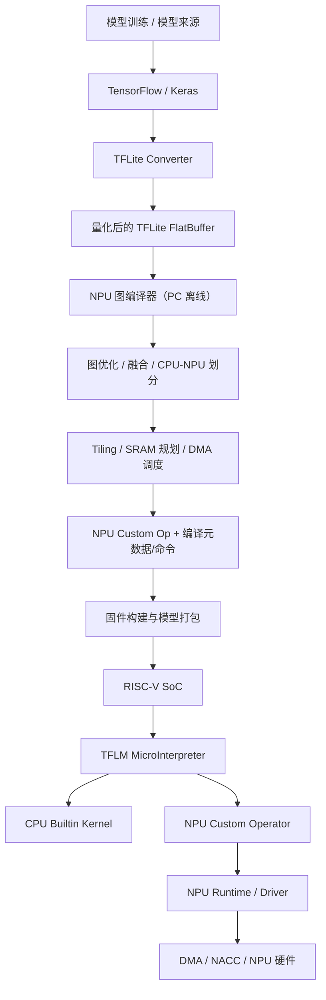
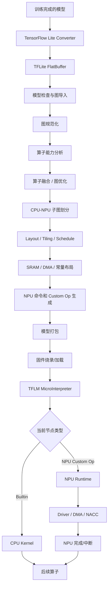
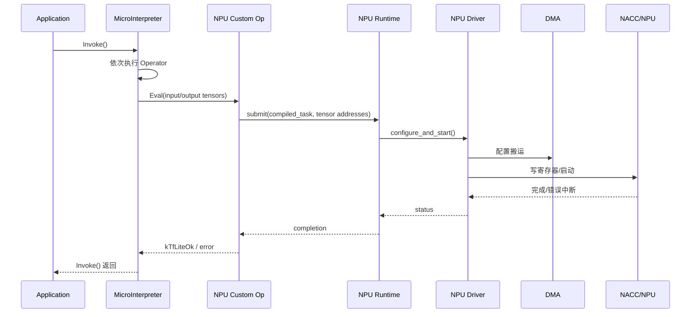
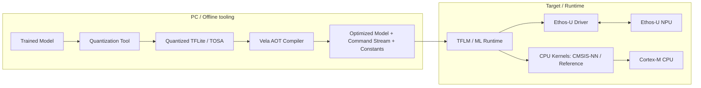
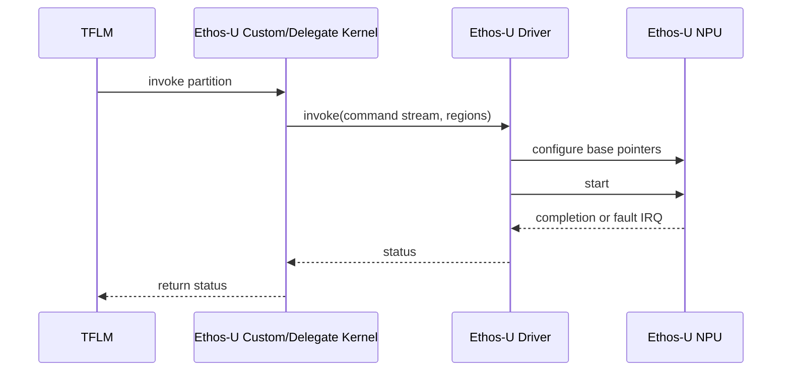
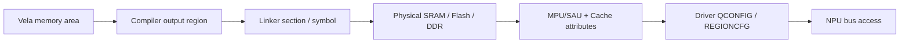
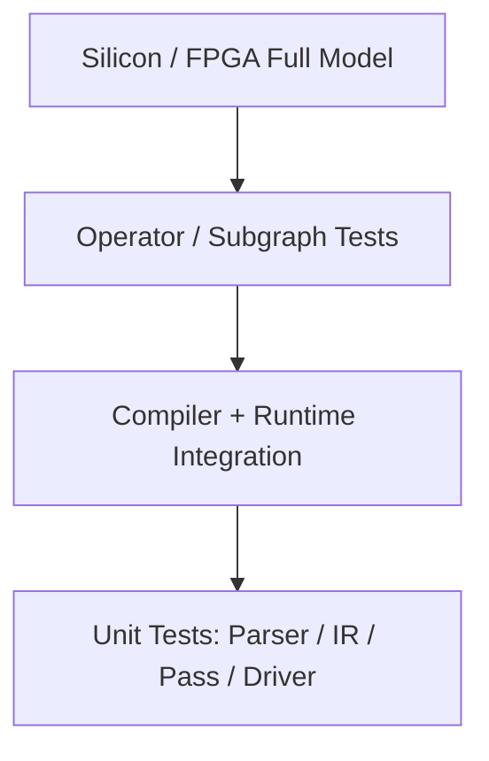
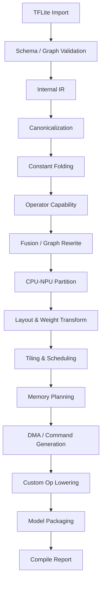
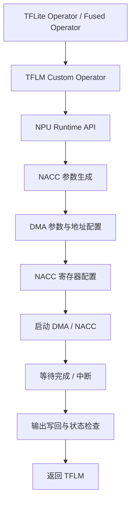

---
title: NPU Software Stack Wiki
aliases: [NPU 软件栈 Wiki]
tags: [NPU, Software-Stack, Obsidian]
---

## 1. 目标

本 Wiki 系统说明如何把训练完成的神经网络模型部署到资源受限的 RISC-V SoC，并通过固定功能 NPU 执行推理。覆盖 PC 端离线工具链、设备端 TFLM、NPU Runtime/Driver、算子库、内存与 DMA、验证和 Benchmark。

核心问题：

1. 模型如何表示、量化和转换？
2. 图编译器如何识别 NPU 可执行算子、融合算子并划分 CPU/NPU 子图？
3. 如何把图编译结果映射到 NPU 计算单元、SRAM、DMA 和控制接口？
4. 设备端如何通过 TFLM Custom Operator 调用 NPU？
5. 如何证明 CPU 与 NPU 计算结果一致，并量化真实性能？

## 2. 当前项目基线

| 项目 | 当前基线/方向 | 状态 |
|---|---|---|
| SoC | RISC-V SoC + 固定功能 NPU | 项目目标 |
| NPU | 包含 NACC、DMA、片上 SRAM 等硬件资源 | 具体寄存器/约束以 RTL、Spec 和 SDK 为准 |
| 运行环境 | Bare-metal 优先 | 后续评估 RTOS |
| 模型格式 | TensorFlow Lite FlatBuffer (`.tflite`) | 当前主线 |
| 设备端框架 | TensorFlow Lite Micro（TFLM） | 需要平台移植与裁剪 |
| 图编译器 | 参考 Arm Ethos-U Vela，逐步形成自研编译器 | Vela 是参考实现，不代表目标 NPU 兼容 Ethos-U |
| NPU 接入 | AOT 图编译 + TFLM Custom Operator + NPU Driver | 当前建议路线 |
| CPU 侧优化 | NMSIS / NMSIS-NN 作为参考或候选 | 需验证目标核、工具链和 ABI |
| 重点优化 | 算子融合、图划分、Tiling、SRAM 规划、DMA 调度 | 与硬件共同设计 |

> 表中项目方向来自当前研发讨论；尚未由芯片规格、代码或测试证明的细节必须标记 TBD，不得写成已支持能力。

## 3. 推荐阅读顺序

1. [[01-软件栈总览]]
2. [[02-端到端推理流程]]
3. [[03-TFLite模型与FlatBuffer]]
4. [[04-量化与数值语义]]
5. [[05-TFLM运行时架构]]
6. [[06-TFLM平台移植]]
7. [[07-算子支持与Custom-Operator]]
8. [[08-图编译器总体架构]]
9. [[09-Vela参考分析]]
10. [[10-图优化与算子融合]]
11. [[11-CPU-NPU图划分]]
12. [[12-Tiling调度与DMA]]
13. [[13-内存规划与SRAM管理]]
14. [[14-NPU-Runtime与Driver]]
15. [[15-NACC集成分析]]
16. [[16-Nuclei-SDK与NMSIS分析]]
17. [[17-算子库设计]]
18. [[18-Benchmark与性能分析]]
19. [[19-验证测试与回归]]
20. [[20-构建部署与版本管理]]
21. [[21-安全许可证与供应链]]
22. [[22-研发路线图与决策记录]]
23. [[23-术语表与缩写]]
24. [[18-自研图编译器架构]]
25. [[19-图优化与算子融合]]
26. [[20-CPU-NPU图划分]]
27. [[21-Tiling调度与DMA]]
28. [[22-内存规划与SRAM管理]]
29. [[23-NACC软件集成分析]]
30. [[24-算子库与支持矩阵]]

## 4. 软件栈分层图



## 5. 关键架构原则

- **离线编译决定执行计划，运行时负责执行计划。** 静态模型的算子映射、融合、常量布局和大部分内存规划应尽可能在 PC 端完成。
- **TFLM 是设备端推理框架，不是图编译器。** 它负责解释 FlatBuffer、准备 Tensor、调用已注册 Kernel。
- **Custom Operator 是 NPU 接入边界。** NPU 支持但不参与融合的单算子，也可以改写为独立 Custom Operator；多个算子融合后可表示为一个融合 Custom Operator。
- **CPU fallback 必须是设计能力。** 不支持或不满足约束的算子应保留 CPU 实现或明确报错。
- **硬件支持、编译器支持、Runtime 支持、测试覆盖是四件不同的事。**
- **性能结论必须来自真实目标平台测量。** Cost model 是估计值，不能代替 FPGA/芯片实测。

## 6. 证据等级

| 标签 | 含义 |
|---|---|
| `[SPEC]` | 芯片/硬件规格明确规定 |
| `[RTL]` | RTL 实现已确认 |
| `[CODE]` | 当前代码实现已确认 |
| `[OFFICIAL-DOC]` | 上游/厂商官方文档明确说明 |
| `[MEASURED]` | 指定硬件和版本实测 |
| `[CALCULATED]` | 基于明确公式和输入计算 |
| `[PROPOSED]` | 本 Wiki 提出的设计建议 |
| `[TBD]` | 尚未找到可靠证据或尚未决策 |

## 7. 参考资料

- [TensorFlow Lite Micro](https://github.com/tensorflow/tflite-micro)
- [TFLM Memory Management](https://github.com/tensorflow/tflite-micro/blob/main/docs/memory_management.md)
- [TensorFlow Lite Quantization](https://www.tensorflow.org/lite/performance/post_training_quantization)
- [Arm Ethos-U Vela](https://github.com/nxp-imx/ethos-u-vela)
- [Arm CMSIS-Ethos-U Integration](https://arm-software.github.io/CMSIS-Ethos-U/main/general/index.html)
- [Nuclei SDK](https://doc.nucleisys.com/nuclei_sdk/)
- [NMSIS](https://doc.nucleisys.com/nmsis/)


---

# 01 软件栈总览

## 1. 软件栈要解决什么问题

NPU 软件栈不是简单地“给 TFLM 增加一个 NPU 函数”。它需要把模型语义转换为目标 NPU 能执行的硬件任务，并确保模型在真实芯片上正确、高效、可维护地运行。

软件栈至少包含：模型导入、量化、图编译器、CPU/NPU 划分、算子库、Tiling、内存规划、DMA 调度、命令生成、TFLM Runtime、NPU Runtime/Driver、BSP/工具链、调试测试和版本管理。

## 2. 两个运行域

### PC 端：离线编译域

- 读取 TFLite FlatBuffer；
- 校验模型版本、算子、Tensor shape、dtype、quantization；
- 规范化图结构；
- 识别目标 NPU 支持的算子；
- 做单算子映射和算子融合；
- 划分 CPU/NPU 子图；
- 做 layout 转换、weight reordering；
- 计算 tile/block；
- 规划 SRAM 和 Tensor 生命周期；
- 生成 NPU 命令、描述符、常量数据或 Custom Operator；
- 输出可部署模型和编译报告。

### 芯片端：在线推理域

- 启动和 BSP 初始化；
- 加载模型和编译产物；
- 初始化 TFLM Interpreter；
- 分配 Tensor Arena；
- 注册 Builtin Operator 和 Custom Operator；
- 执行 CPU Kernel；
- 遇到 NPU Custom Operator 时调用 Runtime；
- 配置 DMA/NACC；
- 等待完成、中断或轮询；
- 处理错误、超时和同步；
- 返回输出 Tensor。

## 3. 软件栈分层

| 层 | 主要职责 | 输入 | 输出 |
|---|---|---|---|
| Model Source | 训练模型 | 训练数据、网络结构 | SavedModel/Keras 等 |
| Model Converter | 转换模型 | TensorFlow 模型 | TFLite FlatBuffer |
| Quantization | 量化 | 浮点模型、代表性数据 | INT8/INT16 模型 |
| Graph Compiler | 目标相关编译 | TFLite | 优化图、CPU/NPU 分区 |
| Backend/Codegen | 硬件映射 | NPU 子图、硬件配置 | 命令流、描述符、常量 |
| Model Package | 模型打包 | FlatBuffer、命令和权重 | 固件可链接/可加载产物 |
| TFLM | 设备端图执行 | TFLite 模型 | Kernel 调用 |
| Custom Op | NPU 接入点 | Tensor、编译元数据 | NPU Runtime 请求 |
| NPU Runtime | 执行管理 | NPU 工作描述 | 任务提交/完成状态 |
| Driver | 寄存器、DMA、中断 | Runtime 请求 | 硬件操作 |
| BSP/HAL | SoC 基础设施 | 硬件平台 | 时钟、内存、中断、UART |
| Test/Profiler | 验证与测量 | 模型、测试数据 | 正确性和性能报告 |

## 4. 容易混淆的概念

### Converter 与图编译器

TFLite Converter 的主要目标是把 TensorFlow 模型转换为 TFLite 格式，并执行转换相关优化和量化。面向某一款 NPU 的 tile 选择、SRAM 分配、DMA 任务生成、命令流生成，通常属于 NPU-specific 图编译器。

不应默认必须修改官方 Converter 才能支持新 NPU。可以保留标准 Converter 输出，再增加独立 NPU 编译阶段。

### TFLM 与 NPU Driver

TFLM 负责模型解释、Tensor 管理、算子查找和 Kernel 调用；Driver 负责硬件寄存器、DMA、中断和底层状态。两者之间建议通过稳定的 NPU Runtime API 解耦。

### NMSIS-NN 与 NPU Kernel

NMSIS-NN 是面向 Nuclei RISC-V CPU 的优化神经网络软件 Kernel 库，不等于 NACC/NPU Driver，也不等于 NPU 图编译器。它可作为 CPU fallback 或对照实现候选，实际使用前要验证目标 CPU、编译器、宏配置、ABI 和性能。

## 5. 推荐最小可用软件栈（MVP）

1. TFLM 在目标 RISC-V SoC 上跑通纯 CPU 模型；
2. 建立 NPU Driver：复位、寄存器访问、DMA、启动、完成、错误；
3. 实现一个 NPU 单算子 Custom Operator；
4. 实现一个固定模型/固定 Shape 的 NPU Kernel；
5. 增加离线工具，把标准 TFLite 单算子改写为 NPU Custom Operator；
6. 增加多算子融合；
7. 增加 CPU/NPU 图划分；
8. 增加 Tiling、SRAM 生命周期和 DMA overlap；
9. 最后扩展动态 Shape、更多算子和 RTOS。

## 6. 参考

- [TFLM](https://github.com/tensorflow/tflite-micro)
- [Vela](https://github.com/nxp-imx/ethos-u-vela)
- [Nuclei SDK](https://doc.nucleisys.com/nuclei_sdk/)
- [NMSIS](https://doc.nucleisys.com/nmsis/)


---

# 02 端到端推理流程

## 1. 从模型到芯片执行



## 2. 离线编译阶段的输入和输出

输入：`.tflite`、NPU Hardware Description、System Configuration、Compiler Options，以及可选校准数据/性能 profile。

输出建议包含：

| 产物 | 内容 | 用途 |
|---|---|---|
| `model_compiled.tflite` | TFLite 图，含 NPU Custom Operator | TFLM 加载 |
| `npu_constants.bin` | 重排后的权重、bias、常量 | NPU 读取 |
| `npu_command.bin` | 命令流/任务描述（若采用） | NPU 执行 |
| `memory_plan.json` | Tensor 生命周期、offset、bank、大小 | 调试和地址绑定 |
| `compile_report.json` | 分区、算子映射、fallback、警告、估算性能 | 可追踪性 |
| `manifest.json` | 版本、硬件配置、文件 hash | 兼容性检查 |

开发阶段建议保留可读的 sidecar 文件；产品中可以合并为容器格式。

## 3. 一次推理的设备端调用关系



## 4. 静态计划与运行时工作的边界

| 工作 | 离线编译 | 运行时 |
|---|---|---|
| 算子支持判定 | 是 | 校验产物兼容性 |
| 算子融合 | 是 | 否 |
| CPU/NPU 分区 | 是 | 按图顺序调度 |
| 常量权重重排 | 是 | 绑定常量地址 |
| 固定 Shape 的 Tiling | 是 | 否 |
| 固定模型 SRAM offset | 是 | 检查区域和地址 |
| DMA 描述符生成 | 尽量是 | 写入实际基地址/启动 |
| 动态输入地址 | 否 | 是 |
| NPU 启停 | 否 | 是 |
| 中断、超时、错误恢复 | 否 | 是 |
| 动态 Shape | 可预编译多个方案 | 选择合法方案/检查边界 |

## 5. Conv2D 示例

假设模型中有 INT8 Conv2D：

1. TFLite FlatBuffer 中存在 Conv2D Operator，输入为 IFM、Filter、Bias，输出为 OFM。
2. 图编译器检查 dtype、padding、stride、dilation、filter shape、quantization。
3. 若硬件原生支持，编译器计算 NPU kernel 参数。
4. 根据 SRAM 容量确定 IFM/OFM/权重 tile。
5. 生成权重重排结果和 DMA 搬运信息。
6. 将节点改写为 NPU Custom Operator，或纳入融合 Custom Operator。
7. TFLM 运行到该节点时，传递 Tensor 地址和编译元数据。
8. Runtime/Driver 配置 DMA 和 NACC。
9. NPU 完成后，输出 Tensor 供后续节点使用。

以上是通用数据流。具体 NACC 参数含义、寄存器顺序、DMA 地址规则，必须以目标 NACC Spec/RTL/SDK 源码为准。

## 6. 失败处理路径

- 模型格式不兼容：离线编译阶段报错；
- 算子不支持：CPU fallback 或编译失败；
- NPU 资源不足：重新切分/降低并行度，失败则回退或报错；
- 运行时地址越界：Driver/Runtime 返回错误，不允许启动；
- DMA/NPU 超时：停止任务、清状态、恢复硬件并返回错误；
- 输出不一致：进入逐层对比与 dump 流程。


---

# 03 TFLite 模型与 FlatBuffer

## 1. TFLite 是什么

TensorFlow Lite（当前 Google AI Edge 文档体系也使用 LiteRT 名称）是端侧模型格式和推理生态。TFLite 模型通常使用 FlatBuffers 序列化为 `.tflite` 文件。

对 NPU 图编译器而言，`.tflite` 是重要输入。编译器需要理解 Tensor、Operator、Buffer、SubGraph 和量化元数据。

## 2. 模型中的核心对象

| 对象 | 作用 | 关键字段/信息 |
|---|---|---|
| Model | 模型顶层容器 | version、operator_codes、subgraphs、buffers、metadata |
| SubGraph | 计算子图 | tensors、inputs、outputs、operators |
| Tensor | 描述数据 | shape、type、buffer、name、quantization |
| Operator | 描述一次计算 | opcode index、inputs、outputs、builtin_options、custom_options |
| OperatorCode | 算子类型声明 | builtin code 或 custom code、version |
| Buffer | 常量数据存储 | 权重、bias、常量 Tensor |
| QuantizationParameters | 量化参数 | scale、zero_point、quantized_dimension |

## 3. Tensor Shape 是什么

Shape 表示 Tensor 每个维度上的元素数量。例如 NHWC 图像 Tensor：

```text
[1, 224, 224, 3]
```

- N=1：一次输入 1 张图像；
- H=224：图像高度；
- W=224：图像宽度；
- C=3：颜色通道数。

Shape 不等于内存地址，也不等于字节数。若 dtype 为 INT8，元素数为 `1*224*224*3`，理论数据字节数为元素数乘 1 byte；实际存储还要考虑对齐、padding、tile 和 buffer 规划。

## 4. Operator 的输入输出

例如 Conv2D：

```text
Operator: CONV_2D
Inputs:
  0: IFM Tensor
  1: Filter Tensor
  2: Bias Tensor
Outputs:
  0: OFM Tensor
Options:
  stride_h / stride_w
  dilation_h / dilation_w
  padding
  fused_activation
```

Operator 描述计算语义和参数，不直接说明由 CPU 或 NPU 执行。执行位置由设备运行时或离线图编译结果决定。

## 5. TFLite 没有通用的“这个算子运行在 NPU”属性

标准 Builtin Operator 表达算子语义，不等同于目标硬件映射。Conv2D 是否能由 NPU 执行取决于：

- NPU 是否支持计算语义；
- dtype 和 quantization 是否满足要求；
- Tensor shape、stride、padding、dilation 是否满足约束；
- 内存布局和对齐是否可接受；
- 图编译器是否实现 lowering；
- 设备端是否有对应 Kernel/Custom Operator 和 Driver。

不能仅凭 TFLite 文件中存在 `CONV_2D` 就断定它会跑 NPU。

## 6. 图编译器应构建自己的 IR

建议解析 FlatBuffer 后转换为内部 IR，而不是在所有优化 pass 中直接操作 FlatBuffer。

IR 至少表达：

- Tensor：shape、dtype、layout、quantization、producer、consumers、buffer/lifetime；
- Operator：opcode、version、inputs、outputs、attributes；
- Graph：节点拓扑、输入输出、子图；
- Device：CPU/NPU；
- Memory：memory space、offset、bank、size、alignment；
- Schedule：tile、dependency、DMA task；
- Lowering：Builtin、NPU Custom Op、fused op。

## 7. 图解析和验证步骤

1. 检查 FlatBuffer 是否可解析；
2. 检查 Schema version 是否受支持；
3. 检查 SubGraph 数量和输入输出索引；
4. 检查每个 Operator 的 opcode/version；
5. 检查 Tensor 索引有效；
6. 检查 Tensor shape/dtype；
7. 检查量化参数；
8. 检查常量 Buffer 是否越界；
9. 检查图拓扑是否可执行；
10. 输出可读模型摘要。

## 8. Conv2D 语义例子

```text
IFM:    [1, 32, 32, 16]  INT8
Filter: [3, 3, 16, 32]  INT8
Bias:   [32]             INT32
OFM:    [1, 30, 30, 32]  INT8
Stride: 1x1
Padding: VALID
```

此例只说明模型属性。真实 NPU 映射还要检查 accumulator 位宽、bias scale、per-channel quantization、输出 requantization、SRAM 容量和 DMA 对齐。

## 9. 参考资料

- [TFLM Repository](https://github.com/tensorflow/tflite-micro)
- [TensorFlow Lite Schema](https://github.com/tensorflow/tensorflow/blob/master/tensorflow/lite/schema/schema.fbs)
- [Google AI Edge - Microcontrollers](https://developers.google.com/edge/litert/microcontrollers)


---

# 04 量化与数值语义

## 1. 为什么 NPU 软件栈必须理解量化

量化不是简单地把 float32 改成 int8。它定义实数与整数之间的映射关系，决定 NPU 的输入、权重、累加、偏置、输出重定标和激活函数数值行为。

若图编译器只识别 dtype，不理解 scale、zero point 和 quantized_dimension，就可能生成能够运行但结果错误的硬件任务。

## 2. Affine Quantization

常见仿射量化关系：

\[
real = scale \times (quantized - zero\_point)
\]

- `scale`：浮点缩放因子；
- `zero_point`：实数 0 对应的整数值；
- `quantized`：整数表示；
- `real`：对应实数值。

## 3. INT8 Conv2D 的核心计算

概念上，一个输出元素可表示为：

\[
acc = \sum_i (x_i-z_x)(w_i-z_w) + bias
\]

实际实现通常使用整数乘加累加。常见约束：

- 输入激活可能是 INT8；
- 权重可能是 INT8；
- Bias 通常使用 INT32；
- 累加器位宽由框架规范和硬件能力决定；
- 输出需要按输出 scale 做 requantization；
- 最后应用激活范围限制和目标 dtype 饱和。

Bias 的量化 scale 通常与输入和权重 scale 的乘积相关。若权重使用 per-channel quantization，bias scale 也必须按输出通道对应。

## 4. Per-tensor 与 Per-channel Quantization

| 类型 | 量化参数 | 常见用途 |
|---|---|---|
| Per-tensor | 整个 Tensor 共用 scale/zero point | 激活 Tensor 常见 |
| Per-channel | 每个通道独立 scale | Conv 权重常见 |

图编译器必须读取 `quantized_dimension`，不能假设所有量化参数都只有一个值。

## 5. 量化检查清单

每个 NPU 算子至少检查：

- 输入、权重、Bias、输出 dtype；
- 输入/权重/Bias/输出 scale 和 zero point；
- per-channel 维度；
- accumulator 位宽；
- requantization multiplier/shift；
- rounding mode；
- saturation/clamping；
- fused activation 数值范围。

## 6. 全整数量化

TensorFlow Lite 官方文档描述了使用代表性数据集进行 full integer quantization 的流程。对 integer-only 设备或加速器，通常需要约束转换后的算子集合，并指定整数输入输出类型。

```python
converter.optimizations = [tf.lite.Optimize.DEFAULT]
converter.representative_dataset = representative_dataset
converter.target_spec.supported_ops = [
    tf.lite.OpsSet.TFLITE_BUILTINS_INT8
]
converter.inference_input_type = tf.int8
converter.inference_output_type = tf.int8
tflite_model = converter.convert()
```

这段代码是量化配置示意，不代表目标 NPU 已支持所有 TFLite INT8 Builtin Operator。

## 7. 量化错误定位

推荐按以下顺序定位：

1. 输入 Tensor 整数值；
2. 单个 MAC 乘积；
3. accumulator；
4. bias 加法；
5. requantization；
6. activation clamp；
7. 输出 Tensor；
8. 完整算子；
9. 完整子图。

同时保存输入/输出整数 dump 和量化参数。只比较反量化后的最终浮点输出可能掩盖整数路径中的差异。

## 8. 量化与硬件能力矩阵

| 项目 | 需要确认的硬件信息 | 软件责任 |
|---|---|---|
| INT8 signed/unsigned | 输入/权重范围 | 转换与校验 |
| INT16 | 乘加和输出支持 | Kernel/Compiler |
| INT32 accumulator | 位宽、溢出语义 | 数值安全检查 |
| Per-channel weight | scale 数量和通道映射 | 参数打包 |
| Bias | 数据类型和 scale 约束 | 参数重排 |
| Requantization | multiplier/shift/rounding | 一致性 |
| Fused activation | 支持的激活及边界 | 融合合法性 |
| Mixed precision | 不同输入精度组合 | lowering/转换 |

所有具体支持项必须引用目标芯片 Spec/RTL/官方 SDK 或实测结果。

## 9. 参考资料

- [TensorFlow Lite Post-training Quantization](https://www.tensorflow.org/lite/performance/post_training_quantization)
- [TensorFlow Model Optimization - Quantization](https://www.tensorflow.org/model_optimization/guide/quantization/post_training)


---

# 05 Arm Ethos-U 软件栈参考架构

> 本章以 Arm Ethos-U55/U65/U85 为参考，重点分析适合 MCU/Edge 场景的软件栈。Ethos-N 属于不同产品线，不在本章混用。

## 1. Arm 官方定义的基本分工

Arm 将 Ethos-U 软件栈明确分为 Offline tooling 与 Runtime 两个区域：



离线侧负责量化模型的目标相关编译；运行时负责 CPU 算子执行和 NPU 子图提交。Vela 生成目标相关 command stream 和编码后的常量数据，Driver 负责把 command stream 和 memory regions 提交给 NPU。

## 2. Arm 软件栈组件

| 组件 | 所属侧 | 主要职责 | 本项目对应 |
|---|---|---|---|
| TensorFlow / Keras | PC | 模型训练与导出 | 模型来源 |
| TFLite Converter / Quantization | PC | 转换、量化 | TFLite 模型生成 |
| TFLite / TOSA | PC 中间格式 | 表达模型计算 | 输入模型格式 |
| Vela | PC | AOT 编译、图优化、调度、内存规划、命令生成 | 自研 NPU 图编译器 |
| TFLM / ML Runtime | 芯片端 | 解析模型、分配 Tensor、调度 CPU/NPU 节点 | 设备端推理 Runtime |
| Ethos-U Core Driver | 芯片端 | NPU 初始化、提交命令流、处理中断/错误、PMU | NACC Driver |
| CMSIS-NN | 芯片端 CPU | Cortex-M 优化 NN kernels | RISC-V CPU 优化 Kernel（如 NMSIS-NN，需验证） |
| Reference Kernels | 芯片端 CPU | 通用 fallback | TFLM reference kernels |
| CMSIS / CMSIS-RTOS2 | 平台层 | Core/RTOS 接口和组件集成 | RISC-V BSP/OS abstraction |
| CMSIS-Toolbox / DFP | PC/平台集成 | Device/Board/Pack/Build 管理 | 自研 SDK pack/build system |

## 3. Arm 方案的关键设计思想

### 3.1 Vela 与 Driver 职责严格分离

Vela 不直接操作设备寄存器。它生成目标 NPU 可执行的模型数据和命令流。Driver 不负责重新编译模型，也不负责为 TFLM 分配 Tensor Arena。

### 3.2 Runtime 是 CPU 与 NPU 的协调者

模型中支持 NPU 的 partition 被编译为目标相关 payload；未委派给 NPU 的节点仍由 ML Runtime 调用 CPU Kernel。一个模型 Invoke 过程中可以多次调用 NPU Driver，而不一定只有一次。

### 3.3 命令流不是独立可执行文件

Command stream 还会引用常量区、activation/working arena 等 memory regions。运行时必须提供正确的 base addresses、region sizes 和访问属性。

### 3.4 平台内存配置是端到端契约

Vela 的 `vela.ini`、linker script、MPU/SAU、cache policy、Driver 的 QCONFIG/REGIONCFG 必须相互匹配。单独改一个配置可能导致 NPU 访问错误地址或性能退化。

## 4. 对自研 NPU 的架构映射

| Arm 概念 | 自研 NPU 对应设计 |
|---|---|
| Vela | 自研 AOT Graph Compiler |
| Ethos-U command stream | NACC command/descriptor 或寄存器配置数据 |
| Ethos-U Driver | NACC Driver |
| Vela memory regions | NPU 常量区、Tensor Arena、scratch/fast SRAM |
| CMSIS-NN | 目标 RISC-V CPU NN 优化库 |
| TFLM Ethos-U integration | TFLM NPU Custom Op / Runtime adapter |
| CMSIS Device/Board Pack | 自研 SoC/Board SDK package |
| PMU counters | NACC 性能计数器或 cycle profiling |

## 5. 不可直接照搬的内容

- Ethos-U command stream 编码；
- Ethos-U memory region 数量和 selector 编码；
- Ethos-U 的 MAC/block/tile 算法；
- Ethos-U 支持的算子、量化限制；
- Ethos-U Driver 的寄存器定义；
- Cortex-M 的 CMSIS、MPU/SAU、cache 代码；
- Ethos-U 的性能模型参数。

可借鉴的是软件分层、接口契约、配置关联、文档结构和验证方法。

## 6. 主要官方资料

- [CMSIS-Ethos-U 总览](https://arm-software.github.io/CMSIS-Ethos-U/main/general/index.html)
- [Vela 文档](https://arm-software.github.io/CMSIS-Ethos-U/main/vela/index.html)
- [Driver 文档](https://arm-software.github.io/CMSIS-Ethos-U/main/driver/index.html)
- [Integration 文档](https://arm-software.github.io/CMSIS-Ethos-U/main/integration/index.html)
- [CMSIS-Ethos-U GitHub](https://github.com/ARM-software/CMSIS-Ethos-U)


---

# 06 Vela AOT 编译器

## 1. 定位

Arm Vela 是面向 Ethos-U55/U65/U85 的 Ahead-of-Time（AOT）神经网络模型编译器。官方文档说明其输入包括量化 TFLite/LiteRT 或 TOSA 模型，输出包括目标相关 command stream 和编码后的常量数据。

Vela 是本项目最值得研究的图编译器架构参考，但其生成结果只适用于匹配的 Ethos-U 目标。

## 2. Vela 的主要工作

- 读取模型和算子元数据；
- 检查目标 NPU 支持能力；
- 对图进行 rewrite、decompose、pack 和 fuse；
- 选择执行 schedule；
- 选择 block configuration；
- 规划常量、activation 和 scratch 的存储区域；
- 生成 NPU command stream；
- 输出优化模型和诊断信息。

## 3. 输入

1. 量化后的 `.tflite` 或 `.tosa`；
2. 目标 Ethos-U 类型及 MAC 配置；
3. `vela.ini` 中的 System Configuration；
4. `vela.ini` 中的 Memory Mode；
5. 编译选项和输出模式。

模型的量化类型、算子版本和 shape 必须符合目标 NPU 支持范围。

## 4. 输出

- 优化后的 TFLite 模型（常见路径）；
- Ethos-U Custom Operator / NPU payload；
- command stream；
- 编码后的权重/常量；
- memory region 需求；
- 编译诊断与性能/内存估计。

具体文件形式和 Custom Operator schema 随 Vela 版本及输出路径变化，应以固定版本文档和生成样例为准。

## 5. TFLite 路径与 TOSA 路径

Vela 文档描述了 TFLite/LiteRT 和 TOSA 输入路径。TFLite 路径中不支持的区域可以保留为 CPU 操作；TOSA 路径的 fallback 语义不同，不能假设同样保留 CPU 节点。

对于当前 TFLM 方案，优先研究 TFLite 路径，因为它更自然地保留 CPU Builtin Operators 与 NPU Custom Operators 的混合模型。

## 6. 研究 Vela 源码的顺序

1. `vela` CLI、参数和版本；
2. TFLite reader；
3. Graph/Tensor/Operation IR；
4. Supported operators / capability；
5. Graph rewrite passes；
6. Fusion 和 decomposition；
7. Subgraph partition；
8. Tensor format 和 weight packing；
9. Scheduler / block config；
10. Memory allocation；
11. Command stream generation；
12. TFLite writer / output；
13. tests 和 performance model。

## 7. 自研编译器映射

| Vela 模块 | 自研 NPU 模块 | 需要替换的内容 |
|---|---|---|
| TFLite reader | Model Importer | 可部分复用解析库 |
| Graph IR | Internal IR | 按项目语义设计 |
| Support query | NACC Capability | 全部按 NACC Spec 定义 |
| Graph rewrite | NPU Graph Passes | 重新实现 |
| Scheduler | NACC Scheduler | 根据 NACC pipeline 设计 |
| Block config | NACC Tiling | 根据 NACC SRAM/MAC 约束设计 |
| Memory allocator | NACC SRAM Planner | 根据 bank/address map 设计 |
| Command generator | NACC Codegen | 完全目标相关 |
| TFLite writer | Custom Op Lowering | 定义项目 Custom Options ABI |

## 8. 版本管理

分析 Vela 必须固定 tag/commit。文档中的行为可能跨版本变化。记录：

- Vela version；
- source commit；
- Python dependency versions；
- input model hash；
- accelerator configuration；
- system/memory configuration；
- output model hash；
- compiler log。

## 9. 参考

- [Arm Vela Documentation](https://arm-software.github.io/CMSIS-Ethos-U/main/vela/index.html)
- [Vela source repository](https://github.com/nxp-imx/ethos-u-vela)
- [CMSIS-Ethos-U repository](https://github.com/ARM-software/CMSIS-Ethos-U)


---

# 07 Ethos-U Driver 与 Runtime 接口

## 1. Driver 的职责边界

Arm Ethos-U Driver 是嵌入式软件与 Ethos-U NPU 之间的低层接口。官方文档列出的能力包括：

- 每个 NPU 实例初始化 Driver；
- 配置 command-stream 和 model-region base addresses；
- 启动 NPU；
- 处理完成或 fault interrupts；
- 支持同步和异步 invocation；
- 访问 Ethos-U PMU；
- 通过平台 weak hooks 适配 power、cache、address 和 RTOS。

Driver 输入是 Vela 优化后的模型 payload、command stream，以及由 ML Runtime 分配的 Tensor Arena 和对应 memory region 地址。

Driver 不负责模型编译、Tensor Arena 分配、Vela memory mode 选择或 linker section placement。

## 2. Driver 不做什么

| 任务 | 责任方 |
|---|---|
| 模型量化 | 训练/转换工具 |
| NPU 图编译 | Vela / 自研 Compiler |
| Tensor Arena 分配 | ML Runtime / TFLM |
| Flash/RAM section 放置 | Linker script / build system |
| NPU 寄存器与启动 | Driver |
| 中断和 fault 处理 | Driver + platform integration |
| CPU 算子执行 | TFLM + CMSIS-NN/reference |
| Cache policy | Platform integration + driver hooks |

## 3. Runtime 调用流程



## 4. 同步和异步执行

- 同步调用：Runtime 调用 Driver 后等待完成，再继续模型图执行。
- 异步调用：Driver 启动任务后返回，完成中断通过事件/回调通知上层。
- 异步并不意味着 TFLM 自动支持任意并行图执行。Runtime 仍需保证 Tensor 生命周期、buffer ownership、任务依赖和后续算子同步。

## 5. 地址与 Region

Arm Driver 文档描述了 command stream 和模型数据的多个 base pointers。常见 Vela 配置会使用：

| Region | 典型用途 | Vela memory area |
|---|---|---|
| 0 | 常量、编码权重 | `const_mem_area` |
| 1 | activation、scratch arena | `arena_mem_area` |
| 2 | 可选快速 scratch | `cache_mem_area` |

具体使用区域取决于 Vela 配置和生成模型，不能只凭表格硬编码。Driver 的 `NPU_QCONFIG` 和 `NPU_REGIONCFG_x` 必须与内存映射一致。

## 6. 平台 Hooks

官方 Driver 提供平台相关扩展点，涵盖：

- power control；
- cache clean/invalidate；
- address translation/remapping；
- RTOS integration；
- interrupt integration。

对自研 NPU，建议定义相同类别的 platform abstraction，而不要让核心 Driver 直接依赖具体 RTOS 或板级代码。

## 7. PMU 与性能分析

Driver 暴露 NPU Performance Monitoring Unit（PMU）访问能力。自研 NACC 若有性能计数器，也应由 Runtime 提供统一查询 API，至少记录：

- NPU active cycles；
- idle/stall cycles（若硬件提供）；
- DMA bytes/transactions（若硬件提供）；
- task duration；
- fault/status counters。

计数器名称和含义必须按硬件 Spec 定义。

## 8. Bring-up Checklist

- NPU reset/clock 正确；
- Driver variant 与 NPU 型号/MAC 配置匹配；
- command stream 地址正确；
- 所有 region base address 正确；
- region size 足够；
- CPU/NPU 地址映射一致；
- cache maintenance 正确；
- interrupt line 和 priority 正确；
- 完成和 fault 两种路径都测试；
- PMU 计数可读取；
- linker map 与运行时地址一致。

## 9. 官方资料

- [Ethos-U Driver documentation](https://arm-software.github.io/CMSIS-Ethos-U/main/driver/index.html)
- [CMSIS-Ethos-U source](https://github.com/ARM-software/CMSIS-Ethos-U)


---

# 08 Vela 内存模型与系统集成

## 1. 为什么内存集成是软件栈的核心

NPU 不只是由 CPU 写几个寄存器启动。NPU 会通过自己的总线 master 访问 command stream、权重、输入输出 Tensor 和 scratch buffer。编译器认为的逻辑内存区域，必须对应到真实芯片物理内存、linker section、MPU/cache 属性和 Driver 地址配置。

## 2. Vela 的三类常见 Memory Area

| Memory area | 典型内容 | 生命周期 |
|---|---|---|
| `const_mem_area` | command stream、权重、scale 等常量 | 模型生命周期 |
| `arena_mem_area` | 输入、输出、中间 activation、working storage | 推理期间 |
| `cache_mem_area` | 可选 fast scratch/staging/spill 区域 | 推理期间 |

注意：`cache_mem_area` 是 Vela 的逻辑内存配置概念，不应直接等同于 CPU data cache。

## 3. `vela.ini` 的角色

Vela configuration 描述目标系统内存性能和 memory modes。它影响编译器如何选择数据存放区域和调度方案。

System Configuration 常需建模：

- memory clock；
- AXI port；
- burst length；
- outstanding transactions；
- memory latency；
- bandwidth/performance assumptions。

Memory Mode 则定义模型常量、arena 和可选 fast area 到 NPU memory aliases 的映射。

具体配置键随 Vela 版本变化，必须参考当前版本文档。

## 4. 端到端映射关系



## 5. 必须一致的配置

| 配置层 | 要回答的问题 |
|---|---|
| Vela `vela.ini` | 编译器认为各类数据放在哪里？ |
| Model package | command/constant/arena 需要多大？ |
| Linker script | 实际 section 被放到哪里？ |
| SoC memory map | CPU 和 NPU 能否访问该区域？ |
| MPU/SAU | CPU 侧 memory attributes 是什么？ |
| Cache policy | DMA/NPU 访问前后如何维护 cache？ |
| Driver config | NPU 访问哪个 memory path/region？ |
| Runtime | 实际 base pointer 和 size 是多少？ |

## 6. Cache coherency

若 CPU cache 与 NPU/DMA 不硬件一致，常见维护流程是：

- CPU 写输入/command/descriptor 后，在 NPU 读取前 clean；
- NPU 写输出后，CPU 读取前 invalidate；
- 按 cache line 对齐处理；
- 在启动和完成边界使用正确的 memory barrier；
- 避免 CPU 与 NPU 同时无同步访问同一 cache line。

具体操作必须依据 SoC cache 架构和 Driver API，不能机械照搬 Cortex-M 代码。

## 7. 地址别名与地址转换

某些系统中 CPU 和 NPU 访问同一物理内存可能使用不同地址视图。需要明确：

- CPU virtual/physical address；
- NPU bus address；
- alias/remap；
- address translation hook；
- region base pointer 的地址语义。

不能把 CPU 指针未经确认直接写入 NPU 地址寄存器。

## 8. 集成验证清单

- [ ] Vela/Compiler 输出的各 region 大小已知；
- [ ] Linker map 中模型和 buffer 地址符合预期；
- [ ] Arena 与 scratch 实际分配不小于编译器需求；
- [ ] 所有 region 对 NPU 可访问；
- [ ] NPU 地址路径与 linker placement 匹配；
- [ ] MPU/SAU 和 cache attributes 正确；
- [ ] Cache maintenance 与 DMA 方向一致；
- [ ] 运行模型正确；
- [ ] 峰值 SRAM 和性能满足目标。

## 9. 自研 NPU 落地建议

建立唯一的 `npu_target_memory.yaml` 或等价配置，描述 memory regions、大小、对齐、CPU/NPU access、cacheability、bank、alias 和 DMA 能力。Compiler、linker generation、Runtime 和 Driver 配置尽量从同一份配置生成或校验，减少人工配置漂移。


---

# 09 CMSIS-NN 与 CPU Fallback

## 1. CMSIS-NN 在 Arm 软件栈中的位置

CMSIS-NN 是面向 Arm Cortex-M CPU 的优化神经网络 Kernel 库。它不是 Ethos-U NPU Driver，也不是 Vela。它用于加速未被 NPU 执行的 CPU 节点，或提供 CPU 侧算子实现。

Arm 的典型 Ethos-U55 软件流同时包含：
- Ethos-U Driver + NPU：执行 Vela 编译的 NPU partition；
- CMSIS-NN optimized kernels：在 Cortex-M CPU 上执行的优化算子；
- TFLM reference kernels：优化 Kernel 不适用时的通用 fallback。

## 2. 为什么 NPU 产品仍需要 CPU NN Kernel

模型中可能包含：
- NPU 不支持的算子；
- shape/quantization 不符合 NPU 限制的算子；
- 小算子，NPU launch/DMA overhead 大于计算收益；
- 预处理、后处理；
- 控制流或自定义逻辑。

因此 CPU fallback 是完整 NPU 软件栈的重要组成，而不是临时补丁。

## 3. 自研 RISC-V 平台的对应关系

| Arm 侧 | RISC-V 自研平台候选 | 注意事项 |
|---|---|---|
| CMSIS-Core | RISC-V Core/BSP HAL | 不可直接移植 CMSIS-Core |
| CMSIS-NN | NMSIS-NN 或自研 SIMD NN kernels | ISA/intrinsic/ABI 需匹配 |
| TFLM reference kernels | TFLM reference kernels | 作为 correctness baseline |
| Ethos-U Driver | NACC Driver | 自研实现 |
| Vela | 自研 NPU AOT Compiler | 自研 backend |

## 4. CPU Kernel 选择策略

1. 若节点已被编译器映射到 NPU，则执行 NPU Custom Operator；
2. 若 NPU 不支持但有优化 CPU kernel，则执行 optimized CPU kernel；
3. 若没有优化实现，则执行 TFLM reference kernel；
4. 若连 reference kernel 都未注册，则编译/初始化阶段报错。

## 5. 性能评估

不要假设 NPU 对所有算子都更快。对小型 elementwise、reshape、轻量 activation 等，CPU 可能更合适。应比较：

- CPU kernel cycles；
- NPU launch overhead；
- DMA bytes/time；
- NPU compute cycles；
- sync overhead；
- end-to-end latency。

## 6. NMSIS-NN 研究清单

- 目标 RISC-V Core 是否支持所需扩展；
- NMSIS-NN 版本和 TFLM 版本是否匹配；
- 是否提供目标算子的 int8/int16 kernel；
- 量化语义是否一致；
- 是否有 LLVM/GCC 工具链支持；
- 是否有汇编/intrinsic 与目标 ISA 绑定；
- 对齐和内存约束；
- 在目标芯片实测的 cycle 和 code size。

## 7. 参考资料

- [CMSIS-NN GitHub](https://github.com/ARM-software/CMSIS-NN)
- [NMSIS Documentation](https://doc.nucleisys.com/nmsis/)
- [NMSIS-NN Overview](https://doc.nucleisys.com/nmsis/nn/overview.html)


---

# 10 TFLM 与 NPU 接入模式

## 1. 三种常见集成方式

### 方式 A：TFLM Custom Operator

图编译器把 NPU 节点转换为 TFLite Custom Operator。TFLM Resolver 注册 Custom Kernel，Eval 中调用 NPU Runtime。

优点：适合静态模型、AOT 编译、Bare-metal；实现边界清楚。缺点：需要维护 Custom Options ABI 和模型转换工具。

### 方式 B：Delegate / Subgraph replacement

在支持 Delegate 的 TensorFlow Lite Runtime 中，Delegate 可以识别可执行子图并替换为硬件实现。具体 Delegate API 与 TFLM 的 Micro Runtime 能力并不相同，不能默认 TFLM 具备与桌面/移动版 TFLite 相同的 Delegate 机制。

### 方式 C：专用模型 Runtime

编译器生成专用网络执行文件，Runtime 直接解释 command/task graph，不再完全依赖 TFLM Operator 调度。

优点：可最大化静态优化；缺点：需维护更完整的模型 Runtime、工具链和生态接口。

## 2. 当前建议

当前项目优先选择方式 A：AOT 编译 + TFLM Custom Operator。它能保留 TFLM CPU Builtin 路径，并以 Custom Op 明确标识 NPU 任务。

## 3. Custom Operator 设计

一个 NPU Custom Operator 可以代表：
- 一个标准算子；
- 多个融合算子；
- 一个已编译的 NPU partition。

Custom Options 建议携带：
- ABI version；
- partition/task ID；
- command stream offset/size；
- constants offset/size；
- memory plan ID；
- tile/schedule metadata；
- target hardware revision。

这些是项目设计字段，不是 TFLite 官方固定字段。

## 4. Init / Prepare / Eval

| 阶段 | 职责 |
|---|---|
| Init | 解析 options、创建轻量状态、检查 ABI |
| Prepare | 检查 Tensor 数量、shape、dtype、量化、资源和地址约束 |
| Eval | 绑定实际地址、提交 Runtime、等待完成、返回状态 |

## 5. 关键约束

- Custom Options 必须有版本；
- 不应将未经验证的任意 MMIO 地址放入模型；
- 所有 offset/size 必须做边界检查；
- 编译器与 Runtime ABI 不匹配必须拒绝执行；
- CPU fallback 路径必须可验证；
- 同步/异步模式必须定义 Tensor buffer 生命周期；
- 多次 Invoke 必须可重复执行。

## 6. 参考资料

- [TFLM repository](https://github.com/tensorflow/tflite-micro)
- [CMSIS-Ethos-U General](https://arm-software.github.io/CMSIS-Ethos-U/main/general/index.html)
- [CMSIS-Ethos-U Integration](https://arm-software.github.io/CMSIS-Ethos-U/main/integration/index.html)


---

# 11 SDK 构建系统与设备描述

## 1. Arm 的 SDK 集成思路

Arm 通过 CMSIS 软件组件、CMSIS-Toolbox、Device Family Pack（DFP）和 Board Support Pack 等机制组织软件组件、设备信息、构建配置和示例工程。CMSIS-Ethos-U Pack 提供 Driver 和相关集成内容。

自研 SDK 不必复制 Arm 工具链，但应学习其组件化、设备描述、可复用 pack 和一致性管理思想。

## 2. 自研 SDK 建议分层

```text
sdk/
  devices/
    <soc>/
      device_config/
      startup/
      linker/
      headers/
  boards/
    <board>/
      board_init/
      pinmux/
      clock/
  drivers/
    uart/
    dma/
    nacc/
    interrupt/
  middleware/
    tflm/
    nmsis_nn/
  npu/
    compiler/
    runtime/
    driver/
    operators/
  examples/
    tflm_cpu/
    npu_conv/
    model_yolo/
  tools/
    model_converter/
    model_inspector/
    profiler/
  tests/
  docs/
```

## 3. Device Description

至少描述：
- CPU ISA/ABI；
- memory map；
- NPU variant/config；
- NPU MMIO base；
- DMA channels；
- SRAM banks；
- interrupt IDs；
- cache/coherency；
- linker regions；
- supported toolchains；
- board-level clocks。

## 4. 构建系统

建议支持：
- CMake 或 Make；
- GCC/LLVM toolchain file；
- Bare-metal；
- RTOS optional；
- Debug/Release；
- CPU/NPU feature flags；
- 静态库；
- examples；
- host tests；
- cross-compile CI。

## 5. 组件版本管理

每个组件要有独立版本或 commit：
- TFLM；
- NMSIS；
- NPU compiler；
- NPU Runtime；
- NPU Driver；
- BSP；
- toolchain；
- model ABI。

## 6. SDK Release 结构

```text
NPU-SDK-x.y.z/
  README.md
  LICENSES/
  docs/
  include/
  lib/
  source/
  tools/
  examples/
  tests/
  models/
  manifest.json
  release_notes.md
```

## 7. 验收

- 新用户按 README 可完成首次构建；
- 示例工程可 clean build；
- 编译器版本可识别；
- linker map 可检查；
- SDK 中每个组件有 license；
- CI 对 host tests 和 cross build 有结果；
- Release 包可复现。


---

# 12 端到端示例：模型部署

## 1. 目标

以一个量化 TFLite CNN 为例，展示从模型转换到 RISC-V SoC NPU 推理的完整流程。这里使用 Conv2D、ReLU、MaxPool、FullyConnected 等常见算子作为说明，实际 NPU 支持范围需要以目标能力表为准。

## 2. PC 端模型准备

1. 使用 TensorFlow/Keras 训练模型；
2. 固定模型输入 shape；
3. 准备 representative dataset；
4. 转换为 INT8 TFLite；
5. 用 TFLite Interpreter 在 PC 上运行 golden inference；
6. 保存输入、输出和中间层 reference（调试构建）。

## 3. 模型检查

检查：
- schema version；
- operator code/version；
- tensor shape；
- dtype；
- quantization scales/zero points；
- per-channel quantization；
- constant buffers；
- subgraph input/output。

## 4. 图编译

1. Import TFLite；
2. 转成内部 IR；
3. 标注每个算子的 NPU capability；
4. 执行合法 graph rewrite；
5. 形成候选 NPU partitions；
6. 估算 CPU/NPU 切换和 DMA 成本；
7. 对 NPU partitions 做 tiling；
8. 做 SRAM planning；
9. 生成 command/descriptor；
10. 改写为 Custom Operator；
11. 输出 compile report 和 manifest。

## 5. 设备端部署

1. 编译 TFLM；
2. 注册 CPU Builtin 和 NPU Custom Operators；
3. 将模型常量放入指定 section；
4. 按 memory plan 分配 Tensor Arena/NPU scratch；
5. 初始化 BSP 和 NPU Driver；
6. 校验 manifest、ABI、硬件版本；
7. 调用 `AllocateTensors()`；
8. 写入输入；
9. `Invoke()`；
10. 读取输出并与 golden result 比较。

## 6. Debug 顺序

若输出不一致：

1. 检查输入预处理；
2. 检查输入量化；
3. 检查第一处 NPU partition 输入；
4. 检查 NPU 输出；
5. 检查 partition 之间 CPU/NPU layout；
6. 检查下一 CPU op；
7. 逐节点定位首个 mismatch。

若出现总线 fault：
- 检查 command address；
- region base；
- region size；
- DMA address range；
- alignment；
- memory attributes；
- cache maintenance；
- linker map。

## 7. 最终交付

- 原始 `.tflite`；
- 编译后的模型；
- constants/commands；
- manifest；
- compile report；
- 固件 ELF/map；
- 输入测试向量；
- golden outputs；
- NPU outputs；
- benchmark report；
- toolchain/compiler/runtime version。


---

# 13 性能模型与 Profiling

## 1. 目标

分析 NPU 加速是否真正提升端到端推理性能，而不仅是比较理论 TOPS。

## 2. 延迟组成

\[
T_{total}=T_{CPU}+T_{launch}+T_{DMA}+T_{NPU}+T_{sync}+T_{layout}+T_{post}
\]

DMA 和计算可能重叠，统计时应避免重复累加重叠时间。

## 3. 需要测量的指标

| 指标 | 说明 |
|---|---|
| End-to-end latency | 整个模型一次 Invoke 的耗时 |
| CPU cycles | CPU Kernel 和 Runtime 耗时 |
| NPU cycles | NPU 执行周期 |
| Launch overhead | Driver 提交任务开销 |
| DMA bytes | 搬运数据量 |
| DMA latency | 数据传输耗时 |
| NPU utilization | 计算单元利用率（硬件可测时） |
| SRAM peak | 片上 SRAM 峰值 |
| CPU/NPU partition count | 分区数量和切换次数 |
| FPS/Throughput | 模型吞吐 |
| Energy/inference | 单次推理能耗（有测量平台时） |

## 4. Arm Driver PMU 的启示

Ethos-U Driver 暴露 PMU 访问接口。自研 NACC 如果有性能计数器，应通过 Runtime 提供统一 API，不让上层直接散布寄存器读取。

## 5. Benchmark 层次

- DMA microbenchmark；
- SRAM bandwidth benchmark；
- NPU launch benchmark；
- 单算子 benchmark；
- 融合子图 benchmark；
- 完整模型 benchmark。

## 6. 公平比较

CPU 与 NPU 比较时固定：
- 模型和权重 hash；
- 输入 shape；
- quantization；
- CPU/NPU clock；
- cache 状态；
- warm-up 次数；
- 测量次数；
- 计时边界；
- 是否包含预处理和后处理。

报告中提供 median、mean、min/max 和测试环境。

## 7. 瓶颈定位

若 NPU 理论算力高但加速比低，检查：
- NPU 子图太小；
- NPU launch 次数多；
- DMA 搬运占比高；
- SRAM 不足导致 spill；
- bank conflict；
- tile 太小；
- MAC 利用率低；
- CPU fallback 比例高；
- layout 转换频繁。


---

# 14 测试验证与质量体系

## 1. 测试金字塔



## 2. Compiler 测试

- FlatBuffer parser；
- schema/version validation；
- shape/type/quantization；
- capability；
- rewrite/fusion；
- partition；
- tiling；
- memory allocator；
- command generator；
- package/manifest；
- invalid model handling。

## 3. Runtime/Driver 测试

- init/deinit；
- reset；
- register access；
- DMA transfer；
- NPU start/done；
- interrupt；
- polling；
- timeout；
- fault；
- abort/recovery；
- invalid address/length；
- repeated invocation；
- concurrent submission（若支持）。

## 4. 数值一致性

比较：
1. 输入整数 Tensor；
2. MAC；
3. accumulator；
4. bias；
5. requantization；
6. activation；
7. 输出 Tensor；
8. 后续算子；
9. 最终模型输出。

整数模型优先比较整数输出；若允许误差，必须明确误差规则。

## 5. 回归维度

- shape；
- stride；
- padding；
- dilation；
- channel tail；
- per-tensor/per-channel quantization；
- min/max/zero/random input；
- SRAM 边界；
- DMA 对齐；
- tile tail；
- 多次执行；
- CPU/NPU 分区切换。

## 6. CI 分层

| CI 层 | 内容 | 能证明什么 |
|---|---|---|
| Host CI | Parser、IR、Pass、Python tests | 编译器逻辑 |
| Cross Compile CI | TFLM/Driver/firmware build | 交叉编译和链接 |
| Simulator CI | 可模拟的接口和状态测试 | 部分控制流 |
| FPGA CI | 真实总线、NPU、DMA | 硬件集成 |
| Silicon CI | 芯片 bring-up 和性能 | 产品目标平台行为 |

无真实硬件的 CI 不应标记为完整 NPU 功能验证。

## 7. 缺陷记录

每个问题记录：
- 模型 hash；
- 输入向量；
- Compiler/Runtime/Driver commit；
- Hardware revision；
- 首个错误 Tensor；
- CPU reference；
- NPU dump；
- 寄存器/中断状态；
- 复现步骤；
- 修复 commit；
- 回归测试。


---

# 15 安全、许可证与版本兼容

## 1. 许可证范围

分别检查：
- TFLM；
- TensorFlow/TFLite schema；
- Vela；
- CMSIS-Ethos-U Driver；
- CMSIS-NN；
- NMSIS/NMSIS-NN；
- 第三方 Python packages；
- 测试模型、权重和数据集；
- 工具链和预编译二进制。

不能因为主仓库采用某个许可证，就认为所有依赖、模型和数据集自动采用同一许可证。

## 2. 合规流程

- 保留 LICENSE/NOTICE；
- 保留版权头；
- 记录 fork 和修改；
- 记录第三方组件版本；
- 生成 SBOM；
- 检查模型权重许可；
- 检查数据集许可；
- 检查发布包中的二进制再分发权利。

## 3. 模型与命令安全

- 校验 FlatBuffer；
- 校验 Tensor/Operator 索引；
- 校验 Custom Options 长度；
- 校验 command stream 长度；
- 校验 offset/size；
- 校验 DMA 地址范围；
- 防止整数溢出；
- 防止越界访问；
- 不允许模型数据直接控制任意 MMIO 地址；
- 产品需要时做模型 hash/签名验证。

## 4. 版本兼容矩阵

| 组件 | 需要记录 |
|---|---|
| TFLite schema | schema version |
| TFLM | tag/commit |
| Graph Compiler | version/commit |
| Hardware Description | version/hash |
| NPU Driver | version |
| Custom Op ABI | major/minor |
| Command Format | version |
| Toolchain | compiler/linker version |
| Model | hash |
| NPU RTL/Silicon | revision |

Compiler 与 Runtime ABI 不兼容时必须拒绝运行。

## 5. 参考资料

- [CMSIS-Ethos-U License/source](https://github.com/ARM-software/CMSIS-Ethos-U)
- [Vela source](https://github.com/nxp-imx/ethos-u-vela)
- [TFLM source](https://github.com/tensorflow/tflite-micro)
- [NMSIS source](https://github.com/Nuclei-Software/NMSIS)


---

# 16 研发路线图与架构决策记录

## 1. 推荐研发路线

### Phase 0：硬件契约与资料基线
固定 NPU Spec、RTL、Memory Map、DMA、interrupt、quantization 和 operator capability。输出 Hardware Description。

### Phase 1：TFLM CPU Bring-up
完成 RISC-V Bare-metal startup/linker、TFLM、Tensor Arena、CPU reference 和 cycle measurement。

### Phase 2：NACC Driver Bring-up
完成 reset/clock、register access、DMA、NACC start/done、polling/interrupt、timeout/fault/recovery。

### Phase 3：单算子 NPU Custom Op
选择一个固定 Shape 算子，跑通 TFLM Custom Op → Runtime → Driver → NACC，并与 CPU reference 比较。

### Phase 4：AOT Graph Compiler MVP
完成 TFLite parser、IR、capability、单算子 lowering、Custom Op rewrite、manifest 和 CPU fallback。

### Phase 5：图优化和融合
完成 canonicalization、passthrough removal、concat/split rewrite、resize conversion、weight reorder、bias/quantization fixup 和 fusion patterns。

### Phase 6：Tiling、SRAM 和 DMA 调度
完成 IFM/OFM/kernel split、SRAM planner、bank-aware allocation、DMA descriptor、double buffering。

### Phase 7：产品化
扩展算子和模型，支持 RTOS、Profiler、debug dump、CI/FPGA regression、SDK release。

## 2. MVP 验收标准

- [ ] TFLM 在 RISC-V SoC 纯 CPU 路径运行；
- [ ] NACC Driver 独立测试通过；
- [ ] 至少一个 NPU Custom Op 运行；
- [ ] 离线编译器可生成 Custom Op；
- [ ] CPU fallback 正常；
- [ ] CPU/NPU 数值一致性通过；
- [ ] 完整模型端到端推理通过；
- [ ] 有 latency/cycle/memory benchmark；
- [ ] Compiler/Runtime/Hardware 版本可追踪。

## 3. 架构决策记录（ADR）

### ADR-001：保留标准 TFLite Converter，增加独立 NPU AOT Compiler
- 状态：Proposed
- 决策：优先不修改官方 Converter，在 TFLite 输出后增加 NPU 编译阶段。
- 原因：模型格式与硬件 backend 解耦。
- 影响：维护独立 IR、图优化和 codegen。

### ADR-002：TFLM 通过 Custom Operator 接入 NPU
- 状态：Proposed
- 决策：AOT 编译器将 NPU 节点改写为项目 Custom Operator。
- 原因：适合当前 TFLM Micro 运行时，不依赖未经确认的 Delegate 支持。
- 影响：维护 Custom Options 和 Runtime ABI。

### ADR-003：NPU 单算子也可以独立 Custom Op
- 状态：Current direction
- 决策：NPU 支持的单算子即使不融合，也可映射为独立 Custom Operator。
- 原因：明确 CPU Builtin 与 NPU 执行路径。
- 影响：评估 launch/DMA 固定开销。

### ADR-004：Bare-metal 优先，RTOS 后续扩展
- 状态：Proposed
- 决策：先完成同步式 Bare-metal Runtime，再抽象 OS adaptation。
- 原因：降低 bring-up 复杂度。

## 4. 待决策问题

| 问题 | 所需信息 | 状态 |
|---|---|---|
| TFLM 版本 | commit、license、算子覆盖 | TBD |
| Converter 版本 | 模型生产环境 | TBD |
| Custom Op ABI | options/command/package schema | TBD |
| NPU command 模式 | 寄存器配置还是 command stream | TBD |
| 模型存储位置 | Flash/DDR/外部存储 | TBD |
| Tensor Arena 位置 | CPU SRAM/共享 SRAM | TBD |
| Cache coherency | CPU/DMA/NPU 一致性 | TBD |
| NPU interrupt | 控制器和优先级 | TBD |
| RTOS | FreeRTOS/其他/暂不支持 | TBD |
| 动态 Shape | 是否需要 | TBD |
| 多模型/多实例 | 是否需要并发 | TBD |

## 5. ADR 模板

```text
ADR ID:
Title:
Status: Proposed / Accepted / Rejected / Superseded
Date:
Context:
Decision:
Alternatives:
Consequences:
Evidence:
Related code/spec:
Owner:
```


---

# 17 术语表

| 术语 | 含义 |
|---|---|
| NPU | Neural Processing Unit，神经网络处理单元 |
| SoC | System on Chip，片上系统 |
| TFLite | TensorFlow Lite 模型格式/端侧推理生态 |
| TFLM | TensorFlow Lite Micro |
| FlatBuffer | TFLite 常用序列化格式 |
| AOT | Ahead-of-Time，提前编译 |
| IR | Intermediate Representation，中间表示 |
| Operator | 模型计算节点 |
| Tensor | 多维数组/张量 |
| SubGraph | 子图 |
| Builtin Operator | TFLite 标准内置算子 |
| Custom Operator | 用户/厂商自定义算子 |
| Kernel | 算子的具体计算实现 |
| Delegate | 部分 TensorFlow Lite Runtime 中的子图委派机制；TFLM 是否支持相同机制需按版本确认 |
| Quantization | 量化 |
| Scale | 量化缩放因子 |
| Zero Point | 零点 |
| Per-channel | 按通道量化 |
| Requantization | 将累加结果重定标到输出量化域 |
| IFM | Input Feature Map，输入特征图 |
| OFM | Output Feature Map，输出特征图 |
| MAC | Multiply-Accumulate，乘加 |
| PE | Processing Element，处理单元 |
| Tiling | 将大计算/数据切分成小块 |
| DMA | Direct Memory Access，直接内存访问 |
| SRAM | Static Random Access Memory |
| Bank | SRAM 存储体 |
| Double Buffering | 双缓冲 |
| CPU Fallback | 不由 NPU 执行，回退到 CPU |
| BSP | Board Support Package |
| HAL | Hardware Abstraction Layer |
| ABI | Application Binary Interface |
| CI | Continuous Integration |
| Golden Model | 参考模型/实现 |
| FPS | Frames Per Second |
| TOPS | Tera Operations Per Second，万亿次运算每秒，需注明计数口径 |
| DFP | Device Family Pack |
| PMU | Performance Monitoring Unit |


---

# 18 自研图编译器架构

## 1. 设计目标

自研图编译器负责把通用 TFLite 模型变成目标 NPU 可执行的计划。它应是独立 PC 工具，输入模型和 NPU target description，输出改写模型、NPU 命令/常量、内存规划和编译报告。

## 2. 推荐 Pipeline



## 3. 每个阶段的输入输出

| 阶段 | 关键问题 | 输出 |
|---|---|---|
| Import | FlatBuffer 是否有效？ | 原始 IR |
| Validation | 索引、shape、版本是否有效？ | 合法图 |
| Canonicalization | 等价图能否统一？ | 规范化图 |
| Constant Folding | 常量表达式能否提前计算？ | 简化图 |
| Capability | 哪些算子满足硬件约束？ | capability annotations |
| Fusion | 哪些相邻节点可融合？ | fused nodes |
| Partition | CPU/NPU 边界在哪里？ | 子图 |
| Layout | NHWC/NCHW、权重布局如何转换？ | transformed tensors |
| Tiling | 一次能处理多少数据？ | tile plan |
| Scheduling | DMA 与计算如何重叠？ | schedule |
| Memory Planning | Tensor 放哪里、何时复用？ | memory plan |
| Codegen | 如何生成命令/描述符？ | binary payload |
| Lowering | 如何改写为 Custom Operator？ | deployable model |
| Packaging | 如何绑定版本和文件？ | package |

## 4. Hardware Description

硬件参数不能散落在 Python 代码中。建议建立版本化 target config：

```yaml
target:
  name: project_npu
  architecture_version: TBD
  command_abi: 1
compute:
  supported_dtypes: [int8]
  accumulator_bits: TBD
  mac_array: TBD
  supported_ops: TBD
memory:
  sram_banks: TBD
  bank_size_bytes: TBD
  bank_width_bits: TBD
  alignment_bytes: TBD
dma:
  channels: TBD
  max_transfer_bytes: TBD
  supports_2d_stride: TBD
  supports_double_buffer: TBD
```

所有 TBD 必须由 Spec/RTL 补齐。

## 5. IR 关键对象

Tensor：id、shape、dtype、layout、quantization、producer/consumers、lifetime、memory space、offset、size、alignment、bank。

Operator：opcode、version、inputs/outputs、attributes、quantization contract、device assignment、fusion group、lowering result。

Schedule：operation dependency、tile iteration、DMA load/store、compute task、synchronization event、buffer ownership、bank assignment。

## 6. 诊断报告

每次编译输出总算子数、NPU 映射数、CPU fallback 数、融合组数量、fallback 原因、每个 NPU 节点的 shape/dtype、SRAM 峰值、常量大小、DMA 搬运量、估算 cycle、资源警告和版本信息。

## 7. 错误策略

- 模型语义非法：hard error；
- NPU 不支持但 CPU 可运行：fallback；
- 资源不足：尝试合法 tiling，失败则 fallback/error；
- 无法证明融合等价：不融合；
- 量化参数缺失/不一致：error；
- ABI 不兼容：error；
- 估算性能差：warning。

## 8. 测试架构

Parser、IR verifier、Pass unit tests、Operator lowering、Golden graph、End-to-end model、Binary/ABI、Hardware execution、Regression/performance tests。


---

# 19 图优化与算子融合

## 1. 图优化目标

图优化不是单纯减少节点数量，而是减少真实执行代价：
- 中间 Tensor 写回和重读；
- CPU/NPU 切换；
- DMA 次数和搬运字节；
- layout 转换；
- NPU 启动次数；
- SRAM 峰值；
同时提高 MAC 利用率。

融合可能减少内存流量，也可能增加 SRAM 压力、降低并行度或使 tile 更难安排，因此必须做合法性和成本判断。

## 2. 常见优化

| 优化 | 目的 | 关键检查 |
|---|---|---|
| Passthrough removal | 移除无实际计算节点 | 多消费者、别名、metadata |
| Concat/Split rewrite | 适配目标布局/数据流 | offset、消费者顺序 |
| Resize conversion | 转成硬件可执行形式 | coordinate transform、rounding |
| Weight reordering | 匹配 NPU 访问模式 | channel/kernel 顺序 |
| Bias/Quantization fixup | 满足 bias/scale 布局 | per-channel scale、overflow |
| Constant folding | 离线计算常量表达式 | 量化/舍入语义 |
| Operator fusion | 合并多个算子 | 中间结果语义、激活、量化 |
| Layout conversion | 适配硬件数据布局 | 转换成本、额外 buffer |

## 3. 融合示例：PAD + CONV2D + LOGISTIC + MUL

项目当前研究的 `Components/tflm/tflite-tools/tflite_fuse.py` 中存在 `FUSE_PATTERNS`，曾以 YOLOv8n 的 `PAD + CONV2D + LOGISTIC + MUL` 作为融合模式示例。该模式是否真正由 NACC 支持，必须继续核对硬件和 Runtime。

必须检查：
- 每个子算子计算语义；
- 输入输出 shape；
- 量化参数和 requantization；
- Logistic 精度/舍入；
- MUL 广播规则；
- 中间 Tensor 是否有外部消费者；
- 硬件是否能执行整个组合；
- 融合后的 SRAM/DMA 需求；
- CPU reference 与 NPU 输出是否一致。

## 4. 融合合法性

1. 数据依赖明确；
2. 中间 Tensor 不存在无法处理的外部消费者；
3. 计算语义等价；
4. 量化参数可表达；
5. Layout 转换合法；
6. Padding/stride/dilation 正确；
7. 激活函数语义保持；
8. 输出 shape/type/quantization 不变；
9. 生命周期和别名安全；
10. 硬件确实能执行组合。

## 5. 融合收益模型

\[
T_{separate}=T_{op1}+T_{write/read}+T_{op2}
\]
\[
T_{fused}=T_{fused\_compute}+T_{fused\_memory}
\]

只有在融合后端到端代价更低、资源满足且数值语义等价时才值得融合。

## 6. 融合反例

- 中间 Tensor 被多个分支消费；
- 融合使中间数据长期占用 SRAM；
- 融合 tile 超出 SRAM；
- 算子要求不兼容 layout；
- 量化参数无法表达；
- 融合增加大量 padding 或无效 MAC；
- 某一子算子 NPU 不支持；
- 分开执行反而更容易 DMA overlap。

## 7. 必须区分两种优化

No-op elimination 删除不产生有效计算的节点；data-movement elimination 真正消除复制/写回/读取。Identity/Reshape 节点被删除，不代表实际内存复制一定消失；节点保留也可能通过 alias/view 避免复制。

## 8. 测试矩阵

测试单消费者链、多消费者、中间节点为模型输出、不同量化参数、不同 dtype、广播 MUL、非对称 padding、stride/dilation、特殊 shape、SRAM 不足、NPU 部分不支持，以及融合/分开执行的数值和性能比较。


---

# 20 CPU/NPU 图划分

## 1. 为什么划分子图

模型中通常不是所有算子都由 NPU 执行。编译器将可支持且值得卸载的连续区域划为 NPU partition，其余保留 CPU。

```text
Input
  |
Conv2D       -> NPU
  |
ReLU         -> NPU 或融合
  |
Resize       -> CPU（若不支持）
  |
Concat       -> CPU/NPU（按约束）
  |
Softmax      -> CPU（若无 NPU kernel）
  |
Output
```

目标不是 NPU 节点数最多，而是端到端延迟、能耗和内存最优。

## 2. 分区考虑因素

- 算子 capability；
- shape/dtype/quantization；
- 融合机会；
- CPU/NPU 数据交换；
- layout 转换；
- NPU 启动开销；
- DMA 搬运成本；
- SRAM 约束；
- 并行执行能力；
- CPU fallback Kernel。

## 3. 代价模型

NPU partition：
\[
T_{NPU}=T_{launch}+T_{DMA}+T_{compute}+T_{sync}+T_{layout}
\]

CPU partition：
\[
T_{CPU}=T_{kernel}+T_{memory}
\]

小算子放到 NPU，launch 和 DMA 开销可能超过计算收益。

## 4. 分区算法建议

MVP 可先采用贪心：
1. 给每个节点打 capability 标记；
2. 找连续可支持的 NPU 区域；
3. 检查融合和内存约束；
4. 估算 NPU 子图收益；
5. 对小子图应用 CPU fallback 阈值；
6. 输出分区及原因。

后续再扩展动态规划或全图 cost optimization。

## 5. CPU fallback 规则

- fallback 是正常能力；
- 必须有 CPU Kernel；
- dtype、shape、quantization 必须保持；
- 分区边界必须出现在报告；
- 不允许静默丢弃不支持算子；
- 无 CPU Kernel 时编译失败。

## 6. 报告示例

```text
Subgraph 0: CPU
  RESHAPE
  RESIZE_BILINEAR
  reason: no NPU lowering

Subgraph 1: NPU
  CONV_2D + ADD + RELU
  reason: supported and fused

Subgraph 2: CPU
  SOFTMAX
  reason: unsupported by target backend
```

这是报告格式示例，不代表目标 NPU 的实际支持列表。


---

# 21 Tiling、调度与 DMA

## 1. 为什么需要 Tiling

当 IFM、权重、OFM 大于 NPU 内部 SRAM 可容纳的数据量时，需要把计算拆成多个 tile。Tiling 决定一次搬运多少输入、权重和输出，以及 tile 之间如何衔接。

## 2. 常见切分维度

| 维度 | 含义 | 影响 |
|---|---|---|
| IFM Height | 输入高度切分 | 行缓存、halo |
| IFM Width | 输入宽度切分 | 地址跨度 |
| IFM Channel | 输入通道切分 | partial accumulation |
| Kernel/Output Channel | 卷积核或输出通道切分 | 权重访问、MAC 利用率 |
| OFM Height/Width | 输出空间切分 | 输出地址、tile 数 |
| Batch | 批次切分 | batch=1 低延迟场景常见 |

## 3. Conv2D 数据依赖

\[
OFM[oy,ox,oc]=\sum_{ky,kx,ic}IFM[iy,ix,ic]\times W[ky,kx,ic,oc]+bias[oc]
\]

切分输出空间时，IFM tile 必须覆盖对应感受野；stride、dilation、padding 改变所需输入范围。

## 4. SRAM 预算

必须考虑 IFM tile、Weight tile、Bias/quantization、OFM tile/accumulator、DMA staging、双缓冲第二份 buffer、对齐/bank padding、scratch。

## 5. DMA 描述

典型字段包括 source/destination address、length、stride、row/plane count、burst、alignment、channel、completion event 和 error status。是否支持 2D transfer、scatter-gather、自动 stride，必须以目标 DMA Spec 为准。

## 6. 双缓冲

```text
Buffer A: DMA load tile 0 -> NPU compute tile 0 -> DMA load tile 2
Buffer B:                 DMA load tile 1 -> NPU compute tile 1
```

DMA 与计算能否重叠取决于 DMA channel、SRAM bank、总线仲裁、buffer ownership、event 和同步机制。

## 7. Bank 冲突

编译器应了解 bank 数量、interleave 粒度、bank width、address-to-bank 映射、NPU datapath 访问模式，以及 DMA/compute 是否共享 bank。不能仅看 Tensor 总大小推断冲突。

## 8. Schedule DAG

每个 tile 可表示为任务 DAG：
- DMA_IFM；
- DMA_WEIGHT；
- DMA_BIAS；
- NPU_COMPUTE；
- DMA_OFM；
- WAIT_EVENT。

调度必须保证数据依赖和 buffer 生命周期合法。

## 9. 边界 Tile

最后一个 tile 可能不足标准大小，需处理有效元素、padding、stride/dilation、DMA length、channel tail、对齐和读写边界。不得默认 over-read/over-write 安全。

## 10. 性能模型

\[
T_{tile}\approx \max(T_{DMA},T_{compute})+T_{sync}
\]

这是 DMA 与计算可充分重叠时的近似；不能重叠时更接近两者之和。实际还受仲裁、bank conflict、启动和流水线填充影响。


---

# 22 内存规划与 SRAM 管理

## 1. 典型内存层次

- Flash/ROM：固件、模型常量；
- 外部 DDR/PSRAM：大模型权重和中间数据（若有）；
- SoC SRAM：CPU 数据、TFLM Arena；
- NPU Local SRAM：IFM/OFM/Weight staging；
- Accumulator SRAM：部分和；
- DMA staging buffer：搬运缓冲区。

实际层次以目标 SoC Memory Map 为准。

## 2. 两类内存管理

### TFLM Arena
管理 CPU 推理需要的 Tensor 和 Operator 内存。TFLM 的 Arena 管理包含 Head、Temporary、Tail 等分配概念。

### NPU SRAM Planner
管理 NPU 专用 tile buffer、IFM/OFM、weight buffer、accumulator、staging、双缓冲、bank、DMA 对齐和生命周期复用。

两者可能共享物理 SRAM，但必须统一地址映射和资源预算。

## 3. Tensor 生命周期复用

若 Tensor A 的最后一次读取早于 Tensor B 的首次写入，且对齐、大小、别名和并发约束满足，A 与 B 可以复用同一内存区域。

每个 Tensor 需记录 producer、first write、last read、lifetime interval、size、alignment、memory space、bank constraint 和 alias relation。

## 4. 分配算法

MVP 可采用 interval-based allocator：
1. 计算 Tensor 生命周期；
2. 按首次使用排序；
3. 寻找可复用空间；
4. 检查 size/alignment/bank；
5. 生命周期重叠则禁止复用；
6. 输出 peak memory；
7. 超限时触发重新 tiling 或 fallback。

## 5. 必须保证的不变量

- DMA 访问期间 buffer 不得被覆盖；
- NPU 读取期间常量不可修改；
- CPU/NPU 不可无同步地并发写同一 buffer；
- alias 符合算子语义；
- cache clean/invalidate 正确；
- 地址和长度满足对齐；
- 不跨不可访问 bank/region；
- 异步任务完成前不复用 buffer。

## 6. 内存报告

```text
TFLM Arena:
  head_peak: TBD
  tail_bytes: TBD
  temporary_peak: TBD

NPU SRAM:
  IFM: TBD
  Weight: TBD
  OFM: TBD
  Accumulator: TBD
  DMA staging: TBD
  Alignment/padding: TBD
  Peak: TBD

External memory:
  Model constants: TBD
  Command stream: TBD
```

## 7. 验证

使用 guard region/canary、记录高水位、测试 tile 边界和最大 Tensor、检查 DMA 完成前不释放 buffer、连续多次推理、CPU/NPU 交替执行，并检查 cache 开关差异。


---

# 23 NACC 软件集成分析

## 1. 目标

建立从 TFLM 算子到 NACC 硬件执行的完整调用链。重点不是猜寄存器，而是以 SDK 源码、Spec、RTL 和测试建立证据链。

## 2. 推荐调用链



## 3. 代码阅读关键点

| 研究对象 | 必须回答的问题 |
|---|---|
| NACC handle/config | 代表实例还是一次任务？ |
| `NACC_DMAParamsInit` | 输入输出是什么？设置哪些字段？何处调用？ |
| Kernel dims | H/W 单位是元素还是字节？ |
| Stride | 输入地址步长还是输出窗口步长？ |
| Dilation | 是否支持非 1？硬件如何编码？ |
| Broadcast | data_in_type/data_out_type 编码含义？ |
| IFM split | width/height/channel 如何切？ |
| Kernel split | 卷积核/输出通道如何分块？ |
| Bank A/B | 数量、深度、宽度和映射规则？ |
| DMA length/offset | 每次搬运字节数和下一块地址如何算？ |
| Completion | 轮询还是中断？如何判断错误？ |

## 4. 不要从函数名推断调用频率

`NACC_DMAParamsInit` 的名字不能证明它每个算子只调用一次、每个 tile 调用一次，或只初始化静态配置。必须检查完整函数体、调用者、循环层次和参数变化，并通过日志/断点确认调用次数。

## 5. 源码调用链记录表

| 层级 | 文件 | 函数 | 输入 | 输出/副作用 | 证据 |
|---|---|---|---|---|---|
| TFLM | TBD | Custom Eval | Tensor | Runtime request | TBD |
| Runtime | TBD | submit | task descriptor | task ID | TBD |
| NACC API | TBD | `NACC_DMAParamsInit` | TBD | DMA params | TBD |
| DMA | TBD | TBD | address/length/stride | register writes | TBD |
| NACC | TBD | TBD | kernel config | start/status | TBD |

## 6. 阅读顺序

从应用示例找到 NACC API；跟踪 handle/config 定义；阅读参数初始化；跟踪 DMA 和 NACC register 写入；找到启动顺序；找到完成判断和输出；对照 Spec/RTL 验证。

## 7. 最终需要形成

NACC API Reference、Register Programming Sequence、DMA Descriptor Format、Tensor/Weight Layout、IFM/Kernel/OFM Split Algorithm、SRAM Bank Mapping、Supported Operator Matrix、Error/Interrupt Handling、Performance Measurement、TFLM Custom Op Integration。

所有 NACC 数值、寄存器位、bank 数量、buffer 大小和参数含义必须引用实际 SDK/Spec/RTL；找不到时标记 TBD。


---

# 24 算子库与支持矩阵

## 1. 算子库的分层

| 类型 | 执行单元 | 示例 |
|---|---|---|
| CPU reference kernels | RISC-V CPU | Conv2D、MaxPool、Add |
| CPU optimized kernels | RISC-V CPU SIMD/DSP | NMSIS-NN 类实现 |
| NPU primitive kernels | NPU | Conv、GEMM、Pooling（按硬件支持） |
| NPU fused kernels | NPU | 多算子组合 |
| Utility kernels | CPU/NPU | Layout transform、quantize |

Compiler 决定调用哪种实现；Operator Library 实现计算；Runtime/Driver 管理硬件任务。

## 2. 支持矩阵

| Operator | TFLite Builtin | TFLM CPU | NPU HW | Compiler | Custom Op | Tested |
|---|---|---|---|---|---|---|
| Conv2D | Yes | TBD | TBD | TBD | TBD | TBD |
| DepthwiseConv2D | Yes | TBD | TBD | TBD | TBD | TBD |
| FullyConnected | Yes | TBD | TBD | TBD | TBD | TBD |
| MaxPool2D | Yes | TBD | TBD | TBD | TBD | TBD |
| AveragePool2D | Yes | TBD | TBD | TBD | TBD | TBD |
| Add | Yes | TBD | TBD | TBD | TBD | TBD |
| Mul | Yes | TBD | TBD | TBD | TBD | TBD |
| ReLU | Yes | TBD | TBD | TBD | TBD | TBD |
| Logistic | Yes | TBD | TBD | TBD | TBD | TBD |
| Softmax | Yes | TBD | TBD | TBD | TBD | TBD |
| Concatenation | Yes | TBD | TBD | TBD | TBD | TBD |
| ResizeBilinear | Yes | TBD | TBD | TBD | TBD | TBD |

“Yes” 只表示 TFLite 中存在该算子语义，不代表目标 NPU 支持。

## 3. Conv2D 与 MaxPool

Conv2D 的每个输出元素由输入窗口与卷积权重乘加累积，计算量与 kernel、输入通道、输出通道相关。

MaxPool 的每个输出元素对输入窗口取最大值，不执行卷积权重乘加。两者都处理空间位置和通道，但数据依赖、权重访问和 MAC 资源使用不同。

## 4. 每个算子的规范

必须定义输入输出数量、Shape、Layout、dtype、Quantization、参数、支持范围、对齐、内存需求、alias/in-place 规则、错误条件、reference implementation、optimized implementation 和测试。

## 5. 测试

单元测试、随机 shape、边界 shape、stride/dilation/padding 组合、多种量化参数、CPU reference 对比、NPU 输出对比、性能测试、越界检测和重复执行。

## 6. 算子文档模板

```text
Operator:
Version:
Semantic definition:
Inputs:
Outputs:
Attributes:
Supported shape:
Supported dtype:
Quantization:
Layout:
Hardware constraints:
Memory requirements:
Implementation:
Reference implementation:
Known limitations:
Tests:
Benchmark:
Source files:
```
