 核心问题：如何删除不必要的计算图节点，同时保证数值、Shape、图连接和内存执行语义正确。

## 1. 概念与优化目标

Tensor 描述数据（Shape、dtype、量化参数、存储等）；Operator 描述计算。IFM 是 Input Feature Map，OFM 是 Output Feature Map。Producer 产生 Tensor，Consumer 使用 Tensor。

Identity 的数学语义为 `Y = X`：数值、Shape、类型及元素顺序不变，但可以产生新的逻辑节点。

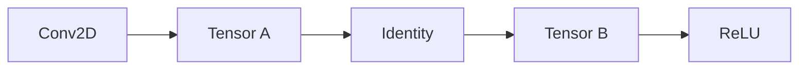

优化后：


例如 `[1,64,64,32]` 的 int8 Tensor 占 128 KiB。假如 A、B 分配独立 Buffer，且执行复制，就可能额外占用 128 KiB，并产生 128 KiB 读取及 128 KiB 写入。实际峰值取决于生命周期、布局及 allocator，并非必然节省这么多。

优化价值：减少节点、避免不必要的搬运和存储、为融合及调度简化图结构。对片上 SRAM 较小的 NPU 尤其重要。

### 1.1 从实际计算图理解为什么存在冗余 Tensor

假设神经网络计算 `Y = ReLU(Conv2D(X,W))`。Conv2D 负责卷积计算，其输出 T1 保存卷积结果；ReLU 读取 T1，产生 Y。如果中间插入 Identity，计算图变成：

```text
Input X
   |
 Conv2D
   |
 Tensor T1
   |
 Identity
   |
 Tensor T2
   |
 ReLU
   |
 Output Y
```

Identity 的数学定义为 $Identity(x)=x$，因此 $T2=T1$。在数据类型、量化参数、布局及其他可观察语义均相同的前提下，ReLU 直接读取 T1 即可。这里删除的是不必要的图节点，而不是卷积计算结果本身。

### 1.2 不优化时的具体内存代价

以 NHWC `[1,64,64,32]` 的 int8 Tensor 为例：

$$1\times64\times64\times32\times1=131072\text{ bytes}=128\text{ KiB}$$

```text
未优化（假设独立 Buffer）           理想优化后
+---------------------+            +---------------------+
| T1: 128 KiB         |            | T1 / T2: 128 KiB    |
+---------------------+            | 同一份数据           |
          |                        +---------------------+
          v
+---------------------+
| T2: 128 KiB         |
+---------------------+
合计 256 KiB                       合计 128 KiB
```

若真实复制一次，需要读取 128 KiB，再写入 128 KiB，总计 256 KiB 的数据访问量。以上只是假设两份 Buffer 同时存在的示例，实际 Vela 未必这样分配。对于固定功能 NPU，节省数据搬运通常比减少一个逻辑节点本身更重要。

还需要考虑后续融合：如果 Conv2D 与 ReLU 之间存在额外 Identity，某些只匹配相邻节点的融合规则就无法直接匹配。消除 Identity 后，融合 Pass 更容易识别 Conv2D + ReLU。但是否实际融合仍取决于硬件和融合规则。

## 2. Identity 为什么存在？

### 2.1 TensorFlow 标准算子

`tf.identity()` 是 TensorFlow 标准 API。它并不是无意义的设计：计算结果不变，不代表图节点没有作用。

```python
import tensorflow as tf
x = tf.constant([1, 2, 3])
y = tf.identity(x, name='output_tensor')
# y 的值仍为 [1, 2, 3]
```

具体来看，A 与 B 的数据完全一样，但节点名称、生产者和消费者关系可以不同：

```text
Tensor A                    Tensor B
name: a                     name: output_tensor
[1, 2, 3]  --> Identity --> [1, 2, 3]
shape: [3]                  shape: [3]
dtype: int32                dtype: int32
```

TensorFlow 可以使用这个新节点表达额外的图语义，并不要求分配一份独立的物理内存。可以把 Identity 理解为计算语义上的空操作（No-op），但图结构上具有用途的节点。

### 2.2 Case A：显式命名输出

```python
@tf.function
def model(x):
    y = x * 2 + 1
    return tf.identity(y, name='classification_output')
```

命名节点便于图级调试、引用及导出。SavedModel 对外签名名称不一定等于该节点名称。类似 C 语言 `int output = result;`，优化器可以在保留外部接口语义的前提下消除中间变量。

例如，图像分类模型可以在最后一层 Dense 后命名输出（以下是在已有 `inputs` 的模型构建上下文中的片段）：

```python
x = tf.keras.layers.Conv2D(32, 3)(inputs)
x = tf.keras.layers.ReLU()(x)
x = tf.keras.layers.Flatten()(x)
x = tf.keras.layers.Dense(10)(x)
output = tf.identity(x, name="classification_output")
```

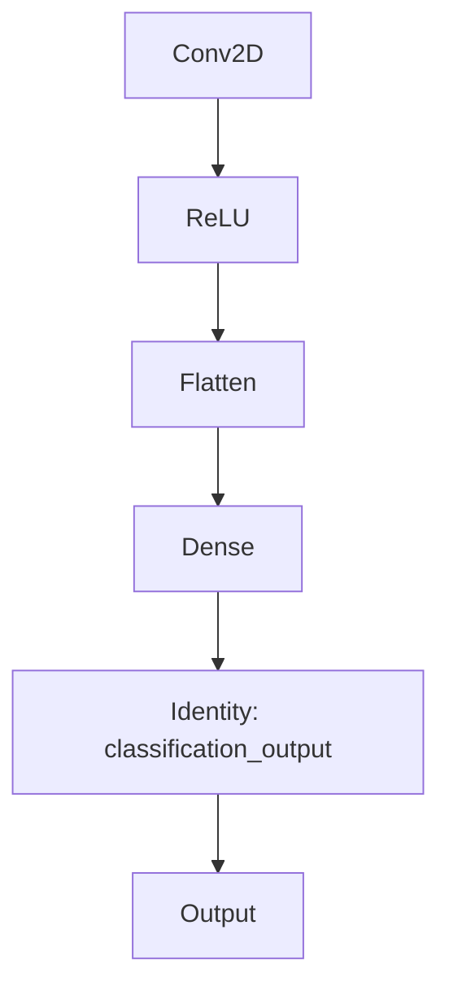

对应的 C 语言类比：

```c
int result = calculate();
int output = result;
return output;
```

`output` 在源代码中有独立的名称，但优化后的机器代码可能不需要单独的变量。这与图编译器删除 Identity 的思想相似。

### 2.3 Case B：框架自动生成函数返回节点

```python
@tf.function
def calculate(x):
    return x * 2 + 1

f = calculate.get_concrete_function(tf.TensorSpec([4], tf.float32))
for op in f.graph.get_operations():
    print(op.name, op.type)
```

典型图：`Placeholder → Mul → AddV2 → Identity → Function Output`（另有常量输入）。即使源代码没有显式 Identity，tracing 仍可能生成它。实际节点列表取决于版本和优化阶段。

更完整的典型输出如下（不是本次实际运行记录）：

```text
x           Placeholder
mul/y       Const
mul         Mul
add/y       Const
add         AddV2
Identity    Identity
```

可以看到，Python 函数并没有调用 `tf.identity()`，但是 TensorFlow 在 tracing 后仍可能创建 Identity 作为函数返回值节点。

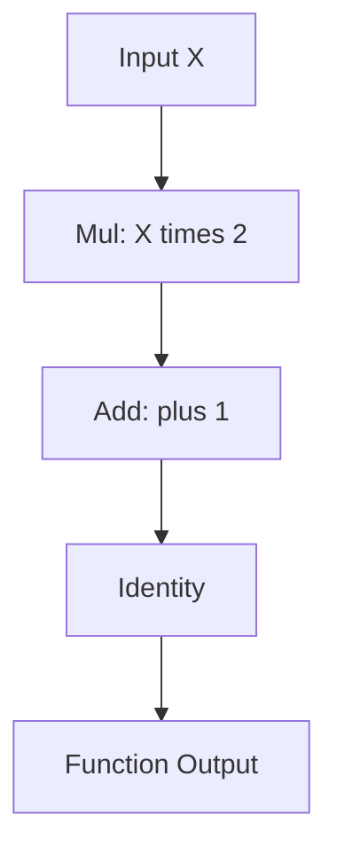

### 2.4 Case C：建立控制依赖

```python
@tf.function
def calculate(x):
    check = tf.debugging.assert_positive(x)
    with tf.control_dependencies([check]):
        y = tf.identity(x)
    return y * 2
```

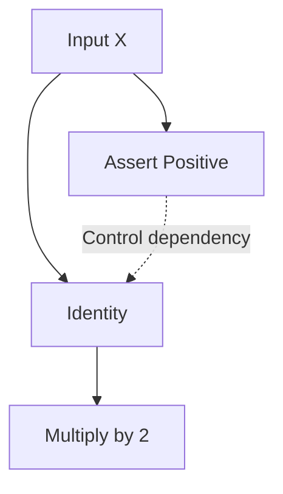

Identity 可以承载执行顺序约束。消除时必须保留依赖的语义，不能直接忽略检查。此例解释 TensorFlow Graph，不代表 Vela 支持 Assert。

为什么不直接返回 x？因为 Assert 与后面的乘法本来未必存在数据依赖。Identity 既读取 x，又具有来自 Assert 的控制依赖，使得乘法通过 Identity 间接依赖检查完成。在 TensorFlow 的控制依赖图中，优化器如果想去掉 Identity，必须把这条控制依赖正确转移，而不能把检查一并丢掉。

### 2.5 Case D：设备之间传输

```python
with tf.device('/GPU:0'):
    x = tf.constant([1, 2, 3])
with tf.device('/CPU:0'):
    y = tf.identity(x)
```

当实际设备放置如上时，可能需要跨设备传输。数值不变，但位置改变。对 CPU/NPU SRAM 的设计也有参考意义。示例要求 GPU 可用。

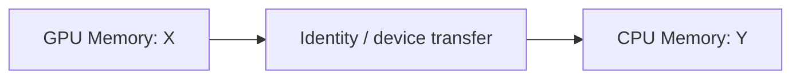

数据从 GPU Memory 到 CPU Memory，数值保持 `[1,2,3]`。这表明数学计算等价不等于执行行为等价。如果自研 NPU 的 CPU Memory 与片上 SRAM 不能直接共享，类似操作可能需要 DMA。若设备共享存储且地址和同步约束允许，则未必需要真实复制。

### 2.6 Case E：读取 Variable 的当前值

```python
a = tf.Variable(10)
b = tf.identity(a)
a.assign(20)
print(a.numpy(), b.numpy())  # 20 10
```

在 eager 模式下，b 保存读取时的值，而非 Variable 的可变引用。

### 2.7 五种用途的归纳

| 产生原因 | Identity 的实际用途 | 消除时需要保护什么 |
|---|---|---|
| 用户显式命名 | 提供可引用的图节点 | 外部接口、输出签名 |
| tf.function 自动生成 | 建立函数返回节点 | 函数输出对应关系 |
| 控制依赖 | 约束执行顺序 | 依赖及副作用 |
| 设备放置 | 表达跨设备的数据传递 | 数据位置及同步 |
| Variable 读取 | 取得变量当时的值 | 读取时序与状态语义 |

上述用途发生于 TensorFlow Graph 层，不意味着 Vela 的 Op.Identity 支持所有这些语义。Vela 处理的是经过 TFLite 转换后的图及自己的内部 IR。

## 3. TensorFlow、TFLite 与 Vela 的区别

| 层次 | Identity 的角色 |
|---|---|
| TensorFlow Graph | 标准算子，可由用户或框架创建 |
| TFLite FlatBuffer | 没有普通独立的 IDENTITY builtin；转换时通常消除或采用等价表达，Flex/custom 另论 |
| Vela Python IR | `Op.Identity`，图重写的内部表示 |
| NPU 硬件 | 一般无需专门的 Identity 计算单元；必要时使用搬运机制 |

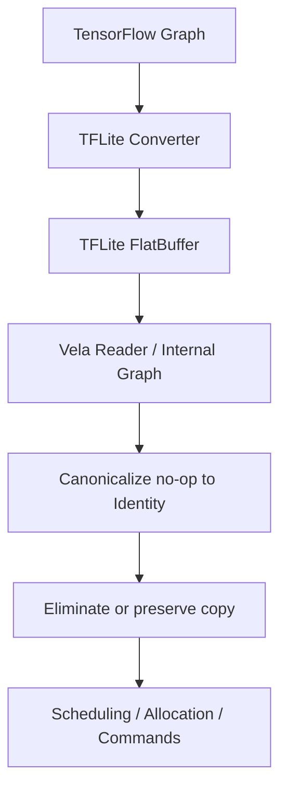

因此 Vela 看到的 Identity 可以是自己生成的，并不一定来自原始 TensorFlow Graph。

举例来说，模型从 TensorFlow 导出时可能包含 `Conv2D → Identity → ReLU`；TFLite Converter 可以将其简化为 `CONV_2D → RELU`。Vela Reader 读取 FlatBuffer 后，又可能因某个 Split 或 Resize 退化为空操作而主动产生 `Op.Identity`。

因此不能仅查看 TFLite 算子表就判断 Vela IR 中一定不存在 Identity。Vela IR 还可以表达不直接对应原始模型算子或硬件计算指令的内部操作，如 Memcpy。需要区分模型格式的 OperatorCode、编译器内部 Op 枚举和 NPU 硬件命令。

## 4. Vela 中 Identity 的实际生成路径

以下针对 NXP 仓库 `lf-6.18.20_2.0.0` 的 Python optimiser 路径；不是对其他版本或 Regor C++ 后端的全面结论。

### 4.1 Case 1：Split 只产生一个输出

函数：`convert_nop_split_to_identity()`。

```python
y = tf.split(x, num_or_size_splits=1, axis=-1)[0]
```

假设输入和输出均为 `[1,8,8,16]`。Split 只切成一份，没有实际切分。模型开发者可能根据配置动态选择 groups，通用代码在 groups=1 时仍保留 Split。

源码条件：`op.type == Op.Split` 且 `op.attrs.get("num_splits") == 1`。通过输入 Shape 与输出 Shape 相同来筛选数据输入，再设置 `op.type = Op.Identity`。代码期望只留下一个输入；不应把这一条件泛化到任意 SplitV。

```text
A → Split(1) → B
A → Identity → B
A → Consumer             # 理想的消除结果
```

是否最终保留 A 或 B，或者先转换为 Memcpy，取决于后续 Pass。

对应的源码逻辑（沿用前次分析，未在本次重新获取源码）：

```python
def convert_nop_split_to_identity(op, arch, nng):
    if op.type == Op.Split and op.attrs.get("num_splits") == 1:
        op.inputs = [
            i for i in op.inputs
            if i.shape == op.outputs[0].shape
        ]
        op.type = Op.Identity
    return op
```

为什么要重新筛选输入？TFLite Split 通常有 axis 和数据两个输入，而 Identity 只需要一个数据输入。对于合法的常见 Split(1)，数据输入的 Shape 和输出相同，标量 axis 的 Shape 不同，因此可以剔除 axis。异常形状或特殊 IR 仍需要合法性约束。

通用模型代码可能写成：

```python
groups = config.groups
outputs = tf.split(x, num_or_size_splits=groups, axis=-1)
```

- `groups=4`：如果输入通道为 16，每个输出包含 4 个通道，是真正的切分。
- `groups=1`：输出仍包含全部 16 个通道，没有实际切分。

开发者没必要专门写 `if groups == 1` 来手工优化每一个通用函数，编译器可以统一处理。是否能在 Vela 看到此 Case，还取决于 Converter 有没有提前消除它。

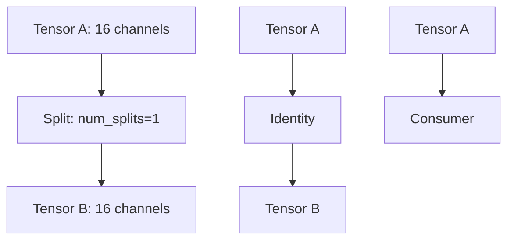

### 4.2 Case 2：Resize 的输入输出 Shape 相同

函数：`fixup_resize()`。

```python
y = tf.image.resize(x, size=[32, 32])
```

假设输入、输出均为 `[1,32,32,16]`，且 dtype、量化、Resize 语义满足等价条件。特征金字塔等通用对齐函数可能对本来已经是目标尺寸的特征图再调用 Resize。

实际判断：`op.type.is_resize_op()`、`op.run_on_npu`，且 `op.ifm_shapes[0] == op.ofm_shapes[0]`。保留第一个输入，类型变为 Identity。这里函数自身没有另做量化等价检查；依赖上游支持性判断及 IR 合法性。

```text
普通 Resize: 2×2 → 4×4，不能直接消除
No-op Resize: 2×2 → 2×2，满足条件时转 Identity
```

特别注意：1×1 扩展至更大尺寸不是这个 Case；源码走其他改写路径。

对应源码条件的关键片段：

```python
if op.type.is_resize_op() and op.run_on_npu:
    if op.ifm_shapes[0] == op.ofm_shapes[0]:
        op.inputs = op.inputs[:1]
        op.type = Op.Identity
```

这里 `op.inputs[:1]` 保留数据输入，去除不再需要的尺寸等输入。它判断的是 Vela 的 Operator Shape 表示，而不仅仅是文字上的目标尺寸。

以单通道 Feature Map 为例：

```text
输入 2x2：       最近邻放大到 4x4：       Resize 到原来的 2x2：
1 2             1 1 2 2                 1 2
3 4             1 1 2 2                 3 4
                3 3 4 4
                3 3 4 4
```

前者改变了 Tensor 的空间尺寸，后者在满足等价条件时没有引入新的数值。以上最近邻数据只是说明 Resize 的区别，不能用于替代 Bilinear 的计算公式。

FPN 中的通用代码可能是：

```python
def align_feature(feature, target_size):
    return tf.image.resize(feature, target_size)
```

如果目标为 32x32，16x16 的特征需要放大，已经是 32x32 的特征就不必重新采样。使用统一模型代码仍可能产生这种冗余 Resize。

### 4.3 为什么先转 Identity，再删除？

Canonicalization（规范化）与 Elimination（消除）分离。前者判断算子是否等价于空操作，后者统一负责图连接重写。这样可以避免每个算子重复实现 Producer/Consumer 更新。

其他理论候选：零 Pad、恒等 Transpose、完整 Slice、Tile multiples 全为 1、同类型 Cast、Add 0、Mul 1。它们必须满足类型、量化、舍入、布局等约束；这些是自研设计候选，不宣称 Vela 当前全部实现为 Identity。

如果每个算子优化函数都单独删除节点，便必须分别实现删除 Operator、替换 Tensor、更新 Producer、更新 Consumer、处理子图输出、维护图的连接关系等逻辑。统一转换为 Identity 能减少重复代码，并使图重写测试集中到公共路径。

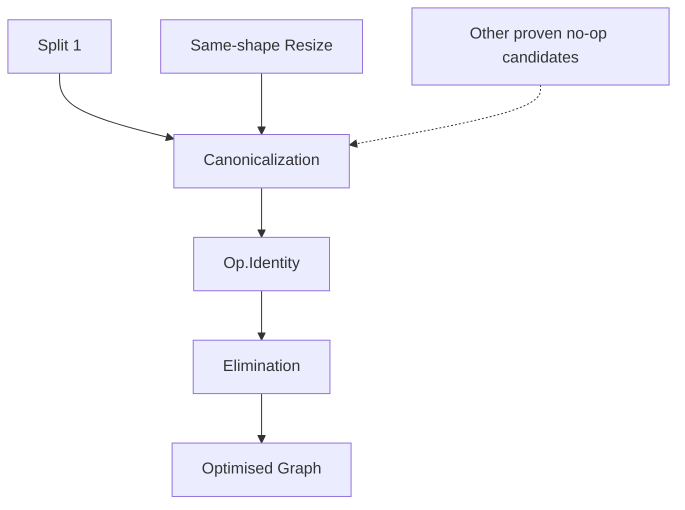

| 算子 | 可能成为 No-op 的条件 | 本文确认的 Vela 路径或设计候选 |
|---|---|---|
| Split | 仅分一份 | Vela 路径 |
| Resize | 输入输出 Shape 相同且语义等价 | Vela 路径 |
| Pad | 所有 padding 为 0 | 设计候选 |
| Transpose | permutation 为原始顺序 | 设计候选 |
| Slice | 截取完整 Tensor | 设计候选 |
| Tile | multiples 全为 1 | 设计候选 |
| Cast | 输入输出类型完全相同 | 设计候选 |
| Add | 加 0 且量化、浮点语义等价 | 设计候选 |
| Mul | 乘 1 且量化、浮点语义等价 | 设计候选 |

## 5. Vela 的两个优化机制

### 5.1 `remove_passthrough_tensor()`：Tensor 级重写

源码：`tflite_graph_optimiser.py`。简短原始实现：

```python
passthrough_nodes = (Op.Identity,)

def remove_passthrough_tensor(tens, arch, nng):
    if len(tens.ops) == 1 and tens.ops[0].type in passthrough_nodes:
        assert len(tens.ops[0].inputs) == 1
        tens = tens.ops[0].inputs[0]
    return tens
```

- `tens.ops` 是生产者列表，不是消费者列表。
- 只有一个生产者且生产者为 Identity 才会替换。
- Identity 必须只有一个输入。
- 返回 Identity 的输入 Tensor；调用方负责重新连接图。这不是直接释放内存的代码，也没有在此函数中检查消费者数量或 `run_on_npu`。

#### 逐行跟踪 Tensor 替换

假设当前传入的 `tens` 是 B：

```text
Conv2D -> A -> Identity -> B -> ReLU
```

1. `len(tens.ops) == 1`：B 只有一个生产者 Identity。
2. `tens.ops[0].type in passthrough_nodes`：生产者类型符合条件。
3. `assert len(tens.ops[0].inputs) == 1`：Identity 只允许一个输入。
4. `tens.ops[0].inputs[0]`：找到 A。
5. 返回 A 给调用者，调用者把消费者的输入连接到 A。

```text
ReLU.inputs[0] : B -> A
```

注意区分 `tens.ops` 和 `tens.consumer_list`：前者是 Producer 列表，后者是 Consumer 列表。此函数没有显式释放 B 的 Buffer；图遍历从输出追踪可达节点，不再使用的节点可在图刷新中被排除。内存规划是另外一个阶段。

### 5.2 `bypass_memory_only_ops()`：Operator 级重写

源码：`graph_optimiser_util.py`。处理 Reshape、QuantizedReshape、Squeeze、ExpandDims、Identity。仅对 `run_on_npu` 的这些算子执行。根据三个保护条件选择重写为 Memcpy 或连接前驱至 OFM。

以下是逻辑等价的伪代码，不是逐字源码：

```python
if not npu_supported(op) or not memory_only(op):
    return op
if shared_input(op) or cpu_produced_input(op) or mean_produced_input(op):
    change_type_to_memcpy(op)
else:
    redirect_input_producers_to_output(op)
return op
```

实际条件分别使用 IFM 的 `consumer_list` 数量、各 IFM Producer 的 `run_on_npu` 和 Producer 是否属于 `ofm_not_replaceable_ops`（此版本只有 Mean）。旁路分支保留原 OFM，把 IFM 的生产者输出改指向它。`set_tensor_equivalence()` 则为 memory-only 输入输出建立 equivalence ID；不是立即分配物理地址。

#### Memory-only 算子集合

```python
memory_only_ops = (
    Op.Reshape,
    Op.QuantizedReshape,
    Op.Squeeze,
    Op.ExpandDims,
    Op.Identity,
)
```

它们的共同特点是，在满足合法性约束时，不必对每个元素做新的算术运算。但不同 Shape、布局和内存位置可能使其不能直接删除。

#### 三个保护条件（关键代码片段）

```python
ifm_has_multiple_cons = len(op.ifm.consumer_list) > 1

ifm_is_cpu_produced = any(
    ifm_prod is not None and not ifm_prod.run_on_npu
    for ifm_prod in op.ifm.ops
)

ofm_not_replaceable_ops = (Op.Mean,)
producer_ofm_not_replaceable = any(
    ifm_prod is not None
    and ifm_prod.type in ofm_not_replaceable_ops
    for ifm_prod in op.ifm.ops
)
```

任一保护条件成立时采用 `Op.Memcpy` 路径，否则可以将前驱的输出重定向到当前 OFM。关键的重定向逻辑如下（仅展示相关片段）：

```python
ofm = op.ofm
ifm = op.ifm
ofm.ops = []
for prev_op in ifm.ops:
    prev_op.outputs = [ofm]
    ofm.ops.append(prev_op)
```

这里保留的是 B（OFM），而上一节严格 Passthrough 回调返回的是 A（IFM）。两种重写方向不同，不应混淆。完整代码还涉及图维护及其他前提，以上片段不宜直接作为独立 Pass 使用。

### 5.3 二者对比

| 项目 | Passthrough Removal | Memory-only Bypass |
|---|---|---|
| 输入 | Tensor | Operator |
| 范围 | Identity | 五类 memory-only op |
| 基本策略 | 返回 Identity 输入 | 将前驱输出重定向至 OFM，或改 Memcpy |
| 多消费者等保护 | 函数本身没有 | 明确有三个条件 |
| 运行时拷贝 | 不在此处决定 | Memcpy 可能留待后续处理 |

## 6. 图重写 Case 详解

### 6.1 普通 Identity

`Conv → A → Identity → B → MaxPool`。

后期 passthrough pass 可以将 MaxPool 的输入改为 A。若先经过 memory-only bypass，则可能保留 B，让 Conv 直接输出 B。两种方式都需要保持数值语义。

```text
优化前：
Input X -> Conv2D -> A [1,8,8,16] -> Identity -> B [1,8,8,16] -> MaxPool -> Output

严格 Passthrough 路径：
Input X -> Conv2D -> A [1,8,8,16] -> MaxPool -> Output

Memory-only 旁路路径（满足条件）：
Input X -> Conv2D -> B [1,8,8,16] -> MaxPool -> Output
```

两条路径都删除了 Identity，但保留的 Tensor 对象不同。MaxPool 的输入数值、形状和量化解释应该保持一致。

### 6.2 连续 Identity

`A → Identity → B → Identity → C → ReLU`。

理想结果为 `A → ReLU`。图遍历需要持续处理返回的新 Tensor，避免只消除一层。此处作为预期测试场景，未执行实际测试。

例如三层连续 Identity：

```text
Conv2D -> A -> Identity 1 -> B -> Identity 2 -> C -> Identity 3 -> D -> ReLU
```

严格 Tensor 回调每次只追溯一层；前次源码分析中，`rewrite_graph_pre_order()` 会反复处理返回的新对象直到不再变化，因此可以逐层把 D 替换为 C、B、A。前置 Memory-only Pass 也可能已经消除其中部分节点，实际保留对象需以完整 Pass 输出为准。

### 6.3 Identity 的 OFM 有多个消费者

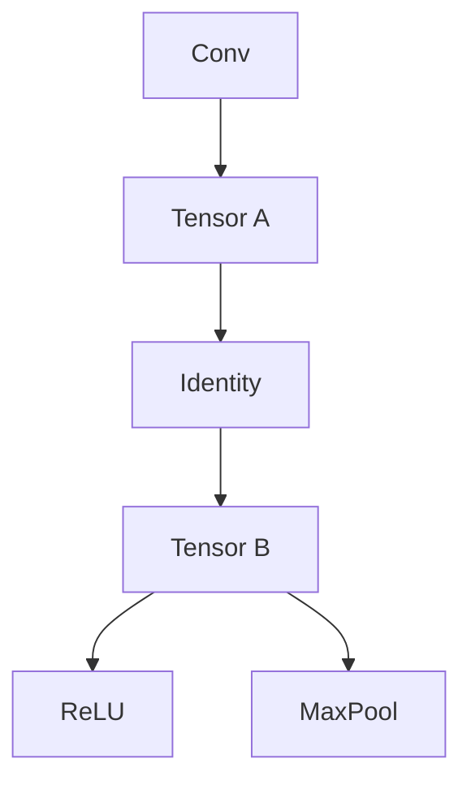

IFM A 只有一个消费者，OFM B 有两个消费者。这并不会触发 memory-only pass 的 IFM 多消费者条件。满足其他条件时，可以旁路，两个消费者仍读同一输出。

理想的旁路结果：

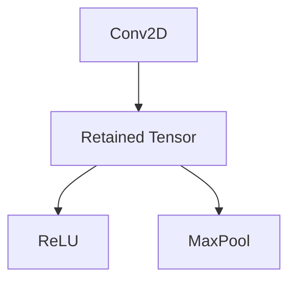

注意：OFM B 有两个消费者并不等于 IFM A 有两个消费者。该保护条件看的是 A，因为重定向生产者输出可能影响 A 的其他使用者。如果 B 本身有两个消费者，保留 B 反而可以让两个消费者都不需要修改输入引用。

### 6.4 Reshape 改变 Shape，但不改变线性数据

A: `[1,2,3,2]`，B: `[1,3,2,2]`，12 个元素的顺序保持不变。

```text
A: 2 行 × 3 列，每格 2 通道
(1,2)   (3,4)   (5,6)
(7,8)   (9,10)  (11,12)

B: 3 行 × 2 列，每格 2 通道
(1,2)   (3,4)
(5,6)   (7,8)
(9,10)  (11,12)
```

`Conv → A → Reshape → B → Mean`，旁路后 `Conv → B → Mean`。生产者的计算 Shape 与消费者逻辑 Shape 可以通过各自的 `ifm_shapes` / `ofm_shapes` 描述；不是把所有 Shape 简单改成相同值。若沿 H 做 Mean，A 与 B 的归约结果不同，因此必须保留 B 的逻辑解释。

Squeeze、ExpandDims 同样可以只改变维度表示：如 `[1,1,3,2] → [1,3,2]` 或反向。QuantizedReshape 还要满足量化解释不变。

#### 为什么不能丢掉 Shape？具体数值证明

以每个位置的第一个 channel 为例，A 的数据排列为：

```text
1 3 5
7 9 11
```

B 的数据排列为：

```text
1 3
5 7
9 11
```

如果对 H 轴做 Mean，A 的结果为 `[4,6,8]`，B 的结果为 `[5,7]`。线性 Buffer 完全相同，但由于维度解释不同，计算结果不同。因此 Reshape 可以消除数据复制，却不能消除它所表达的 Shape 变化。


旁路后的逻辑图：

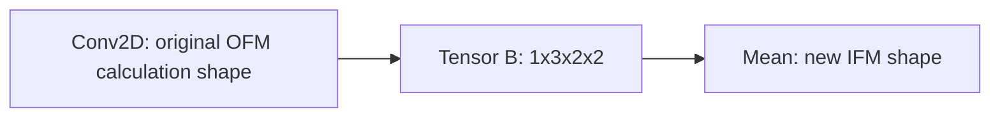

### 6.5 IFM 有多个消费者：改为 Memcpy

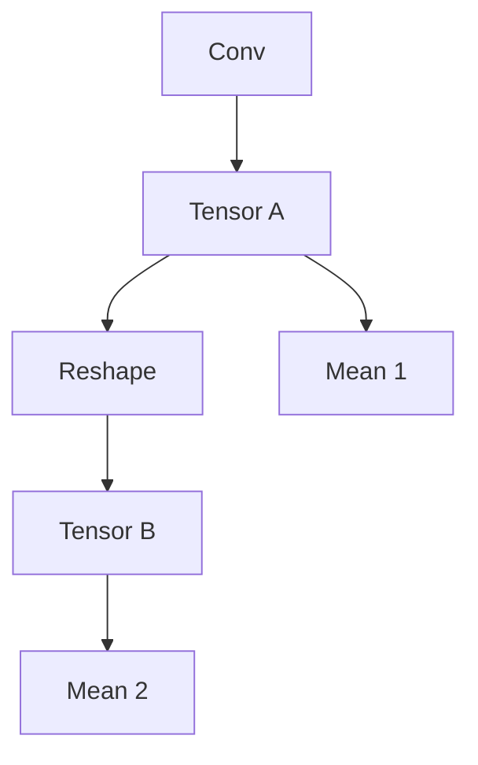

A 同时被 Reshape 和 Mean 1 使用。不能直接把生产者输出改成 B，否则 Mean 1 的连接和 Shape 可能被破坏。因此 memory-only pass 改写 Reshape 为 Memcpy，保留 A、B 两个逻辑 Tensor。

源码注释说明 DMA 输入和输出落在相同 memory area 时可能在命令生成阶段去除该 DMA；不能仅凭这段注释断言任意同区域不同地址的复制都能删除，最终需核对 equivalence、allocator 和 command stream。

优化后的图：

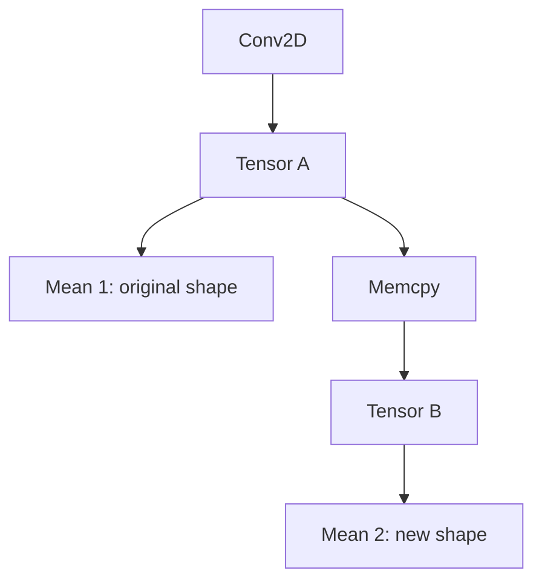

为什么不能直接使用上面的生产者重定向？如果 Conv2D 不再输出 A 而改为 B，Mean 1 仍然依赖 A，图连接就不完整；如果同时把 Mean 1 的输入改为 B，又可能改变 Mean 1 的维度解释。保留 A 和 B 是为了保护不同使用者的契约。

Memcpy 在这个阶段是编译器 IR 的一种表达：图优化阶段先保持连接正确；内存规划阶段决定能否共享存储；命令生成阶段决定是否需要真正搬运。不要把同一 memory area 直接等同于同一地址，也不能断言 Memcpy 一定消失。

### 6.6 IFM 由 CPU 产生：改为 Memcpy

```text
CPU Op → A → Reshape → B → NPU Conv
CPU Op → A → Memcpy  → B → NPU Conv
```

保护 CPU 生产的 Tensor 不被直接替换，维持 CPU/NPU 接口。模型输入也应单独测试：其实际路径取决于 Placeholder/SubgraphInput 的标记。

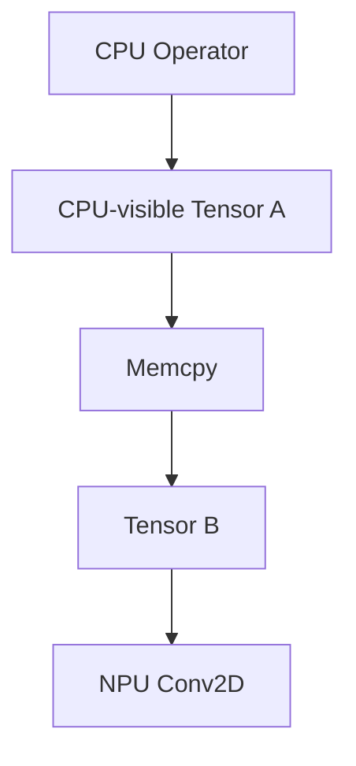

CPU Operator 可能由 TFLite Runtime 执行，而不是由 Vela 控制其输出布局。直接替换 CPU 生产者的输出 Tensor 可能破坏模型接口。即使 A、B 数值完全相同，也必须验证 CPU/NPU 是否使用共享内存、是否要求不同地址或布局，以及同步是否正确。上述硬件约束是设计解释，不是对此版本每种 DMA 情形的实测结论。

### 6.7 前驱是 Mean：改为 Memcpy

`Mean → A → Reshape → B → Conv`。Mean 的原始 OFM Shape 是后续分解需要的信息，不能提前替换。此版本 `ofm_not_replaceable_ops` 只包含 Mean。

```text
优化前：Mean -> A -> Reshape -> B -> Conv2D
保护后：Mean -> A -> Memcpy  -> B -> Conv2D
```

这里的限制尤其值得关注：并不是 Reshape 需要执行数学计算，也不是 Mean 的输出无法保存到其他 Buffer，而是后续 Mean 分解 Pass 需要原始 OFM Shape。过早修改生产者输出，会让后续 Pass 丢失信息。这是图编译器中 Pass 顺序与信息保存的典型问题。

### 6.8 残差连接与生命周期

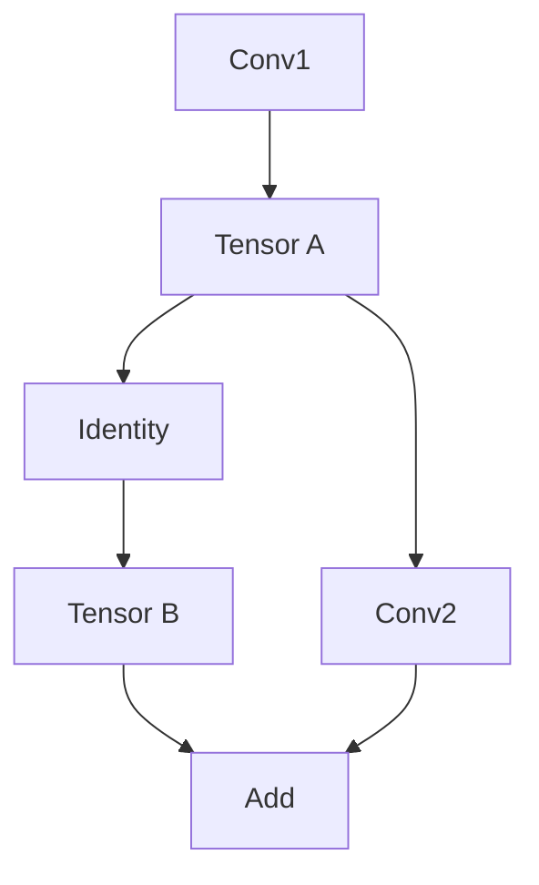

数值上可以消除 Identity，但 memory-only pass 若发现 A 有多个消费者，会走 Memcpy 路径。对于自研编译器，即使两个分支共享同一 Buffer，也不能在另一消费者尚未读完时原地覆盖。需做 liveness 和 alias 分析。

从数学角度，残差图可以简化为：

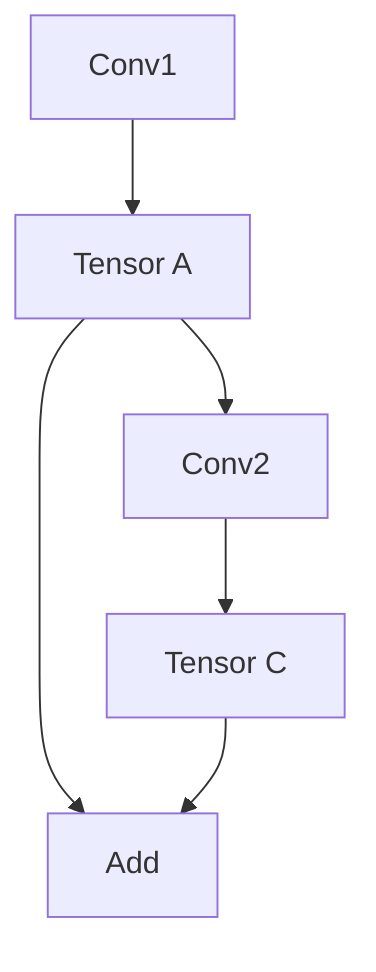

但假设 Conv2 原地覆盖 A，而 Add 在之后还需要读取旧 A，就会得到错误结果。必须保证 A 从产生到最后一次读取的生命周期内，其必要数据未被覆盖。Vela 对这一具体场景的最终 Buffer 和 DMA 行为需要结合 allocator 与 scheduler 验证，不能只凭 Identity 回调推出。

### 6.9 模型输入输出、多个生产者、非 NPU 算子

- 多个 Producer：严格 passthrough 函数不处理；Concat 改写等可产生多生产者 IR。
- 不是 Identity 的 Producer：严格 passthrough 函数原样返回。
- Identity 输入数量不为 1：触发断言，属于非法 IR，不是正常优化 Case。
- `run_on_npu=False`：memory-only pass 不处理；后期 passthrough 回调自身没有此条件，不能把两者混为一谈。
- 子图输出直接来自 Identity 或常量：需要特别检查输出签名、名称、地址及序列化。不能仅根据回调断言所有输出边界都能安全消除。该版本末尾还单独处理优化产生的常量子图输出。

## 7. Pass 执行顺序

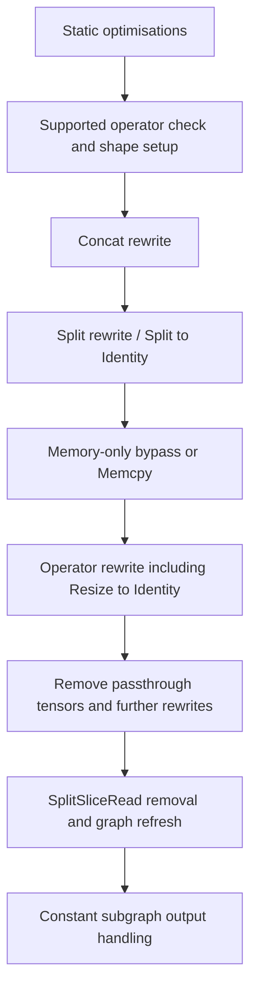

入口：`tflite_optimise_graph()`。上述只展示与主题有关的顺序。第一轮先处理 Split 产生的 Identity 以及其他 memory-only op；后续 Resize 又可能生成 Identity，因此需要第二轮清理。

### 7.1 为什么需要两轮 Identity 处理？

| 顺序 | 函数 | 作用 |
|---|---|---|
| 1 | `convert_nop_split_to_identity()` | Split(1) 规范化为 Identity |
| 2 | `bypass_memory_only_ops()` | 处理已有的 Identity 及其他 Memory-only op |
| 3 | `fixup_resize()` | 后续又可能生成 Identity |
| 4 | `remove_passthrough_tensor()` | 清理仍然存在的 Identity |

第一次清理并不意味着整个编译流程不再产生 Identity。后续的优化 Pass 也可以生成新的 No-op，因此第二次清理有明确的意义。严格 Passthrough 回调本身并不检查 `run_on_npu`，不能把它简单理解为 NPU 内部专用的算子消除。

## 8. 不能简单消除的操作

| 操作 | 原因 |
|---|---|
| 普通 Transpose | 元素顺序改变 |
| 部分 Slice | 数据集合改变 |
| 普通 Split | 输出不同子区域 |
| 真正 Resize | 尺寸或采样结果改变 |
| Quantize / Requantize | 数值表示可能改变 |
| 具有独立外部 Buffer 的 Copy | 即使数值相同也可能需要搬运 |

量化示例：同一 int8 数字 q=10，scale=0.1、zero point=0 表示实数 1；scale=0.2 则表示实数 2。不能只看字节相同就合并 Tensor。

布局示例：NHWC 与通道分块布局的物理地址映射可能不同。即使逻辑元素相同，也不能假设两者可直接共享。Vela 的 `check_format_restrictions()` 会考虑算子 Shape、CPU 边界、Memcpy 等因素来约束非线性布局。

## 9. 自研 NPU 图编译器的设计建议

建议在内部 IR 定义 Identity 与 Memcpy，而不是让 NPU 硬件增加无意义计算指令。先做 no-op 规范化，再做图消除，最后由内存规划及命令生成决定是否搬运。

必须验证三个层次：

1. 计算等价：值、dtype、量化、融合激活、舍入等。
2. 图结构等价：Shape、Producer/Consumer、外部输出、依赖关系。
3. 执行等价：布局、地址、内存区域、生命周期、同步和原地写入安全。

### 9.1 内部 Operator 定义示例

```cpp
enum class OpType {
    Conv2D, MaxPool, Add, Mul,
    Reshape, Split, Resize,
    // Internal compiler operations
    Identity, Memcpy
};
```

| 层次 | 是否需要 Identity |
|---|---|
| TensorFlow 前端 | 已存在 |
| TFLite 标准算子库 | 无需添加独立内置 Identity |
| 自研图编译器 IR | 建议支持 |
| Graph Optimiser | 建议实现规范化及消除 |
| NPU Runtime | 按数据搬运和接口需求决定 |
| NPU 硬件计算单元 | 通常不需要专用 Identity 指令 |
| NPU DMA | 无法共享 Buffer 时可能需要 |

### 9.2 两个独立 Pass 的设计

**Pass 1：Canonicalize No-op Operators**。负责识别可以证明等价的操作，将其统一转换为 Identity 或建立 Tensor 等价关系。

**Pass 2：Eliminate Memory-only Operators**。负责判断可以直接旁路、共享 Buffer，还是需要保留 Copy 表达，并维护图连接关系。

下面是借鉴 Vela 的示意判断，不是完整源码：

```python
def can_bypass_memory_only(op):
    if not op.run_on_npu:
        return False
    if op.type not in MEMORY_ONLY_OPS:
        return False
    if len(op.ifm.consumer_list) > 1:
        return False
    if any(p is not None and not p.run_on_npu for p in op.ifm.ops):
        return False
    if any(p is not None and p.type == Op.Mean for p in op.ifm.ops):
        return False
    return True
```

这个函数只是描述核心条件。真正的自研 Pass 还必须检查子图输入输出、布局、量化、外部 Buffer、生命周期和原地写入风险。不能将这段示意代码直接用于生产环境。

## 10. 建议测试矩阵

| ID | 场景 | 预期检查 |
|---|---|---|
| P01 | 普通 Identity | 节点消除，值不变 |
| P02 | 连续 Identity | 不残留多余节点 |
| P03 | OFM 多消费者 | 两个消费者连接正确 |
| P04 | Reshape 单消费者 | 保留逻辑 Shape |
| P05 | IFM 多消费者 | Memcpy 路径，分支正确 |
| P06 | CPU Producer | 保留边界 Tensor |
| P07 | Mean Producer | 保留原 OFM Shape |
| P08 | Split(1) | 规范化及清理 |
| P09 | 同 Shape Resize | 后期 Identity 清理 |
| P10 | 真正 Resize / Split | 不被错误消除 |
| P11 | Squeeze / ExpandDims | 维度正确 |
| P12 | 多 Producer / 非 Identity | passthrough 回调不替换 |
| P13 | 子图输入输出 | 签名、Buffer、序列化正确 |
| P14 | 不同量化及布局 | 禁止错误别名 |
| P15 | 残差及原地写入 | 生命周期无冲突 |
| P16 | 同区域与跨区域 Copy | 检查地址和 DMA 命令 |

每项分三层验证：IR 单元测试检查节点和边；模型端到端测试比较输出；后端测试检查 Buffer 分配及 DMA command stream。建议同时记录优化前后节点数、峰值 SRAM、搬运字节数和运行时间。TensorFlow Converter 可能提前消除 Split/Resize 等 no-op，因此应补充直接构造 Vela IR 的单元测试。

## 11. 源码阅读索引与参考资料

- [NXP Vela Python optimiser](https://github.com/nxp-imx/ethos-u-vela/blob/lf-6.18.20_2.0.0/ethosu/vela/tflite_graph_optimiser.py)：`remove_passthrough_tensor`、`fixup_resize`、`convert_nop_split_to_identity`、`tflite_optimise_graph`。
- [Graph optimiser utilities](https://github.com/nxp-imx/ethos-u-vela/blob/lf-6.18.20_2.0.0/ethosu/vela/graph_optimiser_util.py)：`memory_only_ops`、`bypass_memory_only_ops`、`set_tensor_equivalence`、`check_format_restrictions`。
- [Graph traversal](https://github.com/nxp-imx/ethos-u-vela/blob/lf-6.18.20_2.0.0/ethosu/vela/rewrite_graph.py)：后续阅读 `rewrite_graph_pre_order`。
- [DeepWiki Compilation Pipeline](https://deepwiki.com/nxp-imx/ethos-u-vela/2-compilation-pipeline)：流程概览。
- [TensorFlow tf.identity](https://www.tensorflow.org/api_docs/python/tf/identity)：标准 API 及用途。
- [TensorFlow tf.function](https://www.tensorflow.org/guide/function)：Graph tracing。
- [TFLite schema](https://github.com/tensorflow/tensorflow/blob/master/tensorflow/compiler/mlir/lite/schema/schema.fbs)：BuiltinOperator 定义。

验证范围：本页重新核对了指定 NXP 分支的两个 Python optimiser 文件及 TensorFlow Identity API；未固定 commit SHA，未实际运行 TensorFlow 转换、Vela 编译或硬件测试。示例图与测试矩阵是教学和验证设计，不是实测结果。Regor C++ 后端及最终 DMA 消除条件需另行源码分析。

## 12. 总结

Identity 并非无用的设计，而是表达命名、依赖、设备放置、变量读取或编译器规范化的工具。Vela 将部分 no-op 统一为 Identity，再通过两类 Pass 处理。**先证明可以消除计算，再证明可以消除数据搬运。两者不是一回事。**


## 修订说明

本次为前两次详细回答的扩充整理版，保留原 Wiki 的所有章节，并补回源码片段、逐行解释、完整案例图、数值示例及自研建议。本次未重新在线核验源码或执行测试；源码片段沿用前次分析，具体分支及验证范围见第 11 节。
