## 目录

- [[#一、Concat 和 Split 基础]]
- [[#二、为什么 Vela 必须优化 Concat 和 Split]]
- [[#三、Concat 的重写]]
- [[#四、Split 的重写]]
- [[#五、Split 无法消除的条件]]
- [[#六、Fallback：AvgPool NOP]]
- [[#七、其他 Case]]
- [[#八、对自研 NPU 图编译器的启示]]
- [[#九、测试与验证]]
- [[#十、总结]]

Concat（拼接）和 Split（拆分）与 Conv2D、MaxPool 不同，通常不需要乘加计算，核心操作是重新组织 Tensor 中的数据。Vela 希望将逻辑数据组织转换成 NPU 能执行的区域读写，减少额外内存搬运。

| 算子 | 原始操作 | Vela 优化思路 |
|---|---|---|
| Concat | 多个 Tensor 拼成一个 | 各输入写入输出 Tensor 的指定区域 |
| Split | 一个 Tensor 拆成多个 | 下游直接读取原 Tensor 的指定区域 |
| Split 无法消除 | 单独生成输出 | AvgPool NOP 等方式复制 |
| Pack / Stack | 插入维度后拼接 | 调整逻辑形状后复用 Concat |
| Slice / StridedSlice | 选择局部区域 | 读取偏移、范围和步长，必要时搬运 |

逻辑层面改变张量组织方式；物理层面是否复制取决于布局、上下游算子、量化和硬件能力。并不是所有场景都能零拷贝。

## 一、Concat 和 Split 基础

### 1.1 Concat

```text
A = [1, 2, 3]
B = [4, 5]
Concat(A, B, axis=0)
C = [1, 2, 3, 4, 5]
```

输入是两个或多个 Tensor，axis 指拼接维度，输出是更大的 Tensor。NHWC = [N,H,W,C]，分别表示 Batch、Height、Width、Channel。除拼接轴外其他维度必须兼容。

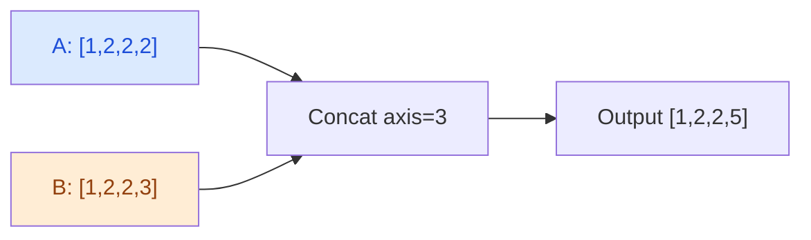

输出每个空间位置的前两个 Channel 来自 A，后三个来自 B。

### 1.2 Split

```text
Input = [10, 20, 30, 40, 50, 60]
Split(Input, axis=0, num_splits=3)
A = [10, 20]
B = [30, 40]
C = [50, 60]
```

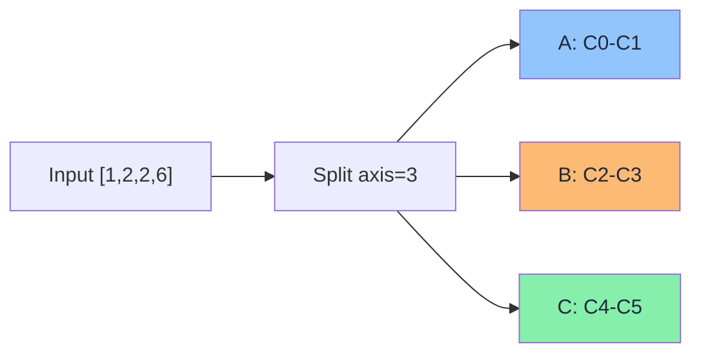

逻辑上产生三个 Tensor，不代表物理上必须生成三份独立内存数据。

## 二、为什么 Vela 必须优化 Concat 和 Split

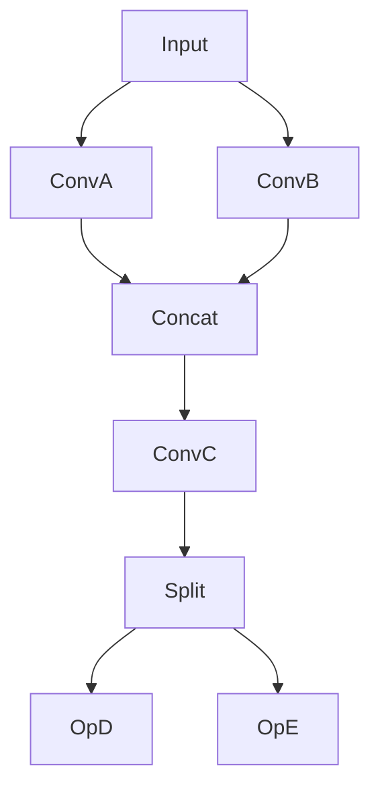

直接执行：ConvA/B 写入 A/B，Concat 读回 A/B 并写入 C，ConvC 读取 C；ConvC 写入 D 后，Split 读 D 并写 E/F，OpD/E 再读 E/F。

这些额外复制增加 SRAM 使用、DMA 和总线流量、算子调度开销及峰值内存需求。理想优化如下：

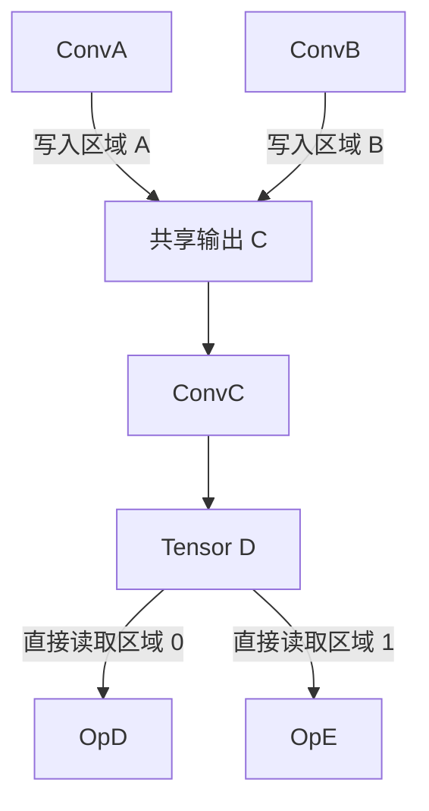

Concat 的关键是 Write Offset，Split 的关键是 Read Offset。注意这是优化目标，并不保证每个 Concat 都能与 Producer 融合。

## 三、Concat 的重写

### 3.1 源码入口：rewrite_concat_ops()

文件：`ethosu/vela/tflite_graph_optimiser.py`。

```python
def rewrite_concat_ops(op, arch):
    if not op.run_on_npu or not op.type.is_concat_op():
        return

    axis_4D = 0
    ofm = op.ofm
    ofm.ops = []
    offset = 0

    unfuse_activation_function(op)

    # Handle Pack / Stack ...
    inputs, axis = op.get_concat_inputs_axis()

    for idx, inp in enumerate(inputs):
        # Determine 4D shapes and axis ...
        write_offset = [0, 0, 0, 0]
        write_offset[axis_4D] = offset
        concat_end = offset + op.ifm_shapes[idx][axis_4D]

        create_avg_pool_for_concat(
            op,
            op.name + str(idx) + "_avgpool",
            inp,
            op.ifm_shapes[idx],
            Shape4D.from_list(write_offset),
        )
        offset = concat_end

    assert ofm.shape[axis] == offset
    return op
```

上面省略 Pack 和维度转换。核心是 `write_offset[axis_4D] = offset` 与 `create_avg_pool_for_concat()`。Vela 并非简单删除 Concat 或直接替换为 DMA，而是先将它转换成一组带写入偏移的 AvgPool 操作。

### 3.2 Case 1：沿 Channel 拼接

```text
A.shape = [1,2,2,2]
B.shape = [1,2,2,3]
axis = 3
C.shape = [1,2,2,5]

A.write_offset = [0,0,0,0]
A.write_shape  = [1,2,2,2]
B.write_offset = [0,0,0,2]
B.write_shape  = [1,2,2,3]
```

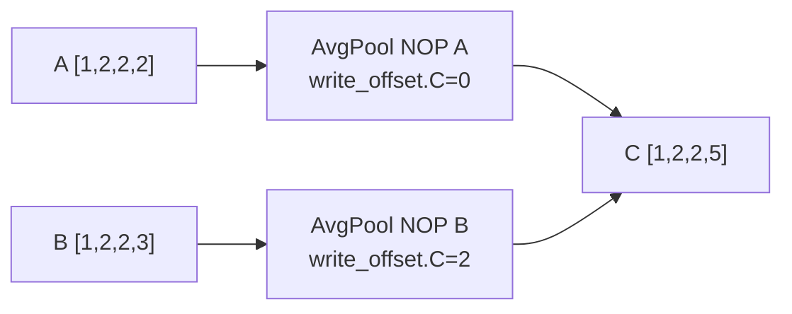

两个操作共同生成同一个完整 OFM 的不同区域。

### 3.3 内存具体布局

简化 H=W=1，int8，输出 C 基地址 0x2000。

| 地址 | 0x2000 | 0x2001 | 0x2002 | 0x2003 | 0x2004 |
|---|---|---|---|---|---|
| 值 | 10 | 11 | 20 | 21 | 22 |
| 来源 | A | A | B | B | B |

```text
A = [10,11]
B = [20,21,22]
C = [10,11,20,21,22]
A 目标地址 = C_base + 0
B 目标地址 = C_base + 2
```

`write_offset` 是逻辑坐标，不是 byte offset；真正地址还需要数据类型、stride 和物理格式。

### 3.4 Case 2：沿 Height 拼接

```text
A.shape = [1,2,4,8]
B.shape = [1,3,4,8]
axis = 1
C.shape = [1,5,4,8]
A.write_offset = [0,0,0,0]
B.write_offset = [0,2,0,0]
```

| H / W | W0 | W1 | W2 | W3 |
|---|---|---|---|---|
| H0 | A | A | A | A |
| H1 | A | A | A | A |
| H2 | B | B | B | B |
| H3 | B | B | B | B |
| H4 | B | B | B | B |

每格含 8 Channel。连续 NHWC int8 下每行 4×8=32 bytes，B 起始偏移 2×32=64 bytes。可以按完整行块组织。

### 3.5 Case 3：沿 Width 拼接

```text
A.shape = [1,2,2,1]
B.shape = [1,2,1,1]
axis = 2
C.shape = [1,2,3,1]

A = [[1,2], [3,4]]
B = [[5], [6]]
C = [[1,2,5], [3,4,6]]

A linear: 1 2 3 4
B linear: 5 6
C linear: 1 2 5 3 4 6
```

不能用下面两次连续复制得到正确结果：

```c
memcpy(C, A, sizeof(A));
memcpy(C + sizeof(A), B, sizeof(B));
```

Vela 逻辑偏移：

```text
A.write_offset = [0,0,0,0]
B.write_offset = [0,0,2,0]
```

必须正确处理行 stride。

| 拼接轴 | 常见连续 NHWC 内存特点 |
|---|---|
| H | 完整行块 |
| W | 逐行写入目标区域 |
| C | 每个 Pixel 拼接 Channel |
| N | Batch 块，受目标支持条件限制 |

### 3.6 Case 4：Channel 拼接不能简单加固定线性偏移

```text
A.shape = [1,2,2,2]
B.shape = [1,2,2,3]
C.shape = [1,2,2,5]

A:
  Pixel0: A0 A1
  Pixel1: A2 A3
  Pixel2: A4 A5
  Pixel3: A6 A7
B:
  Pixel0: B0 B1 B2
  Pixel1: B3 B4 B5
  Pixel2: B6 B7 B8
  Pixel3: B9 B10 B11
C:
  Pixel0: A0 A1 B0 B1 B2
  Pixel1: A2 A3 B3 B4 B5
  Pixel2: A4 A5 B6 B7 B8
  Pixel3: A6 A7 B9 B10 B11
```

| Pixel | C0 | C1 | C2 | C3 | C4 |
|---|---|---|---|---|---|
| 0 | A0 | A1 | B0 | B1 | B2 |
| 1 | A2 | A3 | B3 | B4 | B5 |
| 2 | A4 | A5 | B6 | B7 | B8 |
| 3 | A6 | A7 | B9 | B10 | B11 |

独立紧密存储的 A/B 搬到 C 时是按 Pixel 交错，不是把完整 A 接在完整 B 前面。写入偏移能表达区域，但实际融合取决于后续优化与硬件布局。

### 3.7 Case 5：Concat 前面是 Conv2D

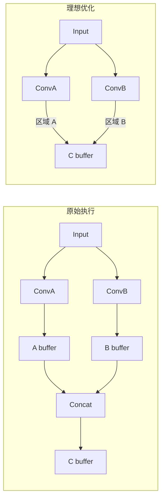

第一步源码明确发生的是 Concat → 多个 AvgPool 写入同一输出的不同区域。第二步能否将写入偏移直接合并到 Conv2D 输出，需要后续图优化、内存分配和调度共同决定。不能仅凭 `rewrite_concat_ops()` 断言一定零拷贝。

### 3.8 Case 6：Concat 带融合激活函数

```python
unfuse_activation_function(op)
```

例如 `Concat(A,B) + ReLU`，必须保持 `C = ReLU(Concat(A,B))` 的语义。不能删除 Concat 时丢弃 ReLU。图优化要保留形状、激活与量化语义。

## 四、Split 的重写

### 4.1 源码入口：rewrite_split_ops()

```python
def rewrite_split_ops(tens, arch, nng):
    if (
        len(tens.ops) == 1
        and tens.ops[0].type.is_split_op()
        and tens.ops[0].type != Op.Unpack
    ):
        split_op = tens.ops[0]
        if not split_op.run_on_npu:
            return tens

        inp, outputs, axis, offset_start, \
            offset_end, strides_tens = \
            split_op.get_split_inputs_axis()

        # Calculate the region for this output ...
        new_op = Operation(Op.SplitSliceRead, split_op.name)
        new_op.inputs = [inp]

        # Calculate read offset and shape ...
        new_op.read_offsets[0] = ...
        new_op.read_shapes[0] = ...
        new_op.run_on_npu = True
        new_op.set_output_tensor(tens)
    return tens
```

`SplitSliceRead` 是编译器内部表示，表示从 IFM 某个逻辑区域读取指定形状的数据，不一定对应真实 NPU 指令。

### 4.2 Case 7：最简单的 Split

```text
X.shape = [1,1,1,6]
X = [10,20,30,40,50,60]
Split(axis=3, num_splits=3)
```

| 输出 | 值 | Read Offset | Read Shape | int8 连续地址 |
|---|---|---|---|---|
| A | 10,20 | [0,0,0,0] | [1,1,1,2] | 0x3000–0x3001 |
| B | 30,40 | [0,0,0,2] | [1,1,1,2] | 0x3002–0x3003 |
| C | 50,60 | [0,0,0,4] | [1,1,1,2] | 0x3004–0x3005 |

适合共享输入存储，使用不同读取偏移。

### 4.3 Case 8：Split 后接 Conv2D

```text
X.shape = [1,8,8,16]
A.shape = [1,8,8,8]
B.shape = [1,8,8,8]
```

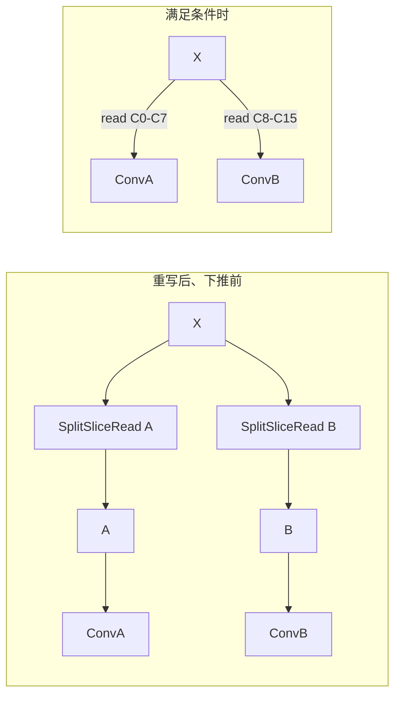

后续 `remove_SplitSliceRead()` 通过 `move_splitsliceread_to_consumer(op, cons_op)` 尝试把读取区域转移给 Consumer，省去两份特征图复制。

### 4.4 Case 9：Split 输出被多个算子使用

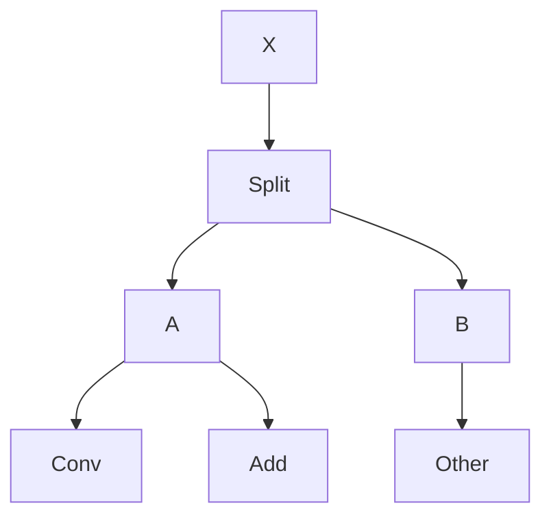

如果所有 Consumer 都能接受区域读取，则可分别传递读取信息；只要某一个不满足条件，整体判断就可能失败，进入实际搬运路径。

## 五、Split 无法消除的条件

### 5.1 `remove_SplitSliceRead()` 的实际判断条件

```python
if (
    op.ofm_shapes[0] == Shape4D.from_list(op.ofm.shape)
    and all(
        s_mul == 1
        for s_mul in op.ifm_stride_multiplier[0]
    )
    and all(
        consumer is not None
        and consumer.run_on_npu
        and consumer.type not in memory_only_ops
        and consumer.type != Op.Memcpy
        and consumer.original_type != Op.Transpose
        and consumer.original_type != Op.SplitSliceRead
        and check_splitsliceread_to_consumer_shape(
            op, consumer
        )
        and not (
            consumer.type.is_binary_elementwise_op()
            and Shape4D.from_list(consumer.ofm.shape)
                != op.ofm_shapes[0]
        )
        for consumer in op.ofm.consumer_list
    )
):
    # Move the read to the consumer
    ...
else:
    # Insert an AvgPool NOP
    ...
```

| 检查条件 | 意义 | 不满足时 |
|---|---|---|
| OFM shape 一致 | 防止形状语义不一致 | 可能需要实际复制 |
| Stride multiplier 为 1 | 不存在额外采样步长 | 需要额外处理 |
| Consumer 存在 | 必须有有效使用者 | 不执行直接下推 |
| Consumer 在 NPU 上运行 | 下游具备 NPU 读取能力 | 不直接下推 |
| 不是 memory-only op | 避免纯内存操作冲突 | 不直接下推 |
| 不是 Memcpy | 避免不兼容复制路径 | 不直接下推 |
| 不是 Transpose | 避免布局重排冲突 | 不直接下推 |
| 不是另一层 SplitSliceRead | 避免嵌套区域读取问题 | 不直接下推 |
| Shape 检查通过 | 下游形状兼容 | 不直接下推 |
| 没有不兼容广播 | 防止读取区域与广播冲突 | 不直接下推 |

这里的 `all(...)` 表示所有消费者都必须满足条件。只要一个消费者不满足，整个判定就可能进入 fallback。

### 5.2 Case 10：Split 后面接 Transpose

```text
Input [1,4,4,8]
      |
     Split
      |
      A [1,4,4,4]
      |
   Transpose
      |
      B
```

```text
A.shape = [1,4,4,4]
Transpose permutation = [0,3,1,2]
B.shape = [1,4,4,4]
```

尽管输入输出 shape 碰巧相同，维度含义已发生变化。不能简单地将 Split 偏移传给 Transpose。

```python
consumer.original_type != Op.Transpose
```

该路径明确排除 Transpose。使用 `original_type` 的意义在于：即使之前被改写为其他内部形式，也仍然能识别原始算子。

### 5.3 Case 11：Split 后面接 Broadcast Add

```text
Input X.shape = [1,4,4,8]
       |
      Split
       |
       A.shape = [1,4,4,4]
       |
      Add <---- Bias [1,1,1,4]
       |
       Y.shape = [1,4,4,4]
```

广播是将小 Tensor 在某些维度上逻辑扩展。上例输出 shape 与 A 一致，不能仅因为有广播就判定无法优化。

```python
consumer.type.is_binary_elementwise_op()
and Shape4D.from_list(consumer.ofm.shape) != op.ofm_shapes[0]
```

实际限制同时要求 Consumer 为二元逐元素算子且输出形状不同于 Split 输出。例如：

```text
Split output A: [1,1,1,4]
Other input B:  [1,4,4,4]
Add output Y:   [1,4,4,4]
```

这个场景中 A 被广播到更大空间，Vela 不会简单下推 SplitSliceRead。真正限制是广播导致输出形状变化，而非所有 Broadcast。

### 5.4 Case 12：StridedSlice 步长大于 1

```python
X = [0,1,2,3,4,5,6,7]
Y = X[0:8:2]
# Y = [0,2,4,6]
```

```text
Input:  0 1 2 3 4 5 6 7
        ↑   ↑   ↑   ↑
Output: 0   2   4   6
```

Vela 使用 `new_op.ifm_stride_multiplier[0]` 表示相关访问。直接消除要求：

```python
all(s_mul == 1 for s_mul in op.ifm_stride_multiplier[0])
```

具有大于 1 的 H/W stride 的情形无法走简单下推路径；如果该 StridedSlice 已通过目标支持检查，则进入 AvgPool fallback，保留 stride multiplier 并强制线性输入格式。并非任意维度或任意步长都受 NPU 支持。

### 5.5 Case 13：连续多层 Split

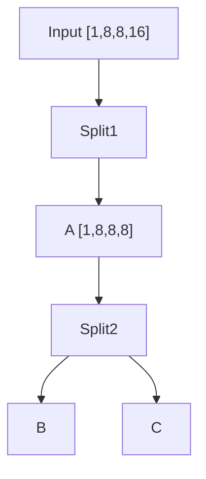

```text
Split1: A = Channel 8..15
Split2: B = A 的 Channel 0..3
B 对应原始 Input Channel 8..11

ReadOffset(B) = ReadOffset(Split1) + ReadOffset(Split2)
```

理论上可合成偏移，但当前路径检查：

```python
consumer.original_type != Op.SplitSliceRead
```

因此不会在该路径无条件合并嵌套 SplitSliceRead。不是说连续 Split 必然报错。

## 六、Fallback：AvgPool NOP

```python
avgpool_op = create_avgpool_nop(
    op.name + "_avgpool"
)
avgpool_op.add_input_tensor(op.ifm)
avgpool_op.outputs = [op.ofm]

avgpool_op.read_offsets[0] = op.read_offsets[0]
avgpool_op.read_shapes[0] = op.read_shapes[0]

if any(
    s_mul != 1
    for s_mul in op.ifm_stride_multiplier[0]
):
    avgpool_op.ifm_stride_multiplier[0] = \
        op.ifm_stride_multiplier[0].copy()
    avgpool_op.ifm.force_linear_format = True
```

普通 AvgPool：

$$Y=\frac{1}{K_HK_W}\sum X$$

当 Kernel=1×1、Stride=1，并配置为值不变的传递操作时，$Y=X$。利用 NPU 现有池化数据路径读取指定区域并产生输出。

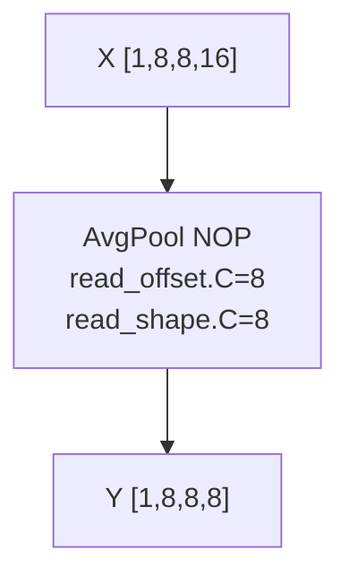

AvgPool 在这里不承担有意义的平均运算，而是读写数据的手段。代价是可能产生额外内存搬运，但比生成硬件不支持的 Split 指令更容易落地。

自研 NPU 需要考虑独立 DMA Copy/Slice 还是复用计算单元，取决于 DMA 多维 stride、Channel 分块、量化及布局能力。

## 七、其他 Case

| Case | 例子 | Vela 处理重点 |
|---|---|---|
| Concat 两输入 | [1,4,4,8] + [1,4,4,8] | 顺序写指定区域 |
| Concat 多输入 | 4 个 Tensor | 累加偏移 |
| Concat H | 不同高度 IFM | 行地址与 stride |
| Concat W | 不同宽度 IFM | 逐行拼接 |
| Concat C | 不同 Channel IFM | Pixel 内组织 |
| Concat 负 axis | axis=-1 | 归一化维度 |
| Pack / Stack | [H,W] → [N,H,W] | 插入维度 |
| Split 等分 | 16 → 8+8 | 输出 offset |
| SplitV 不等分 | 16 → 4+6+6 | 累计输出长度 |
| Slice | 局部 H/W/C | 起止位置与范围 |
| StridedSlice | 间隔采样 | stride multiplier |
| Split + Conv | 拆分后卷积 | 下推 read offset |
| Split 多 Consumer | 输出复用 | 检查全部消费者 |
| Split + Transpose | 重排维度 | fallback |
| Split + Broadcast | 输出形状变化 | shape 检查 |
| CPU/NPU 混合 | Split 后 CPU 算子 | 避免错误消除 |
| 量化参数不匹配 | 不同 scale/zero point | 数值语义 |
| 子图边界 Concat | 不同执行区段 | 生存期与依赖 |

### 7.1 SplitV：不等分拆分

```text
普通 Split: 16 Channels → 8 + 8
SplitV:     16 Channels → 4 + 6 + 6

Output0: offset = 0,  channels = 4
Output1: offset = 4,  channels = 6
Output2: offset = 10, channels = 6
```

`get_split_inputs_axis()` 与后续偏移计算确定各输出区域。不能使用 `index * fixed_split_size`，应累计前面输出的长度。

### 7.2 Pack / Stack

```text
A.shape = [2,3]
B.shape = [2,3]
Concat(axis=0): Output.shape = [4,3]
Stack(axis=0):  Output.shape = [2,2,3]
```

Stack 创建新维度。`rewrite_concat_ops()` 包含类似以下逻辑：

```python
if op.type == Op.Pack:
    ...
    desired_shape = ...
    ...
    op.type = Op.PackReshaped
```

先调整逻辑形状，再复用 Concat 写偏移机制。Shape4D 将不同 rank 映射到内部四维表示。

### 7.3 量化参数不一致

```text
A: int8, scale=0.1, zero_point=0
B: int8, scale=0.2, zero_point=0
```

$$x_{real}=(x_q-z)\times s$$

相同整数 10 对应不同实数：A = 1.0，B = 2.0。直接复制到统一量化参数的输出可能出错。必须考虑重新量化及硬件转换能力。能否直接 Concat 应以模型规范、目标支持检查和量化约束为准，不能只检查 shape。

### 7.4 CPU/NPU 混合执行

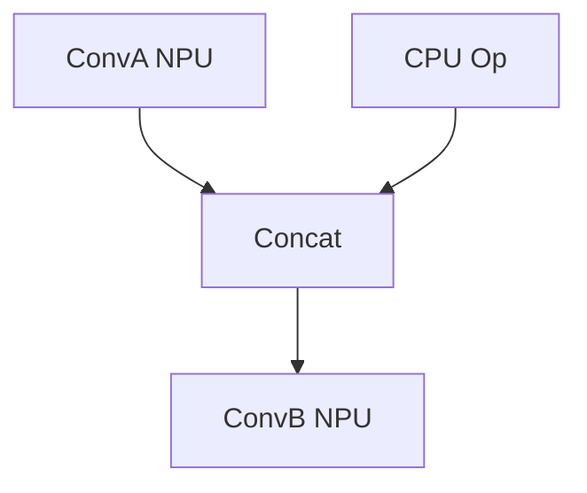

需要保证共享内存可访问、Producer 完成写入后 Consumer 才能读取、不同子图生存期正确以及必要的缓存同步与一致性。

```python
op.run_on_npu
```

原始 Concat 不在 NPU 上执行时，不进入该 NPU 改写路径。目标算子支持表还有更多限制，例如 Ethos-U55/U65 的 Split/SplitV 输出数量与 num_splits 的一致性以及 32-bit feature map 限制，具体以所选版本支持表为准。

## 八、对自研 NPU 图编译器的启示

建议设计三个层次：

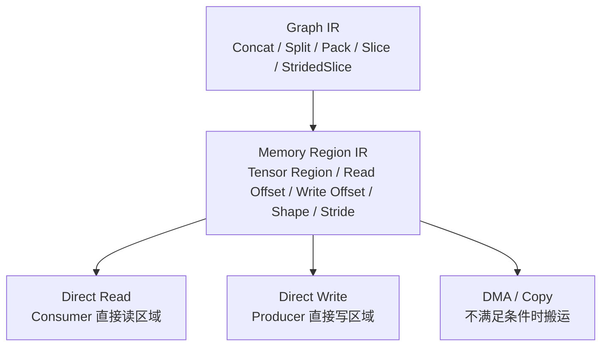

这样编译器不绑定某一种 NPU 指令形式。

```text
Concat → Write Region → 直接写输出 / DMA Copy / NPU Copy
Split  → Read Region  → 直接区域读取 / DMA 切片搬运 / NPU Copy
```

对于 NACC DMA 描述符，可以考虑以下概念字段（设计建议，不是 Vela 原始定义）：

```c
struct TensorRegion {
    uint64_t base_address;
    uint32_t shape[4];
    uint32_t offset[4];
    uint32_t strides[4];
    uint32_t element_size;
};
```

如果硬件直接支持 Region 读写，就有机会消除很多 Concat/Split 的中间搬运。

## 九、测试与验证

除了最终推理结果，还要检查优化后中间图及内存访问。

| 测试场景 | 检查重点 |
|---|---|
| Concat Channel | 每个 Pixel 的 Channel 顺序 |
| Concat Width | 各行交错 |
| Concat Height | 行偏移 |
| Concat 多输入 | offset 累计 |
| Concat 负 axis | 维度归一化 |
| Split 等分 | 各输出 read offset |
| SplitV 不等分 | 累计偏移 |
| Split + Conv | 是否消除独立读取操作 |
| Split + Transpose | fallback 路径 |
| Split + Broadcast | shape 检查 |
| StridedSlice | 采样步长保留 |
| Split 多消费者 | 各 Consumer 数据正确 |
| 量化不同 | 实数语义一致 |
| CPU/NPU 边界 | 数据传递与依赖 |

这些 Case 可以构成自研编译器 regression suite。Concat/Split 不仅是地址计算问题，也涉及图依赖和执行顺序；具体历史修复记录可在仓库 CHANGELOG 中按 Split、Concat 搜索核对。

## 十、总结

| 维度        | Concat              | Split                        |
| --------- | ------------------- | ---------------------------- |
| 数据流方向     | 多输入到一输出             | 一输入到多输出                      |
| 优化目标      | 避免拼接复制              | 避免拆分复制                       |
| 核心属性      | write_offset        | read_offset                  |
| Vela 初步重写 | 多个 AvgPool 写区域      | SplitSliceRead               |
| 后续优化      | 尝试利用 Producer 直接写入  | 尝试将读取下推 Consumer             |
| Fallback  | 保留必要传递              | AvgPool NOP 读取复制             |
| 关键约束      | Shape、Layout、量化、写区域 | Consumer、Shape、Stride、Layout |

从图编译器角度，核心价值是将独立的 Tensor 数据组织操作尽量融入上下游计算的数据访问。对自研 NPU 最值得借鉴的不是 AvgPool 模拟复制，而是 Region 思想：Producer 支持输出区域偏移，Consumer 支持输入区域偏移。可以延伸到 DMA、SRAM 规划、计算单元接口和算子融合策略。

## 参考资料

- [Vela tflite_graph_optimiser.py](https://github.com/nxp-imx/ethos-u-vela/blob/lf-6.18.20_2.0.0/ethosu/vela/tflite_graph_optimiser.py)
- [SUPPORTED_OPS.md](https://github.com/nxp-imx/ethos-u-vela/blob/lf-6.18.20_2.0.0/SUPPORTED_OPS.md)
- [DeepWiki — Vela Compilation Pipeline](https://deepwiki.com/nxp-imx/ethos-u-vela/2-compilation-pipeline)
- [Vela 仓库](https://github.com/nxp-imx/ethos-u-vela)

> 版本说明：本页保留前一轮分析的源码节选与示意案例，未重新执行 Vela 或逐行复核目标分支。示例不代表已经通过实际 NPU 编译测试；目标支持条件与最终 lowering 应以对应版本源码及测试结果为准。
