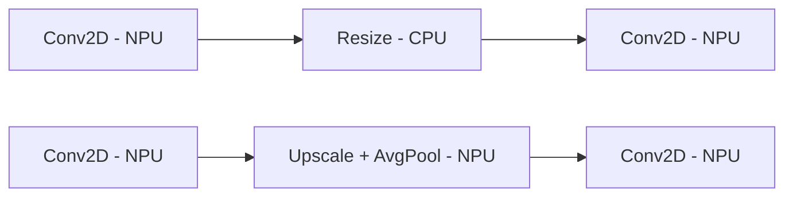
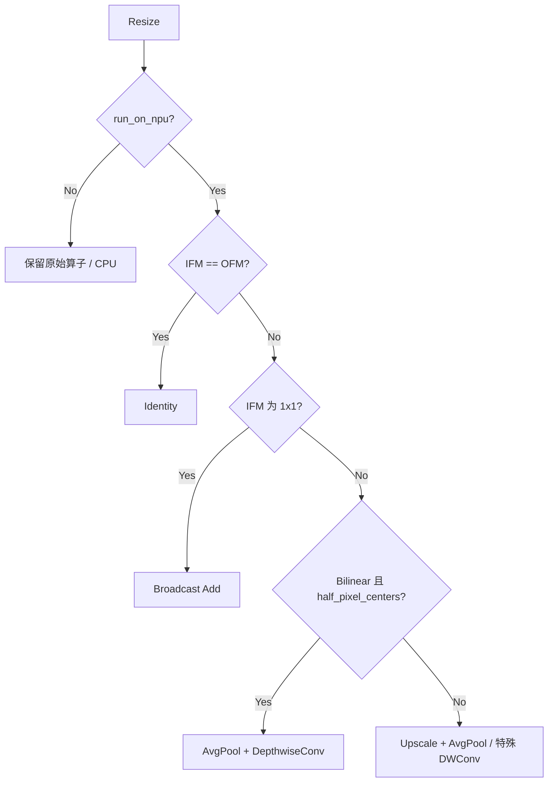
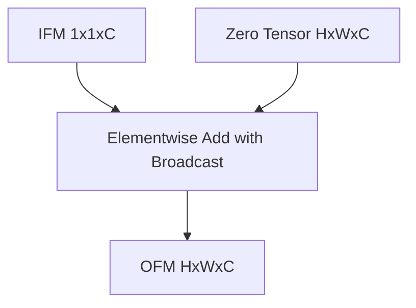
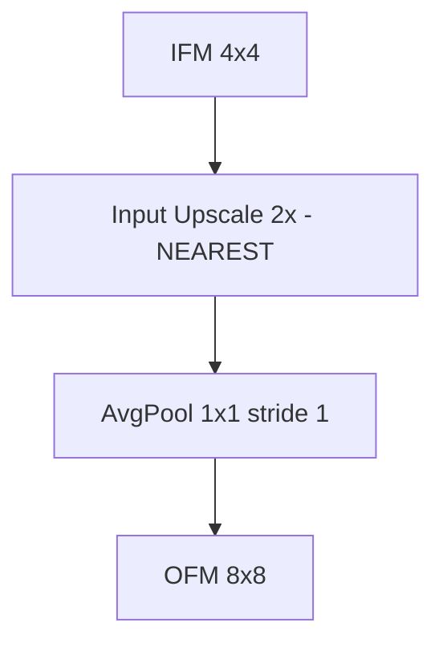
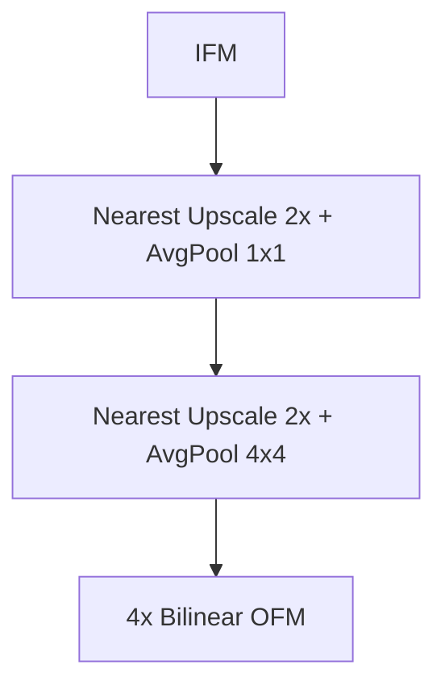
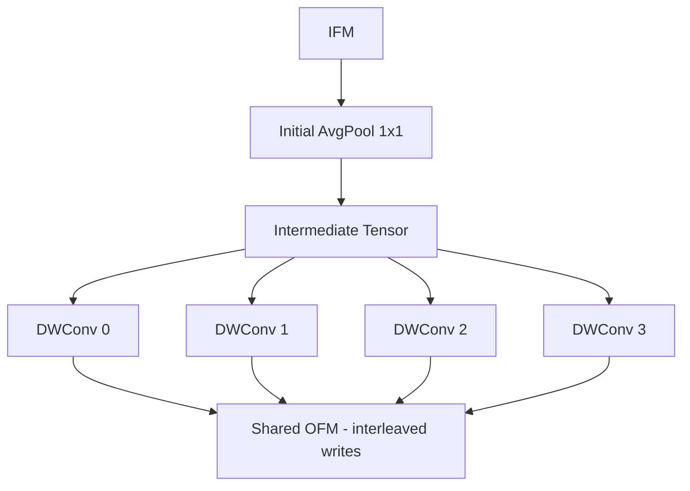
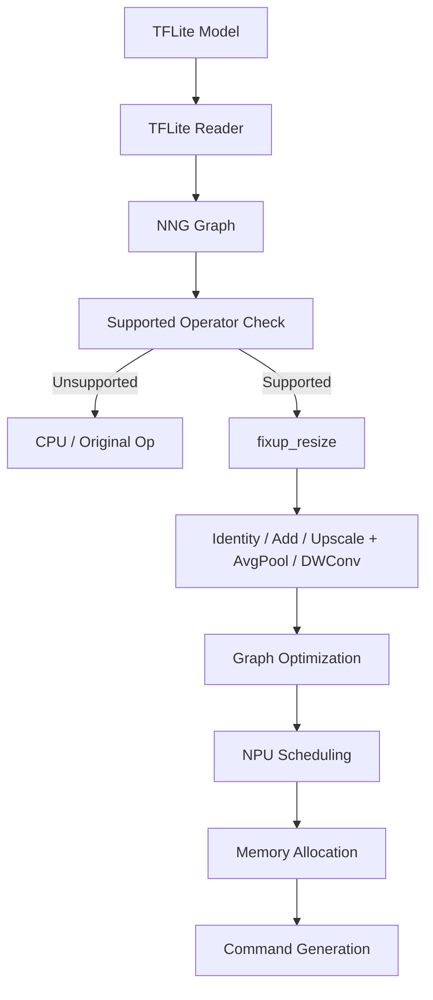
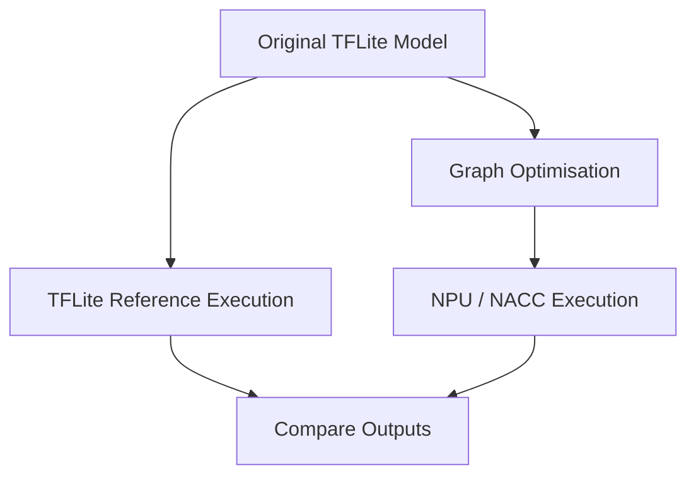

前置阅读：[[01-Passthrough-Tensors]]、[[02-Concat-and-Split]]

## 1. 要解决的问题

Resize Conversion（尺寸缩放转换）将 TFLite 的高级 Resize 算子转换为 NPU 可执行的基础操作。与 Passthrough Removal（删除冗余操作）、Concat/Split Rewrite（重写数据关系与地址）不同，它主要解决硬件算子覆盖率问题，而不一定减少算子数量。

固定功能 NPU 可能只有 Conv、DepthwiseConv、Pooling、Elementwise、DMA 和输入重采样单元，并没有通用 Resize Engine。



CPU fallback 可能引入 CPU/NPU 同步、缓存维护、布局转换和额外内存读写。转换的目标是扩大 NPU 子图，减少跨设备开销；但多阶段转换也可能增加中间 Tensor、计算量及 SRAM 压力。

## 2. Resize 的数学原理

输入 NHWC = `[1,2,2,1]`，输出 `[1,4,4,1]`。N 为 batch，H/W 为空间尺寸，C 为 Channel。Resize 通常只改变 H/W。目标检测（如 YOLO 多尺度特征融合）、语义分割和图像恢复常使用 Resize。

### 2.1 Nearest Neighbor 与 Bilinear

```text
Input          Nearest 2x            Bilinear 2x
10 20          10 10 20 20           10 15 20 20
30 40          10 10 20 20           20 25 30 30
               30 30 40 40           30 35 40 40
               30 30 40 40           30 35 40 40
```

上例采用 `align_corners=false, half_pixel_centers=false`。Nearest 直接复制输入像素；Bilinear 根据四个相邻像素做加权平均。

```text
A -------- B
|          |
|    P     |
|          |
C -------- D
```

$$P=(1-d_x)(1-d_y)A+d_x(1-d_y)B+(1-d_x)d_yC+d_xd_yD$$

当 P 位于中心，A=10、B=20、C=30、D=40 时，P=(10+20+30+40)/4=25。每个 Channel 独立计算，不发生跨 Channel 混合。

## 3. Vela 源码入口和转换决策

分析基线沿用前文的 NXP `ethos-u-vela` 分支 `lf-6.18.20_2.0.0`，讨论 Ethos-U55/U65 TFLite 路径。源码片段沿用前文分析，部分为节选；本次整理未重新拉取仓库或执行测试。

源码：[`ethosu/vela/tflite_graph_optimiser.py`](https://github.com/nxp-imx/ethos-u-vela/blob/lf-6.18.20_2.0.0/ethosu/vela/tflite_graph_optimiser.py)

```python
def fixup_resize(op: Operation, arch, nng) -> Operation:
    """Fixup resize ops to increase support
    for ResizeNearestNeighbor cases."""
    if op.type.is_resize_op() and op.run_on_npu:
        if op.ifm_shapes[0] == op.ofm_shapes[0]:
            op.inputs = op.inputs[:1]
            op.type = Op.Identity
        elif op.ifm_shapes[0].height == 1 and op.ifm_shapes[0].width == 1:
            convert_resize_1x1_to_add(op)
        elif op.type == Op.ResizeBilinear and op.attrs.get("half_pixel_centers", False):
            convert_resizebilinear_to_depthwise_convolutions(op)
        else:
            convert_resize_to_upscale_and_average_pool(op)
    return op
```



`fixup_resize()` 注册于 `tflite_optimise_graph()` 的 `op_rewrite_list`。在进入转换前，由 `supported_operator_check()` 检查架构约束：

```python
op.run_on_npu = arch.tflite_supported_operators.is_operator_supported(op)
```

因此不是所有 Resize 都会进入上述转换路径。

## 4. Case 1：输入输出尺寸相同 → Identity

```text
Input [1,32,32,16]
  | ResizeBilinear(size=[32,32])
Output [1,32,32,16]

转换后：Tensor A → Identity → Tensor B
```

```python
if op.ifm_shapes[0] == op.ofm_shapes[0]:
    op.inputs = op.inputs[:1]
    op.type = Op.Identity
```

删除第二个输入（目标尺寸 Tensor），将算子变为 Identity。随后 passthrough 清理可以继续处理生产者/消费者关系，避免直接删除导致图引用失效。该判断依据是 IFM/OFM Shape 相等，而非显式计算倍率。模型导出时保留通用 Resize、但具体尺寸恰好相同，就可能产生此 Case。参见 [[01-Passthrough-Tensors]]。

## 5. Case 2：输入只有 1×1 → Broadcast Add

输入 `[1,1,1,3]`，唯一像素为 `[10,20,30]`；输出 `[1,4,4,3]`。无论 Nearest 或 Bilinear，所有输出空间位置都取该像素。

```text
Channel 0:               Channel 1:              Channel 2:
10 10 10 10              20 20 20 20             30 30 30 30
10 10 10 10              20 20 20 20             30 30 30 30
10 10 10 10              20 20 20 20             30 30 30 30
10 10 10 10              20 20 20 20             30 30 30 30
```

$$Y[h,w,c]=X[0,0,c]+0$$



### 5.1 源码

```python
def convert_resize_1x1_to_add(op):
    op.type = Op.Add
    op.name = op.name + "_add"
    name = op.inputs[1].name + "_add"
    dtype = op.inputs[0].dtype
    shape = op.ofm_shapes[0].as_list()
    values = np.zeros(shape, dtype.as_numpy_type())
    quantization = QuantizationParameters(0.0, 255.0)
    quantization.scale_f32 = 1.0
    quantization.zero_point = 0
    op.inputs[1] = op.inputs[0]
    op.set_input_tensor(
        create_const_tensor(name, shape, dtype, values,
                            quantization=quantization),
        0,
    )
    op.set_ifm_ofm_shapes()
    DebugDatabase.add_optimised(op, op)
    return op
```

| 操作 | 目的 |
|---|---|
| `op.type = Op.Add` | 使用 Elementwise 硬件 |
| `np.zeros(shape)` | 构造输出尺寸的零常量 |
| `op.inputs[1] = op.inputs[0]` | 用原 IFM 替换 size 输入 |
| `set_input_tensor(..., 0)` | 设置第一个输入为零 Tensor |
| `set_ifm_ofm_shapes()` | 更新内部 shape 元数据 |

不需要专用 Resize Engine，只要 Elementwise 支持 `[1,1,1,C]` 到 `[1,H,W,C]` 广播即可。不过量化 Add 0 的逐 bit 等价性仍取决于输入输出 scale、zero point、requantization 与舍入。零常量是否造成实际内存开销也需要结合后续编译结果判断。

## 6. Case 3：普通 Nearest Neighbor → Upscale + AvgPool

### 6.1 为什么 AvgPool 可以放大？

输入 `[1,4,4,8]`，输出 `[1,8,8,8]`。AvgPool 本身不会放大，真正的放大依赖硬件 IFM Resampling。

```python
op.attrs.update({"strides": (1, 1, 1, 1),
                 "ksize": (1, 1, 1, 1)})
op.attrs["padding"] = Padding.SAME
op.ifm_resampling_mode = resampling_mode.NEAREST
```



1×1 AvgPool 只读取一个重采样后的值，因而保留最近邻结果。Input Upscale 是与 NPU 计算操作关联的输入重采样模式，并不意味着必须生成完整的放大 Tensor 再写回 DRAM。

### 6.2 4× 和 8× 多阶段放大

```text
4×: 4×4 → 8×8 → 16×16
8×: 4×4 → 8×8 → 16×16 → 32×32
```

```python
upscale_factor = op.attrs["upscale_factor"]
n = int(np.log2(upscale_factor))
for count in range(n - 1):
    # Generate intermediate 2x upscale op
    ...
```

最后再生成一个 2× 阶段。

| 总倍率 | 2× 阶段数量 |
|---|---:|
| 2× | 1 |
| 4× | 2 |
| 8× | 3 |

只适用于支持检查允许的倍率，不代表任意比例均可分解。

## 7. Case 4：普通 Bilinear → Upscale + Average Pool

`half_pixel_centers=false` 的常规 Bilinear 同样进入 `convert_resize_to_upscale_and_average_pool()`，但最终 AvgPool 使用较大 Kernel。

```python
if scaled_op.original_type == Op.ResizeBilinear:
    if scaled_op.attrs["align_corners"]:
        scaled_op.attrs["padding"] = Padding.VALID
    else:
        scaled_op.attrs["padding"] = Padding.EXPLICIT
        scaled_op.attrs["explicit_padding"] = [
            0, 0, upscale_factor_h - 1, upscale_factor_w - 1
        ]
    scaled_op.attrs.update({
        "ksize": (1, upscale_factor_h, upscale_factor_w, 1)
    })
```

### 7.1 2× 示例

```text
原始输入           Nearest Upscale          AvgPool 2x2 (stride 1)
10 20              10 10 20 20             10 15 20 20
30 40              10 10 20 20             20 25 30 30
                   30 30 40 40             30 35 40 40
                   30 30 40 40             30 35 40 40
```

内部位置的窗口 `[10,20;30,40]` 产生 25；窗口 `[10,10;30,30]` 产生 20。通过重复像素在窗口中出现的次数形成插值权重。边界需要正确的 padding 与平均池化除数规则，不能简单补零后固定除以 4。

### 7.2 4× / 8×



中间阶段做最近邻展开，最后阶段使用整体倍率对应的 Kernel（4×4 或 8×8）。例如一维放大 4× 后，滑动窗口 `[A,A,A,B]` 的均值是 0.75A+0.25B，而 `[A,A,B,B]` 是 0.5A+0.5B。

该路径的硬件限制之一是带 Padding 的 AvgPool Kernel 最大 8×8，所以最大常规放大倍率为 8×。不是 Bilinear 数学算法本身的限制。

## 8. Case 5：Bilinear + half_pixel_centers → DepthwiseConv

### 8.1 坐标规则为何重要？

设一维输入 `[10,20]`，长度从 2 放大到 4。普通坐标（align_corners=false、half_pixel_centers=false）：

$$x_{in}=x_{out}\frac{W_{in}}{W_{out}}$$

Half Pixel 坐标：

$$x_{in}=(x_{out}+0.5)\frac{W_{in}}{W_{out}}-0.5$$

| 输出位置 | 普通坐标 | 普通 Bilinear | Half Pixel 坐标 | Half Pixel Bilinear |
|---|---:|---:|---:|---:|
| 0 | 0 | 10 | -0.25 | 10（边界截取） |
| 1 | 0.5 | 15 | 0.25 | 12.5 |
| 2 | 1 | 20 | 0.75 | 17.5 |
| 3 | 1.5 | 20（边界截取） | 1.25 | 20（边界截取） |

```text
普通坐标：  10     15     20     20
Half Pixel：10     12.5   17.5   20
```

同一 shape、同一倍率的 Resize 可能产生不同结果，所以不能仅按算子名称和尺寸决定 lowering。以上为浮点数学示意，未计入量化舍入。

### 8.2 源码路径

```python
elif op.type == Op.ResizeBilinear and op.attrs.get("half_pixel_centers", False):
    convert_resizebilinear_to_depthwise_convolutions(op)
```

第一层建立初始 AvgPool 节点：

```python
avgpool_op = op
avgpool_op.name = "rb_init_avgpool"
avgpool_op.type = Op.AvgPool
avgpool_op.attrs["padding"] = Padding.VALID
avgpool_op.attrs["ksize"] = [1, 1, 1, 1]
```

第二层生成四组 DepthwiseConv（节选）：

```python
for i in (0, 1):
    for j in (0, 1):
        index = i * 2 + j
        # ... construct dw_conv ...
        dw_conv.name = f"depthwise_conv_{index}"
        # ...
```



四组卷积计算的是同一输出 Tensor 的不同空间位置，而非四个 Channel 分支。图中分支表示数据依赖，不意味着硬件并行执行四组卷积。

### 8.3 为什么是四组 DepthwiseConv？

2× 放大后，输出坐标的行列奇偶组合共有四种。各类位置可重复使用固定 2×2 插值 Kernel，而无需运行时动态生成浮点系数。

| 卷积 | 输出行列奇偶 | 空间位置 |
|---|---|---|
| DWConv 0 | (0,0) | 左上 |
| DWConv 1 | (0,1) | 右上 |
| DWConv 2 | (1,0) | 左下 |
| DWConv 3 | (1,1) | 右下 |

对于内部位置，若两个方向的插值权重均为 `[0.75,0.25]`，二维权重矩阵为：

$$K=\begin{bmatrix}0.5625&0.1875\\0.1875&0.0625\end{bmatrix}$$

乘以 16 后得到整数 Kernel：

```text
9 3
3 1
```

源码中使用如下整数化思路：

```python
kernel *= 16
quant.scale_f32 = 1.0 / 16
```

数学上四种二维权重组合可表示为下列矩阵（用于解释原理，不代表源码中四组 Kernel 的确切编号、方向及边界处理）：

```text
9 3     3 9     3 1     1 3
3 1     1 3     9 3     3 9
```

例如输入窗口 `[10,20;30,40]`，第一组 Kernel 的结果为 `(9*10+3*20+3*30+1*40)/16=17.5`。四种 Kernel 分别产生不同的空间插值结果。实际实现还需考虑 Tile Padding、边界、权重方向和定点舍入。

### 8.4 四组卷积怎样写入同一个 OFM？

源码片段：

```python
dw_conv.ofm_stride_multiplier = [1, 2, 2]
dw_conv.tile_base_offsets_ofm[0] = (
    (i * ow + j) * c * elem_size
)
```

- `i,j`：当前操作对应的空间位置。
- `ow`：输出宽度。
- `c`：Channel 数。
- `elem_size`：元素字节数。
- `ofm_stride_multiplier`：让每组卷积间隔写入输出位置。
- `tile_base_offsets_ofm`：配置起始地址偏移。

```text
OFM 4×4：
DW0 DW1 DW0 DW1
DW2 DW3 DW2 DW3
DW0 DW1 DW0 DW1
DW2 DW3 DW2 DW3
```

以 NHWC 线性布局、W=4、C=3、INT8 为示意：正常列步长为 3 字节、行步长为 12 字节；交错写入时分别为 6、24 字节，四组起始偏移分别为 0、3、12、15 字节。

这样可以避免先生成四个完整 Tensor 再 Rearrange/Concat。实际硬件地址规则还应结合 Tensor Layout 和命令生成检查。可编程 OFM stride 与 tile base address 是自研 NPU 值得评估的硬件能力。

## 9. Case 6：Nearest Neighbor + align_corners

`align_corners=true` 保证输入输出的首末像素对齐。坐标规则为：

$$x_{in}=x_{out}\frac{W_{in}-1}{W_{out}-1}$$

例如输入宽度 3、输出宽度 5：实际坐标放大倍率为 `(5-1)/(3-1)=2`，而尺寸比为 `5/3`。宽度为 1 时须单独处理，避免除零。

Vela 针对最近邻的 align_corners 路径使用特殊 DepthwiseConv：

```python
if scaled_op.attrs["align_corners"]:
    scaled_op = convert_resizenn_ac_to_depthwise_conv(
        scaled_op, upscale_factor_h, upscale_factor_w
    )
```

```python
op.type = Op.DepthwiseConv2DBias
op.ifm_resampling_mode = resampling_mode.NEAREST
```

```python
weight_shape = [
    upscale_factor_h, upscale_factor_w,
    output_depth, output_depth
]
weight_values = np.zeros(shape=weight_shape)
weight_values[
    upscale_factor_h // 2,
    upscale_factor_w // 2,
    :, :
] = 1
```

以上沿用前文源码节选；内部权重布局不能直接套用普通 Conv2D 的解释。其主要思想是通过仅在特定空间位置为 1 的权重选择输入值，而不是计算一般加权卷积。

以输入 `[10,20,30]`、输出长度 5 为例，映射坐标为 `[0,0.5,1,1.5,2]`。若最近邻采用 half-up 取整，则输出为 `[10,20,20,30,30]`。实际结果需要按 TFLite 的坐标和取整规则验证，不能把普通 floor 复制规则直接套用。

## 10. 支持范围和 CPU fallback

对应前文分析的 Ethos-U55/U65 TFLite 路径，不应直接推广到 Ethos-U85 或自研 NPU。下表仅表示典型 shape 和预期路径，实际支持还受通用约束、数据类型、量化及算子属性影响。

| Case | IFM → OFM（省略 N/C） | 预期 |
|---|---|---|
| 同尺寸 | 16×16 → 16×16 | Identity |
| 1×1 广播 | 1×1 → 32×32 | Add |
| Nearest 2× | 16×16 → 32×32 | Upscale + AvgPool |
| Nearest 4× | 16×16 → 64×64 | 两阶段 Upscale |
| Nearest 8× | 16×16 → 128×128 | 三阶段 Upscale |
| Bilinear 2× | 16×16 → 32×32 | Upscale + AvgPool 2×2 |
| Bilinear 4× | 16×16 → 64×64 | Upscale + AvgPool 4×4 |
| Bilinear 8× | 16×16 → 128×128 | Upscale + AvgPool 8×8 |
| Bilinear Half Pixel 2× | 16×16 → 32×32 | AvgPool + 四组 DWConv |
| Align Corners | 3×3 → 5×5 | 按实际坐标倍率判断 |
| Nearest 3× | 16×16 → 48×48 | 不满足常规倍率约束 |
| 缩小 | 32×32 → 16×16 | 不属于上述上采样路径 |
| 不等比例 | 16×16 → 32×64 | 一般不满足支持规则 |
| 单维度特殊情况 | 1×8 → 1×16 | 需检查单维度例外 |

常规 Bilinear 和 Nearest 的倍率为 2×、4×、8×；Bilinear Half Pixel 路径要求 2×。32-bit Feature Map 不在该组算子支持范围内。对于 align_corners 模式，倍率使用 `(OFM-1)/(IFM-1)` 判断；某维度始终为 1 时存在例外。最终以对应版本 `SUPPORTED_OPS.md` 和实际支持检查为准。

## 11. 在完整编译流程中的位置



`fixup_resize()` 修改 Operation、Tensor、属性与连接关系，不直接执行 Resize，也不直接控制 DMA。

| 层次 | 职责 |
|---|---|
| Graph Rewrite | 决定 Resize 替换为什么操作 |
| NPU Lowering / Scheduling | 决定 Kernel、Tile、中间 Tensor 与执行次序 |
| Memory Allocation | 决定 Tensor 地址及生命周期复用 |
| Command Generation | 将操作编码为具体 NPU 命令 |

## 12. 对自研 NACC 的启示

不能直接照搬 Vela，需要先建立真实的硬件 Capability 表。

| 能力 | 硬件条件 | 编译器实现建议 |
|---|---|---|
| Identity Resize | 无额外硬件 | 消除节点 |
| 1×1 Broadcast | Elementwise 广播 | Add/Copy |
| Nearest 2× | Input Upscale 或其他复制能力 | 直接映射或分解 |
| Nearest 4×/8× | 多阶段执行 | 拆成多个 2× |
| Bilinear 2× | Pooling 或 DWConv | 比较代价后选择 |
| Bilinear Half Pixel | DWConv、定点插值、输出布局 | 特殊 Kernel |
| 非整数倍率 | 通用插值或其他等价实现 | NPU 或 CPU fallback |
| Downsample | Pooling/采样能力 | 独立优化路径 |

需要从 NACC 实际 Spec 确认：

1. Pooling 的 Kernel、Stride、Padding 和除数规则；没有 IFM Upscale 时不能直接沿用 Vela 的 AvgPool 方案。
2. Elementwise 是否支持 `[1,1,1,C]` → `[1,H,W,C]` 的 NHWC 广播。
3. DepthwiseConv 是否支持逐 Channel 权重，权重量化精度能否实现插值。
4. DMA/OFM 是否支持非连续输出 Stride 和可编程起始地址。
5. Rounding、Saturation、Requantization 是否满足 TFLite 数值语义。
6. Bank SRAM、DMA 分块、Tensor Layout 如何影响中间特征图的读写。

### 12.1 多阶段分解的成本

```text
IFM 80×80×64 INT8  =   409,600 Bytes
       | Resize 2×
OFM 160×160×64 INT8 = 1,638,400 Bytes
```

空间放大 2 倍意味着数据量增加至 4 倍。4× 放大时输出数据量为原来的 16 倍，8× 为 64 倍；多阶段处理还可能增加中间 Tensor 的读写。

$$Cost=ComputeCost+MemoryCost+SyncCost$$

对于自研 NPU，硬件支持简单的 2× Nearest Upscale，再由编译器组合复杂操作，是值得评估的方案，但不是唯一方案。专用插值单元、DMA 重复读取或者其他等价 lowering 也可能更合适，需实际 benchmark。

## 13. 测试矩阵

以下是建议测试集，并非声明 Vela 已经包含全部这些测试。

| ID | 类型 | 测试内容 | 验证点 |
|---|---|---|---|
| R01 | Identity | 16×16 → 16×16 | 删除无效 Resize |
| R02 | Broadcast | 1×1 → 8×8 | Add 广播 |
| R03 | Nearest | 8×8 → 16×16 | 2× Upscale |
| R04 | Nearest | 8×8 → 32×32 | 多阶段 Upscale |
| R05 | Nearest | 8×8 → 64×64 | 8× 上限 |
| R06 | Bilinear | 8×8 → 16×16 | 2×2 Pooling |
| R07 | Bilinear | 8×8 → 32×32 | 4×4 Pooling |
| R08 | Bilinear | 8×8 → 64×64 | 8×8 Pooling |
| R09 | Half Pixel | 8×8 → 16×16 | 四组 DWConv |
| R10 | Align Corners | 3×3 → 5×5 | 坐标映射 |
| R11 | Boundary | 边界像素不同 | Padding、除数 |
| R12 | Quantization | INT8 正负极值 | Rounding/Saturation |
| R13 | Channel | C=1、3、16、64 | Channel 处理 |
| R14 | Fallback | 8×8 → 24×24 | 不支持倍率 |
| R15 | Downsample | 16×16 → 8×8 | CPU fallback |
| R16 | One Dimension | 1×8 → 1×16 | 单维度缩放 |



每个 Case 应检查输出 Shape、实际转换后的 Operator 类型、逐元素结果或明确的量化误差界限、中间 Tensor 读写、CPU fallback、执行周期与峰值 SRAM。使用非对称数据和多 Channel 输入，避免所有元素相同导致地址或插值错误被掩盖。

## 14. 总结

| 核心思想 | 实现 |
|---|---|
| 简化特殊情况 | 同尺寸 Identity、1×1 Broadcast Add |
| 复用现有硬件 | Upscale、AvgPool、DepthwiseConv |
| 分解复杂操作 | 4×、8× 分成多个 2× 阶段 |
| 保持数值语义 | 区分 align_corners 与 half_pixel_centers |
| 利用内存布局 | 四组 DepthwiseConv 交错写入 OFM |
| 尊重硬件边界 | 不支持的倍率、精度或模式不强行映射 |

自研图编译器应先理解 Vela 的语义转换，再结合 NACC 真实能力选择 lowering 方案，而非直接复制 Python 实现。本文尚未验证 NACC 实际支持这些硬件能力，也未执行 Vela 或 TFLite 测试。

## 15. 源码索引与参考资料

- [NXP ethos-u-vela repository](https://github.com/nxp-imx/ethos-u-vela)
- [tflite_graph_optimiser.py](https://github.com/nxp-imx/ethos-u-vela/blob/lf-6.18.20_2.0.0/ethosu/vela/tflite_graph_optimiser.py)：`fixup_resize`、`convert_resize_1x1_to_add`、`convert_resize_to_upscale_and_average_pool`、`convert_resizebilinear_to_depthwise_convolutions`、`convert_resizenn_ac_to_depthwise_conv`。
- [SUPPORTED_OPS.md](https://github.com/nxp-imx/ethos-u-vela/blob/lf-6.18.20_2.0.0/SUPPORTED_OPS.md)：架构支持限制；具体分支文件位置以仓库为准。
- [DeepWiki - Compilation Pipeline](https://deepwiki.com/nxp-imx/ethos-u-vela/2-compilation-pipeline)
- [TensorFlow Resize API](https://www.tensorflow.org/api_docs/python/tf/image/resize)
- [[01-Passthrough-Tensors]]
- [[02-Concat-and-Split]]
