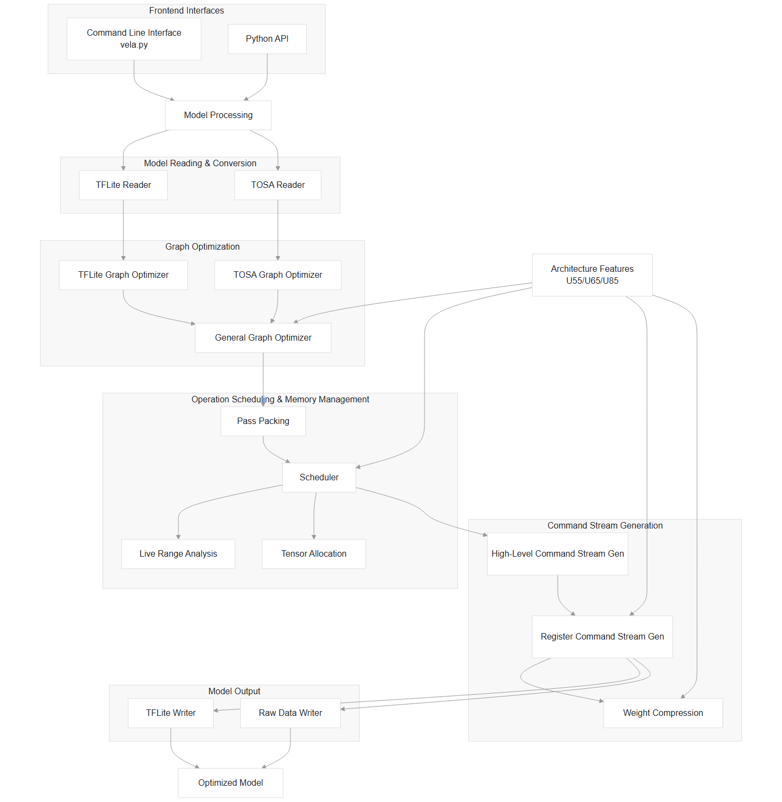
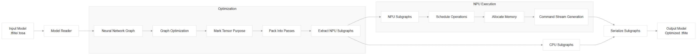
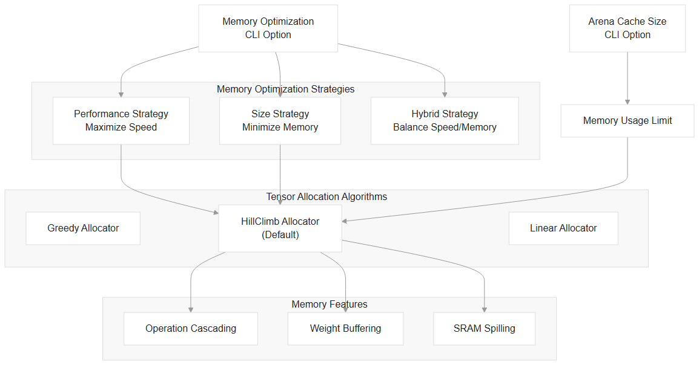

# 概览

**相关源码**

- [README.md](https://github.com/nxp-imx/ethos-u-vela/blob/395a5690/README.md?plain=1)
- [RELEASES.md](https://github.com/nxp-imx/ethos-u-vela/blob/395a5690/RELEASES.md?plain=1)
- [ethosu/vela/test/test_build.py](https://github.com/nxp-imx/ethos-u-vela/blob/395a5690/ethosu/vela/test/test_build.py)
- [pyproject.toml](https://github.com/nxp-imx/ethos-u-vela/blob/395a5690/pyproject.toml)
- [setup.py](https://github.com/nxp-imx/ethos-u-vela/blob/395a5690/setup.py)

Ethos-U Vela编译器是一个工具,旨在优化用于Arm Ethos-U神经处理单元(NPU)执行的神经网络模型。此文档引入了Vela的目的架构和核心功能。关于编译流程的详细资料,参见: [编译流程](2-compilation-pipeline.md).

源码 [README.md18-41](https://github.com/nxp-imx/ethos-u-vela/blob/395a5690/README.md?plain=1#L18-L41) [setup.py56](https://github.com/nxp-imx/ethos-u-vela/blob/395a5690/setup.py#L56-L56)

## 用途与范围

Vela 取 TensorFlow Lite(TFLite) 或 TOSA 神经网络模型, 分析它们, 并生成优化的版本, 利用 Ethos-U NPU 的硬件加速能力。 编译器 :

1. 确定Ethos-U NPU可以加速的操作
2. 将支持的操作转换为优化的版本
3. 将不支持的操作保留到 Cortex- M CPU 上运行
4. 制作自定义 算子 的优化型号用于 NPU 执行
5. 对编译后的模型进行性能估算

Vela支持量化的到8位(无符号或有符号)或16位(有符号)格式,这是Ethos-U NPU加速所需的.

源码 [README.md20-39](https://github.com/nxp-imx/ethos-u-vela/blob/395a5690/README.md?plain=1#L20-L39) [README.md390-392](https://github.com/nxp-imx/ethos-u-vela/blob/395a5690/README.md?plain=1#L390-L392)

## 支持的硬件与软件

Vela支持多个Ethos-U NPU变体:

- Ethos-U55 NPU 化学式
- Ethos-U65 NPU 化学式
- Ethos-U85 NPU(在4.0.0版本中添加)

编译器与 :

- TensorFlow 2.17(截至Vela 4.0.0 到当前)
- Python 3.10 或较新(最低3.9)
- Linux 和 Microsoft Windows 10 操作系统

源码 [README.md55-68](https://github.com/nxp-imx/ethos-u-vela/blob/395a5690/README.md?plain=1#L55-L68) [README.md78-83](https://github.com/nxp-imx/ethos-u-vela/blob/395a5690/README.md?plain=1#L78-L83) [README.md87-88](https://github.com/nxp-imx/ethos-u-vela/blob/395a5690/README.md?plain=1#L87-L88) [README.md376-382](https://github.com/nxp-imx/ethos-u-vela/blob/395a5690/README.md?plain=1#L376-L382) [pyproject.toml20](https://github.com/nxp-imx/ethos-u-vela/blob/395a5690/pyproject.toml#L20-L20)

## 总体架构

Ethos-U Vela编译器由几个主要组件组成,它们共同致力于转变神经网络模型:



源码 [README.md20-45](https://github.com/nxp-imx/ethos-u-vela/blob/395a5690/README.md?plain=1#L20-L45) [RELEASES.md63-79](https://github.com/nxp-imx/ethos-u-vela/blob/395a5690/RELEASES.md?plain=1#L63-L79)

### 主要组件

1. **前端接口**:用于与Vela互动的命令线和Python API接口.
2. **模型读取和转换**:用于解析tensorFlow Lite和TOSA模型格式的模块.
3. **图优化**: 分析并转换神经网络图,以优化Ethos-U执行.
4. **算子调度 和内存管理**: 调度操作和管理内存以优化性能和内存使用.
5. **命令流生成**:为Ethos-U NPU生成硬件特异性命令流.
6. **模型输出**:将优化的模型写回TensorFlow Lite格式,带有自定义 算子.

源码 [README.md29-35](https://github.com/nxp-imx/ethos-u-vela/blob/395a5690/README.md?plain=1#L29-L35)

## 编译流程

编译过程将输入神经网络模型转化为Ethos-U NPU的优化版本:



源码 [README.md192-206](https://github.com/nxp-imx/ethos-u-vela/blob/395a5690/README.md?plain=1#L192-L206)

### 流程阶段

1. **模型读取**: 解析输入 `.tflite` 或 减 减 `.tosa` 将文件输入内部代理。
2. **图优化**: 应用各种优化神经网络图,包括:

   - 清除直通张量
   - 重写操作以更好地执行 NPU
   - 将不支持的行动转换为支持形式
3. **子图 采掘业**:将操作分离为NPU加速子图和CPU执行子图.
4. **算子调度**:确定NPU上操作的最佳执行命令.
5. **内存分配**: 使用希尔攀登等策略分配 张量 的内存,以优化SRAM的使用.
6. **命令流生成**: 创建执行Ethos-U NPU网络所需的硬件命令.
7. **型号 序列化**:将优化的模型写回一个带有自定义的TensorFlow Lite文件算子.

源码 [README.md192-239](https://github.com/nxp-imx/ethos-u-vela/blob/395a5690/README.md?plain=1#L192-L239)

## 内存管理策略

Vela使用几种内存管理策略优化Ethos-U NPU上神经网络的执行:



源码 [README.md216-240](https://github.com/nxp-imx/ethos-u-vela/blob/395a5690/README.md?plain=1#L216-L240) [RELEASES.md382-406](https://github.com/nxp-imx/ethos-u-vela/blob/395a5690/RELEASES.md?plain=1#L382-L406)

### 优化策略

Vela通过下列方式提供不同的优化战略: `--optimise` CLI 选项 :

1. **性能**:将更快的推论时间优先于较低的SRAM使用.
2. **大小**:在运行时间上优先使用较低的SRAM性能.
3. **混合**: 对 性能 进行优化,在 SRAM 使用(使用) 上方绑定 `--arena-cache-size`).

HillClimb 张量 分配器 (自2.1.0版本以来的默认)在维护性能的同时,采用了先进的技术来优化内存使用.

源码 [README.md223-240](https://github.com/nxp-imx/ethos-u-vela/blob/395a5690/README.md?plain=1#L223-L240) [RELEASES.md414-420](https://github.com/nxp-imx/ethos-u-vela/blob/395a5690/RELEASES.md?plain=1#L414-L420)

## 支持的算子

Vela支持在Ethos-U NPU上广泛执行TensorFlow Lite算子,包括: .

- 卷积 操作(CONV_2D,DEPTHWISE_CONV_2D,TRANSPOSE_CONV).
- 池化操作(AverAGE_POOL_2D,MA ⁇ POOL_2D).
- 逐元素业务(ADD,MUL,SUB等).
- 激活功能(RELU,RELU6,TANH,SIGMOID等).
- 张量 操纵(RESIZE_BILINEAR,RESIZE_NEAREST_NEIGHBOR,PAD等).
- 其他操作(SOFTMAX, FULLY_CONNEECED等)

关于所支持的综合清单算子,参见: [支持的算子](3.3-supported-operators.md).

源码 [README.md390-391](https://github.com/nxp-imx/ethos-u-vela/blob/395a5690/README.md?plain=1#L390-L391) [RELEASES.md111-113](https://github.com/nxp-imx/ethos-u-vela/blob/395a5690/RELEASES.md?plain=1#L111-L113) [RELEASES.md130-134](https://github.com/nxp-imx/ethos-u-vela/blob/395a5690/RELEASES.md?plain=1#L130-L134) [RELEASES.md149-151](https://github.com/nxp-imx/ethos-u-vela/blob/395a5690/RELEASES.md?plain=1#L149-L151) [RELEASES.md171-172](https://github.com/nxp-imx/ethos-u-vela/blob/395a5690/RELEASES.md?plain=1#L171-L172) [RELEASES.md227-228](https://github.com/nxp-imx/ethos-u-vela/blob/395a5690/RELEASES.md?plain=1#L227-L228) [RELEASES.md413-414](https://github.com/nxp-imx/ethos-u-vela/blob/395a5690/RELEASES.md?plain=1#L413-L414) [RELEASES.md445-446](https://github.com/nxp-imx/ethos-u-vela/blob/395a5690/RELEASES.md?plain=1#L445-L446)

## 使用示例

Vela的基本用途包括通过一个输入模型文件来编译:

```
vela my_model.tflite
```

生成一个命名为“ 优化” 的模型 `my_model_vela.tflite` 在输出目录中,与 性能 一起估计 CSV 文件。

常见的配置选项包括:

- 指定目标 NPU : `--accelerator-config ethos-u65-512`
- 优化 性能 或大小 : `--optimise Performance` 或 减 减 `--optimise Size`
- 设置内存限制 : `--arena-cache-size 300000` (300KB限制)
- 自定义系统配置 : `--config vela.ini --system-config My_Config`

源码 [README.md198-261](https://github.com/nxp-imx/ethos-u-vela/blob/395a5690/README.md?plain=1#L198-L261)

## 版本历史与功能演进

Vela自首次发布以来发生了显著变化:

| 版本 | 发布日期 | 密钥特性添加 |
| --- | --- | --- |
| 4.1.0 | 26/11/2024 | TOSA v 0. 80.0 支持 Ethos-U85, 改进的 TOSA 算子 引信 |
| 4.0.0 | 04/09/2024 | 初期Ethos-U85支持,TensorFlow 2.17支持 |
| 3.12.0 | 20/05/2024 | 带有 步长 > 1 的 STRIDED_SLICE, tensorFlow 2. 16 支持 |
| 3.11.0 | 19/02/2024 | MIRROR_PAD 支持, TensorFlow 2. 15 支持 |
| 3.10.0 | 16/11/2023 | SQUARED_difference 和 转置 支持, TensorFlow 2.14 支持 |
| 3.9.0 | 15/08/2023 | RSQRT支助,TensorFlow 2.12支助 |
| 3.8.0 | 17/05/2023 | ARG_MAX,INSTIECTIONAL_SEQUENCE_LSTM,EXP支持,TensorFlow 2.11支持 |
| 2.1.0 | 25/02/2021 | PAD, 意指, HARD_ SWISH 支持, HillClimb 分配器, Windows 支持 |
| 2.0.0 | 30/11/2020 | 高级 溢出,网络调试数据库, TensorFlow 2.3 支持 |
| 1.0.0 | 18/06/2020 | Int16 支持, RESIZE_ BILINEAR 和 TRANSPOSE_CONV 支持 |

源码 [RELEASES.md25-543](https://github.com/nxp-imx/ethos-u-vela/blob/395a5690/RELEASES.md?plain=1#L25-L543) [setup.py56](https://github.com/nxp-imx/ethos-u-vela/blob/395a5690/setup.py#L56-L56)

[返回中文目录](0-Index.md)
