# 编译流程

**相关源码**

- [OPTIONS.md](https://github.com/nxp-imx/ethos-u-vela/blob/395a5690/OPTIONS.md?plain=1)
- [ethosu/regor/compiler/compiler.cpp](https://github.com/nxp-imx/ethos-u-vela/blob/395a5690/ethosu/regor/compiler/compiler.cpp)
- [ethosu/regor/compiler/graph.hpp](https://github.com/nxp-imx/ethos-u-vela/blob/395a5690/ethosu/regor/compiler/graph.hpp)
- [ethosu/regor/compiler/graph_packing.cpp](https://github.com/nxp-imx/ethos-u-vela/blob/395a5690/ethosu/regor/compiler/graph_packing.cpp)
- [ethosu/regor/tflite/tflite_reader.cpp](https://github.com/nxp-imx/ethos-u-vela/blob/395a5690/ethosu/regor/tflite/tflite_reader.cpp)
- [ethosu/regor/tflite/tflite_writer.cpp](https://github.com/nxp-imx/ethos-u-vela/blob/395a5690/ethosu/regor/tflite/tflite_writer.cpp)
- [ethosu/vela/compiler_driver.py](https://github.com/nxp-imx/ethos-u-vela/blob/395a5690/ethosu/vela/compiler_driver.py)
- [ethosu/vela/vela.py](https://github.com/nxp-imx/ethos-u-vela/blob/395a5690/ethosu/vela/vela.py)

编译流程是Ethos-U Vela编译器的核心过程,将输入神经网络模型(TensorFlow Lite或TOSA)转化为优化模型,可以在Arm Ethos-U神经处理单元(NPU)上高效执行. 本文概述了端对端编译流程,详细介绍了从输入模型解析到优化输出生成的步骤.

关于应用在神经网络图上的具体优化技术的详细情况,参见: [图优化](3-graph-optimization.md)。关于命令流生成的信息,参见: [命令流生成](5-command-stream-generation.md).

## 编译流程总览

Vela编译器由一系列定义明确的处理阶段组成,这些阶段系统地转化和优化神经网络模型.

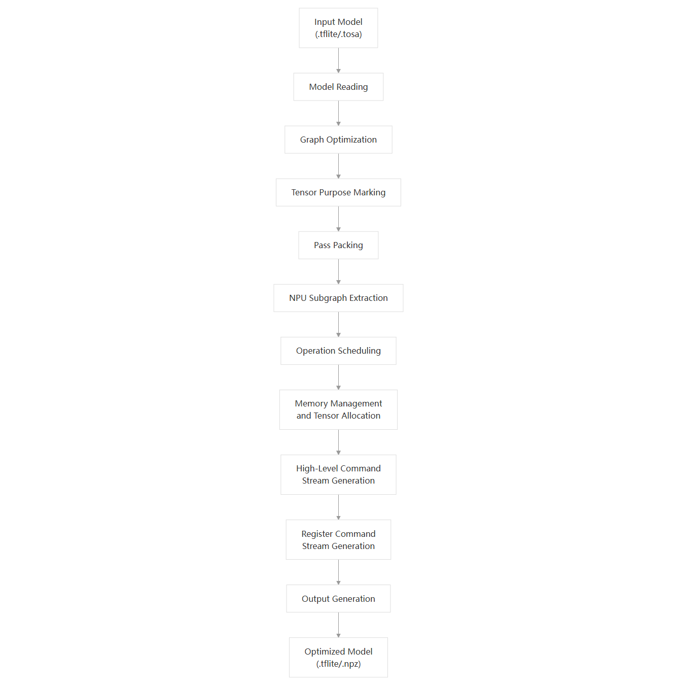

源码 [ethosu/vela/vela.py63-113](https://github.com/nxp-imx/ethos-u-vela/blob/395a5690/ethosu/vela/vela.py#L63-L113) [ethosu/vela/compiler_driver.py160-283](https://github.com/nxp-imx/ethos-u-vela/blob/395a5690/ethosu/vela/compiler_driver.py#L160-L283)

## 编译路径

Vela 支持两种编译路径。

1. **传统路径** - Ethos-U55 和 Ethos-U65 的默认路径
2. **Regor路径** - Ethos-U85 的默认路径。对 U55/U65，可通过以下参数启用 `--debug-force-regor`

两条路径的整体流程相似，部分组件的实现方式各有不同。原页主要介绍使用时间较长的传统路径。

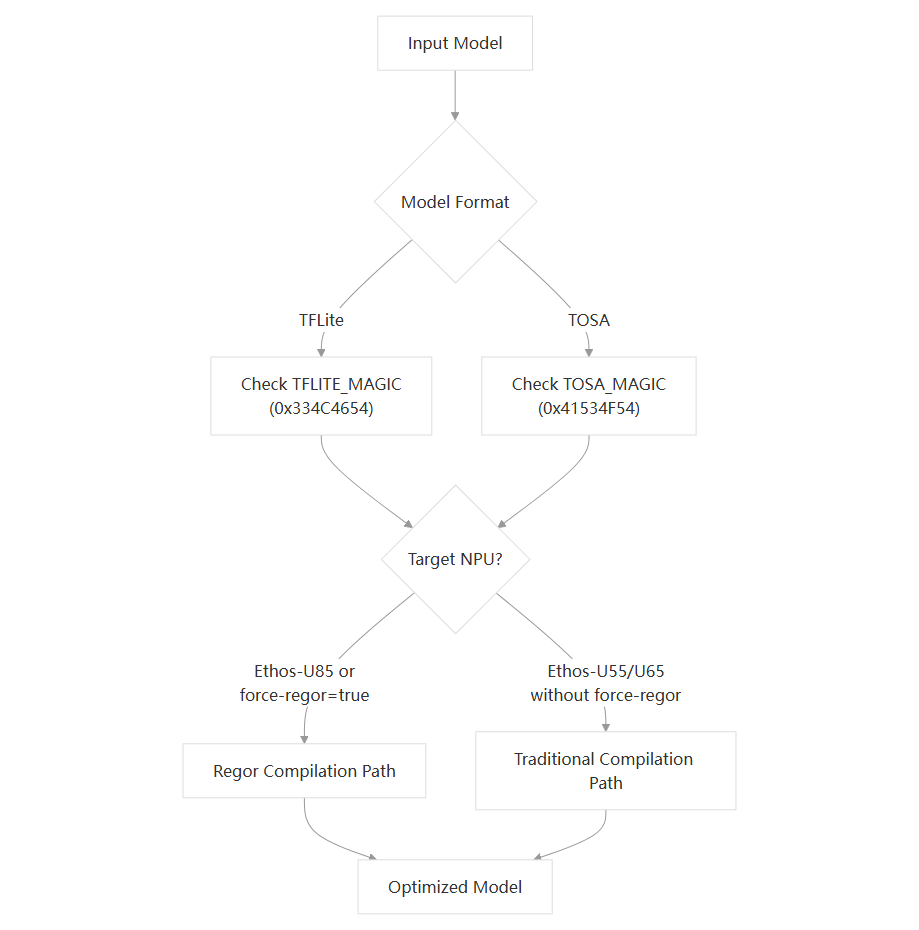

源码 [ethosu/vela/vela.py856-895](https://github.com/nxp-imx/ethos-u-vela/blob/395a5690/ethosu/vela/vela.py#L856-L895) [ethosu/vela/vela.py119-175](https://github.com/nxp-imx/ethos-u-vela/blob/395a5690/ethosu/vela/vela.py#L119-L175)

## 1. 模型读取

首先解析输入模型，将其转换为 Vela 的内部神经网络图（NNG）。

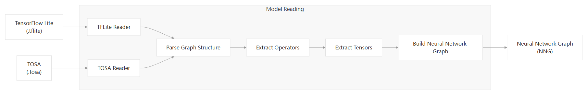

主要组件:

- **TFLite 读取器**: 解析 TensorFlow Lite模型,摘录 算子, 张量,并构建内部图
- **TOSA 读取器**: TOSA格式模型的实验支持
- **网络类型检测**:基于魔数的识别模型格式(TFLITE_MAGIC:0x334C4654,TOSA_MAGIC:0x41534F54)

读取后的模型是后续各项优化的基础。

源码 [ethosu/vela/vela.py71](https://github.com/nxp-imx/ethos-u-vela/blob/395a5690/ethosu/vela/vela.py#L71-L71) [ethosu/regor/tflite/tflite_reader.cpp120-366](https://github.com/nxp-imx/ethos-u-vela/blob/395a5690/ethosu/regor/tflite/tflite_reader.cpp#L120-L366)

## 2. 图优化

神经网络图建成后,图优化阶段应用各种变换来提高执行效率.

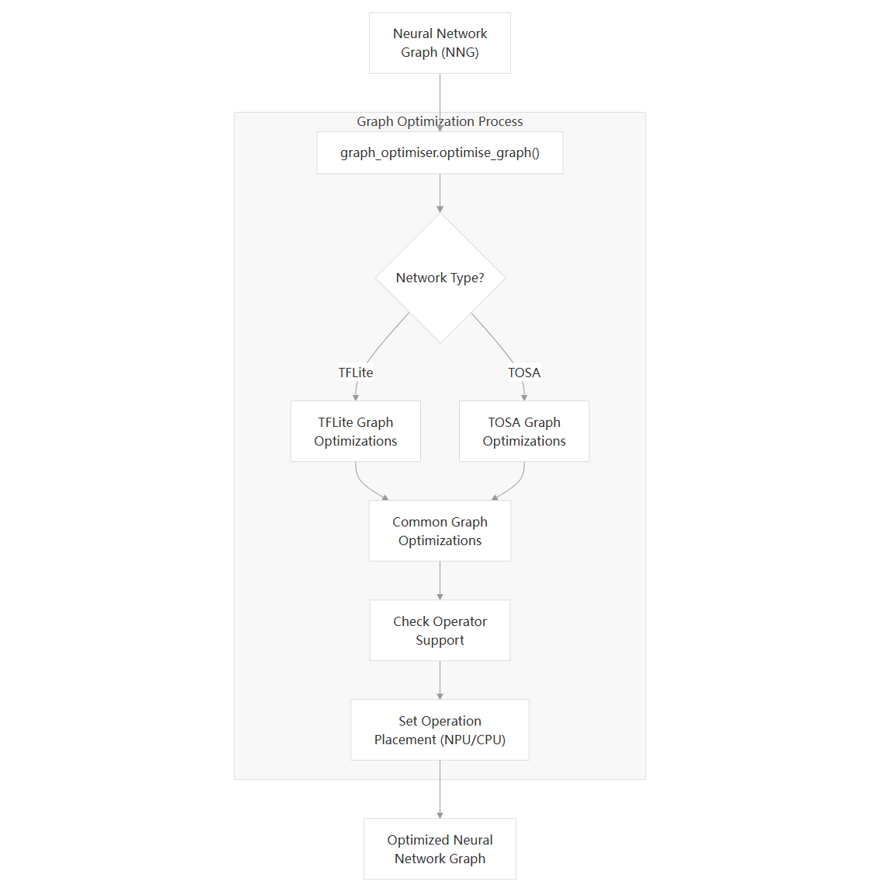

主要优化包括:

- 清除直通张量
- 重写拼接和拆分算子
- 转换 Resize 算子
- 重新排列权重，提高内存访问效率
- 修正偏置张量的维度和量化参数

这一阶段还判断每个算子能否运行在 NPU 上，或者需要回退到 CPU。

源码 [ethosu/vela/compiler_driver.py169-172](https://github.com/nxp-imx/ethos-u-vela/blob/395a5690/ethosu/vela/compiler_driver.py#L169-L172)

## 3. 张量用途标记与 pass 打包

接下来标记张量的用途，并将算子打包成 pass。

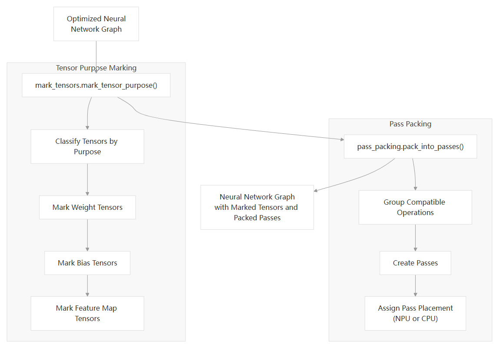

用途包括:

- 权重
- 偏置
- 特征图 (激活数据)
- 中间数据

一个 pass 代表可作为单次硬件运算执行的一组算子，通常包括主算子及其激活函数。

源码 [ethosu/vela/compiler_driver.py177-182](https://github.com/nxp-imx/ethos-u-vela/blob/395a5690/ethosu/vela/compiler_driver.py#L177-L182) [ethosu/vela/compiler_driver.py181-183](https://github.com/nxp-imx/ethos-u-vela/blob/395a5690/ethosu/vela/compiler_driver.py#L181-L183)

## 4. NPU 子图提取

在通过创建和指定位置后,编译器将图分解为NPU和CPU子图:

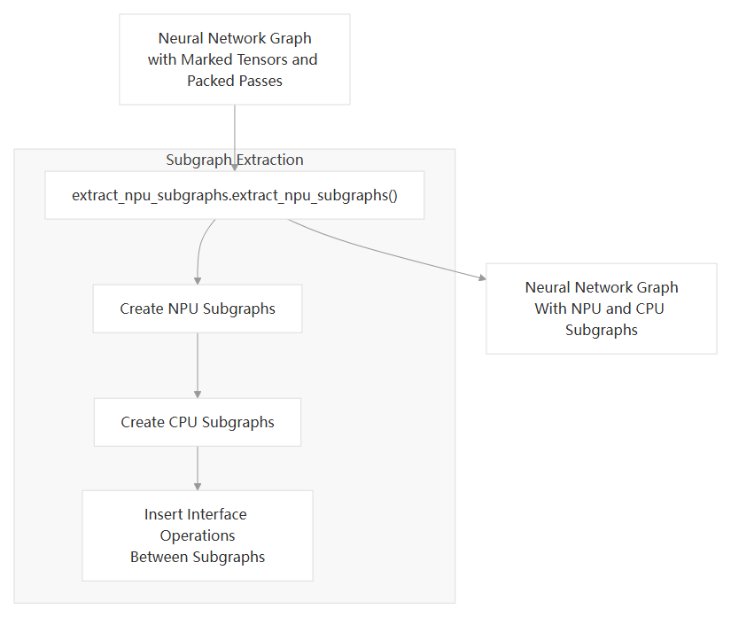

这种分离允许在保持与CPU操作兼容性的同时,对NPU操作进行专门处理.

源码 [ethosu/vela/compiler_driver.py185-186](https://github.com/nxp-imx/ethos-u-vela/blob/395a5690/ethosu/vela/compiler_driver.py#L185-L186)

## 5. 调度与内存管理

调度阶段决定操作的执行命令和内存分配 :

```

```

关键概念:

- **级联**: 运行于 条带 的操作组,以减少内存使用
- **条带划分**: 将 特征图 分成水平小节以减少缓冲大小
- **张量 分配器**:
  - HillClimb: 优化用于 性能, 迭代改进分配
  - 贪婪:简单的分配战略
  - 线性:顺序地址分配

调度员考虑两项主要优化策略:

- **性能**: 最大化执行速度( 使用竞技场缓存)
- **大小**: 尽量减少SRAM 使用

源码 [ethosu/vela/compiler_driver.py192-195](https://github.com/nxp-imx/ethos-u-vela/blob/395a5690/ethosu/vela/compiler_driver.py#L192-L195) [ethosu/vela/compiler_driver.py214-238](https://github.com/nxp-imx/ethos-u-vela/blob/395a5690/ethosu/vela/compiler_driver.py#L214-L238) [ethosu/vela/OPTIONS.md225-237](https://github.com/nxp-imx/ethos-u-vela/blob/395a5690/ethosu/vela/OPTIONS.md?plain=1#L225-L237)

## 6. 命令流生成

排程后,编译器为 Ethos-U NPU 生成命令 :

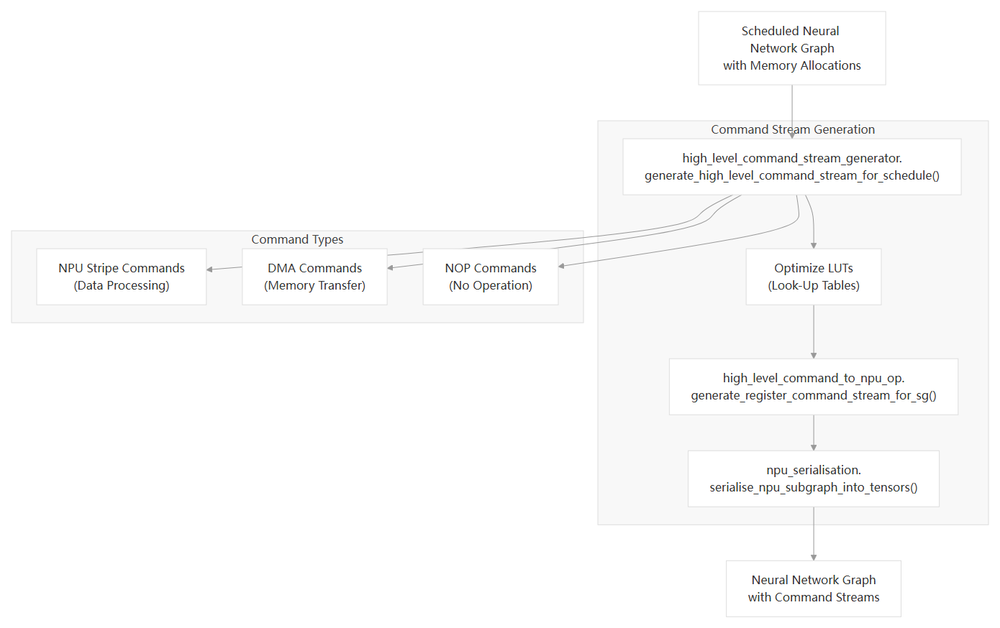

命令流生成进程创建了两个级别的命令:

1. **高级指挥**: NpuStripe(处理)和DMA(记忆传输)等抽象操作
2. **注册级命令**: Ethos-U NPU 的低级硬件专用指令

每个NPU子图被序列化为包含命令流和相关数据的张量.

源码 [ethosu/vela/compiler_driver.py242-254](https://github.com/nxp-imx/ethos-u-vela/blob/395a5690/ethosu/vela/compiler_driver.py#L242-L254) [ethosu/vela/OPTIONS.md471-497](https://github.com/nxp-imx/ethos-u-vela/blob/395a5690/ethosu/vela/OPTIONS.md?plain=1#L471-L497)

## 7. 生成输出

最终阶段生成优化输出模式:

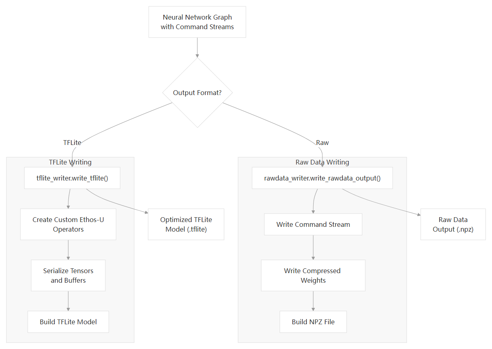

Vela 支持两种输出格式:

- **TensorFlow Lite (.tflite) (英语).**: 为 NPU 优化的操作被编码为自定义 Ethos- U 算子
- **原始数据 (.npz)**: 包含用于直接执行的原命令流和权重

对于TFLite输出,模型结构保留了CPU操作未动,而NPU操作则替换为自定义算子.

源码 [ethosu/vela/vela.py97-101](https://github.com/nxp-imx/ethos-u-vela/blob/395a5690/ethosu/vela/vela.py#L97-L101) [ethosu/regor/tflite/tflite_writer.cpp49-234](https://github.com/nxp-imx/ethos-u-vela/blob/395a5690/ethosu/regor/tflite/tflite_writer.cpp#L49-L234)

## Regor 编译路径

为 Ethos- U85 默认的 Regor 汇编路径遵循类似的流程,但执行组件不同:

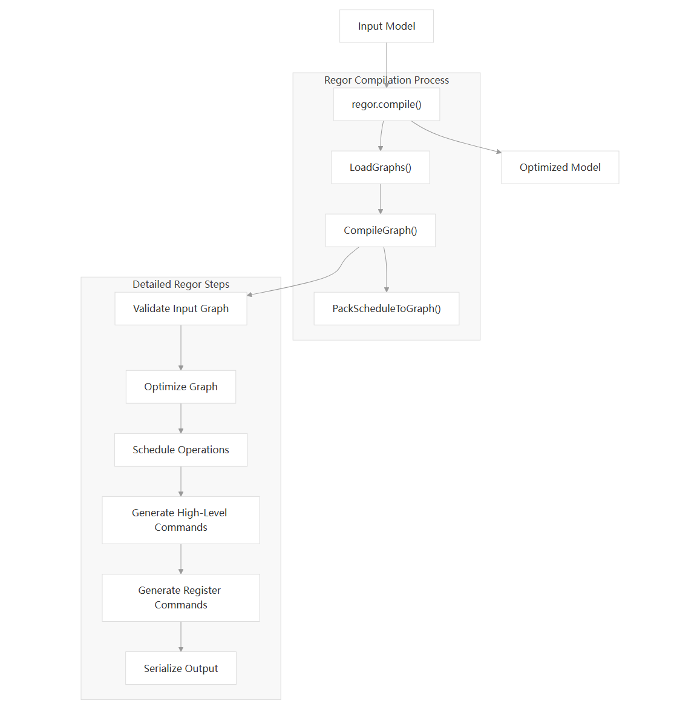

Regor路径的关键差异 :

- 不同的架构优化策略
- 增强指令流生成
- 支持其他功能,如连锁和权重缓冲

输出仍然与传统路径兼容,但内部处理对于较新的架构更为优化.

源码 [ethosu/vela/vela.py119-173](https://github.com/nxp-imx/ethos-u-vela/blob/395a5690/ethosu/vela/vela.py#L119-L173) [ethosu/regor/compiler/compiler.cpp48-501](https://github.com/nxp-imx/ethos-u-vela/blob/395a5690/ethosu/regor/compiler/compiler.cpp#L48-L501) [ethosu/regor/compiler/graph_packing.cpp36-276](https://github.com/nxp-imx/ethos-u-vela/blob/395a5690/ethosu/regor/compiler/graph_packing.cpp#L36-L276)

## 配置选项

编译流程可以配置各种选项:

| 选项类别 | 说明 | 示例选项 |
| --- | --- | --- |
| 架构 | 目标 NSU 配置 | `ethos-u55-256`, `ethos-u65-512`, `ethos-u85-256` |
| 系统配置 | 内存系统配置 | 内存带宽,晚期等. |
| 内存模式 | 内存分配战略 | 共享的SRAM, 专用的SRAM |
| 优化 | 优化战略 | 大小, 性能 |
| 张量分配 | 内存分配算法 | 贪婪, 山丘, LinearAlloc |

这些备选方案可以对具体部署设想的汇编过程进行微调。

源码 [ethosu/vela/OPTIONS.md25-297](https://github.com/nxp-imx/ethos-u-vela/blob/395a5690/ethosu/vela/OPTIONS.md?plain=1#L25-L297) [ethosu/vela/compiler_driver.py46-101](https://github.com/nxp-imx/ethos-u-vela/blob/395a5690/ethosu/vela/compiler_driver.py#L46-L101)

## 性能分析

编译器为优化模型提供性能 度量衡:

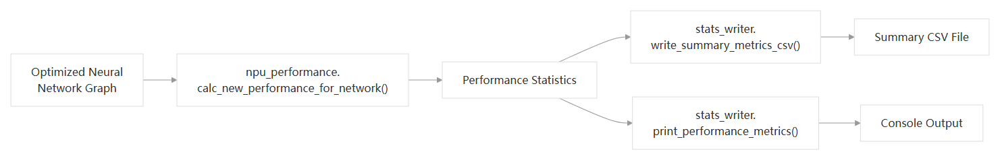

性能 衡量标准包括:

- 每层和整个网络的周期估计
- 内存使用情况分析
- 权重压缩统计
- CPU vs. NPU 操作分布

这些度量衡帮助开发者理解其优化模型的性能特征.

源码 [ethosu/vela/vela.py86-95](https://github.com/nxp-imx/ethos-u-vela/blob/395a5690/ethosu/vela/vela.py#L86-L95) [ethosu/vela/compiler_driver.py280-283](https://github.com/nxp-imx/ethos-u-vela/blob/395a5690/ethosu/vela/compiler_driver.py#L280-L283)

## 除错信息

为调试目的,Vela可以生成调试信息:

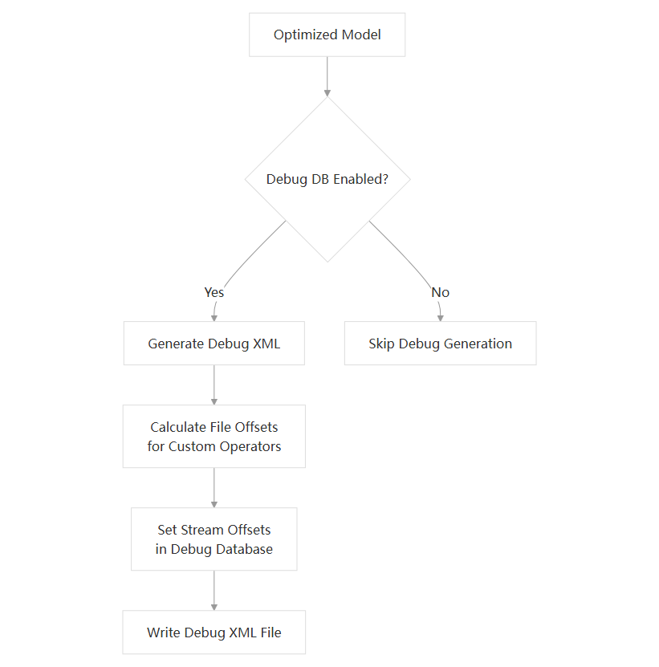

调试数据库允许从输入图到输出的跟踪优化命令流,并启用了该数据库 `--enable-debug-db` 选项。

源码 [ethosu/vela/vela.py103-110](https://github.com/nxp-imx/ethos-u-vela/blob/395a5690/ethosu/vela/vela.py#L103-L110) [ethosu/vela/OPTIONS.md110-120](https://github.com/nxp-imx/ethos-u-vela/blob/395a5690/ethosu/vela/OPTIONS.md?plain=1#L110-L120)

## 小结

Ethos-U Vela 编译流程通过一系列适合Arm Ethos-U NPU的优化改造神经网络模型,这一过程包括图优化,张量分配,调度,以及命令流生成,从而产生了有效利用NPU能力的模型.

通过理解编译流程,开发者可以更好地优化Ethos-U NPU的模型,并利用各种配置选项,实现最佳的性能,用于其具体的部署情景.

源码 [ethosu/vela/vela.py20-117](https://github.com/nxp-imx/ethos-u-vela/blob/395a5690/ethosu/vela/vela.py#L20-L117) [ethosu/vela/compiler_driver.py16-283](https://github.com/nxp-imx/ethos-u-vela/blob/395a5690/ethosu/vela/compiler_driver.py#L16-L283)

[返回中文目录](0-Index.md)
