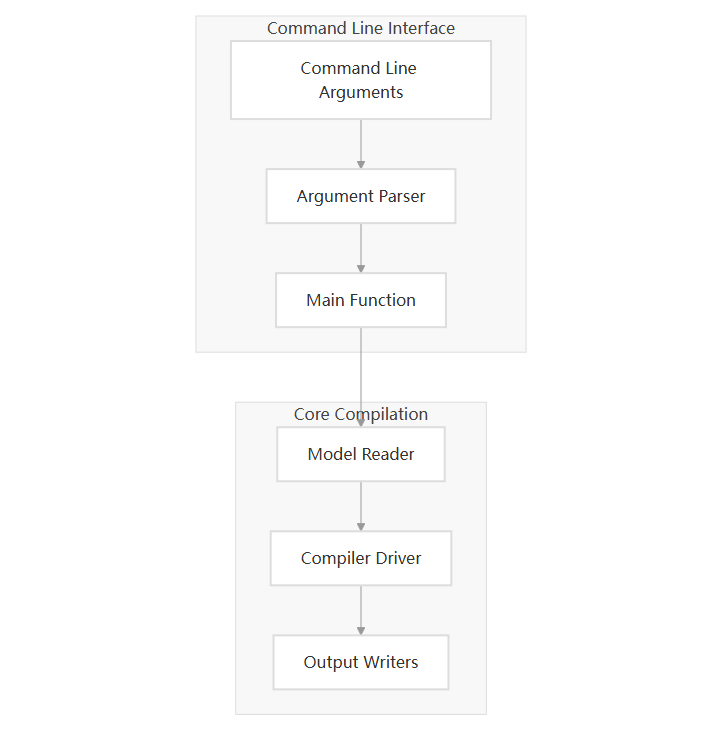

# 命令行接口

**相关源码**

- [OPTIONS.md](https://github.com/nxp-imx/ethos-u-vela/blob/395a5690/OPTIONS.md?plain=1)
- [README.md](https://github.com/nxp-imx/ethos-u-vela/blob/395a5690/README.md?plain=1)
- [RELEASES.md](https://github.com/nxp-imx/ethos-u-vela/blob/395a5690/RELEASES.md?plain=1)
- [ethosu/vela/compiler_driver.py](https://github.com/nxp-imx/ethos-u-vela/blob/395a5690/ethosu/vela/compiler_driver.py)
- [ethosu/vela/test/test_build.py](https://github.com/nxp-imx/ethos-u-vela/blob/395a5690/ethosu/vela/test/test_build.py)
- [ethosu/vela/vela.py](https://github.com/nxp-imx/ethos-u-vela/blob/395a5690/ethosu/vela/vela.py)
- [pyproject.toml](https://github.com/nxp-imx/ethos-u-vela/blob/395a5690/pyproject.toml)
- [setup.py](https://github.com/nxp-imx/ethos-u-vela/blob/395a5690/setup.py)

Ethos-U Vela编译器提供了一个全面的指令行界面(CLI),允许用户优化Arm Ethos-U神经处理单元(NPU)的神经网络模型. 本页面记录了CLI选项,基本使用模式,以及命令行界面如何与总体编译过程融合. 关于可用于CLI的配置选项,请参见 [配置选项](2.2-configuration-options.md).

## 概览

Vela编译器CLI是将TensorFlow Lite或TOSA神经网络模型转换为优化版本的主要接口,可以运行在包含Arm Ethos-U NPU的嵌入式系统中. CLI处理编译过程的所有方面,从读取输入模型到生成性能估计和调试信息.



源码 [ethosu/vela/vela.py20-117](https://github.com/nxp-imx/ethos-u-vela/blob/395a5690/ethosu/vela/vela.py#L20-L117) [OPTIONS.md24-262](https://github.com/nxp-imx/ethos-u-vela/blob/395a5690/OPTIONS.md?plain=1#L24-L262)

## 安装和访问

Vela 编译器可以通过 pip 安装,这使得 `vela` 命令行中可用的命令 :

```
pip install ethos-u-vela
```

安装后,可随该设备一起引用CLI。 `vela` 命令,然后是各种选项。

源码 [README.md113-117](https://github.com/nxp-imx/ethos-u-vela/blob/395a5690/README.md?plain=1#L113-L117) [pyproject.toml58](https://github.com/nxp-imx/ethos-u-vela/blob/395a5690/pyproject.toml#L58-L58)

## 基本用途

使用 Vela 编译器的最简单方法是提供输入网络模型文件的路径:

```
vela my_model.tflite
```

这将使用默认设置来编译模型,并将优化的版本输出到 `./output` 带有目录的目录 `_vela` 后缀添加到文件名中。

### 常用模式

以下是Vela CLI的一些常用模式:

1. **指定输出目录**:

   ```
   vela --output-dir ./results_dir /path/to/my_model.tflite
   ```
2. **目标特定加速器配置**:

   ```
   vela --accelerator-config ethos-u65-512 my_model.tflite
   ```
3. **优化大小而不是 性能**:

   ```
   vela --optimise Size my_model.tflite
   ```
4. **设置内存限制**:

   ```
   vela --optimise Performance --arena-cache-size 300000 my_model.tflite
   ```
5. **使用特定的系统配置**:

   ```
   vela --config Arm/vela.ini --system-config My_Sys_Config --memory-mode My_Mem_Mode my_model.tflite
   ```

源码 [README.md192-248](https://github.com/nxp-imx/ethos-u-vela/blob/395a5690/README.md?plain=1#L192-L248) [OPTIONS.md26-31](https://github.com/nxp-imx/ethos-u-vela/blob/395a5690/OPTIONS.md?plain=1#L26-L31)

## CLI 工作流程

以下图表说明了使用Vela CLI时的典型工作流程:

```

```

源码 [ethosu/vela/vela.py62-116](https://github.com/nxp-imx/ethos-u-vela/blob/395a5690/ethosu/vela/vela.py#L62-L116) [ethosu/vela/compiler_driver.py160-284](https://github.com/nxp-imx/ethos-u-vela/blob/395a5690/ethosu/vela/compiler_driver.py#L160-L284)

## 命令行选项

Vela CLI 为控制编译进程提供了许多选项。 这些选项可分为以下几类:

### 核心选项

| 选项 | 说明 | 默认 |
| --- | --- | --- |
| `network.tflite` | 输入模式文件( 需要) | 无 |
| `--help` | 显示帮助消息 | N/A |
| `--version` | 显示 Vela 版本 | N/A |
| `--api-version` | 显示 API 版本 | N/A |
| `--output-dir` | 指定输出目录 | ./产出 |

### 硬件配置

| 选项 | 说明 | 默认 |
| --- | --- | --- |
| `--accelerator-config` | 目标 NSU 配置 | 社会风貌 55-256 |
| `--system-config` | 来自配置文件的系统配置 | 默认系统配置 |
| `--memory-mode` | 来自配置文件的内存模式 | 默认内存模式 |
| `--config` | 配置文件路径 | 使用默认配置 |

### 优化选项

| 选项 | 说明 | 默认 |
| --- | --- | --- |
| `--optimise` | 设置优化策略( 大小或 性能 ) | 性能 |
| `--arena-cache-size` | 以字节设置竞技场缓存内存大小 | 支持最大地址 |
| `--tensor-allocator` | 张量分配 的算法 | 山丘攀登( HillClimb) |
| `--max-block-dependency` | 最大块依赖 延迟 | 3 |
| `--cpu-tensor-alignment` | CPU 字节对齐 张量 | 16 |
| `--recursion-limit` | 限制重现深度 | 1000 |
| `--hillclimb-max-iterations` | HillClimb 的最大迭代 分配器 | 99999 |

### 调试和 Verbosity 选项

| 选项 | 说明 | 默认 |
| --- | --- | --- |
| `--enable-debug-db` | 启用调试数据库生成 | 虚假 |
| `--timing` | 测量编译时间 | 虚假 |
| `--show-cpu-operations` | 显示返回 CPU 的操作 | 虚假 |
| `--show-subgraph-io-summary` | 显示 子图 I/O 摘要 | 虚假 |
| `--verbose-all` | 启用所有动词选项 | 虚假 |
| 各种 `--verbose-*` 选项 | 启用特定的动词输出 | 虚假 |

源码 [OPTIONS.md24-600](https://github.com/nxp-imx/ethos-u-vela/blob/395a5690/OPTIONS.md?plain=1#L24-L600) [ethosu/vela/vela.py795-896](https://github.com/nxp-imx/ethos-u-vela/blob/395a5690/ethosu/vela/vela.py#L795-L896)

## CLI 架构 (法语).

Vela CLI的结构围绕几个关键组件,它们共同处理输入模型,应用优化,并生成输出文件:

```

```

源码 [ethosu/vela/vela.py20-116](https://github.com/nxp-imx/ethos-u-vela/blob/395a5690/ethosu/vela/vela.py#L20-L116) [ethosu/vela/compiler_driver.py46-101](https://github.com/nxp-imx/ethos-u-vela/blob/395a5690/ethosu/vela/compiler_driver.py#L46-L101)

## 与 编译流程 合并

CLI是进入Vela编译流程的切入点,它由几个阶段组成,将输入模型转化为优化的形式:

```

```

源码 [ethosu/vela/vela.py62-116](https://github.com/nxp-imx/ethos-u-vela/blob/395a5690/ethosu/vela/vela.py#L62-L116) [ethosu/vela/compiler_driver.py160-284](https://github.com/nxp-imx/ethos-u-vela/blob/395a5690/ethosu/vela/compiler_driver.py#L160-L284)

## 备选类别和关系

下图显示了不同类别的CLI选项如何影响汇编过程的不同部分:

```

```

源码 [ethosu/vela/vela.py795-896](https://github.com/nxp-imx/ethos-u-vela/blob/395a5690/ethosu/vela/vela.py#L795-L896) [ethosu/vela/compiler_driver.py46-101](https://github.com/nxp-imx/ethos-u-vela/blob/395a5690/ethosu/vela/compiler_driver.py#L46-L101)

## B. 选择优先性和关系

一些 CLI 选项具有依赖性或可以互相覆盖。 下表概述了这些关系:

| 选项 | 相关选项 | 关系 |
| --- | --- | --- |
| `--config` | `--system-config`, `--memory-mode` | 指定这些选项从中获取值的配置文件 |
| `--optimise` | `--arena-cache-size` | `Size` 忽略竞技场缓存大小, `Performance` 用它来优化 |
| `--verbose-all` | 全部人员 `--verbose-*` 选项 | 启用所有动词选项 |
| `--tensor-allocator` | `--hillclimb-max-iterations` | 仅在使用 HillClimb 分配器 时才相关 。 |
| `--enable-debug-db` | `--output-dir` | 调试数据库写入输出目录 |
| `--accelerator-config` | `--system-config` | 不同的加速器有不同的默认系统配置 |

源码 [OPTIONS.md102-139](https://github.com/nxp-imx/ethos-u-vela/blob/395a5690/OPTIONS.md?plain=1#L102-L139) [OPTIONS.md230-251](https://github.com/nxp-imx/ethos-u-vela/blob/395a5690/OPTIONS.md?plain=1#L230-L251) [ethosu/vela/vela.py795-896](https://github.com/nxp-imx/ethos-u-vela/blob/395a5690/ethosu/vela/vela.py#L795-L896)

## 使用配置文件的 CLI

Vela CLI 可以使用配置文件来指定复杂的系统和内存配置。 `--config`, `--system-config`,以及 `--memory-mode` 选项:

```
vela network.tflite --config Arm/vela.ini --system-config Ethos_U55_High_End_Embedded --memory-mode Shared_Sram
```

配置文件是 Python 配置程序 `.ini` 文件包含用于系统配置和内存模式的段落。关于配置文件格式的完整解释可见于 [配置选项](2.2-configuration-options.md) 页面。

源码 [OPTIONS.md102-139](https://github.com/nxp-imx/ethos-u-vela/blob/395a5690/OPTIONS.md?plain=1#L102-L139) [OPTIONS.md602-696](https://github.com/nxp-imx/ethos-u-vela/blob/395a5690/OPTIONS.md?plain=1#L602-L696)

## CLI 整合点

CLI 与 Vela 编译器的几个关键组件集成:

1. **模型读取器** - 读取输入的 TFLite 或 TOSA 文件,并将其转换为内部神经网络图示
2. **架构 特性** - 界定硬件能力和制约因素
3. **编译驱动程序** - 协调汇编工作
4. **调度器** - 将操作安排在NPU上
5. **输出写入器** - 生成最佳模式和业绩统计

每一个组件都受到各种CLI选项的影响,允许对编译过程进行精细控制.

源码 [ethosu/vela/vela.py31-58](https://github.com/nxp-imx/ethos-u-vela/blob/395a5690/ethosu/vela/vela.py#L31-L58) [ethosu/vela/compiler_driver.py33-45](https://github.com/nxp-imx/ethos-u-vela/blob/395a5690/ethosu/vela/compiler_driver.py#L33-L45)

## 性能 报告

CLI 包含显示编译网络 性能 估计数的功能。 这些估计数默认会打印到控制台, 也可以写入 CSV 文件 :

```
vela network.tflite --verbose-performance
```

这将为网络中的每一项操作提供性能 指标的详细分类,而标准产出则包括总体性能的概要.

源码 [ethosu/vela/vela.py86-95](https://github.com/nxp-imx/ethos-u-vela/blob/395a5690/ethosu/vela/vela.py#L86-L95) [README.md364-367](https://github.com/nxp-imx/ethos-u-vela/blob/395a5690/README.md?plain=1#L364-L367)

## 解决问题

当使用 Vela CLI 时, 用户可能会遇到警告或错误, 当它们显示在汇编过程中发生的决定或问题时, 应当对其进行彻底审查 。

可通过国家行动倡议备选方案解决的共同问题:

- **内存限制**编号: 使用 `--optimise Size` 或设置特定 `--arena-cache-size`
- **折返错误**: 增加 `--recursion-limit`
- **业绩问题**编号: 使用 `--verbose-performance` 找出瓶颈
- **调试信息**启用 `--enable-debug-db` 用于更详细的调试

为了详细了解算子可以放在NPU上,使用:

```
vela --supported-ops-report
```

这就产生了一份全面报告,说明受支助的操作人员及其制约因素。

源码 [README.md263-268](https://github.com/nxp-imx/ethos-u-vela/blob/395a5690/README.md?plain=1#L263-L268) [OPTIONS.md76-83](https://github.com/nxp-imx/ethos-u-vela/blob/395a5690/OPTIONS.md?plain=1#L76-L83)

## 小结

Vela CLI为Arm Ethos-U NPU的神经网络模型的编译提供了全面的接口,它为控制编译过程提供了众多的选项,从基本的输入/输出规格到详细的优化和调试控制. 了解这些选项是有效优化模型以便在Ethos-U NPU上部署的关键.

有关汇编工作具体方面的更详细资料,请参看以下各页:

- [配置选项](2.2-configuration-options.md)
- [图优化](3-graph-optimization.md)
- [算子调度](4-operation-scheduling.md)
- [命令流生成](5-command-stream-generation.md)

[返回中文目录](0-Index.md)
