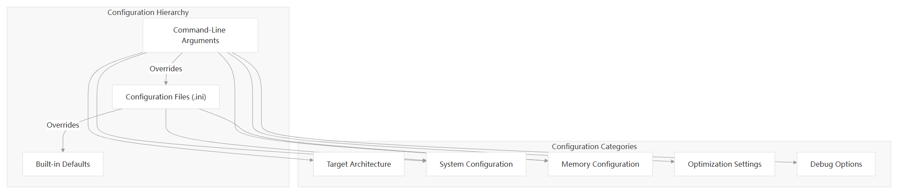
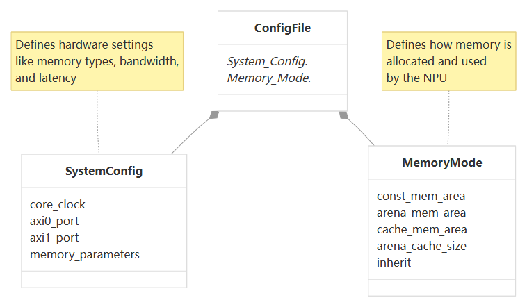
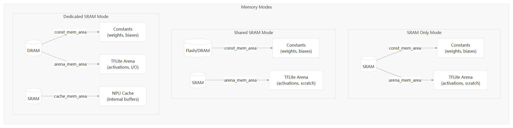
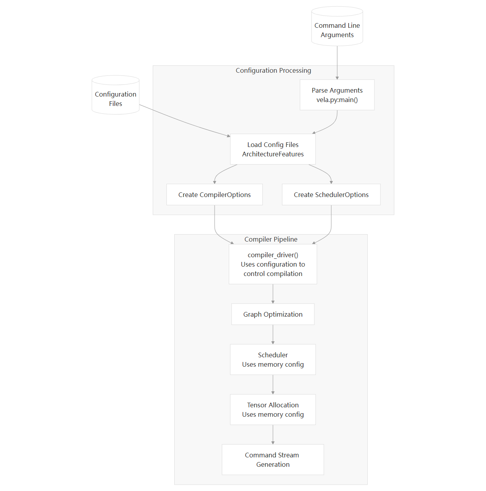

# 配置选项

**相关源码**

- [OPTIONS.md](https://github.com/nxp-imx/ethos-u-vela/blob/395a5690/OPTIONS.md?plain=1)
- [ethosu/vela/compiler_driver.py](https://github.com/nxp-imx/ethos-u-vela/blob/395a5690/ethosu/vela/compiler_driver.py)
- [ethosu/vela/vela.py](https://github.com/nxp-imx/ethos-u-vela/blob/395a5690/ethosu/vela/vela.py)

此文档描述了 Ethos- U Vela 编译器可用的配置选项, 允许您自定义不同 Arm Ethos- U 神经处理单元( NPU) 设备和系统配置的编译过程。 这些选项控制了从目标硬件架构 到内存分配策略和优化设置的所有内容 。

关于使用命令行界面的信息,参见 [命令行接口](2.1-command-line-interface.md).

## 配置系统概览

Vela编译器使用分层配置系统,包含三个组件:

1. **命令行参数** - 引用编译器时指定的直接选项
2. **配置文件** - 系统和内存规格的INI格式文件
3. **默认值** - 未提供明确配置时的内置设置



源码 [ethosu/vela/vela.py962-1133](https://github.com/nxp-imx/ethos-u-vela/blob/395a5690/ethosu/vela/vela.py#L962-L1133) [OPTIONS.md18-97](https://github.com/nxp-imx/ethos-u-vela/blob/395a5690/OPTIONS.md?plain=1#L18-L97)

## 命令行配置选项

### 核心选项

这些基本选项定义了输入模型和输出设置:

| 选项 | 说明 | 默认 |
| --- | --- | --- |
| `--output-dir` | 输出文件目录 | `output` |
| `--output-format` | 输出格式( tflite 或 原始) | `tflite` |
| `--config` | 配置 INI 文件的路径 | 无 |
| `--list-config-files` | 列出可用的配置文件 | N/A |

### 目标 架构 选项

这些选项指定目标硬件 架构 :

| 选项 | 说明 | 默认 |
| --- | --- | --- |
| `--accelerator-config` | 目标 NSU 配置 | `ethos-u65-256` |
| `--system-config` | INI 文件的系统配置 | 结构依赖 |
| `--memory-mode` | 来自 INI 文件的内存模式 | 结构依赖 |

那个... `--accelerator-config` 接受以下数值:

- `ethos-u55-32`, `ethos-u55-64`, `ethos-u55-128`, `ethos-u55-256`
- `ethos-u65-256`, `ethos-u65-512`
- `ethos-u85-128`, `ethos-u85-256`, `ethos-u85-512`, `ethos-u85-1024`, `ethos-u85-2048`

源码 [ethosu/vela/vela.py1042-1061](https://github.com/nxp-imx/ethos-u-vela/blob/395a5690/ethosu/vela/vela.py#L1042-L1061) [OPTIONS.md155-199](https://github.com/nxp-imx/ethos-u-vela/blob/395a5690/OPTIONS.md?plain=1#L155-L199)

### 内存配置选项

这些选项控制内存分配策略 :

| 选项 | 说明 | 默认 |
| --- | --- | --- |
| `--tensor-allocator` | 张量分配 的算法 | `HillClimb` |
| `--arena-cache-size` | 竞技场缓存大小 内存区域 (字节) | `384 * 1024` |
| `--cpu-tensor-alignment` | CPU 字节对齐 张量 | `16` |
| `--hillclimb-max-iterations` | 攀登山峰的最大迭代 分配器 | `99999` |

源码 [ethosu/vela/vela.py1062-1124](https://github.com/nxp-imx/ethos-u-vela/blob/395a5690/ethosu/vela/vela.py#L1062-L1124) [OPTIONS.md201-266](https://github.com/nxp-imx/ethos-u-vela/blob/395a5690/OPTIONS.md?plain=1#L201-L266) [OPTIONS.md284-296](https://github.com/nxp-imx/ethos-u-vela/blob/395a5690/OPTIONS.md?plain=1#L284-L296)

### 优化选项

这些选项控制编译器的优化行为 :

| 选项 | 说明 | 默认 |
| --- | --- | --- |
| `--optimise` | 优化战略`Size` 或 减 减 `Performance`) | `Performance` |
| `--max-block-dependency` | 操作之间的最大 块依赖 | `3` |
| `--force-symmetric-int-weights` | 力对称的内重 量化 | `False` |

源码 [ethosu/vela/vela.py1084-1094](https://github.com/nxp-imx/ethos-u-vela/blob/395a5690/ethosu/vela/vela.py#L1084-L1094) [ethosu/vela/vela.py1103-1109](https://github.com/nxp-imx/ethos-u-vela/blob/395a5690/ethosu/vela/vela.py#L1103-L1109) [OPTIONS.md213-251](https://github.com/nxp-imx/ethos-u-vela/blob/395a5690/OPTIONS.md?plain=1#L213-L251)

### 调试选项

有许多调试和动词选项不会改变编译者的行为,而是提供额外输出:

| 类别 | 选项 |
| --- | --- |
| 图解分析 | `--verbose-graph`, `--verbose-quantization`, `--verbose-packing`, `--verbose-operators` |
| 内存 | `--verbose-tensor-purpose`, `--verbose-tensor-format`, `--verbose-allocation` |
| 性能 | `--verbose-performance`, `--verbose-cycle-estimate`, `--verbose-weights` |
| 命令生成 | `--verbose-high-level-command-stream`, `--verbose-register-command-stream` |
| 其他人员 | `--verbose-all`, `--verbose-progress`, `--show-cpu-operations`, `--timing` |

源码 [ethosu/vela/vela.py1012-1038](https://github.com/nxp-imx/ethos-u-vela/blob/395a5690/ethosu/vela/vela.py#L1012-L1038) [OPTIONS.md298-559](https://github.com/nxp-imx/ethos-u-vela/blob/395a5690/OPTIONS.md?plain=1#L298-L559)

## 配置文件结构

Vela配置文件使用Python ConfigParser INI格式,并包含两个主要部分类型:

1. **系统配置** (`[System_Config.*]`) - 定义硬件特性
2. **内存模式** (`[Memory_Mode.*]`) - 定义内存使用模式



源码 [OPTIONS.md602-707](https://github.com/nxp-imx/ethos-u-vela/blob/395a5690/OPTIONS.md?plain=1#L602-L707)

### 系统配置科

系统配置部分定义硬件特性和内存连接:

```
[System_Config.My_Sys_Cfg]
core_clock=500000000             # NPU clock frequency (Hz)
axi0_port=Sram                   # Memory type on AXI0 port
axi1_port=Dram                   # Memory type on AXI1 port
Sram_clock_scale=0.5             # SRAM bandwidth as fraction of core clock
Sram_burst_length=64             # Burst length in bytes
Dram_clock_scale=0.25            # DRAM bandwidth as fraction of core clock
```

可用的内存类型为 `Sram`, `Dram`, `OnChipFlash`,以及 `OffChipFlash`。每种内存类型都可以有下列参数:

- `*_clock_scale` - 带宽作为核心时钟的一小部分
- `*_ports_used` - 使用的端口数目
- `*_burst_length` - 最小有效爆破长度
- `*_read_latency` - 周期读取延迟
- `*_write_latency` - 周期内书写延迟
- `*_max_reads` - 最大未完成读数
- `*_max_writes` - 最大未完成的写法

源码 [OPTIONS.md664-691](https://github.com/nxp-imx/ethos-u-vela/blob/395a5690/OPTIONS.md?plain=1#L664-L691)

### 内存模式部分

内存模式部分定义NPU如何分配和使用内存 :

```
[Memory_Mode.My_Mem_Mode]
const_mem_area=Axi1              # AXI port for read-only data
arena_mem_area=Axi0              # AXI port for read-write data
cache_mem_area=Axi0              # AXI port for dedicated SRAM
arena_cache_size=393216          # Size of arena/cache in bytes
```

内存模式可以使用该模式继承其他内存模式 `inherit` 属性 :

```
[Memory_Mode.My_Child_Mode]
inherit=Memory_Mode.My_Mem_Mode  # Inherit from parent
arena_cache_size=262144          # Override specific settings
```

源码 [OPTIONS.md697-706](https://github.com/nxp-imx/ethos-u-vela/blob/395a5690/OPTIONS.md?plain=1#L697-L706)

## 内存模式

Vela支持三种主内存模式配置,定义内存如何用于不同目的:



### 仅SRAM 模式

在此模式下,NPU只能访问SRAM内存. 编译器在SRAM中使用两个区域:

- `const_mem_area` 用于常数(权重,偏置)
- `arena_mem_area` TensorFlow Lite 微竞技场张量

那个... `arena_cache_size` 参数定义大小 `arena_mem_area`,则 `cache_mem_area` 未使用。

### 共享的SRAM 模式

在此模式下 :

- `arena_mem_area` 点到 SRAM
- `const_mem_area` 指向闪光或 DRAM
- `cache_mem_area` 未使用
- `arena_cache_size` 定义大小 `arena_mem_area`

当SRAM有限且可以与其他软件组件共享时,这个模式是有用的.

### 专用的SRAM模式

在此模式下 :

- `cache_mem_area` 用于 NPU 的 SRAM 点数
- `const_mem_area` 财务报告和财务报告 `arena_mem_area` 指向另一个内存类型( 如 DRAM)
- `arena_cache_size` 定义大小 `cache_mem_area`

这个模式对于性能是最佳的,因为专用的SRAM可以被NPU用于内部缓冲.

源码 [OPTIONS.md709-762](https://github.com/nxp-imx/ethos-u-vela/blob/395a5690/OPTIONS.md?plain=1#L709-L762)

## 编译器中的配置流程

下图显示配置选项如何通过编译器流出:



源码 [ethosu/vela/vela.py956-1313](https://github.com/nxp-imx/ethos-u-vela/blob/395a5690/ethosu/vela/vela.py#L956-L1313) [ethosu/vela/compiler_driver.py160-284](https://github.com/nxp-imx/ethos-u-vela/blob/395a5690/ethosu/vela/compiler_driver.py#L160-L284)

## 示例配置设想

### 带有有限SRAM的嵌入式系统

对于包含有限SRAM的嵌入式系统,您可能使用:

```
vela model.tflite --accelerator-config ethos-u55-64 --config Arm/vela.ini \
    --system-config Ethos_U55_High_End_Embedded --memory-mode Shared_Sram \
    --optimise Size
```

此配置 :

- 目标Ethos-U55有64个MAC
- 使用带有共享SRAM的高端嵌入式系统配置
- 优化最低限度的SRAM使用

### 高绩效系统

最大值 性能 有专用的SRAM :

```
vela model.tflite --accelerator-config ethos-u65-256 --config Arm/vela.ini \
    --system-config Ethos_U65_Client_Server --memory-mode Dedicated_Sram \
    --optimise Performance --arena-cache-size 1048576
```

此配置 :

- 以256架MAC作为目标
- 使用具有专用SRAM的客户端-服务器系统配置
- 用 1MB 竞技场缓存优化最大 性能

源码 [OPTIONS.md634-640](https://github.com/nxp-imx/ethos-u-vela/blob/395a5690/OPTIONS.md?plain=1#L634-L640) [OPTIONS.md636-643](https://github.com/nxp-imx/ethos-u-vela/blob/395a5690/OPTIONS.md?plain=1#L636-L643)

## 高级配置

### 登山 张量 分配器 (英语).

默认 张量 分配器 (中文(简体) ).`HillClimb`)使用迭代算法来找到最佳内存分配。您可以用:

- `--tensor-allocator` - 准备 `Greedy`, `LinearAlloc`,或 `HillClimb`
- `--hillclimb-max-iterations` - 最多重复次数(默认:99999)

### 系统内存配置

对于对内存系统的精细控制,创建带有详细内存规格的自定义配置文件:

```
[System_Config.Custom_System]
core_clock=500000000
axi0_port=Sram
axi1_port=Dram
Sram_clock_scale=0.5
Sram_ports_used=1
Sram_burst_length=64
Sram_read_latency=1
Sram_write_latency=1
Dram_clock_scale=0.2
Dram_ports_used=1
Dram_burst_length=128
Dram_read_latency=10
Dram_write_latency=5
 
[Memory_Mode.Custom_Memory]
const_mem_area=Axi1
arena_mem_area=Axi0
cache_mem_area=Axi0
arena_cache_size=262144
```

这个配置可以让你精确调谐特定硬件的内存参数.

源码 [OPTIONS.md662-707](https://github.com/nxp-imx/ethos-u-vela/blob/395a5690/OPTIONS.md?plain=1#L662-L707)

[返回中文目录](0-Index.md)
