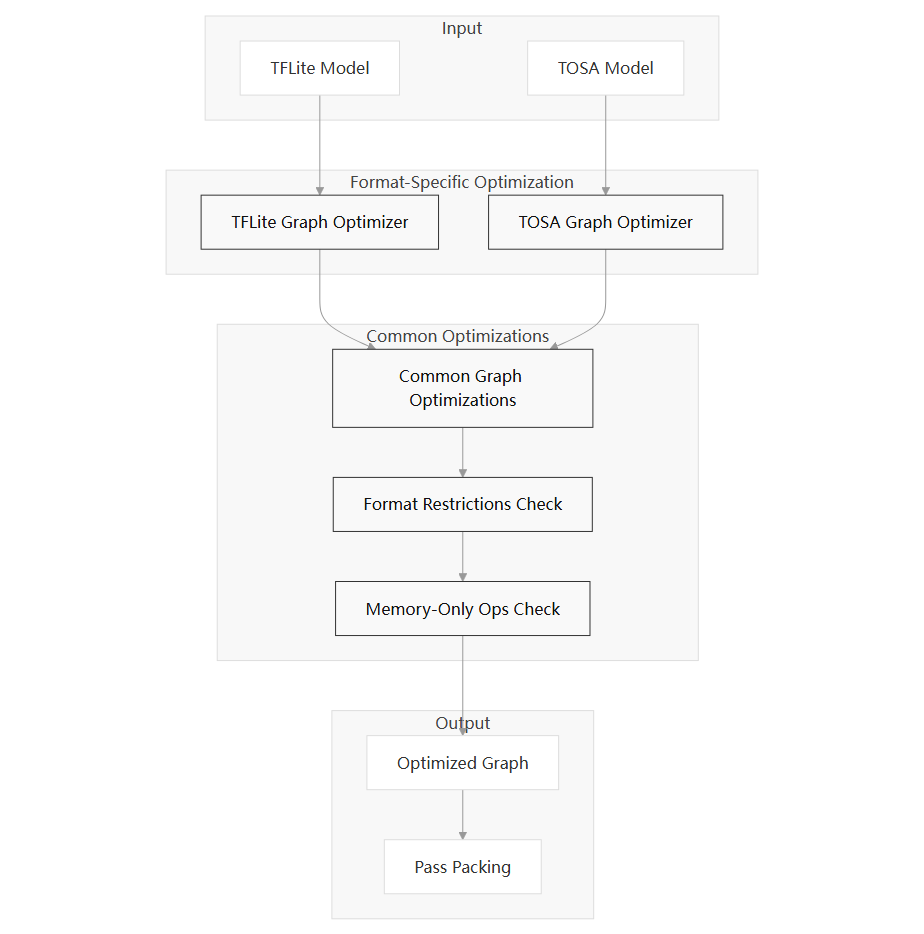
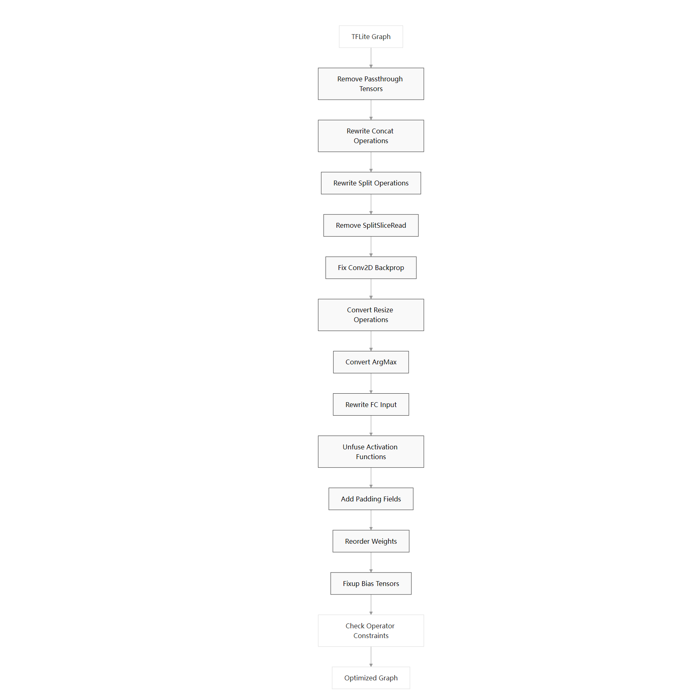
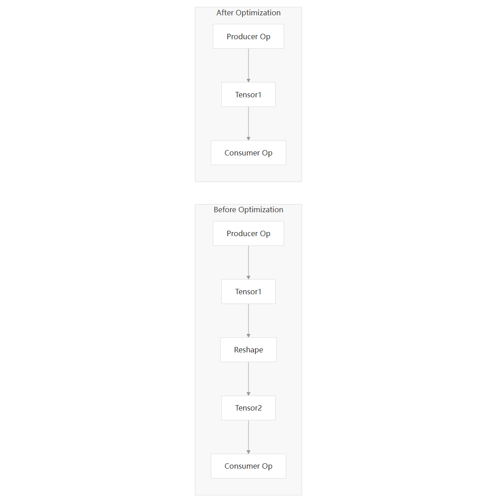
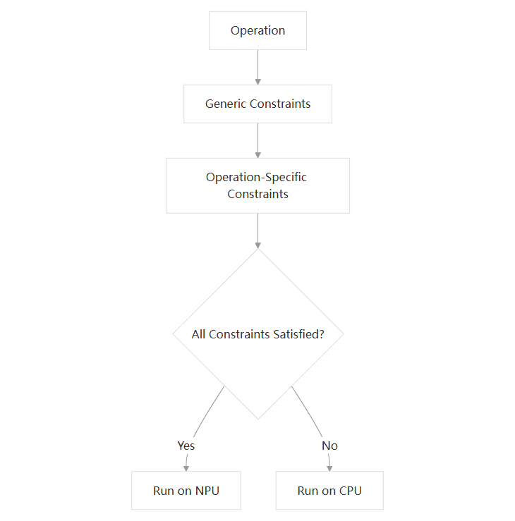
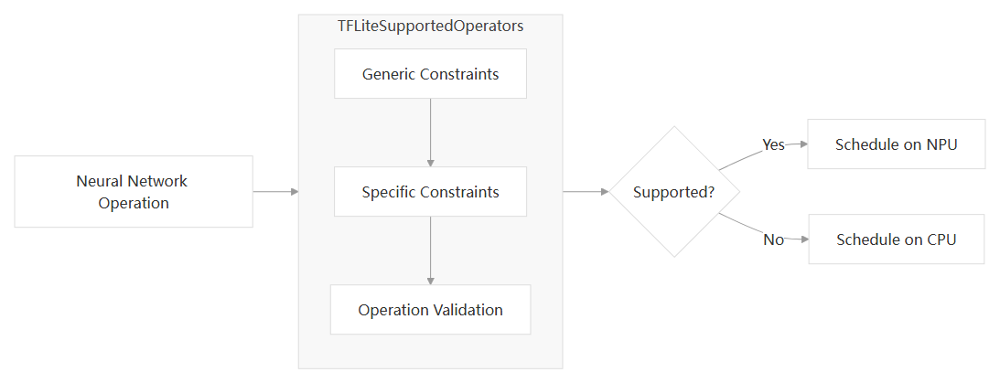
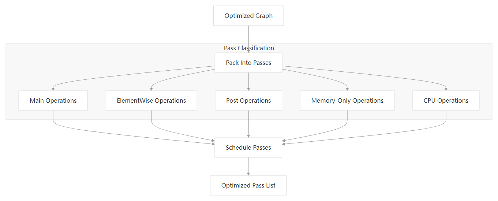
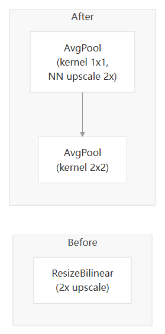
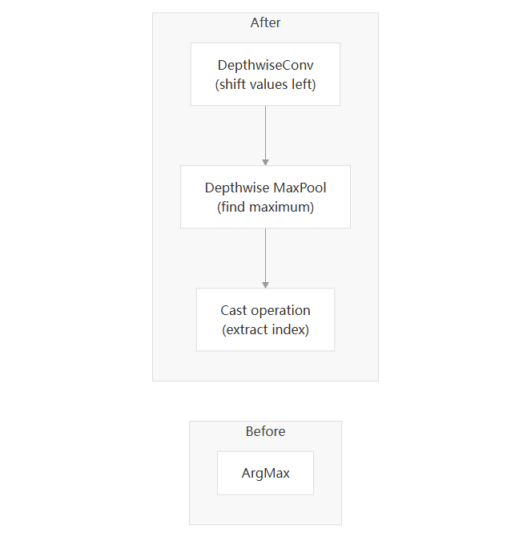

# 图优化

**相关源码**

- [SUPPORTED_OPS.md](https://github.com/nxp-imx/ethos-u-vela/blob/395a5690/SUPPORTED_OPS.md?plain=1)
- [ethosu/regor/compiler/graphir_optimiser.cpp](https://github.com/nxp-imx/ethos-u-vela/blob/395a5690/ethosu/regor/compiler/graphir_optimiser.cpp)
- [ethosu/regor/compiler/graphir_optimiser.hpp](https://github.com/nxp-imx/ethos-u-vela/blob/395a5690/ethosu/regor/compiler/graphir_optimiser.hpp)
- [ethosu/regor/compiler/tflite_graph_optimiser.cpp](https://github.com/nxp-imx/ethos-u-vela/blob/395a5690/ethosu/regor/compiler/tflite_graph_optimiser.cpp)
- [ethosu/regor/compiler/tflite_graph_optimiser.hpp](https://github.com/nxp-imx/ethos-u-vela/blob/395a5690/ethosu/regor/compiler/tflite_graph_optimiser.hpp)
- [ethosu/regor/tflite/tflite_model_semantics.cpp](https://github.com/nxp-imx/ethos-u-vela/blob/395a5690/ethosu/regor/tflite/tflite_model_semantics.cpp)
- [ethosu/vela/graph_optimiser.py](https://github.com/nxp-imx/ethos-u-vela/blob/395a5690/ethosu/vela/graph_optimiser.py)
- [ethosu/vela/operation.py](https://github.com/nxp-imx/ethos-u-vela/blob/395a5690/ethosu/vela/operation.py)
- [ethosu/vela/pass_packing.py](https://github.com/nxp-imx/ethos-u-vela/blob/395a5690/ethosu/vela/pass_packing.py)
- [ethosu/vela/softmax.py](https://github.com/nxp-imx/ethos-u-vela/blob/395a5690/ethosu/vela/softmax.py)
- [ethosu/vela/test/test_tflite_model_semantic.py](https://github.com/nxp-imx/ethos-u-vela/blob/395a5690/ethosu/vela/test/test_tflite_model_semantic.py)
- [ethosu/vela/test/test_tflite_supported_operators.py](https://github.com/nxp-imx/ethos-u-vela/blob/395a5690/ethosu/vela/test/test_tflite_supported_operators.py)
- [ethosu/vela/tflite_graph_optimiser.py](https://github.com/nxp-imx/ethos-u-vela/blob/395a5690/ethosu/vela/tflite_graph_optimiser.py)
- [ethosu/vela/tflite_model_semantic.py](https://github.com/nxp-imx/ethos-u-vela/blob/395a5690/ethosu/vela/tflite_model_semantic.py)
- [ethosu/vela/tflite_supported_operators.py](https://github.com/nxp-imx/ethos-u-vela/blob/395a5690/ethosu/vela/tflite_supported_operators.py)

图优化是Arm Ethos-U Vela编译器管道中一个关键的早期阶段,它转换神经网络图,使其在神经处理单元(NPU)上执行效率更高. 优化过程分析网络结构,尽可能修改操作,引信层,并将不支持的图案转换为等效的辅助形式. 这些转换旨在在确保计算准确性的同时最大限度地利用NPU.

有关以下算子调度的信息,见图优化 [算子调度](4-operation-scheduling.md),关于命令流生成,见 [命令流生成](5-command-stream-generation.md).

## 优化管道概览

图优化管道采用神经网络图(无论是TensorFlow Lite还是TOSA格式)作为输入,并应用一系列的转换,以提高Ethos-U NPU硬件上的执行效率.

**图: 图优化 管道**

源码 [ethosu/vela/graph_optimiser.py28-47](https://github.com/nxp-imx/ethos-u-vela/blob/395a5690/ethosu/vela/graph_optimiser.py#L28-L47) [ethosu/vela/tflite_graph_optimiser.py81-796](https://github.com/nxp-imx/ethos-u-vela/blob/395a5690/ethosu/vela/tflite_graph_optimiser.py#L81-L796)

图优化的主要切入点是: `optimise_graph` 函数,它执行下列步骤:

1. 根据网络类型向 TFLite 或 TOSA 特定优化器路径进行优化
2. 应用特定格式的图形转换
3. 进行优化后检查,以确保正确处理所有业务
4. 返回优化的图表供进一步处理

## 格式 - 特定优化

Vela既支持TensorFlow Lite格式,也支持TOSA图形格式,每个都有专用的优化模块.

### TFLite 图优化

TFLite图优化器应用了重写序列来转换图,以更好地执行NPU.

**图: TFLite 图优化 流量**

源码 [ethosu/vela/tflite_graph_optimiser.py84-413](https://github.com/nxp-imx/ethos-u-vela/blob/395a5690/ethosu/vela/tflite_graph_optimiser.py#L84-L413)

关键 TFLite 优化技术包括:

1. **删除 直通 张量**: 消除身份等不必要的张量操作
2. **重写模式特定业务**:
   - Concat 操作被重写为每个输入使用 AvgPool
   - 拆分操作转换为拆分读操作
   - 调整Bilinear/Resize邻域操作转换为 深度卷积 卷积 或平均值 池化
3. **将复杂操作转换为更简单的操作**:
   - argMax 重写为 深度卷积 卷积 和 最大集合操作的序列
   - Leaky Relu 使用 逐元素 操作重写
4. **输入/输出形状和填充调整**

### TOSA 图优化

对于TOSA图,也采用了类似的优化,但对不同的输入格式进行了调整.

## 常见 图优化 模式

不论输入格式如何,都应用了几种关键优化模式:

### 行动转换

许多操作被转换成在NPU上运行效率更高的等效表:

| 原始操作 | 已转换为 | 目的 |
| --- | --- | --- |
| 调整比线性大小 | 深度卷积 卷积 + AvgPool | 更高效的升级 |
| 调整邻里大小 | AvgPool, 最近的升级 | 硬件友好实施 |
| 阿尔格马克斯语Name | 深度Conv2D → MaxPool → 深度Conv2D | 退货 核动力原生物 |
| 莱基雷卢 | 多个 逐元素 操作 | 支持操作的地图 |
| LSTM业务 | 演化和元素化的系列行动 | 将复杂的重复模式映射到 NPU 操作 |

源码 [ethosu/vela/tflite_graph_optimiser.py493-683](https://github.com/nxp-imx/ethos-u-vela/blob/395a5690/ethosu/vela/tflite_graph_optimiser.py#L493-L683)

### 内存( 仅操作处理)

Reshape,Squeeze,以及转置等仅存储操作不执行计算,而是重排数据. 这些操作在优化时经常被绕过或简化:

**图表: 内存- 仅操作删除**

源码 [ethosu/vela/graph_optimiser_util.py36-78](https://github.com/nxp-imx/ethos-u-vela/blob/395a5690/ethosu/vela/graph_optimiser_util.py#L36-L78)

### 算子 支持检查

优化后,每个操作都会对照硬件限制进行检查,以确定它是否能够运行在NPU上:

**图表 : 算子 支持检查流量**

源码 [ethosu/vela/tflite_supported_operators.py368-442](https://github.com/nxp-imx/ethos-u-vela/blob/395a5690/ethosu/vela/tflite_supported_operators.py#L368-L442)

## 键优化类和函数

### 核心优化组件

图优化系统由几个关键组成部分组成:

1. **图像优化器** (`graph_optimiser.py`: 协调优化的主要切入点
2. **TFLite 图优化器** (`tflite_graph_optimiser.py`: 处理 TFLite 特定优化
3. **TOSA 图优化器** (`tosa_graph_optimiser.py`: 处理 TOSA 特定优化
4. **支持的算子** (`tflite_supported_operators.py`: 界定业务支助限制
5. **算子** 财务报告和财务报告 **张量** 类: 优化过程中操纵的核心数据结构

### 优化进程中的关键函数

| 函数 | 目的 |
| --- | --- |
| `optimise_graph` | 代表特定格式优化器的主要录入功能 |
| `tflite_optimise_graph` | 应用 TFLite 特定优化 |
| `tosa_optimise_graph` | 应用 TOSA 特定优化 |
| `remove_passthrough_tensor` | 消除身份或占位符操作 |
| `rewrite_concat_ops` | 将调试操作转换为等效形式 |
| `rewrite_split_ops` | 转换分裂的操作以更好地执行 |
| `is_operator_supported` | 确定一个操作是否能够在 NPU 上运行 |

源码 [ethosu/vela/graph_optimiser.py28-47](https://github.com/nxp-imx/ethos-u-vela/blob/395a5690/ethosu/vela/graph_optimiser.py#L28-L47) [ethosu/vela/tflite_graph_optimiser.py84-134](https://github.com/nxp-imx/ethos-u-vela/blob/395a5690/ethosu/vela/tflite_graph_optimiser.py#L84-L134)

## 约束检查

优化后,操作会接受强制检查,以确定它们是否能够运行在NPU上. 这些限制包括:

1. **一般性限制** 适用于大多数业务:

   - 必须支持输入/输出张量数据类型(int8, int8, int16, int32)
   - 张量 维度必须在有效范围内
   - 必须有适当的量化参数
   - 批量大小限制
2. **具体行动方面的制约因素**:

   - 卷积: 卷积核大小, 步长, 膨胀率 限制
   - 池化:过滤大小和步长限制
   - 逐元素:广播限制
   - 激活: 支持的函数类型

**图表: 约束检查 架构**

源码 [ethosu/vela/tflite_supported_operators.py44-372](https://github.com/nxp-imx/ethos-u-vela/blob/395a5690/ethosu/vela/tflite_supported_operators.py#L44-L372) [SUPPORTED_OPS.md31-139](https://github.com/nxp-imx/ethos-u-vela/blob/395a5690/SUPPORTED_OPS.md?plain=1#L31-L139)

## 优化后:pass 打包

图优化之后,操作被装入"通道"执行:

**图: pass 打包 流量**

源码 [ethosu/vela/pass_packing.py95-196](https://github.com/nxp-imx/ethos-u-vela/blob/395a5690/ethosu/vela/pass_packing.py#L95-L196)

pass 打包将操作分为几种类型:

- **主要业务**: 卷积,池化在MAC单元上运行的操作
- **逐元素业务**: 逐元素 单元运行的操作
- **员额业务**: 激活 和其他处理后业务
- **仅存储操作**: 不进行计算形状变换
- **CPU 操作**: 必须在CPU上运行的操作

## 优化实例

### 例1: 调整比线性转换大小

**图: 调整比线性变换大小**

源码 [ethosu/vela/tflite_graph_optimiser.py419-489](https://github.com/nxp-imx/ethos-u-vela/blob/395a5690/ethosu/vela/tflite_graph_optimiser.py#L419-L489)

### 例2: argMax 转换

**图: argMax 转换**

源码 [ethosu/vela/tflite_graph_optimiser.py493-660](https://github.com/nxp-imx/ethos-u-vela/blob/395a5690/ethosu/vela/tflite_graph_optimiser.py#L493-L660)

## 架构 兼容性

图优化过程对目标Ethos-U 架构(U55,U65,或U85)敏感,因为不同的架构具有不同的能力和约束. 优化通过确保了由此而来的图能利用目标架构的具体特征.

源码 [ethosu/vela/graph_optimiser.py28-30](https://github.com/nxp-imx/ethos-u-vela/blob/395a5690/ethosu/vela/graph_optimiser.py#L28-L30)

## 总结

图优化是Vela编译器中一个根本性的步骤,它将神经网络转换为在Ethos-U NPU上高效运行. 通过一系列精密的转换,它确保操作与硬件限制兼容,同时最大化性能. 优化后的图随后进入调度阶段,在NPU上组织操作以实际执行.

图优化完成后,管道的下一步是 [算子调度](4-operation-scheduling.md),其中,优化的操作被安排执行。

[返回中文目录](0-Index.md)
