# TFLite 图优化

**相关源码**

- [SUPPORTED_OPS.md](https://github.com/nxp-imx/ethos-u-vela/blob/395a5690/SUPPORTED_OPS.md?plain=1)
- [ethosu/vela/test/test_tflite_model_semantic.py](https://github.com/nxp-imx/ethos-u-vela/blob/395a5690/ethosu/vela/test/test_tflite_model_semantic.py)
- [ethosu/vela/test/test_tflite_supported_operators.py](https://github.com/nxp-imx/ethos-u-vela/blob/395a5690/ethosu/vela/test/test_tflite_supported_operators.py)
- [ethosu/vela/tflite_graph_optimiser.py](https://github.com/nxp-imx/ethos-u-vela/blob/395a5690/ethosu/vela/tflite_graph_optimiser.py)
- [ethosu/vela/tflite_model_semantic.py](https://github.com/nxp-imx/ethos-u-vela/blob/395a5690/ethosu/vela/tflite_model_semantic.py)
- [ethosu/vela/tflite_supported_operators.py](https://github.com/nxp-imx/ethos-u-vela/blob/395a5690/ethosu/vela/tflite_supported_operators.py)

本页面记录了Ethos-U Vela编译器中的 TensorFlow Lite (TFLite) 图优化 进程。这些优化将 TFLite 神经网络图转换为在Arm Ethos-U 神经处理单元(NPU)上高效运行.

## 用途与范围

TFLite图优化器作为Vela编译流程的早期优化阶段,将原TFLite图转换为:

1. 消除效率低下的业务
2. 为更好的 NPU 执行重写操作
3. 将未支持的操作转换为同等支持的操作
4. 为更好的内存使用而应用操作员特有的优化和 性能

本文件特别侧重于TFLite图优化。关于TOSA图优化,参见: TOSA 图优化。关于所支持的信息算子,参见 [支持的算子](3.3-supported-operators.md).

## TFLite概览图优化

TFLite 图优化在TFLite模型读取后但在算子调度之前的编译流程早期出现.

```

```

源码 [ethosu/vela/tflite_graph_optimiser.py84-145](https://github.com/nxp-imx/ethos-u-vela/blob/395a5690/ethosu/vela/tflite_graph_optimiser.py#L84-L145) [ethosu/vela/tflite_graph_optimiser.py298-320](https://github.com/nxp-imx/ethos-u-vela/blob/395a5690/ethosu/vela/tflite_graph_optimiser.py#L298-L320) [ethosu/vela/tflite_graph_optimiser.py615-882](https://github.com/nxp-imx/ethos-u-vela/blob/395a5690/ethosu/vela/tflite_graph_optimiser.py#L615-L882)

## 主要组件

TFLite 图优化 系统由这些关键组成部分组成:

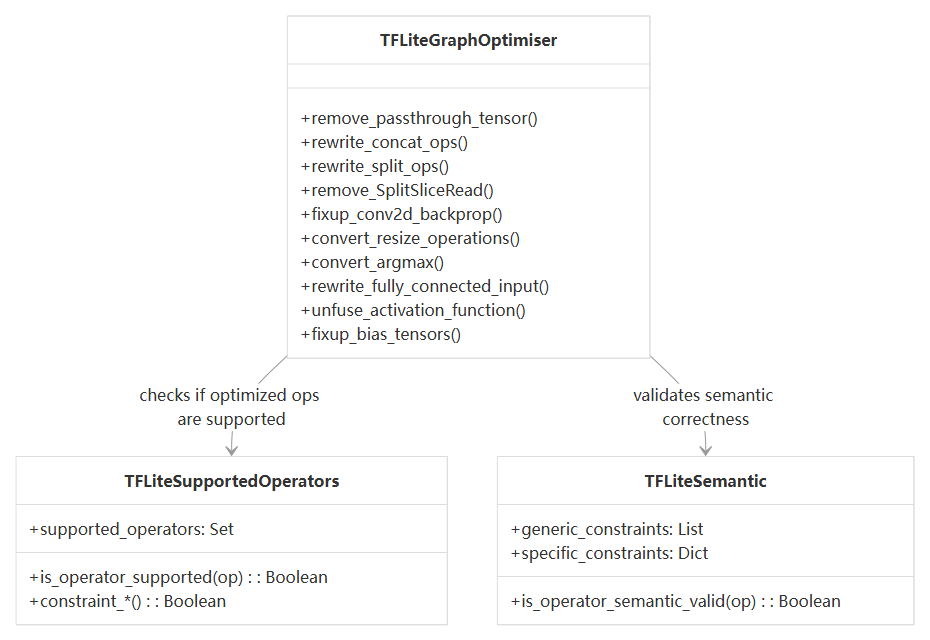

源码 [ethosu/vela/tflite_graph_optimiser.py](https://github.com/nxp-imx/ethos-u-vela/blob/395a5690/ethosu/vela/tflite_graph_optimiser.py) [ethosu/vela/tflite_supported_operators.py44-387](https://github.com/nxp-imx/ethos-u-vela/blob/395a5690/ethosu/vela/tflite_supported_operators.py#L44-L387) [ethosu/vela/tflite_model_semantic.py43-235](https://github.com/nxp-imx/ethos-u-vela/blob/395a5690/ethosu/vela/tflite_model_semantic.py#L43-L235)

## 优化技术

TFLite 图表优化器对图表应用了许多优化。 关键技术如下 :

### 删除 直通 张量

身份操作( 如 `Op.Identity`通过直接将其投入与产出连接起来,减少内存转移和计算间接费用,从而消除。

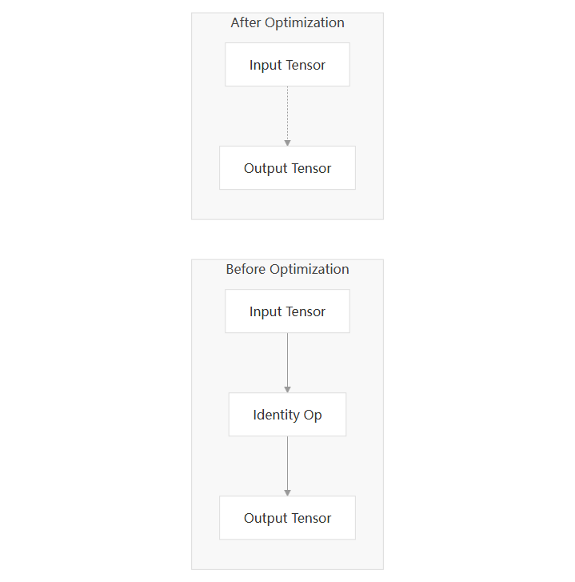

源码 [ethosu/vela/tflite_graph_optimiser.py84-88](https://github.com/nxp-imx/ethos-u-vela/blob/395a5690/ethosu/vela/tflite_graph_optimiser.py#L84-L88)

### 重写 Concat 操作

Concat操作被重写为使用一系列平均集合操作,这些操作在NPU上执行效率更高.

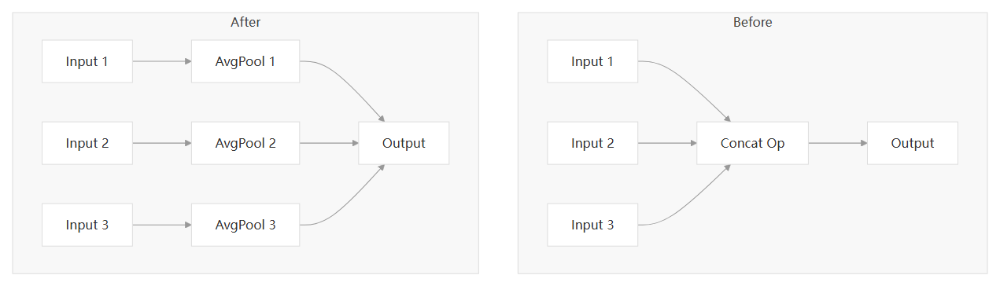

重写操作为每个输入创建单独的平均集合操作,每个输入写入输出的特定片段张量.

源码 [ethosu/vela/tflite_graph_optimiser.py91-133](https://github.com/nxp-imx/ethos-u-vela/blob/395a5690/ethosu/vela/tflite_graph_optimiser.py#L91-L133)

### 重写拆分操作

拆分操作被重写为使用 `SplitSliceRead` 从输入中读取特定切片的操作 张量。

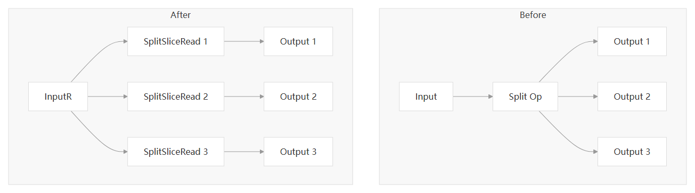

源码 [ethosu/vela/tflite_graph_optimiser.py136-196](https://github.com/nxp-imx/ethos-u-vela/blob/395a5690/ethosu/vela/tflite_graph_optimiser.py#L136-L196)

### 删除拆分读取

`SplitSliceRead` 通过以下两种方式进一步优化操作:

1. 将操作移至 张量 消费者
2. 转换为没有实际 池化 (NOP) 的平均集合操作

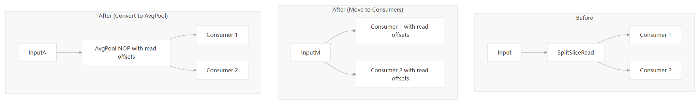

源码 [ethosu/vela/tflite_graph_optimiser.py198-242](https://github.com/nxp-imx/ethos-u-vela/blob/395a5690/ethosu/vela/tflite_graph_optimiser.py#L198-L242)

### 改变操作大小的转换

调整操作大小(Resize Bilinear,ResizeNearest Neightbor)转换为:

1. 平均集合业务,并升级
2. 深度卷积 卷积
3. 添加操作( 对于 1x1 调整大小)

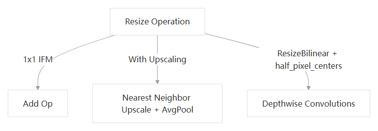

源码 [ethosu/vela/tflite_graph_optimiser.py317-797](https://github.com/nxp-imx/ethos-u-vela/blob/395a5690/ethosu/vela/tflite_graph_optimiser.py#L317-L797)

### 转换 ArgMax 中

argMax被转换成一个操作序列: 深度Conv2D → MaxPool → 深度Conv2D.


这种转换可以让ArgMax在NPU硬件上高效执行.

源码 [ethosu/vela/tflite_graph_optimiser.py493-662](https://github.com/nxp-imx/ethos-u-vela/blob/395a5690/ethosu/vela/tflite_graph_optimiser.py#L493-L662)

### 重写全连接输入

将全连接操作的输入张量重塑为NPU兼容的2D格式.

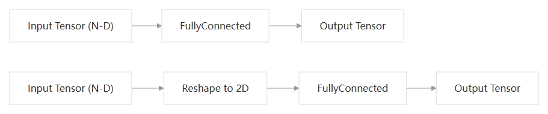

源码 [ethosu/vela/tflite_graph_optimiser.py824-840](https://github.com/nxp-imx/ethos-u-vela/blob/395a5690/ethosu/vela/tflite_graph_optimiser.py#L824-L840)

## 支持的运算符和制约

TFLite图优化器与一组预定义支持的算子工作. Each 算子 具有一般和具体的制约,必须满足这些制约才能在NPU上执行算子.

### 一般制约因素

这些限制适用于大多数操作者:

| 约束 | 说明 |
| --- | --- |
| 张量 数据类型 | 必须是int8,int8,int16或int32(有限操作) |
| 张量尺寸 | 必须在范围 [1, 65535] |
| 张量 形状 | 无法超过 4D |
| 批量大小 | 必须是1(具体行动除外) |
| 引信激活 | 必须是被支持的类型之一 |

源码 [ethosu/vela/tflite_supported_operators.py196-213](https://github.com/nxp-imx/ethos-u-vela/blob/395a5690/ethosu/vela/tflite_supported_operators.py#L196-L213) [SUPPORTED_OPS.md142-163](https://github.com/nxp-imx/ethos-u-vela/blob/395a5690/SUPPORTED_OPS.md?plain=1#L142-L163)

### 算子 支持检查

那个... `TFLiteSupportedOperators` class 包含逻辑以检查是否可在 NPU 上执行 算子 。 它验证 :

1. 适用于大多数经营者的一般限制
2. 操作员特有的制约因素(例如,步长大小,卷积核维度)

如果所有限制都得到满足,则算子可以在NPU上运行;否则,将在CPU上执行.

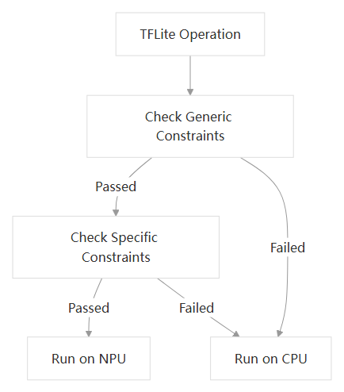

源码 [ethosu/vela/tflite_supported_operators.py368-387](https://github.com/nxp-imx/ethos-u-vela/blob/395a5690/ethosu/vela/tflite_supported_operators.py#L368-L387) [ethosu/vela/tflite_model_semantic.py216-241](https://github.com/nxp-imx/ethos-u-vela/blob/395a5690/ethosu/vela/tflite_model_semantic.py#L216-L241)

## 示例:优化Concat操作

让我们来检查一下Concat操作是如何优化的.

原始 Concat 操作 :

```
Inputs: [Tensor1(1,10,10,16), Tensor2(1,10,10,16)]
Axis: 3 (channel dimension)
Output: Tensor3(1,10,10,32)
```

在优化后,它变成:

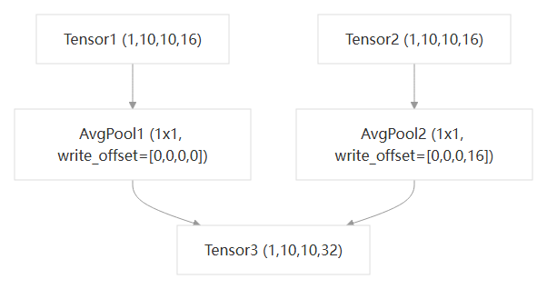

AvgPool操作的设置有1x1内核(有效只是一个复制操作),并有适当的写入抵消,将每个输入置于输出的正确区域张量. 这种方法可以使NPU上更高效的内存访问模式.

源码 [ethosu/vela/tflite_graph_optimiser.py91-133](https://github.com/nxp-imx/ethos-u-vela/blob/395a5690/ethosu/vela/tflite_graph_optimiser.py#L91-L133) [ethosu/vela/test/test_tflite_supported_operators.py437-487](https://github.com/nxp-imx/ethos-u-vela/blob/395a5690/ethosu/vela/test/test_tflite_supported_operators.py#L437-L487)

## 示例:优化调整运行规模

调整业务规模特别复杂,可以采取以下几种方式优化:

1. **1x1 输入**: 转换为零 张量 的添加操作
2. **以半像素_ 中心调整比线性大小**: 转换为带有特定内核的 深度卷积 卷积
3. **标准调整大小**: 转换为系列 1x1 平均池, 最近的邻居提升

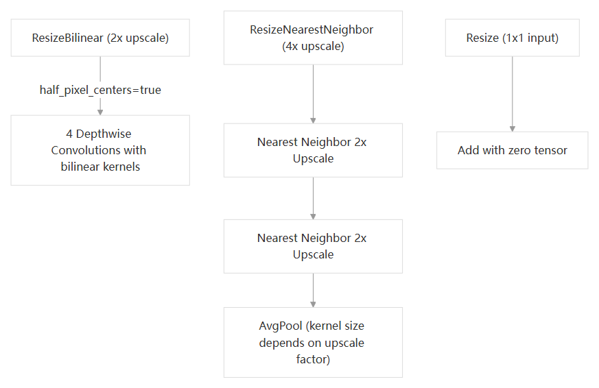

对于带有半像素中心的调整比线性,创建了四个深度卷积 卷积,每个处理输出的四角(TL,TR,BL,BR). 内核包含根据调整大小系数计算的插值系数.

源码 [ethosu/vela/tflite_graph_optimiser.py665-797](https://github.com/nxp-imx/ethos-u-vela/blob/395a5690/ethosu/vela/tflite_graph_optimiser.py#L665-L797) [ethosu/vela/test/test_tflite_supported_operators.py361-433](https://github.com/nxp-imx/ethos-u-vela/blob/395a5690/ethosu/vela/test/test_tflite_supported_operators.py#L361-L433)

## 优化流程

以下是TFLite图优化进程在Vela的整体流量:

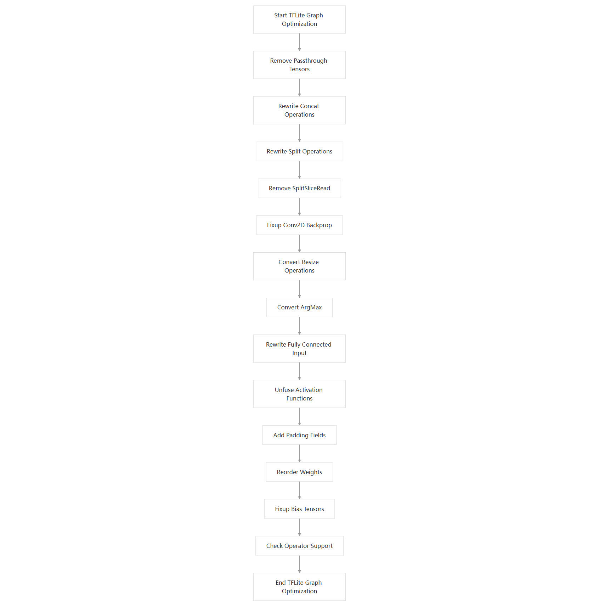

每个优化步骤依次应用到图表中,早期的优化有可能使后期的优化得以实现。如果结果的算子得到NPU的支持,则进行最后的步骤检查。

源码 [ethosu/vela/tflite_graph_optimiser.py](https://github.com/nxp-imx/ethos-u-vela/blob/395a5690/ethosu/vela/tflite_graph_optimiser.py) [ethosu/vela/tflite_supported_operators.py368-387](https://github.com/nxp-imx/ethos-u-vela/blob/395a5690/ethosu/vela/tflite_supported_operators.py#L368-L387)

## 小结

TFLite 图优化 模块是 Vela 编译器的关键组件,该模块将 TensorFlow Lite 操作转换为在 Ethos-U NPU 上高效运行,它应用了一系列优化来:

1. 消除不必要的操作(移走直通张量)
2. 将不支持的操作转换为支持的操作( 更改大小, argmax)
3. 重写更好的操作 性能 (cat, 拆分)
4. 重塑 NPU 兼容性输入( 完全连接)

这些优化对于实现Ethos-U NPU上的最佳性能和内存使用至关重要. 优化后,系统检查每个算子是否符合NPU执行所需的限制. 算子 不符合这些限制的将运行在CPU上.

[返回中文目录](0-Index.md)
