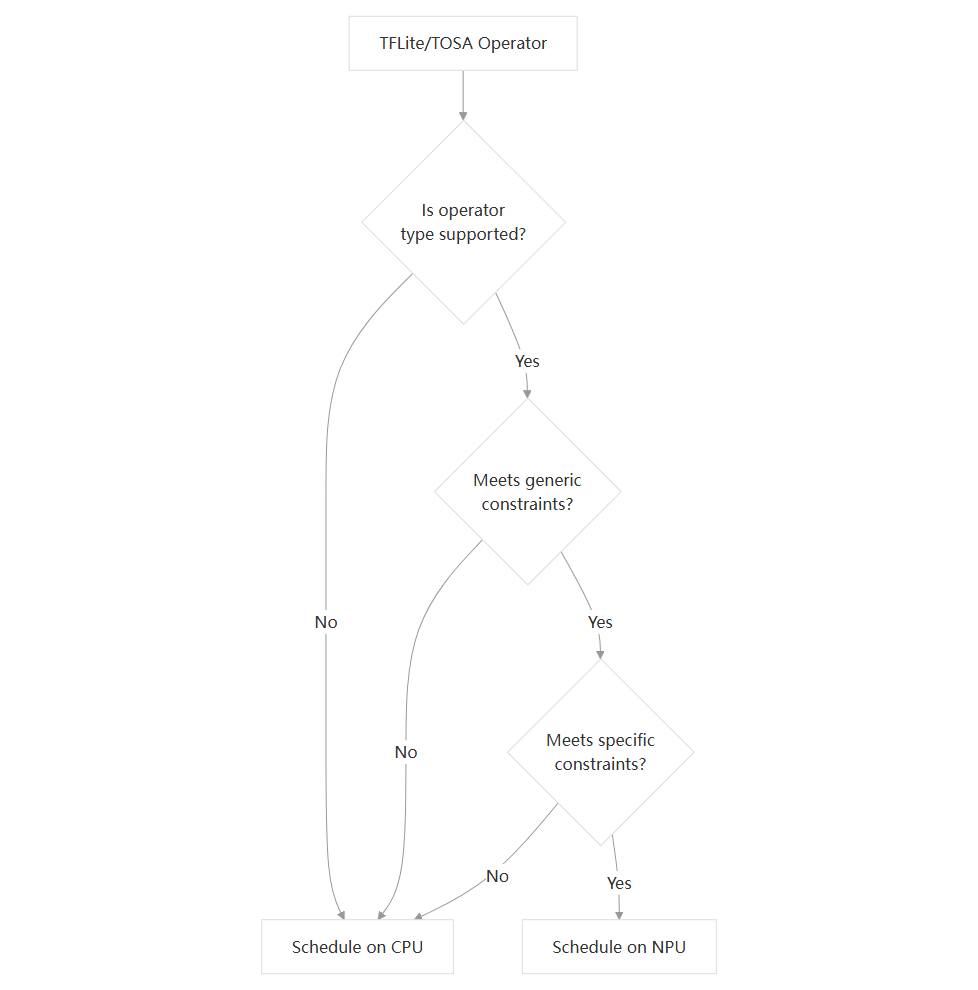
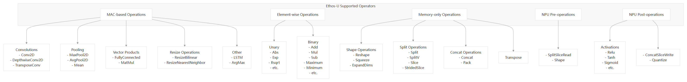
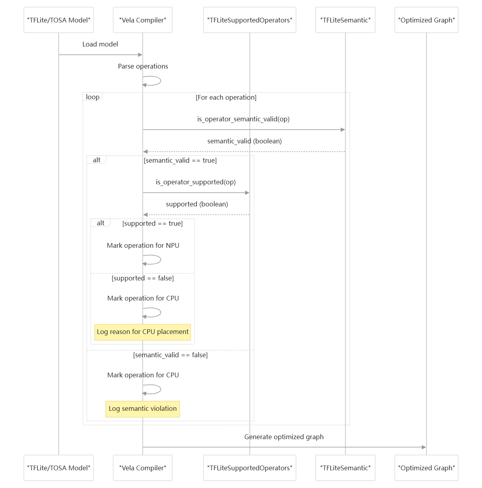

# 支持的算子

**相关源码**

- [SUPPORTED_OPS.md](https://github.com/nxp-imx/ethos-u-vela/blob/395a5690/SUPPORTED_OPS.md?plain=1)
- [ethosu/vela/test/test_graph_optimiser.py](https://github.com/nxp-imx/ethos-u-vela/blob/395a5690/ethosu/vela/test/test_graph_optimiser.py)
- [ethosu/vela/test/test_tflite_model_semantic.py](https://github.com/nxp-imx/ethos-u-vela/blob/395a5690/ethosu/vela/test/test_tflite_model_semantic.py)
- [ethosu/vela/test/test_tflite_supported_operators.py](https://github.com/nxp-imx/ethos-u-vela/blob/395a5690/ethosu/vela/test/test_tflite_supported_operators.py)
- [ethosu/vela/test/testutil.py](https://github.com/nxp-imx/ethos-u-vela/blob/395a5690/ethosu/vela/test/testutil.py)
- [ethosu/vela/tflite_graph_optimiser.py](https://github.com/nxp-imx/ethos-u-vela/blob/395a5690/ethosu/vela/tflite_graph_optimiser.py)
- [ethosu/vela/tflite_model_semantic.py](https://github.com/nxp-imx/ethos-u-vela/blob/395a5690/ethosu/vela/tflite_model_semantic.py)
- [ethosu/vela/tflite_supported_operators.py](https://github.com/nxp-imx/ethos-u-vela/blob/395a5690/ethosu/vela/tflite_supported_operators.py)

本页面记录了 Ethos-U 神经处理单元(NPU) 在使用 Vela 编译器时所支持的 算子 。 它详细介绍了 TensorFlow Lite 和 TOSA 算子 可以在 NPU 硬件上执行哪些功能, 以及限制和要求 。 有关在编译过程中如何优化 算子 的信息, 请参见 [图优化](3-graph-optimization.md).

## 算子支助系统概况

Vela编译器决定神经网络模型中的算子是可以在Ethos-U NPU上运行,还是需要在CPU上执行. 这一决定基于一系列检查:

1. NPU架构支持操作类型吗?
2. 该操作是否满足适用于大多数操作者的通用限制?
3. 行动是否满足特定类型的具体限制?

如果其中任何一次检查失败,操作会被安排在CPU上运行,而不是NPU.



源码 [ethosu/vela/tflite_supported_operators.py367-386](https://github.com/nxp-imx/ethos-u-vela/blob/395a5690/ethosu/vela/tflite_supported_operators.py#L367-L386)

## 制约因素类别

算子 制约因素分为两类:

### 一般限制

这些是大多数算子在NPU上运行必须满足的基本要求:

- 所有需要的 算子 属性必须指定
- 输入和输出张量不得是动态的
- 张量 必须有定义的形状(无) `None` 维度)
- 张量 维度必须在范围 [1, 65535]
- 多数算子要求批量尺寸为 1
- 支持的数据类型为int8,int8,int16和int32(带有某些算子限制).
- 单轴 量化 仅支持特定 算子
- 如果存在引信激活功能,它们必须具有支持类型

### 具体制约因素

这些是每一种操作者特有的要求。例如:

- 卷积 卷积核 尺寸限制
- 过滤尺寸限制
- 步长和膨胀率限制
- 填充要求
- 输入和输出的形状兼容性

源码 [ethosu/vela/tflite_supported_operators.py214-224](https://github.com/nxp-imx/ethos-u-vela/blob/395a5690/ethosu/vela/tflite_supported_operators.py#L214-L224) [SUPPORTED_OPS.md141-163](https://github.com/nxp-imx/ethos-u-vela/blob/395a5690/SUPPORTED_OPS.md?plain=1#L141-L163)

## 支持的 算子 类别

Ethos-U NPU支持广泛的TensorFlow Lite算子,可以分类如下:



源码 [ethosu/vela/tflite_supported_operators.py46-194](https://github.com/nxp-imx/ethos-u-vela/blob/395a5690/ethosu/vela/tflite_supported_operators.py#L46-L194)

## 算子 支助执行

Vela编译器通过类和功能组合执行算子支持检查机制:

```

```

支助检查过程遵循这些步骤:

1. 那个... `is_operator_supported()` 如果 算子 类型在所支持的列表中, 将首先检查方法
2. 然后适用一般性限制(某些操作者除外)
3. 最后,它对算子类型适用具体限制。
4. 如果所有检查都通过,则标记 算子 在 NPU 上运行, 否则在 CPU 上运行

源码 [ethosu/vela/tflite_supported_operators.py368-387](https://github.com/nxp-imx/ethos-u-vela/blob/395a5690/ethosu/vela/tflite_supported_operators.py#L368-L387) [ethosu/vela/tflite_model_semantic.py216-240](https://github.com/nxp-imx/ethos-u-vela/blob/395a5690/ethosu/vela/tflite_model_semantic.py#L216-L240)

## 架构- 特定 算子 支持

Ethos-U产品线包括不同的NPU架构,每个架构在算子支持中都略有变化:

### Ethos-U55和Ethos-U65号卫星

这些架构支持一套共同的 算子 , 具有相同的限制。 支持的密钥 算子 包括:

- Conv2D, 深度Conv2D, 转录Conv
- 最大pool2D, 平均Pool2D
- 添加、 穆尔、 子、 最大、 最小值
- 雷卢,雷卢6,坦赫,西格莫伊德,莱基雷卢
- 重塑,挤压,转置
- 完全连接(有限制)
- LSTM(有限制)
- 还有更多

### Ethos-U85 (英语).

Ethos-U85架构支持由U55/U65+附加支持的大部分算子:

- 批量马特穆尔
- 聚集起来
- 散点

此外,一些制约因素可能因架构而异,例如步长限制,滤波器尺寸,以及其他硬件特异性能力可能有所不同.

源码 [SUPPORTED_OPS.md31-139](https://github.com/nxp-imx/ethos-u-vela/blob/395a5690/SUPPORTED_OPS.md?plain=1#L31-L139) [SUPPORTED_OPS.md85-138](https://github.com/nxp-imx/ethos-u-vela/blob/395a5690/SUPPORTED_OPS.md?plain=1#L85-L138)

## 详细制约因素实例

让我们详细研究一些具体的操作人员制约因素:

### 卷积（Conv2D）约束

Conv2D算子有几种具体的限制:

- 步长 值必须在一定限度内:
  - 步长 当输出高度 > 1时,高度必须在1至3之间
  - 步长宽度的类似限制
- 卷积核 高度必须在1至64之间
- 膨胀卷积核的产物宽度和高度必须在1至4096之间
- 重量 张量 必须为 8 位且恒定
- 可选 偏置张量必须是1D,类型为int32或int64
- 偏置 张量 值必须在 40 位内

### 池化约束

用于池化 MaxPool2D和AvgPool2D等操作:

- 卷积核 滤波器尺寸有最大尺寸(典型的8x8是AvgPool与SAME填充).
- 带有 VALID 填充 的 AvgPool 可以支持更大的过滤维度
- MaxPool 支持更大的过滤维度, 不管 填充

### 元素运算符限制

算子像Add,Mul,Sub有他们自己的要求:

- 至少一个输入形状必须匹配输出形状
- 两种输入数据类型必须匹配
- 对于有符号输入数据类型,输出也必须是有符号.
- 广播只允许进行一级分级索引

源码 [SUPPORTED_OPS.md222-258](https://github.com/nxp-imx/ethos-u-vela/blob/395a5690/SUPPORTED_OPS.md?plain=1#L222-L258) [SUPPORTED_OPS.md309-319](https://github.com/nxp-imx/ethos-u-vela/blob/395a5690/SUPPORTED_OPS.md?plain=1#L309-L319) [SUPPORTED_OPS.md359-366](https://github.com/nxp-imx/ethos-u-vela/blob/395a5690/SUPPORTED_OPS.md?plain=1#L359-L366)

## 支持检查进程

下图说明Vela编译器在编译过程中如何支持算子:



当一个算子失败支持检查时,Vela会输出一个警告信息,解释为什么算子必须在CPU上运行而不是NPU.

源码 [ethosu/vela/tflite_supported_operators.py380-384](https://github.com/nxp-imx/ethos-u-vela/blob/395a5690/ethosu/vela/tflite_supported_operators.py#L380-L384) [ethosu/vela/tflite_model_semantic.py232-238](https://github.com/nxp-imx/ethos-u-vela/blob/395a5690/ethosu/vela/tflite_model_semantic.py#L232-L238)

## 使用支持的算子报告

要查看您目标设备的完整支持列表 算子, 您可以使用 `--supported-ops-report` 带有 Vela 编译器的旗帜 。 这将生成一份所有支持 算子 及其限制的详细报告 :

```
vela --supported-ops-report
```

报告包括:

- Ethos-U的简表架构
- 适用于大多数经营者的一般限制
- 每种操作人员的具体制约细节架构

这种信息可以帮助您设计你的神经网络,通过避免强制CPU执行的操作来确保NPU的高利用率.

## 测试 算子 支持

在为Ethos-U NPU开发模型时,您可以使用几种方法来检查您的算子是否会得到支持:

1. 使用 Vela 编译器与 `--show-cpu-operations` 标记以识别将运行在 CPU 上的操作
2. 审查不支持的警告输出日志 算子
3. 咨询所支持的算子报告,以了解详细的制约因素

早期在模型开发过程中了解这些制约因素,将有助于您设计能最大限度利用NPU和性能的网络.

源码 [SUPPORTED_OPS.md21-22](https://github.com/nxp-imx/ethos-u-vela/blob/395a5690/SUPPORTED_OPS.md?plain=1#L21-L22)

[返回中文目录](0-Index.md)
