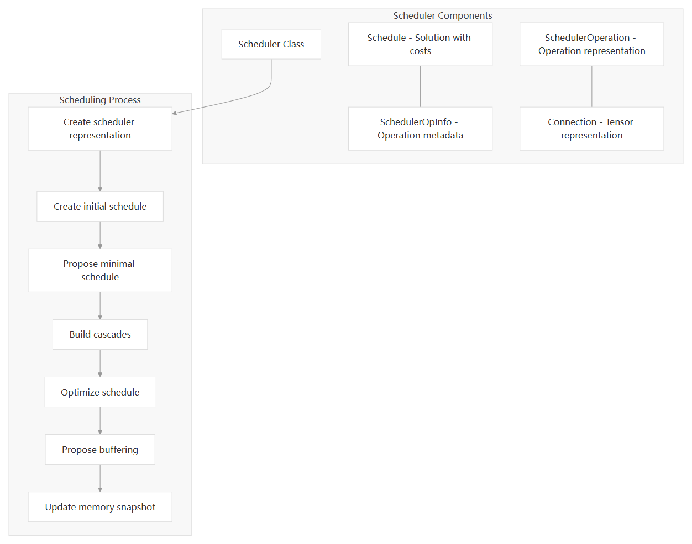
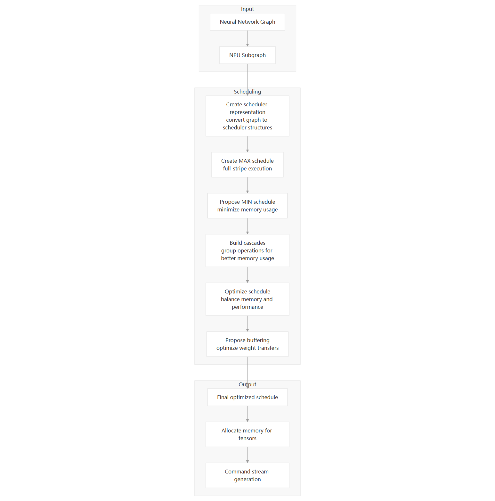
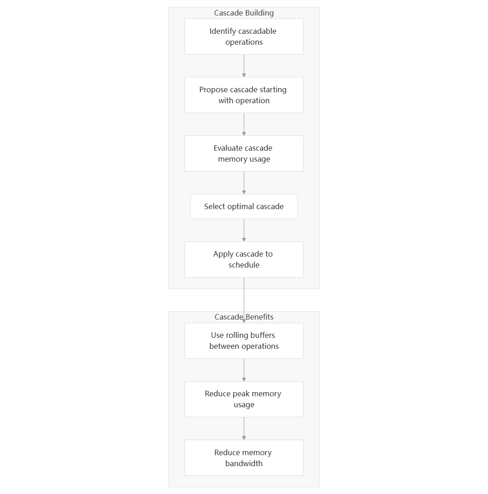
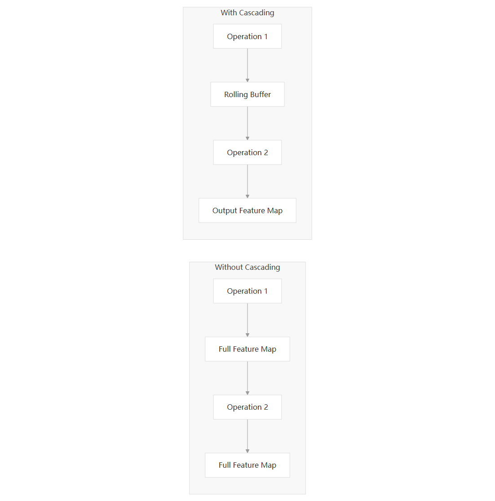
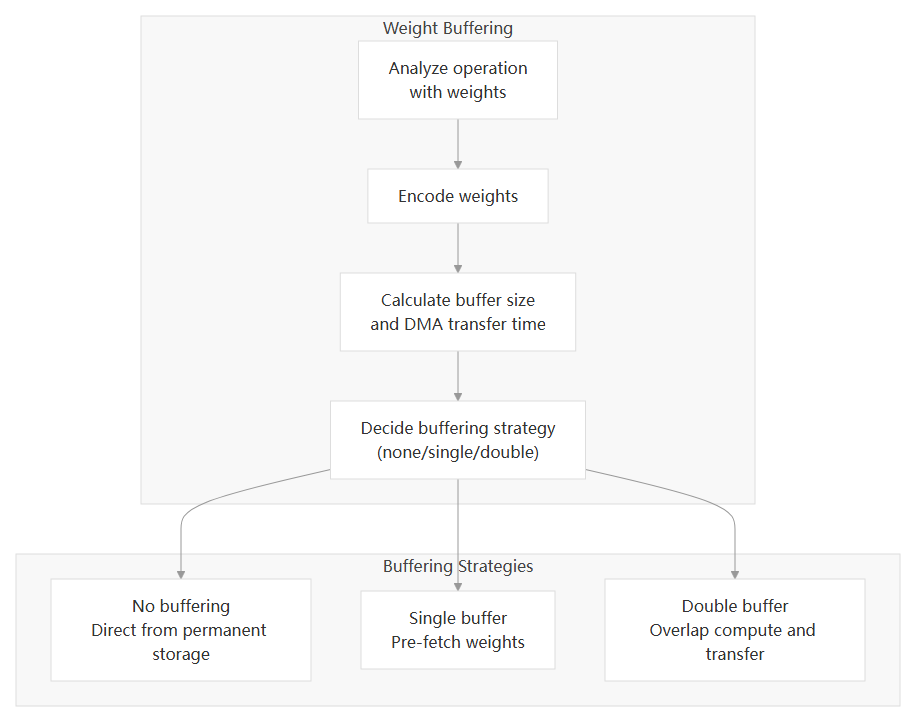
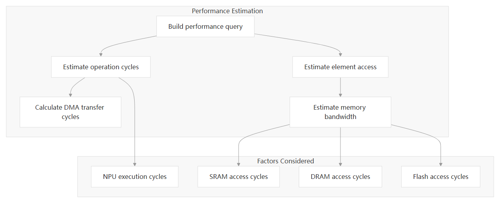
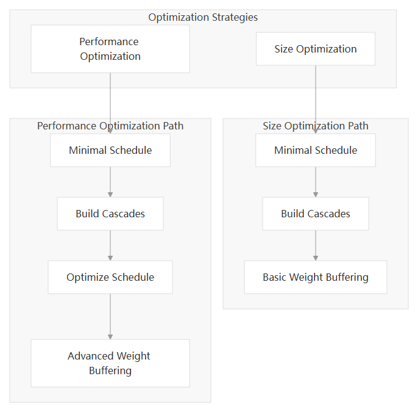

# 算子调度

**相关源码**

- [ethosu/regor/compiler/scheduler.cpp](https://github.com/nxp-imx/ethos-u-vela/blob/395a5690/ethosu/regor/compiler/scheduler.cpp)
- [ethosu/regor/compiler/scheduler.hpp](https://github.com/nxp-imx/ethos-u-vela/blob/395a5690/ethosu/regor/compiler/scheduler.hpp)
- [ethosu/vela/cascade_builder.py](https://github.com/nxp-imx/ethos-u-vela/blob/395a5690/ethosu/vela/cascade_builder.py)
- [ethosu/vela/live_range.py](https://github.com/nxp-imx/ethos-u-vela/blob/395a5690/ethosu/vela/live_range.py)
- [ethosu/vela/npu_performance.py](https://github.com/nxp-imx/ethos-u-vela/blob/395a5690/ethosu/vela/npu_performance.py)
- [ethosu/vela/scheduler.py](https://github.com/nxp-imx/ethos-u-vela/blob/395a5690/ethosu/vela/scheduler.py)

算子调度是Ethos-U Vela编译器的关键组成部分,它决定了Ethos-U NPU上的神经网络操作是如何执行的. 调度器 为网络创建并搜索一个最佳计划,为操作选择块配置和分区以平衡内存使用和性能. 本页面解释列表过程,级联机制,以及Vela编译器中使用的优化策略. 关于内存管理的信息和张量分配作为调度过程的一部分,请参见: [内存管理与张量分配](4.1-memory-management-and-tensor-allocation.md).

## 调度器 概览

源码 [ethosu/vela/scheduler.py429-434](https://github.com/nxp-imx/ethos-u-vela/blob/395a5690/ethosu/vela/scheduler.py#L429-L434) [ethosu/vela/scheduler.py413-427](https://github.com/nxp-imx/ethos-u-vela/blob/395a5690/ethosu/vela/scheduler.py#L413-L427)

调度器负责为Ethos-U NPU上的神经网络操作寻找一个最佳执行策略,它使用一个图示来工作,其中操作的节点(Scheduler Operation)和张量是操作之间的边缘(连接).

### 主要组件

- **调度器**: 主持调度进程的主要课程
- **时间表**: 包含一个如何安排 NPU 子图 及其成本的解决方案
- **调度操作**: 指预定进行的行动
- **调度器OpInfo**: 包含关于计划操作的元数据
- **连接**: 运行之间的连接张量

调度器通过考虑内存限制,操作依赖性,和NPU硬件能力,决定了如何最佳地执行操作. 它创造了不同的调度,在内存使用和性能之间有不同的权衡,最终根据优化策略选择最合适的调度.

源码 [ethosu/vela/scheduler.py76-164](https://github.com/nxp-imx/ethos-u-vela/blob/395a5690/ethosu/vela/scheduler.py#L76-L164) [ethosu/vela/scheduler.py166-322](https://github.com/nxp-imx/ethos-u-vela/blob/395a5690/ethosu/vela/scheduler.py#L166-L322) [ethosu/vela/scheduler.py395-409](https://github.com/nxp-imx/ethos-u-vela/blob/395a5690/ethosu/vela/scheduler.py#L395-L409)

## 日程安排过程

源码 [ethosu/vela/scheduler.py432-564](https://github.com/nxp-imx/ethos-u-vela/blob/395a5690/ethosu/vela/scheduler.py#L432-L564) [ethosu/regor/compiler/scheduler.cpp80-151](https://github.com/nxp-imx/ethos-u-vela/blob/395a5690/ethosu/regor/compiler/scheduler.cpp#L80-L151)

时间安排过程包括以下主要步骤:

1. **创建 调度器 代表**: 将神经网络图转换成调度器特定数据结构
2. **创建初始时间表**: 当操作使用全 张量 时生成一个最大调度 。
3. **提议最小时间表**: 试图尽量减少 条带划分 操作的内存使用
4. **构建 级联**: 将操作组合为 级联 以优化内存使用
5. **优化时间表**: 平衡内存使用和性能
6. **提议缓冲**: 添加权重缓冲以进一步优化性能
7. **内存分配**: 根据最后时间表为 张量 分配内存

每一步都有助于找到一个最佳的执行策略,既能满足内存限制,又能最大化性能.

源码 [ethosu/vela/scheduler.py485-564](https://github.com/nxp-imx/ethos-u-vela/blob/395a5690/ethosu/vela/scheduler.py#L485-L564) [ethosu/regor/compiler/scheduler.cpp288-320](https://github.com/nxp-imx/ethos-u-vela/blob/395a5690/ethosu/regor/compiler/scheduler.cpp#L288-L320)

### 初始计划创建

调度器 开头创建一个初始的"最大"时间表,其中每次操作使用全 张量 而不进行任何优化:

源码 [ethosu/vela/scheduler.py559-569](https://github.com/nxp-imx/ethos-u-vela/blob/395a5690/ethosu/vela/scheduler.py#L559-L569) [ethosu/regor/compiler/scheduler.cpp666-696](https://github.com/nxp-imx/ethos-u-vela/blob/395a5690/ethosu/regor/compiler/scheduler.cpp#L666-L696)

每次行动,调度器:

1. 使用全 输出特征图 形状
2. 为 NPU 硬件找到最佳 块配置
3. 编码 权重 和比例尺(如果适用)
4. 使用NPU性能模型的估算 性能

这个初始时间表为进一步优化提供了基线,并代表了最大内存使用设想.

源码 [ethosu/vela/scheduler.py324-362](https://github.com/nxp-imx/ethos-u-vela/blob/395a5690/ethosu/vela/scheduler.py#L324-L362)

## 行动级联

调度器中最重要的优化之一是操作级联,它将连续的操作分组,以最小化内存使用:

源码 [ethosu/vela/cascade_builder.py86-350](https://github.com/nxp-imx/ethos-u-vela/blob/395a5690/ethosu/vela/cascade_builder.py#L86-L350)

A级联连接操作,使一个操作的输出成为下一个操作的输入. 级联操作不是存储完整张量,而是使用较小的滚动缓冲区来显著减少内存使用.

### 分级标准

符合这些标准的操作可分级进行:

- 它们不是矢量生产或减量生产
- 输出 条带 的大小小于完整的输出形状
- 他们没有读数的冲抵
- 对于逐元素 业务,IFM必须是非恒星/非恒星/非广播
- 他们的顺序正确,形状相容

级联构建器以最小的进度开始,并尝试构建级联以优化内存使用,同时确保运行高效运行.

源码 [ethosu/vela/cascade_builder.py95-106](https://github.com/nxp-imx/ethos-u-vela/blob/395a5690/ethosu/vela/cascade_builder.py#L95-L106) [ethosu/vela/cascade_builder.py153-308](https://github.com/nxp-imx/ethos-u-vela/blob/395a5690/ethosu/vela/cascade_builder.py#L153-L308)

### 滚动缓冲区

级联中的关键概念是滚动缓冲区,这是级联中连续运行之间共享的较小的内存区域:

滚动缓冲区大小是根据生产者的输出条带和消费者的输入要求计算出来的,与存储全特征图相比,大大降低了内存占用.

源码 [ethosu/vela/cascade_builder.py76-83](https://github.com/nxp-imx/ethos-u-vela/blob/395a5690/ethosu/vela/cascade_builder.py#L76-L83)

## 时间安排中的内存管理

调度器使用活跃区间分析追踪张量寿命并优化内存分配:

源码 [ethosu/vela/live_range.py33-158](https://github.com/nxp-imx/ethos-u-vela/blob/395a5690/ethosu/vela/live_range.py#L33-L158) [ethosu/vela/scheduler.py571-585](https://github.com/nxp-imx/ethos-u-vela/blob/395a5690/ethosu/vela/scheduler.py#L571-L585)

调度器 保持一个内存快照,跟踪整个执行时间段内存的使用情况,这有助于估计顶峰内存的使用情况并寻找内存优化的机会.

记忆管理的关键方面:

- 跟踪张量寿命(开始和结束时间)
- 确定热量再利用的机会
- 估计不同时间表选项的内存要求
- 确保内存使用不受限制

源码 [ethosu/vela/live_range.py214-225](https://github.com/nxp-imx/ethos-u-vela/blob/395a5690/ethosu/vela/live_range.py#L214-L225) [ethosu/vela/live_range.py338-407](https://github.com/nxp-imx/ethos-u-vela/blob/395a5690/ethosu/vela/live_range.py#L338-L407)

## 权重缓冲

另一个重要的优化是权重缓冲,它通过在更快的内存中搭载权重来改进性能:

源码 [ethosu/vela/scheduler.py649-924](https://github.com/nxp-imx/ethos-u-vela/blob/395a5690/ethosu/vela/scheduler.py#L649-L924)

权重缓冲过程 :

1. 与 权重 分析操作,以确定缓冲是否将改进 性能
2. 编码 权重 并计算缓冲大小和 DMA 传输时间
3. 决定缓冲策略(无缓冲、单缓冲或双缓冲)
4. 对于双缓冲,重力转移与计算重叠,以隐藏延迟

调度器在作出缓冲决定时,会考虑从以往操作中可获得的松懈周期和可用的内存.

源码 [ethosu/vela/scheduler.py702-771](https://github.com/nxp-imx/ethos-u-vela/blob/395a5690/ethosu/vela/scheduler.py#L702-L771)

## 性能估算

调度器使用一个性能模型来估计不同调度选项的执行周期和内存带宽:

源码 [ethosu/vela/npu_performance.py104-171](https://github.com/nxp-imx/ethos-u-vela/blob/395a5690/ethosu/vela/npu_performance.py#L104-L171) [ethosu/vela/npu_performance.py447-777](https://github.com/nxp-imx/ethos-u-vela/blob/395a5690/ethosu/vela/npu_performance.py#L447-L777)

性能估算包括:

1. 构建带有操作细节(形状、格式、内存区域)的 性能 查询
2. 根据操作类型和块配置估计操作执行周期
3. 估计投入、产出和权重要素准入量
4. 计算 权重、LUTs 和其他数据的 DMA 传输周期
5. 估计不同内存领域的内存带宽要求

这一性能模型既用于安排评估不同提案,也用于提供汇编网络的最后性能估计数。

源码 [ethosu/vela/npu_performance.py260-437](https://github.com/nxp-imx/ethos-u-vela/blob/395a5690/ethosu/vela/npu_performance.py#L260-L437)

## 优化策略

调度器支持两项主要优化战略:

1. **大小优化**:尽可能减少内存使用,可能以业绩为代价
2. **性能 优化**:优先执行速度,同时将内存使用控制在限度内

源码 [ethosu/vela/scheduler.py83-90](https://github.com/nxp-imx/ethos-u-vela/blob/395a5690/ethosu/vela/scheduler.py#L83-L90) [ethosu/regor/compiler/scheduler.cpp95-121](https://github.com/nxp-imx/ethos-u-vela/blob/395a5690/ethosu/regor/compiler/scheduler.cpp#L95-L121)

所选策略会如何影响调度器:

- 构建 级联
- 决定权重缓冲
- 在备选附表中选择
- 为 张量 分配内存

调度器总是试图满足配置中指定的内存限制,同时优化选定目标.

源码 [ethosu/vela/scheduler.py432-439](https://github.com/nxp-imx/ethos-u-vela/blob/395a5690/ethosu/vela/scheduler.py#L432-L439)

## 小结

操作调度器是Ethos-U Vela编译器的一个基本组成部分:

1. 在 NPU 上执行的神经网络操作
2. 通过级联和张量再利用优化内存使用
3. 通过权重缓冲改进性能和操作订单
4. 估计性能和不同时间表选项的内存使用
5. 根据选定的优化战略平衡内存和性能取舍

调度器的输出决定了NPU上的操作如何执行,既影响内存使用,也影响编译神经网络的执行性能.

源码 [ethosu/vela/scheduler.py17-20](https://github.com/nxp-imx/ethos-u-vela/blob/395a5690/ethosu/vela/scheduler.py#L17-L20) [ethosu/regor/compiler/scheduler.cpp17-56](https://github.com/nxp-imx/ethos-u-vela/blob/395a5690/ethosu/regor/compiler/scheduler.cpp#L17-L56)

[返回中文目录](0-Index.md)
