# 内存管理与张量分配

**相关源码**

- [ethosu/vela/cascade_builder.py](https://github.com/nxp-imx/ethos-u-vela/blob/395a5690/ethosu/vela/cascade_builder.py)
- [ethosu/vela/greedy_allocation.py](https://github.com/nxp-imx/ethos-u-vela/blob/395a5690/ethosu/vela/greedy_allocation.py)
- [ethosu/vela/hillclimb_allocation.py](https://github.com/nxp-imx/ethos-u-vela/blob/395a5690/ethosu/vela/hillclimb_allocation.py)
- [ethosu/vela/live_range.py](https://github.com/nxp-imx/ethos-u-vela/blob/395a5690/ethosu/vela/live_range.py)
- [ethosu/vela/nn_graph.py](https://github.com/nxp-imx/ethos-u-vela/blob/395a5690/ethosu/vela/nn_graph.py)
- [ethosu/vela/npu_performance.py](https://github.com/nxp-imx/ethos-u-vela/blob/395a5690/ethosu/vela/npu_performance.py)
- [ethosu/vela/scheduler.py](https://github.com/nxp-imx/ethos-u-vela/blob/395a5690/ethosu/vela/scheduler.py)
- [ethosu/vela/stats_writer.py](https://github.com/nxp-imx/ethos-u-vela/blob/395a5690/ethosu/vela/stats_writer.py)
- [ethosu/vela/tensor_allocation.py](https://github.com/nxp-imx/ethos-u-vela/blob/395a5690/ethosu/vela/tensor_allocation.py)
- [ethosu/vela/test/test_hillclimb_allocation.py](https://github.com/nxp-imx/ethos-u-vela/blob/395a5690/ethosu/vela/test/test_hillclimb_allocation.py)

本页面记录了Ethos-U Vela编译器在神经网络编译过程中如何管理内存和分配张量. 它解释了活跃区间分析,张量分配策略,以及用于高效映射张量到内存地址的内存优化技术.

关于与内存管理密切合作的算子调度的信息,参见: [算子调度](4-operation-scheduling.md).

## 概览

Ethos-U NPU限制在芯片上存储器,使得高效的内存管理对于性能至关重要. Vela的内存管理系统在张量创建和消耗时进行分析,确定重叠的寿命,并指定内存地址以尽量减少整体内存使用.

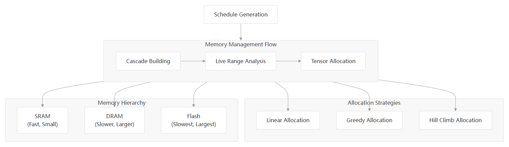

源码 [ethosu/vela/live_range.py1-409](https://github.com/nxp-imx/ethos-u-vela/blob/395a5690/ethosu/vela/live_range.py#L1-L409) [ethosu/vela/tensor_allocation.py1-291](https://github.com/nxp-imx/ethos-u-vela/blob/395a5690/ethosu/vela/tensor_allocation.py#L1-L291) [ethosu/vela/cascade_builder.py1-351](https://github.com/nxp-imx/ethos-u-vela/blob/395a5690/ethosu/vela/cascade_builder.py#L1-L351)

## 活跃区间分析

活跃区间分析当张量在网络执行中是"活性"时的音轨,以识别内存再利用的机会. A张量从创建到最后使用时都是活性的.

### 核心构成部分

- **直播范围**: 代表张量在创建到最后使用之间的寿命
- **生活线条( L)**: 管理 活跃区间 的集合,并计算内存使用时间

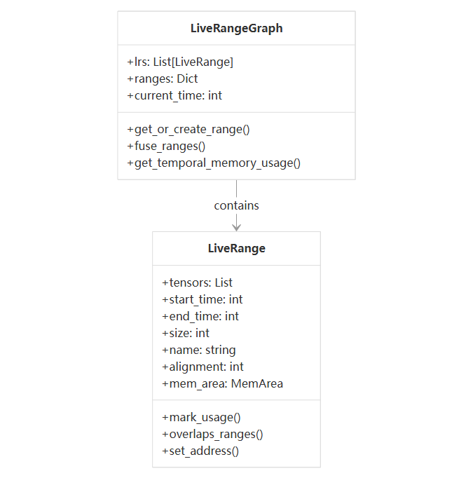

源码 [ethosu/vela/live_range.py33-111](https://github.com/nxp-imx/ethos-u-vela/blob/395a5690/ethosu/vela/live_range.py#L33-L111) [ethosu/vela/live_range.py116-158](https://github.com/nxp-imx/ethos-u-vela/blob/395a5690/ethosu/vela/live_range.py#L116-L158)

### 提取活跃区间

活跃区间是从网络时间表中提取的,方法是在创建和消耗张量时跟踪:

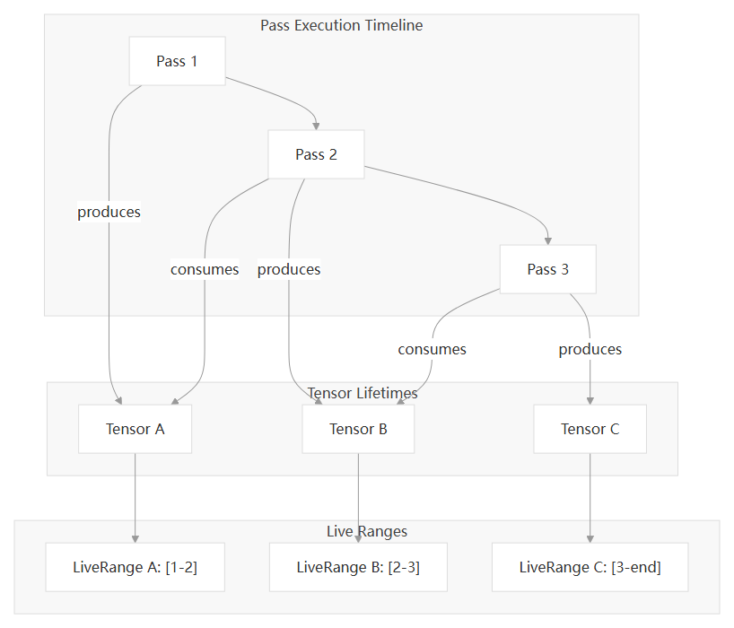

系统根据计划执行的操作提取活跃区间:

1. 为每个操作指定时间索引
2. 对于每个张量,表示创建时间(开始_时间)和最后消耗时间(结束_时间)
3. 构建包含全部 张量 活跃区间 的 Live RangeGraph
4. 分析哪些张量寿命重叠,哪些不重复

源码 [ethosu/vela/live_range.py234-313](https://github.com/nxp-imx/ethos-u-vela/blob/395a5690/ethosu/vela/live_range.py#L234-L313) [ethosu/vela/live_range.py338-407](https://github.com/nxp-imx/ethos-u-vela/blob/395a5690/ethosu/vela/live_range.py#L338-L407)

### 内存复用机会

在活跃区间分析期间确定了两种关键的内存优化技术:

1. **逐元素行动**: 对于 逐元素 操作,输出经常可以重复输入 张量 的内存
2. **级联 缓冲共享**: 级联 中的操作可以使用较小的“滚动缓冲区”而不是全尺寸的缓冲器

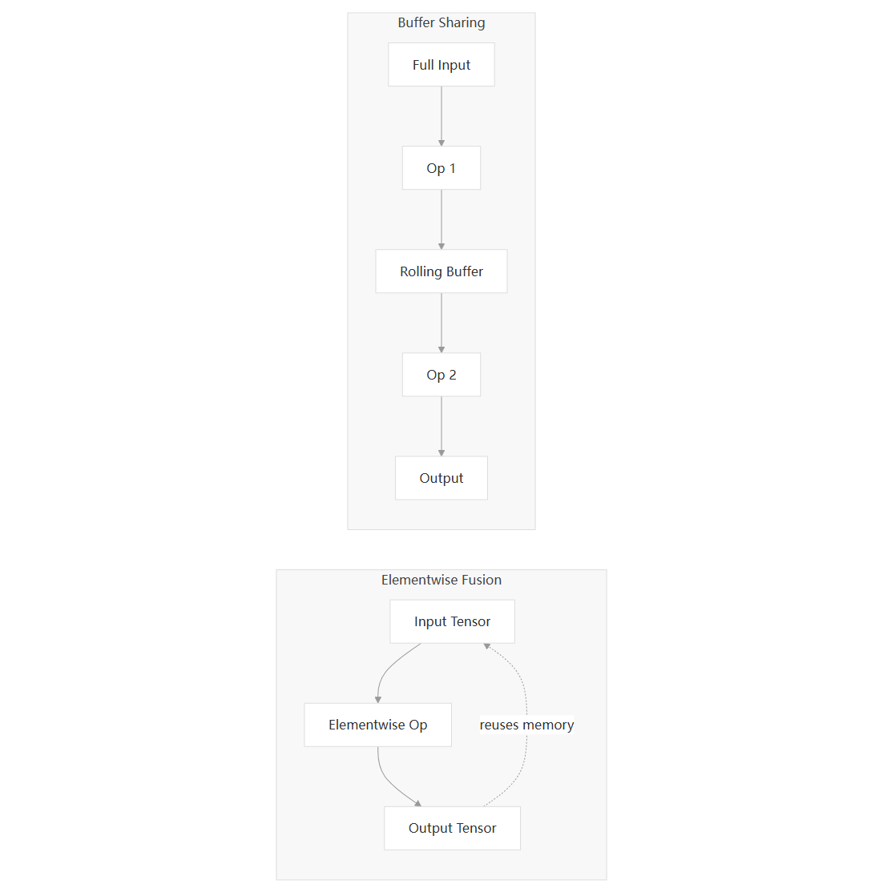

源码 [ethosu/vela/live_range.py170-220](https://github.com/nxp-imx/ethos-u-vela/blob/395a5690/ethosu/vela/live_range.py#L170-L220) [ethosu/vela/scheduler.py445-463](https://github.com/nxp-imx/ethos-u-vela/blob/395a5690/ethosu/vela/scheduler.py#L445-L463)

## 张量分配策略

Vela执行三个分配策略,在分配速度和内存效率之间有不同的权衡.

### 1. 线性分配

最简单的方法,按顺序分配 张量 内存:

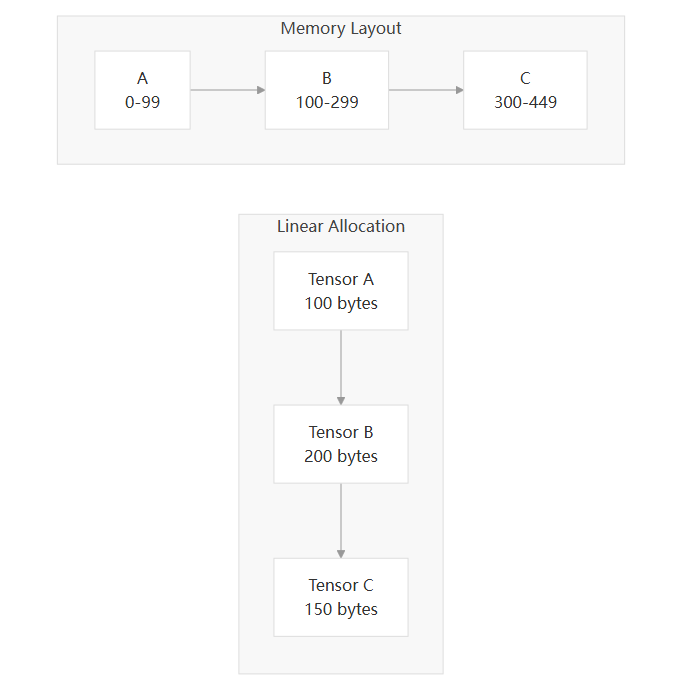

源码 [ethosu/vela/tensor_allocation.py39-67](https://github.com/nxp-imx/ethos-u-vela/blob/395a5690/ethosu/vela/tensor_allocation.py#L39-L67)

### 2. 贪婪分配

按起始时间排序活跃区间,并将每个张量分配给尽可能低的地址,而现有分配不重叠:

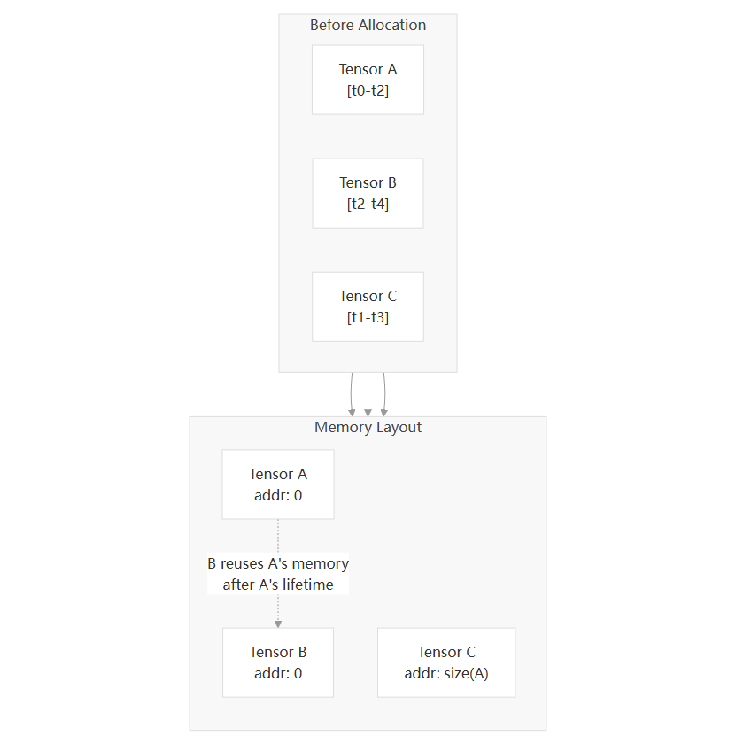

源码 [ethosu/vela/greedy_allocation.py1-78](https://github.com/nxp-imx/ethos-u-vela/blob/395a5690/ethosu/vela/greedy_allocation.py#L1-L78)

### 3. HillClimb分配

最精密的战略是反复改善起始分配:

1. 以高压分配方式开始
2. 识别具有最高内存地址的"瓶颈"(张量)
3. 张量的交换分配顺序影响瓶颈
4. 如果内存使用得到改善, 请保留更改; 否则还原
5. 重复到找到最佳解决方案或达到重复限制为止

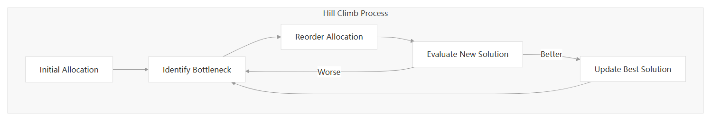

这项战略对复杂的网络特别有效,但计算需要更长的时间。

源码 [ethosu/vela/hillclimb_allocation.py27-352](https://github.com/nxp-imx/ethos-u-vela/blob/395a5690/ethosu/vela/hillclimb_allocation.py#L27-L352) [ethosu/vela/tensor_allocation.py70-81](https://github.com/nxp-imx/ethos-u-vela/blob/395a5690/ethosu/vela/tensor_allocation.py#L70-L81)

## 通过构建级联优化内存

级联是一系列操作,其中间缓冲器可以共享以减少内存使用.

### 什么是级联?

A级联是下列操作的序列:

- 一个操作的输出只被下一个操作消耗
- 操作可以连续执行
- 完整的中间体 张量 不需要存储

与其为每个中间体分配全尺寸的缓冲器张量,级联使用较小的"滚动缓冲区",只持有下次操作所需的部分数据.

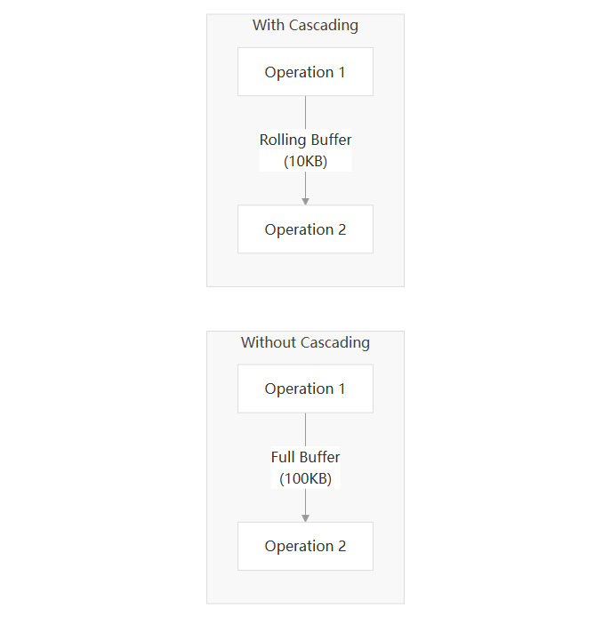

源码 [ethosu/vela/cascade_builder.py32-152](https://github.com/nxp-imx/ethos-u-vela/blob/395a5690/ethosu/vela/cascade_builder.py#L32-L152)

### 级联构建 进程

那个... `CascadeBuilder` 确定级联的候选者,并构建最佳级联:

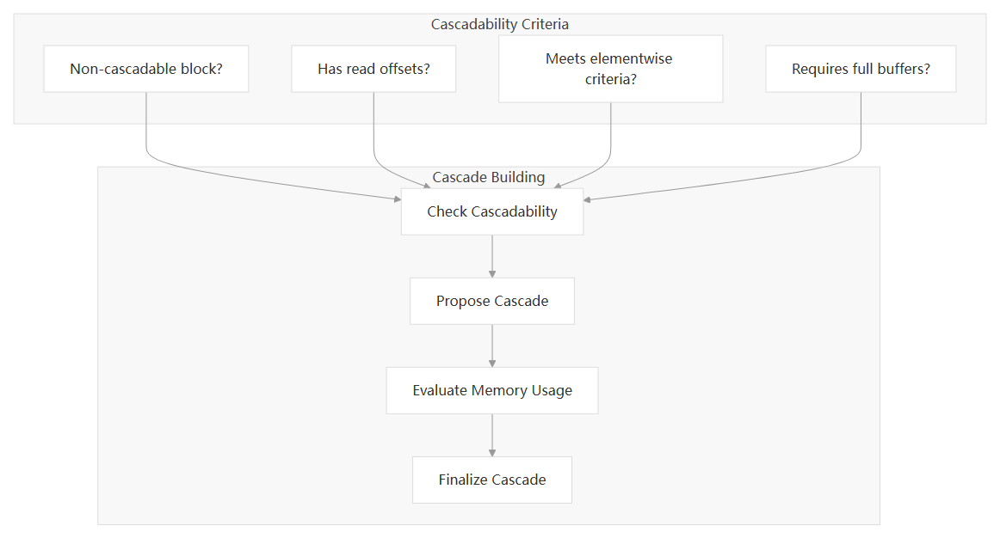

在建造级联时,系统考虑:

1. 操作类型是否支持 级联
2. 如果操作构成线性链
3. 与非乱处决相比的内存节省
4. 如果操作有兼容的输入/输出形状

源码 [ethosu/vela/cascade_builder.py86-350](https://github.com/nxp-imx/ethos-u-vela/blob/395a5690/ethosu/vela/cascade_builder.py#L86-L350)

## 内存管理实现

### 分配进程

在Vela的张量分配中,遵循了这一一般过程:

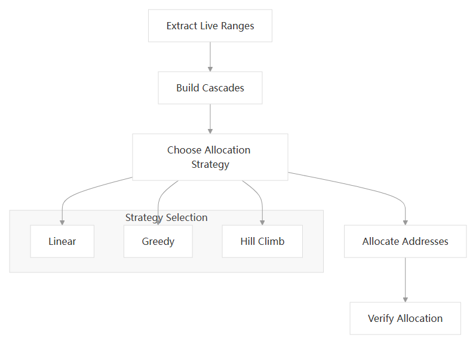

主要分配职能, `allocate_tensors()`,执行这一过程:

1. 计划业务摘录 活跃区间
2. 选择和适用适当的分配战略
3. 向 张量 指定内存地址
4. 核实分配正确性
5. 更新内存使用统计

源码 [ethosu/vela/tensor_allocation.py232-290](https://github.com/nxp-imx/ethos-u-vela/blob/395a5690/ethosu/vela/tensor_allocation.py#L232-L290) [ethosu/vela/tensor_allocation.py195-229](https://github.com/nxp-imx/ethos-u-vela/blob/395a5690/ethosu/vela/tensor_allocation.py#L195-L229)

### 内存等级管理

Vela管理张量 跨越不同内存领域,具有不同特性:

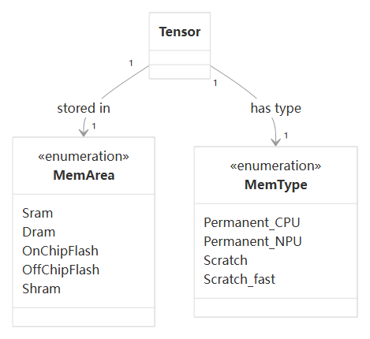

分配过程可应用于不同的内存领域和类型:

- 特征图 可能使用SRAM(快但小)
- 权重 可能使用芯片闪光(较慢但较大)
- 临时缓冲器可能使用 暂存内存

源码 [ethosu/vela/tensor_allocation.py195-229](https://github.com/nxp-imx/ethos-u-vela/blob/395a5690/ethosu/vela/tensor_allocation.py#L195-L229)

### 权重缓冲

对于重量张量,系统可以实施双缓冲来改进性能:

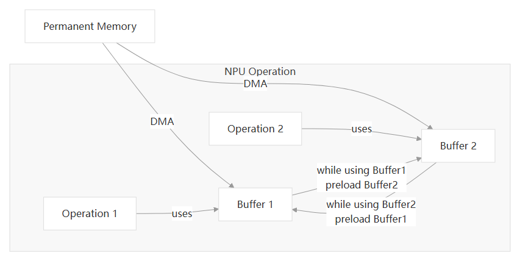

源码 [ethosu/vela/scheduler.py633-876](https://github.com/nxp-imx/ethos-u-vela/blob/395a5690/ethosu/vela/scheduler.py#L633-L876)

## 分配的性能考量

### 内存随时间而使用

系统跟踪内存使用情况,以识别顶峰内存需求:

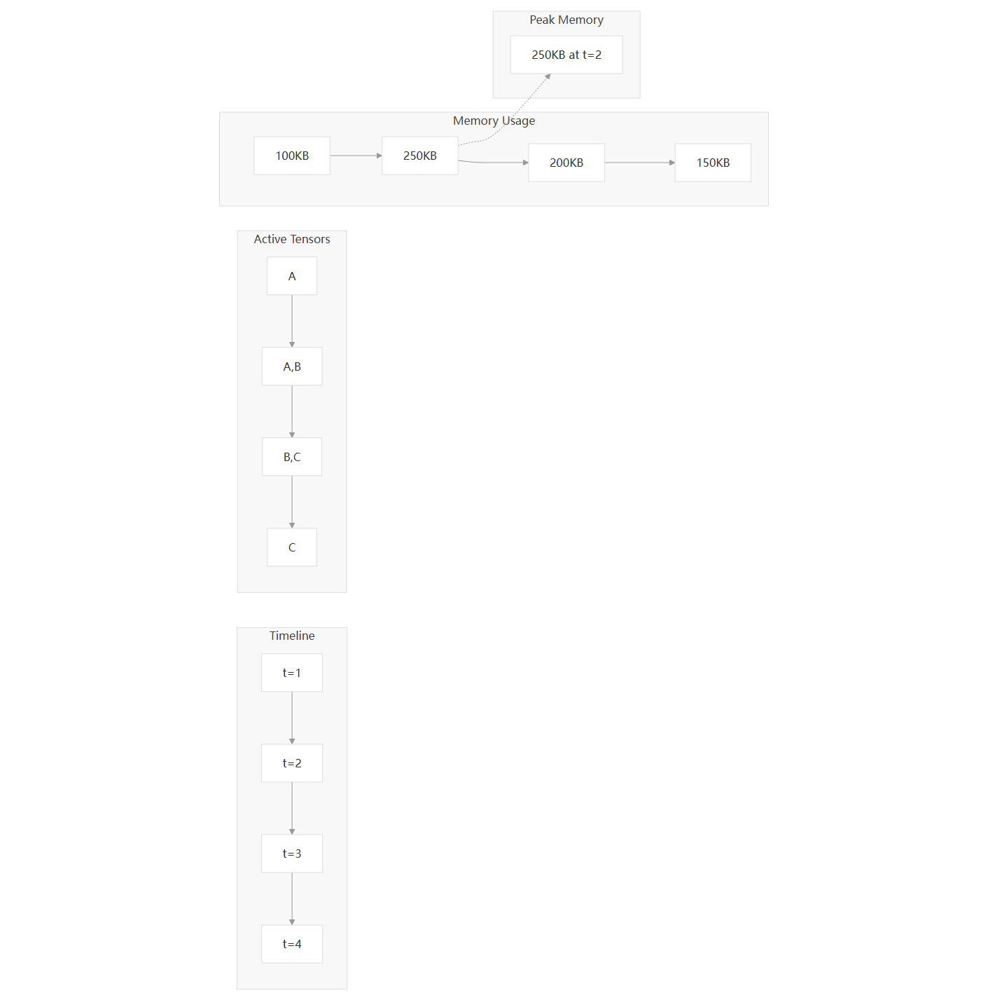

这一时间分析有助于查明瓶颈,优化时间安排和分配。

源码 [ethosu/vela/live_range.py144-158](https://github.com/nxp-imx/ethos-u-vela/blob/395a5690/ethosu/vela/live_range.py#L144-L158) [ethosu/vela/tensor_allocation.py186-192](https://github.com/nxp-imx/ethos-u-vela/blob/395a5690/ethosu/vela/tensor_allocation.py#L186-L192)

### 分配战略选择

这三个分配战略具有不同的特点:

| 战略 | 速度 | 内存效率 | 最佳时间 |
| --- | --- | --- | --- |
| 线性 | 最快 | 最低 | 小网络, 调试 |
| 贪婪 | 快点 | 不错 | 多数网络 |
| 攀登山顶 | 慢点 | 最佳( E) | 内存受限制的情景 |

选择取决于编译时间限制和内存限制.

源码 [ethosu/vela/tensor_allocation.py39-81](https://github.com/nxp-imx/ethos-u-vela/blob/395a5690/ethosu/vela/tensor_allocation.py#L39-L81)

## 与调度器的集成

内存管理与调度器紧密结合:

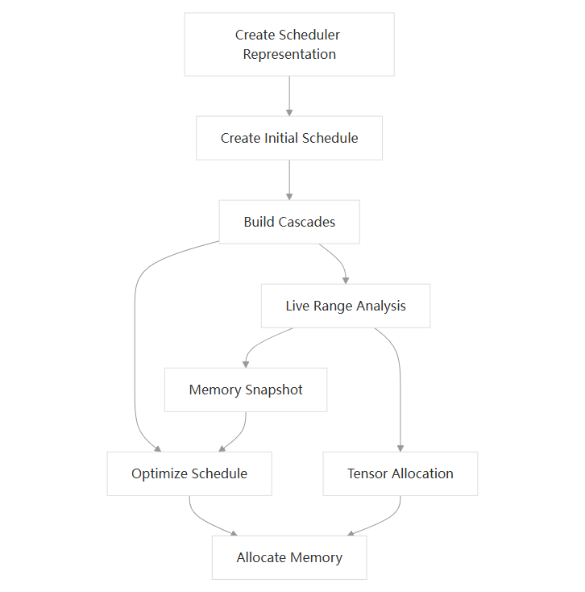

调度器使用内存使用信息用于:

1. 创建初始时间表
2. 构建内存效率 级联
3. 根据内存限制优化时间表
4. 更新内存快照以优化

源码 [ethosu/vela/scheduler.py429-607](https://github.com/nxp-imx/ethos-u-vela/blob/395a5690/ethosu/vela/scheduler.py#L429-L607) [ethosu/vela/scheduler.py571-586](https://github.com/nxp-imx/ethos-u-vela/blob/395a5690/ethosu/vela/scheduler.py#L571-L586)

## 总结

高效的内存管理对于Ethos-U NPU上的神经网络的最佳执行至关重要. Vela的内存管理系统:

1. 使用 活跃区间分析 跟踪 张量 寿命
2. 确定内存再利用的机会
3. 构建 级联 以共享中间缓冲
4. 应用不同的分配策略优化内存使用
5. 支持不同的内存类型和领域

这个系统允许Vela在有限的NPU内存内装更大的网络,并通过减少内存转移来优化性能.

[返回中文目录](0-Index.md)
