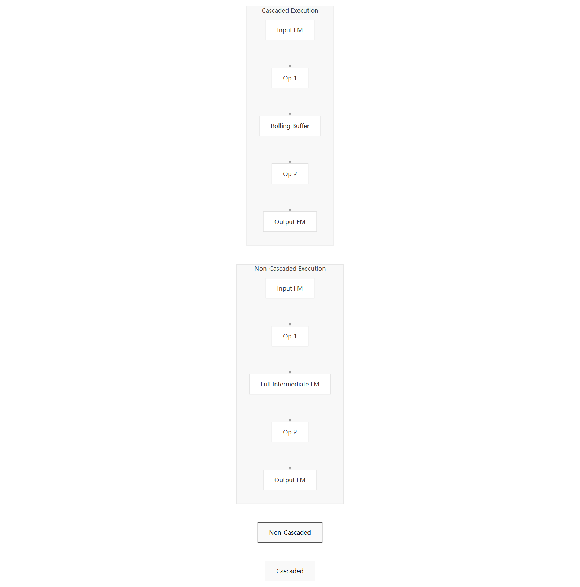
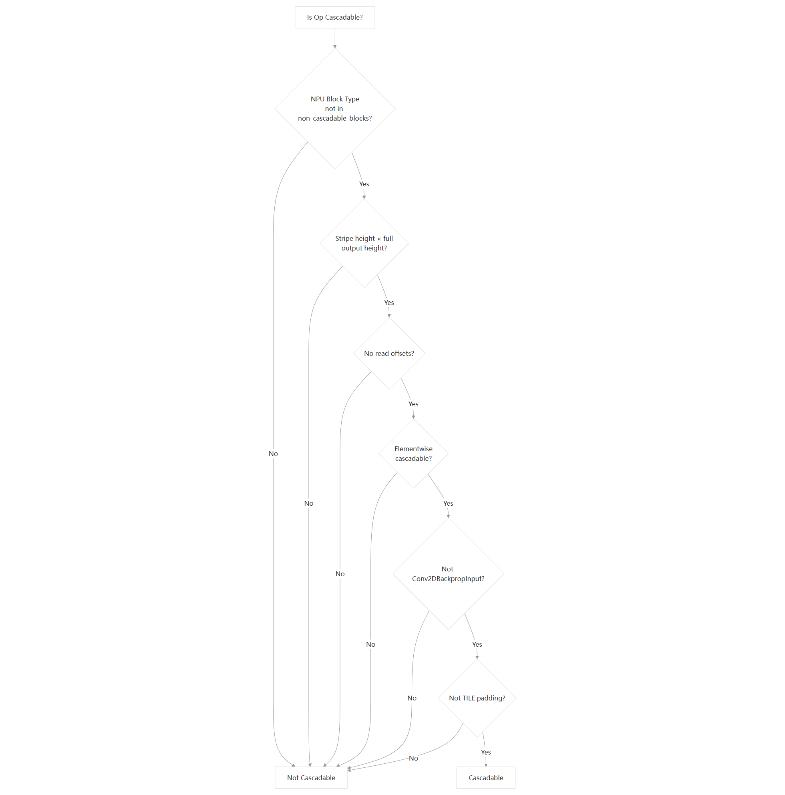
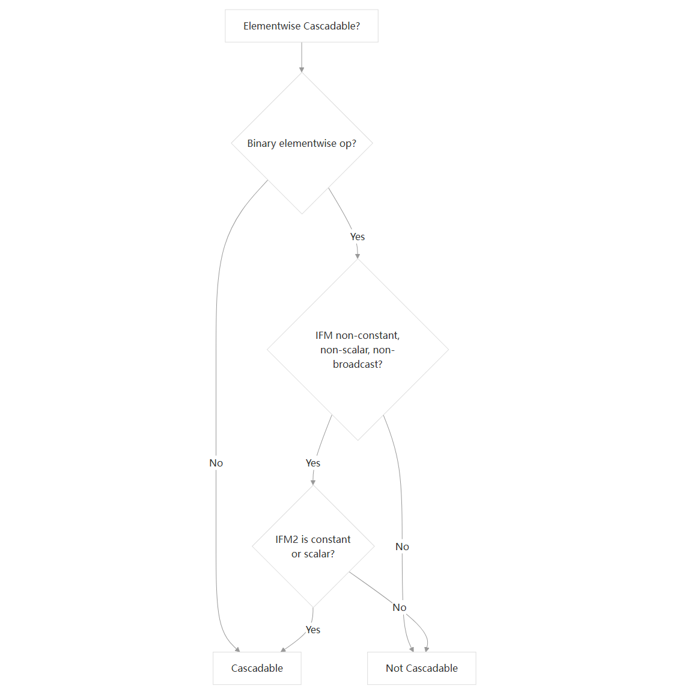
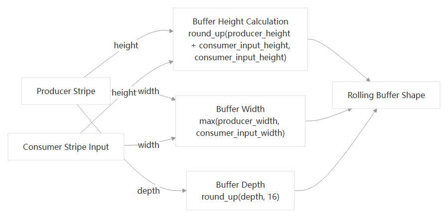
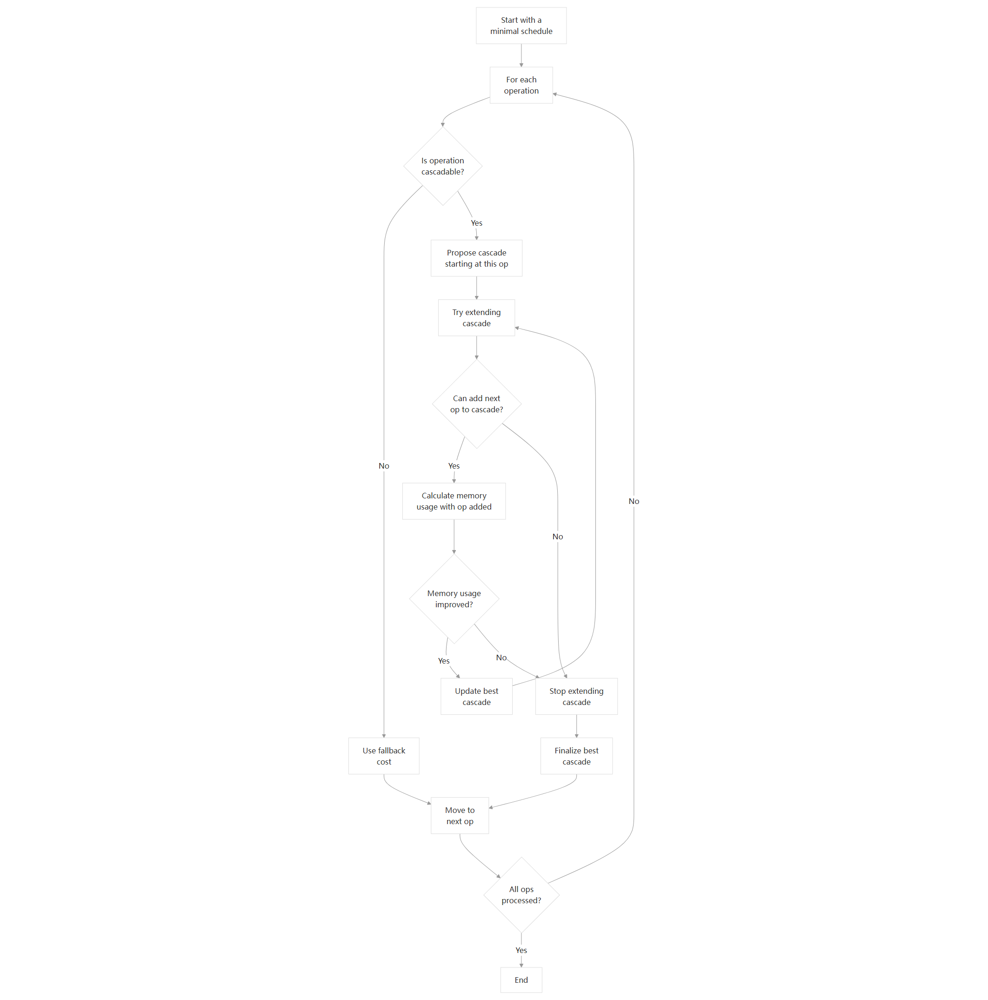
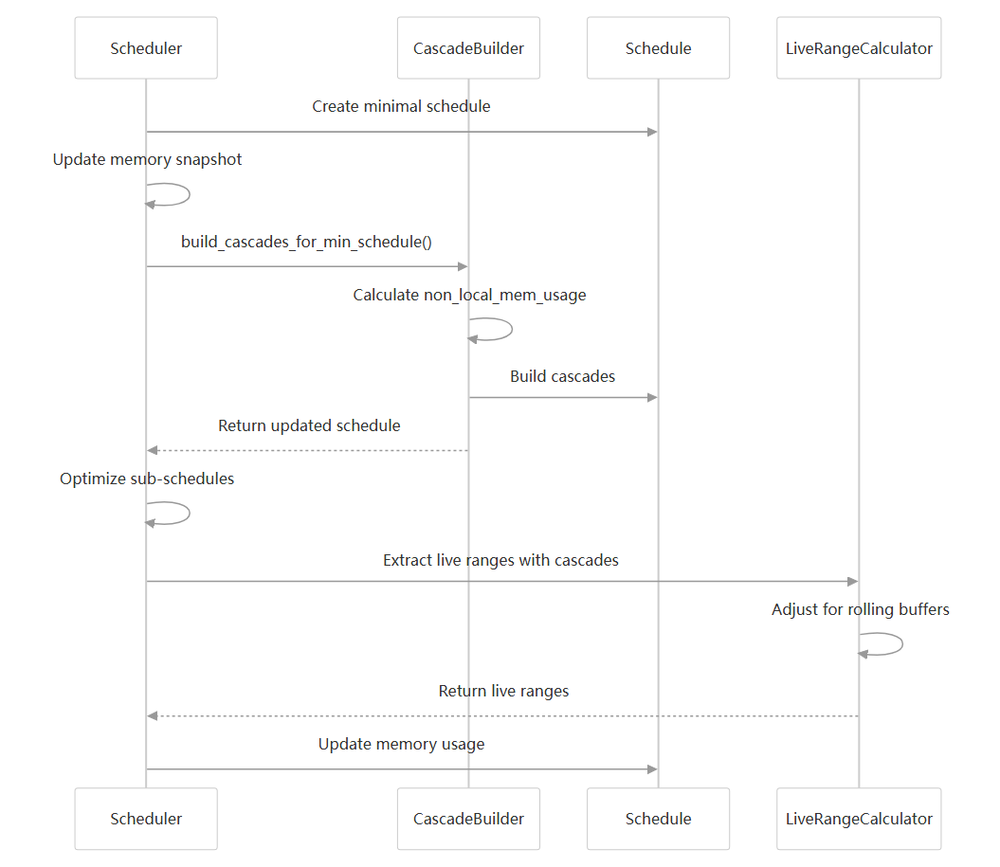
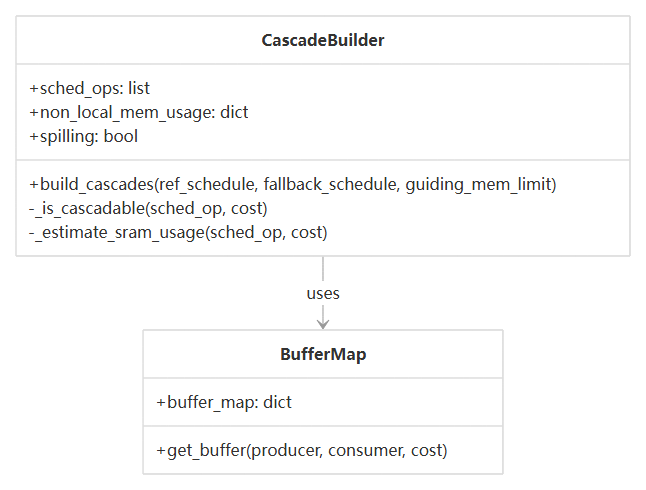

# 级联构建

**相关源码**

- [ethosu/vela/cascade_builder.py](https://github.com/nxp-imx/ethos-u-vela/blob/395a5690/ethosu/vela/cascade_builder.py)
- [ethosu/vela/live_range.py](https://github.com/nxp-imx/ethos-u-vela/blob/395a5690/ethosu/vela/live_range.py)
- [ethosu/vela/npu_performance.py](https://github.com/nxp-imx/ethos-u-vela/blob/395a5690/ethosu/vela/npu_performance.py)
- [ethosu/vela/scheduler.py](https://github.com/nxp-imx/ethos-u-vela/blob/395a5690/ethosu/vela/scheduler.py)

## 用途与范围

本文解释了Ethos-U Vela编译器中的级联构建过程,这是一种在调度时使用的关键内存优化技术. 级联 使多个顺序操作能够通过滚动缓冲区共享内存,在保持性能的同时显著降低峰值内存使用量. 本页面涵盖了级联如何在调度器的执行计划中识别,构建,优化.

相关专题见 [算子调度](4-operation-scheduling.md) 总体时间安排过程和 [内存管理与张量分配](4.1-memory-management-and-tensor-allocation.md) 用于一般内存分配策略。

## 什么是级联?

A级联是一个操作的序列,其中一个操作的输出是输入到下一个操作,这些操作可以用共享的"滚动缓冲区"执行,而不是分配全尺寸的中间体特征图. 目标是在保持执行效率的同时尽量减少内存使用.



在非连锁执行中,每次操作都需要在内存中分配全部输入和输出特征图. 有了级联,操作可以与部分特征图合作,通过条带处理数据条带,并减少峰值内存要求.

源码 [ethosu/vela/cascade_builder.py1-20](https://github.com/nxp-imx/ethos-u-vela/blob/395a5690/ethosu/vela/cascade_builder.py#L1-L20) [ethosu/vela/scheduler.py1001-1005](https://github.com/nxp-imx/ethos-u-vela/blob/395a5690/ethosu/vela/scheduler.py#L1001-L1005)

## 分级标准

并非所有操作都能够级联. Vela 编译器评价了几个标准以确定操作是否适合 级联 :



可隐蔽操作的主要标准包括:

- 不是矢量产品, 减速Sum, 或默认块类型
- 在 条带 (条带 高度小于全输出高度) 中处理数据
- 3个P-5、2个P-3、2个P-3、2个P-3、2个P-3、2个P-3、2个P-3、2个P-3、2个P-3、2个P-3、2个P-3、2个P-3、2个P-3、2个P-3、2个P-3、2个P-3、2个P-3、2个P-3、2个P-3、2个P-3、2个P-3、2个P-3、2个P-3、2个P-3、2个P-3、2个P-3、2个P-3、2个P-3、2个P-3、2个P-3、2个P-3、2个P-3、2个P-3、2个P-3、2个P-3、2个P-3、2个P-3、2个P-3、2个P-3、2个P-3、2个P-3、2个P-3、2、2个P-3、2个P-3、2个P-3、3个P-3、3个P-3、3个P-3、2个P-3、2个P
- 通过逐元素级联规则(用于逐元素操作)
- 不是像Conv2DBackprop Input那样的某些特殊操作
- 不使用 TITE 填充

源码 [ethosu/vela/cascade_builder.py96-106](https://github.com/nxp-imx/ethos-u-vela/blob/395a5690/ethosu/vela/cascade_builder.py#L96-L106) [ethosu/vela/cascade_builder.py27-30](https://github.com/nxp-imx/ethos-u-vela/blob/395a5690/ethosu/vela/cascade_builder.py#L27-L30)

### 逐元素 运行级联规则

逐元素操作有特殊级联规则:



二进制 逐元素 操作 :

- 主要输入(IFM)必须是常规特征图(不是恒定的,标量的,或广播的)
- 二次输入( IFM2) 必须是常数或刻度

源码 [ethosu/vela/cascade_builder.py134-151](https://github.com/nxp-imx/ethos-u-vela/blob/395a5690/ethosu/vela/cascade_builder.py#L134-L151)

## 滚动缓冲区

级联中的核心内存保存机制是滚动缓冲区,它能够对特征图进行部分处理.

### 滚动缓冲区 形状计算



与分配全部特征图大小不同,一个滚动缓冲区只需要足够大,以便:

1. 存储当前 条带 生产商操作的输出
2. 为消费者经营的下一个条带提供足够的投入。
3. 与硬件要求保持一致(如深度四舍五入至十六舍五入)

源码 [ethosu/vela/cascade_builder.py76-83](https://github.com/nxp-imx/ethos-u-vela/blob/395a5690/ethosu/vela/cascade_builder.py#L76-L83)

## 级联构建 进程

级联构建进程在时间安排过程中进行,并遵循这些关键步骤:



该算法优先减少内存使用量,力求将执行所需的峰值内存降到最小,它逐步构建级联,在每个步骤上评价内存使用量,并在增加更多的操作不再改善内存使用时最终确定级联.

源码 [ethosu/vela/scheduler.py1001-1032](https://github.com/nxp-imx/ethos-u-vela/blob/395a5690/ethosu/vela/scheduler.py#L1001-L1032) [ethosu/vela/cascade_builder.py164-350](https://github.com/nxp-imx/ethos-u-vela/blob/395a5690/ethosu/vela/cascade_builder.py#L164-L350)

## 内存使用估计

对于每一种潜力级联,级联构建估算出有无级联所需的内存:

### 对于非cascaded 操作:

- 完整的 IFM 大小
- 完全 OFM 大小
- 权重缓冲器
- 任何非本地内存使用

### 用于cascaded操作 :

- IFM 初始大小(用于级联的第一次操作)
- 组合 滚动缓冲区 大小
- 最终 OFM 大小(用于 级联 中最后一次操作)
- 权重缓冲器
- 任何非本地内存使用

该算法构建级联,将内存总用量最小化.

源码 [ethosu/vela/cascade_builder.py107-132](https://github.com/nxp-imx/ethos-u-vela/blob/395a5690/ethosu/vela/cascade_builder.py#L107-L132)

## 级联构建,在调度器中

调度器将级联构建纳入其优化过程:



过程从最小调度开始,然后构建级联以优化内存使用. 级联建成后,调度器可以进一步优化每个子调度,最后计算活跃区间核算级联中的滚动缓冲区.

源码 [ethosu/vela/scheduler.py1001-1032](https://github.com/nxp-imx/ethos-u-vela/blob/395a5690/ethosu/vela/scheduler.py#L1001-L1032) [ethosu/vela/live_range.py357-366](https://github.com/nxp-imx/ethos-u-vela/blob/395a5690/ethosu/vela/live_range.py#L357-L366)

## 级联 执行细节

### 连锁信息

那个... `CascadeInfo` 类存储关于 级联 的元数据 :

| 外地 | 说明 |
| --- | --- |
| 开始 | 级联中第一次运行的索引 |
| 结束 | 级联中上一次操作的索引 |
| 缓冲器 | 滚动缓冲区 形状的操作图 |
| 使用纪念 | 级联的总内存使用量 |

源码 [ethosu/vela/cascade_builder.py33-41](https://github.com/nxp-imx/ethos-u-vela/blob/395a5690/ethosu/vela/cascade_builder.py#L33-L41)

### 缓冲图

那个... `BufferMap` 分类保持生产者-消费者对缓冲要求的映射:



在确定操作之间的缓冲大小时,系统要么:

1. 需要时使用全 特征图 大小(用于子图投入/产出或需要全 特征图 操作)
2. 可级联操作的用途 滚动缓冲区 大小

源码 [ethosu/vela/cascade_builder.py43-73](https://github.com/nxp-imx/ethos-u-vela/blob/395a5690/ethosu/vela/cascade_builder.py#L43-L73)

## 级联的内存影响

级联可以在神经网络执行中显著降低内存要求. 例如:

```

```

在这个简化的例子中:

- 无 级联 :峰值内存为450KB(当需要所有的中间体特征图).
- 与 级联 :峰值内存为 220KB(a~51%还原) .

源码 [ethosu/vela/cascade_builder.py261-305](https://github.com/nxp-imx/ethos-u-vela/blob/395a5690/ethosu/vela/cascade_builder.py#L261-L305)

## 与 活跃区间分析 合并

级联建成后,调度器将其与活跃区间分析集成,以准确计算内存分配:

1. 内 `extract_live_ranges_from_schedule()`,滚动缓冲区在级联中是专门处理的。
2. 对于级联中的张量,修改了活跃区间的尺寸,以反映滚动缓冲区的大小,而不是完整的张量的大小。
3. 这确保了内存分配计划准确反映级联的内存节省效益.

源码 [ethosu/vela/live_range.py357-366](https://github.com/nxp-imx/ethos-u-vela/blob/395a5690/ethosu/vela/live_range.py#L357-L366) [ethosu/vela/scheduler.py576-585](https://github.com/nxp-imx/ethos-u-vela/blob/395a5690/ethosu/vela/scheduler.py#L576-L585)

## 性能考量

虽然级联主要优化内存使用,但也可能影响性能:

1. 级联 减少操作之间的内存转移
2. 性能估算系统`npu_performance.py`计算周期成本时的级联账户
3. 与非连带作业相比,连带作业可能有不同的带宽要求

调度器平衡了内存使用和性能在建设级联时,在内存受限制的环境中优先使用内存.

源码 [ethosu/vela/npu_performance.py777-778](https://github.com/nxp-imx/ethos-u-vela/blob/395a5690/ethosu/vela/npu_performance.py#L777-L778)

[返回中文目录](0-Index.md)
