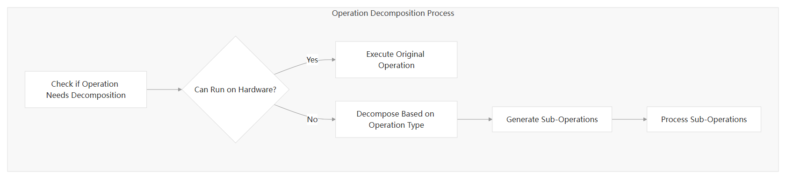
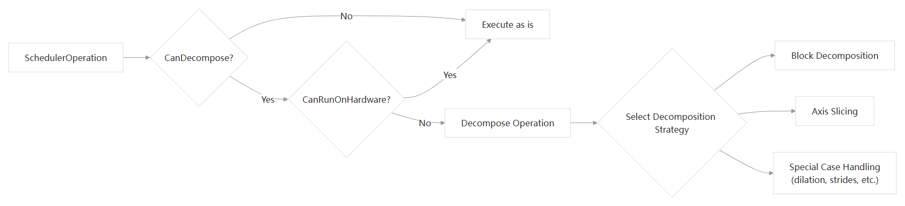
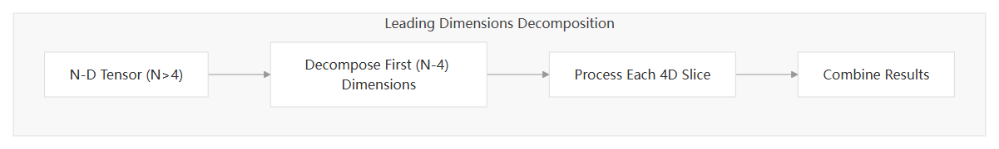
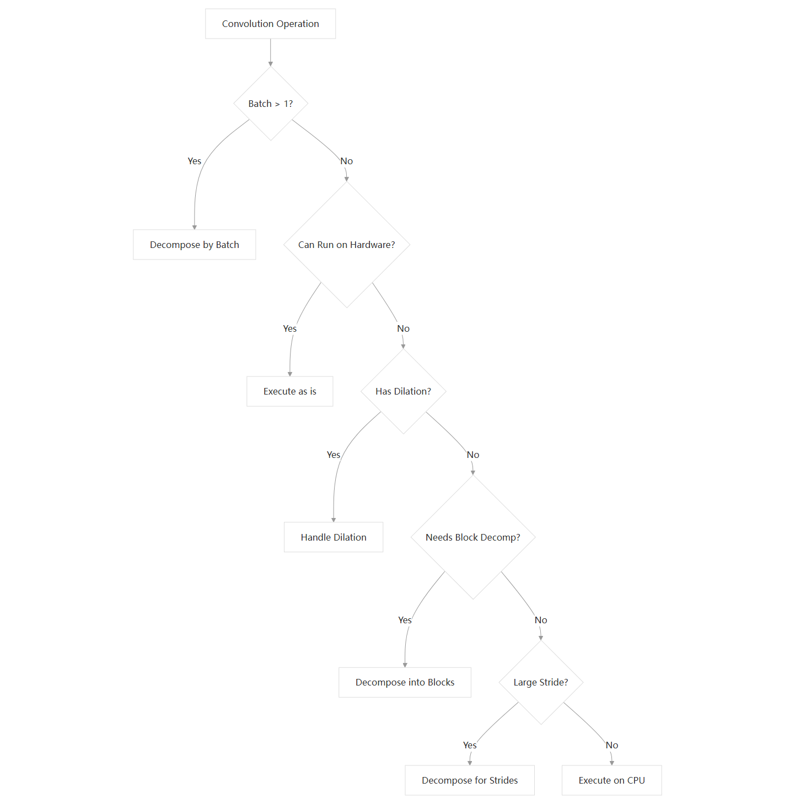
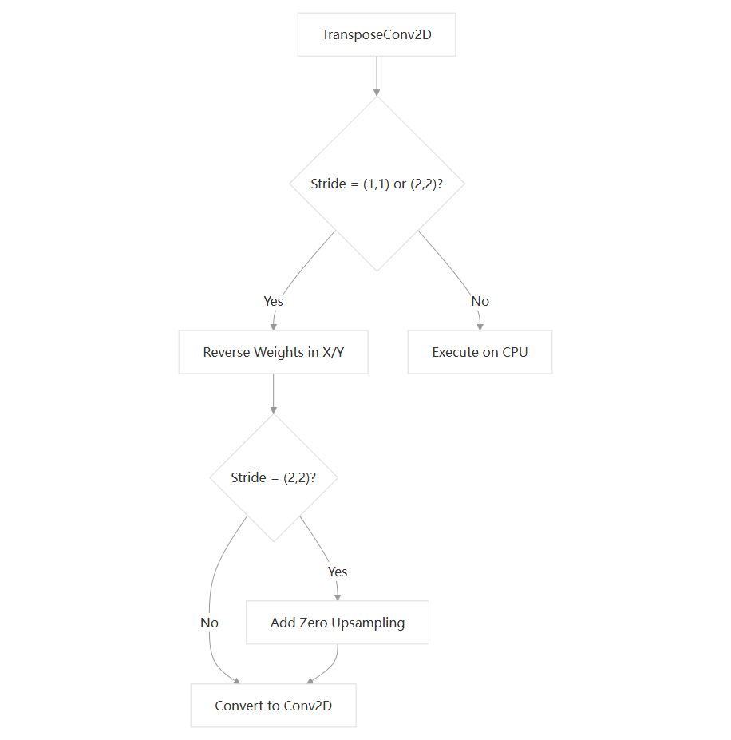
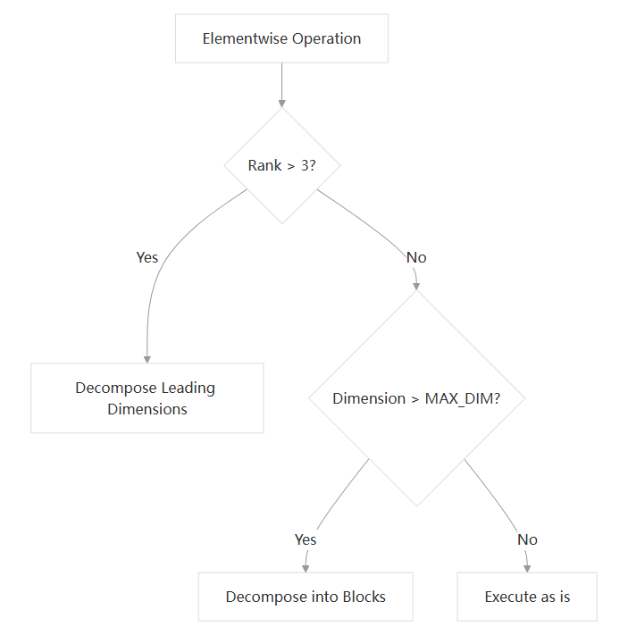
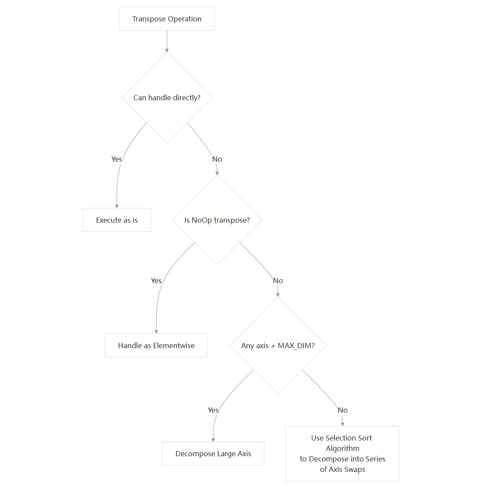
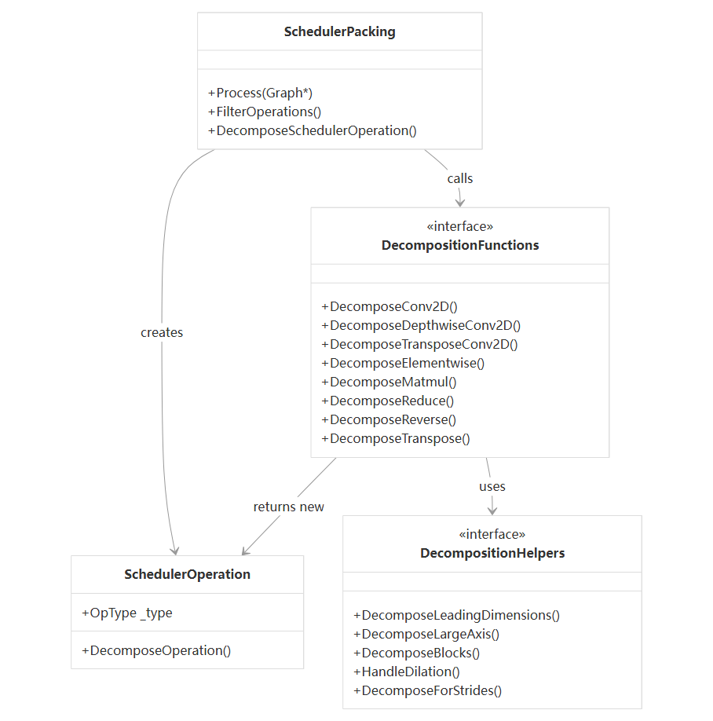
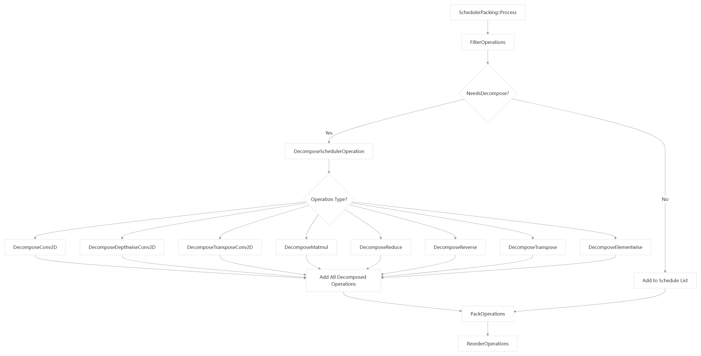

# 算子分解

**相关源码**

- [ethosu/regor/compiler/scheduler_decompose.cpp](https://github.com/nxp-imx/ethos-u-vela/blob/395a5690/ethosu/regor/compiler/scheduler_decompose.cpp)
- [ethosu/regor/compiler/scheduler_packing.cpp](https://github.com/nxp-imx/ethos-u-vela/blob/395a5690/ethosu/regor/compiler/scheduler_packing.cpp)

本文解释了Ethos-U Vela编译器如何将复杂的神经网络操作分解为更简单的操作,这些操作可以在NPU硬件上高效地执行. 算子分解是一个关键的优化步骤,它能够执行否则会太大或复杂到无法直接执行硬件的操作.

相关专题见 [算子调度](4-operation-scheduling.md) 总体时间安排过程和 [级联构建](4.2-cascade-building.md) 如何组合业务,以便高效执行。

## 分解行动概览

算子分解是将超过硬件限制的复杂神经网络操作分解为多个简单操作的过程,这些操作共同产生相同的结果. 这样做是必要的,因为Ethos-U NPU有硬件限制,例如:

- 最大支持的 张量 维度
- 限制卷积核尺寸
- 中间结果的内存限制
- 对输入特性图(IFM)和输出特性图(OFM)大小的限制

源码 [ethosu/regor/compiler/scheduler_decompose.cpp33-36](https://github.com/nxp-imx/ethos-u-vela/blob/395a5690/ethosu/regor/compiler/scheduler_decompose.cpp#L33-L36) [ethosu/regor/compiler/scheduler_decompose.cpp154-203](https://github.com/nxp-imx/ethos-u-vela/blob/395a5690/ethosu/regor/compiler/scheduler_decompose.cpp#L154-L203)

## 分解决定程序

编译器遵循一种系统的方法来确定是否以及如何将一个操作分解:

源码 [ethosu/regor/compiler/scheduler_decompose.cpp33-36](https://github.com/nxp-imx/ethos-u-vela/blob/395a5690/ethosu/regor/compiler/scheduler_decompose.cpp#L33-L36) [ethosu/regor/compiler/scheduler_decompose.cpp205-221](https://github.com/nxp-imx/ethos-u-vela/blob/395a5690/ethosu/regor/compiler/scheduler_decompose.cpp#L205-L221) [ethosu/regor/compiler/scheduler_packing.cpp127-137](https://github.com/nxp-imx/ethos-u-vela/blob/395a5690/ethosu/regor/compiler/scheduler_packing.cpp#L127-L137)

## 分解战略

编译器使用几种策略,根据操作的特性进行分解:

### 块分解

区块分解将操作分为小块,可以适应硬件限制,主要用于卷积操作和有大特征图的逐元素操作.

源码 [ethosu/regor/compiler/scheduler_decompose.cpp534-612](https://github.com/nxp-imx/ethos-u-vela/blob/395a5690/ethosu/regor/compiler/scheduler_decompose.cpp#L534-L612) [ethosu/regor/compiler/scheduler_decompose.cpp502-530](https://github.com/nxp-imx/ethos-u-vela/blob/395a5690/ethosu/regor/compiler/scheduler_decompose.cpp#L502-L530)

### 轴切切

轴切片通过一次处理一个轴片来分解操作,这对一个或多个维度超过硬件限制的操作有用.

源码 [ethosu/regor/compiler/scheduler_decompose.cpp283-324](https://github.com/nxp-imx/ethos-u-vela/blob/395a5690/ethosu/regor/compiler/scheduler_decompose.cpp#L283-L324)

### 主要维度分解

对于具有超过3或4维的张量的操作,编译器会沿着主维进行分解,将其降低到硬件可以直接处理的3D或4D操作.

源码 [ethosu/regor/compiler/scheduler_decompose.cpp328-343](https://github.com/nxp-imx/ethos-u-vela/blob/395a5690/ethosu/regor/compiler/scheduler_decompose.cpp#L328-L343)

## 特定操作解析

不同的操作类型需要不同的分解方法. 编译器包括针对每个主要操作类型的特殊分解功能:

### 卷积 分解

卷积操作(Conv2D,深智Conv2D,TransposeConv2D)的分解基于:

- 批量尺寸( 一次一个批次)
- 膨胀率(改为使用步长=膨胀率和膨胀率=1]操作)
- 块大小( 分解成较小的 卷积 )
- 步长 (用节省的蓄积器分解为操作)

源码 [ethosu/regor/compiler/scheduler_decompose.cpp717-769](https://github.com/nxp-imx/ethos-u-vela/blob/395a5690/ethosu/regor/compiler/scheduler_decompose.cpp#L717-L769) [ethosu/regor/compiler/scheduler_decompose.cpp771-854](https://github.com/nxp-imx/ethos-u-vela/blob/395a5690/ethosu/regor/compiler/scheduler_decompose.cpp#L771-L854) [ethosu/regor/compiler/scheduler_decompose.cpp916-971](https://github.com/nxp-imx/ethos-u-vela/blob/395a5690/ethosu/regor/compiler/scheduler_decompose.cpp#L916-L971)

### 转换 Conv2D 特殊案件

转换Conv2D操作是特别处理的,将其转换为标准Conv2D操作:

源码 [ethosu/regor/compiler/scheduler_decompose.cpp916-971](https://github.com/nxp-imx/ethos-u-vela/blob/395a5690/ethosu/regor/compiler/scheduler_decompose.cpp#L916-L971)

### 逐元素运算

逐元素操作(加法,乘法等)在超过张量尺寸限制时分解:

源码 [ethosu/regor/compiler/scheduler_decompose.cpp973-1003](https://github.com/nxp-imx/ethos-u-vela/blob/395a5690/ethosu/regor/compiler/scheduler_decompose.cpp#L973-L1003)

### 转置 业务

转置 具有高维张量的操作被分解成一系列较简单的转录器:

源码 [ethosu/regor/compiler/scheduler_decompose.cpp1289-1404](https://github.com/nxp-imx/ethos-u-vela/blob/395a5690/ethosu/regor/compiler/scheduler_decompose.cpp#L1289-L1404)

## 密钥代码组件

算子分解系统由几个关键组成部分组成,它们共同工作:

源码 [ethosu/regor/compiler/scheduler_decompose.cpp717-1404](https://github.com/nxp-imx/ethos-u-vela/blob/395a5690/ethosu/regor/compiler/scheduler_decompose.cpp#L717-L1404) [ethosu/regor/compiler/scheduler_packing.cpp520-568](https://github.com/nxp-imx/ethos-u-vela/blob/395a5690/ethosu/regor/compiler/scheduler_packing.cpp#L520-L568)

## 与 调度器 包装整合

算子分解 已纳入调度器包装工艺,其中,操作准备执行:

源码 [ethosu/regor/compiler/scheduler_packing.cpp101-119](https://github.com/nxp-imx/ethos-u-vela/blob/395a5690/ethosu/regor/compiler/scheduler_packing.cpp#L101-L119) [ethosu/regor/compiler/scheduler_packing.cpp520-568](https://github.com/nxp-imx/ethos-u-vela/blob/395a5690/ethosu/regor/compiler/scheduler_packing.cpp#L520-L568)

## 解析函数选择

编译器根据操作类型选择适当的分解功能 :

| 算子类型 | 分解函数 | 使用时 |
| --- | --- | --- |
| Conv2D 数据 | 解析 Conv2D | 用于标准 卷积 操作 |
| 深度Conv2D 函数 | 分解深度Conv2D | 用于深度卷积卷积业务 |
| 转换Conv2D | 解析转换器Conv2D | 用于转置卷积业务 |
| 马特穆尔 | 分解马特穆尔 | 用于矩阵乘法操作 |
| 减少Sum、 减少Min、 减少Max、 减少All、 减少All、 argMax | 分解调制程 | 用于裁减业务 |
| 反转 | 分解逆变 | 用于反向操作 |
| 转置 | 分解转换 | 用于转置业务 |
| 其他要素操作 | 按元素分解 | 用于逐元素 添加,乘法等操作. |

源码 [ethosu/regor/compiler/scheduler_packing.cpp520-568](https://github.com/nxp-imx/ethos-u-vela/blob/395a5690/ethosu/regor/compiler/scheduler_packing.cpp#L520-L568)

## 小结

Ethos-U Vela编译器中的算子分解是一个关键的优化步骤,它能够在特定限制的硬件上执行复杂的神经网络操作. 分解过程:

1. 检查操作是否能够和应该分解
2. 根据操作类型选择适当的分解策略
3. 将复杂操作细分为可以运行在硬件上的简单操作
4. 将已分解的操作重新纳入调度进程

这种方法使编译器能够高效地将广泛的神经网络操作映射到Ethos-U NPU硬件能力.

[返回中文目录](0-Index.md)
