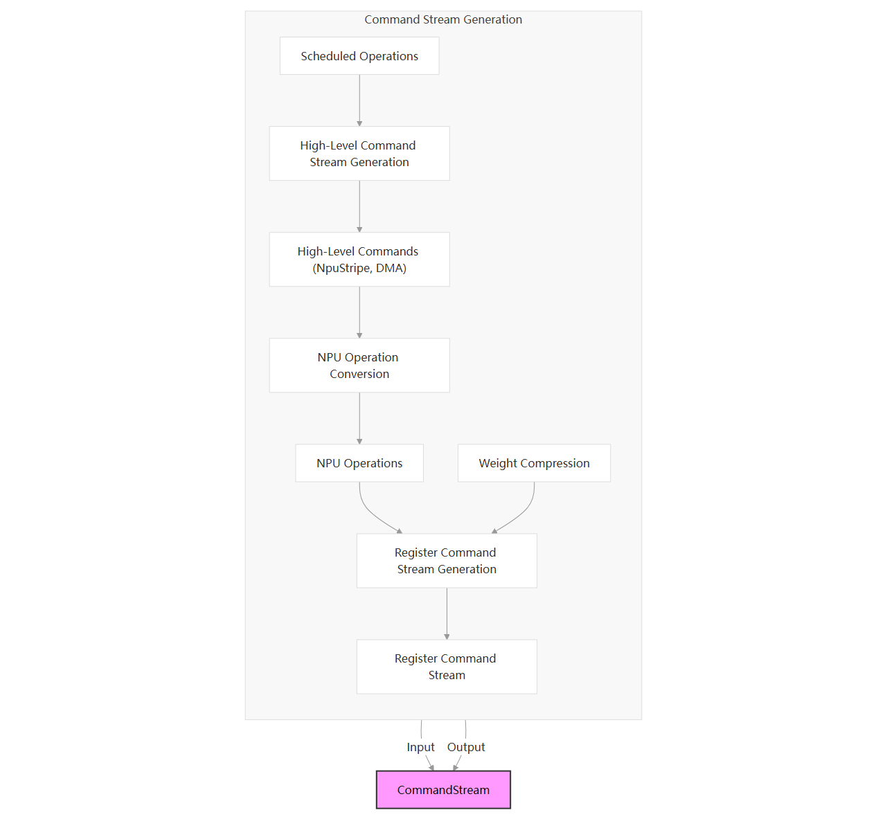
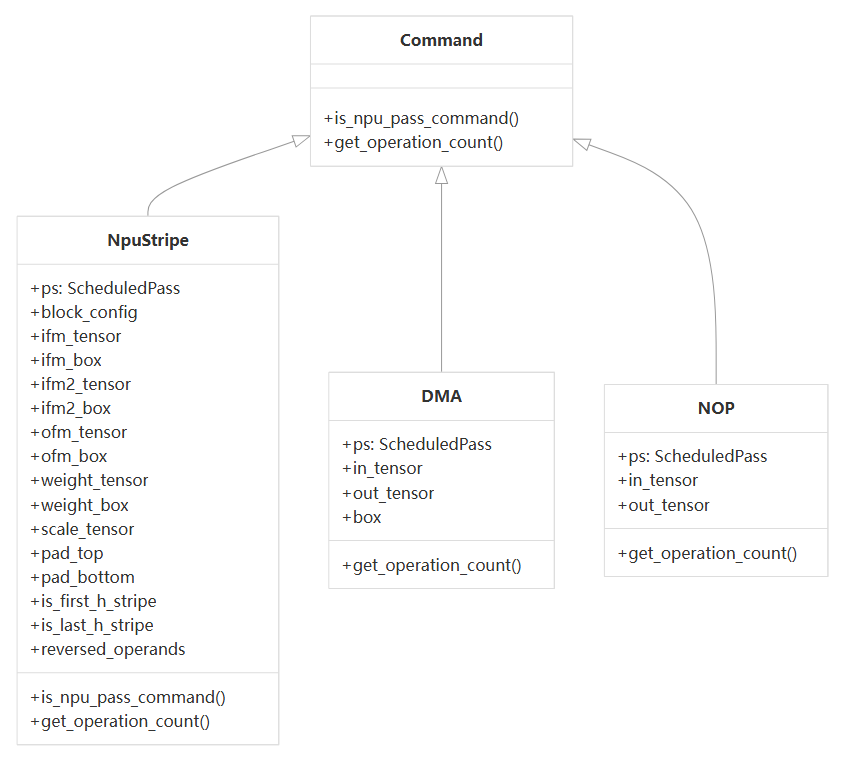
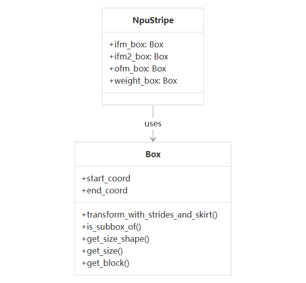
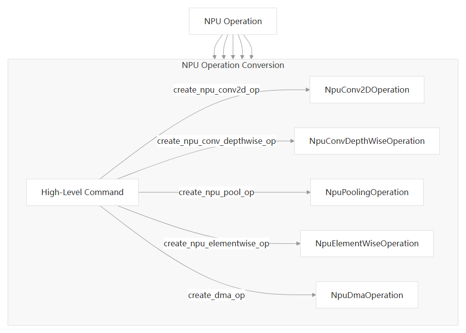
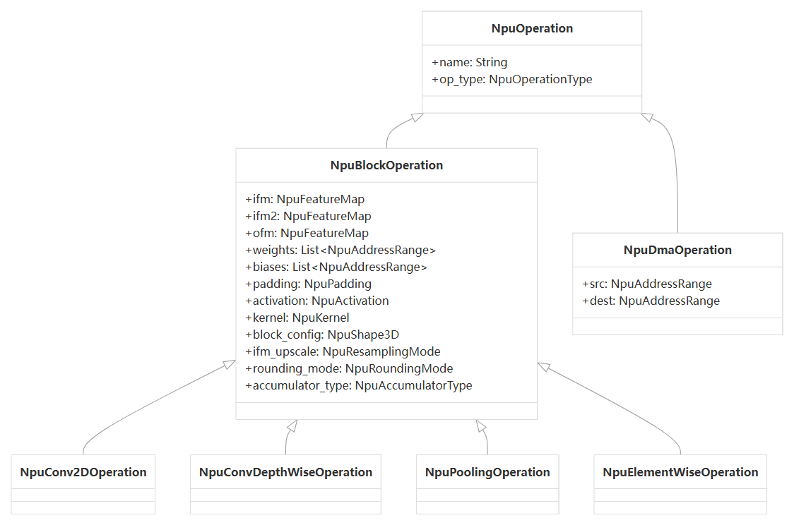
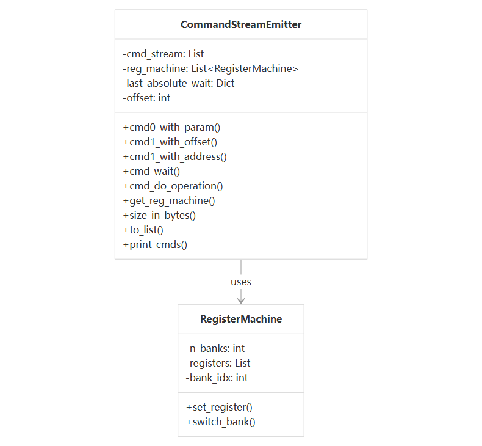
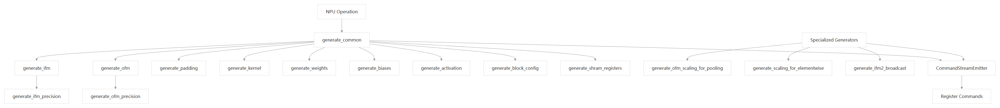
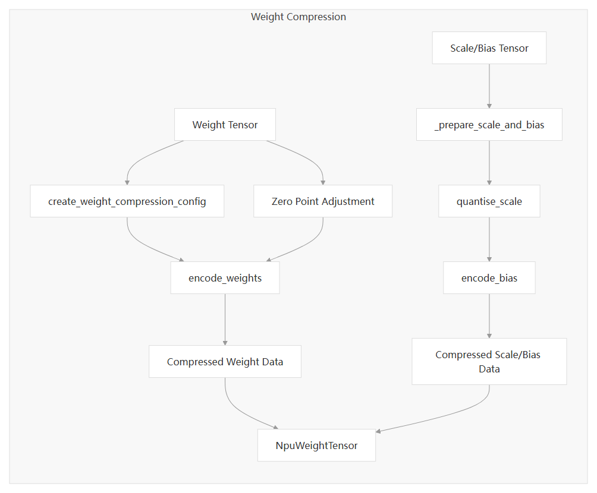
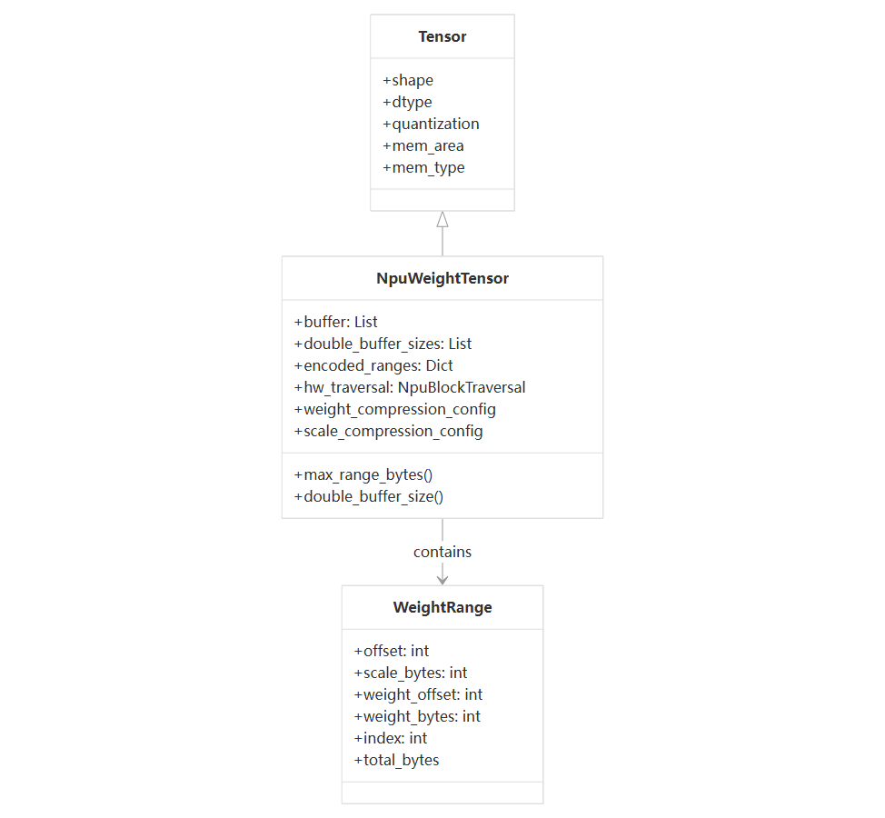
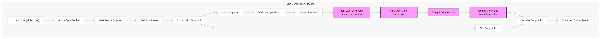

# 命令流生成

**相关源码**

- [ethosu/vela/architecture_features.py](https://github.com/nxp-imx/ethos-u-vela/blob/395a5690/ethosu/vela/architecture_features.py)
- [ethosu/vela/high_level_command_stream.py](https://github.com/nxp-imx/ethos-u-vela/blob/395a5690/ethosu/vela/high_level_command_stream.py)
- [ethosu/vela/high_level_command_stream_generator.py](https://github.com/nxp-imx/ethos-u-vela/blob/395a5690/ethosu/vela/high_level_command_stream_generator.py)
- [ethosu/vela/high_level_command_to_npu_op.py](https://github.com/nxp-imx/ethos-u-vela/blob/395a5690/ethosu/vela/high_level_command_to_npu_op.py)
- [ethosu/vela/register_command_stream_generator.py](https://github.com/nxp-imx/ethos-u-vela/blob/395a5690/ethosu/vela/register_command_stream_generator.py)
- [ethosu/vela/weight_compressor.py](https://github.com/nxp-imx/ethos-u-vela/blob/395a5690/ethosu/vela/weight_compressor.py)

命令流生成是将高级神经网络操作转换为Arm Ethos-U神经处理单元(NPU)的低级硬件指令的过程,代表了Vela编译器管道中的一个关键阶段,将优化的网络操作转换为Ethos-U硬件可执行的格式.

本文解释了 Vela 编译器如何生成命令流,涵盖从高级命令到注册级指令的多步骤进程。关于具体的建筑限制,请参见: [架构支持](6-architecture-support.md).

## 命令流生成概览

命令流生成进程弥合了优化神经网络操作与硬件特定指令之间的差距。它由三个主要阶段组成:

1. **高层次指令流生成**: 创建代表神经网络操作和 DMA 传输的抽象命令
2. **NPU 操作转换**: 将高层次命令转换成更具体的 NPU 操作对象
3. **寄存器命令 流体生成**: 将 NPU 操作转换为硬件专用 寄存器设置

源码

- [ethosu/vela/high_level_command_stream_generator.py51-263](https://github.com/nxp-imx/ethos-u-vela/blob/395a5690/ethosu/vela/high_level_command_stream_generator.py#L51-L263)
- [ethosu/vela/high_level_command_to_npu_op.py693-744](https://github.com/nxp-imx/ethos-u-vela/blob/395a5690/ethosu/vela/high_level_command_to_npu_op.py#L693-L744)
- [ethosu/vela/register_command_stream_generator.py99-228](https://github.com/nxp-imx/ethos-u-vela/blob/395a5690/ethosu/vela/register_command_stream_generator.py#L99-L228)

## 高层次指令流生成

高级命令流由代表神经网络操作和内存转移的抽象命令组成. 这个步骤将计划中的操作从调度器(参见: [算子调度](4-operation-scheduling.md))成为命令的序列.

### 命令类型

支持三种主要类型的高级命令:

1. **NpuSTripe 函数**: 代表拟在 NPU 上执行的神经网络操作的片段
2. **DMA**: 代表不同内存区域之间的内存传输
3. **NOP**: 代表一个不操作命令(用于调试中的可见度)

源码

- [ethosu/vela/high_level_command_stream.py18-322](https://github.com/nxp-imx/ethos-u-vela/blob/395a5690/ethosu/vela/high_level_command_stream.py#L18-L322)

### 框结构

那个... `Box` 类对于定义操作所运行的 张量 区域至关重要。它规定了在串连操作中输入、输出和重量的起始和结束坐标 张量 :

源码

- [ethosu/vela/high_level_command_stream.py30-194](https://github.com/nxp-imx/ethos-u-vela/blob/395a5690/ethosu/vela/high_level_command_stream.py#L30-L194)

### 生成过程

高级指令流生成流程计划操作如下:

1. 按执行顺序处理每个预定的操作
2. 对于 级联 中的操作,从上次操作开始为整个 级联 生成命令
3. 每次操作,根据块配置计算输出特征图(OFM)条带
4. 对每个条纹, 计算需要的输入特征图( IFM) 区域
5. 根据操作类型和内存要求生成适当的命令( NpuStripe, DMA, NOP)

源码

- [ethosu/vela/high_level_command_stream_generator.py51-263](https://github.com/nxp-imx/ethos-u-vela/blob/395a5690/ethosu/vela/high_level_command_stream_generator.py#L51-L263)

## NPU 操作转换

高级命令转换为NPU操作,这些操作是Ethos-U NPU操作的更具体的表示,这种中间格式捕捉生成寄存器命令所需的所有细节.

### NPU 操作类型

支持四种主要类型的NPU操作:

1. **NpuConv2D 行动**: 标准卷积业务
2. **NpuConv 深度监视操作**: 代表深度卷积卷积业务
3. **NpuPooling 行动**: 代表池化业务(最大值、平均值、减少值)
4. **NpuElementWise 行动**: 代表逐元素业务(Add, Mul, Sub, Min, Max等)
5. **NpuDma 操作**: 直接内存访问操作

源码

- [ethosu/vela/high_level_command_to_npu_op.py561-689](https://github.com/nxp-imx/ethos-u-vela/blob/395a5690/ethosu/vela/high_level_command_to_npu_op.py#L561-L689)

### NPU 操作的关键组件

每一个NPU操作包含寄存器命令生成所需的详细信息:

- **特征图**: 输入/输出 特征图 带量化,布局和地址信息
- **卷积核**: 卷积 卷积核 参数(大小,步长,膨胀率)
- **权重/偏置**: 压缩 权重 和 偏置 的地址范围
- **填充**: 填充 操作配置
- **块配置**: 用于 NPU 执行的块大小
- **启动**: 操作后激活功能

源码

- [ethosu/vela/high_level_command_to_npu_op.py382-558](https://github.com/nxp-imx/ethos-u-vela/blob/395a5690/ethosu/vela/high_level_command_to_npu_op.py#L382-L558)

### 转换过程

转换过程包括:

1. 根据操作类型创建适当的 NSU 操作对象
2. 传播特征图信息(传出、步长、量化)
3. 设置 卷积核 参数和 块配置
4. 配置 权重、偏置和激活
5. 处理特殊案件,如填充、分级和升级

源码

- [ethosu/vela/high_level_command_to_npu_op.py693-744](https://github.com/nxp-imx/ethos-u-vela/blob/395a5690/ethosu/vela/high_level_command_to_npu_op.py#L693-L744)

## 寄存器命令 流体生成

寄存器命令流生成器将NPU操作转换为Ethos-U NPU的低级寄存器设置,这是产生硬件执行的实际命令的最后一步.

### 寄存器命令 发射器

那个... `CommandStreamEmitter` class 负责生成 寄存器命令。它保持关于先前发布的命令的状态,以避免冗余并支持不同的命令类型 :

- **(单位:百万美元)**: 没有有效载荷的简单命令
- **缩略语1**: 装有32位有效载荷的命令
- **缩略语_ wait**: 同步的特殊命令
- **cmd_ do_操作**: 执行操作的命令

源码

- [ethosu/vela/register_command_stream_generator.py99-228](https://github.com/nxp-imx/ethos-u-vela/blob/395a5690/ethosu/vela/register_command_stream_generator.py#L99-L228)

### 寄存器命令生成过程

寄存器命令流生成过程遵循这些步骤:

1. 将每次 NPU 操作转换为相应的 寄存器设置
2. 计算操作之间的内存访问模式和依赖性
3. 必要时插入等待操作
4. 通过取消冗余命令优化 命令流
5. 为 NPU 生成最后的位流

这一过程涉及几个不同部件的专用登记册发电机:

源码

- [ethosu/vela/register_command_stream_generator.py314-675](https://github.com/nxp-imx/ethos-u-vela/blob/395a5690/ethosu/vela/register_command_stream_generator.py#L314-L675)

### 命令类型和绘图

寄存器命令 对应特定的硬件设置. NPU 操作的生成器映射到这些特定的寄存器命令 :

| 算子类型 | 主要注册命令 |
| --- | --- |
| Conv2D 数据 | NPU_SET_IFM_*, NPU_SET_OFM_ (韩语).*, NPU_SET_克尔内尔_*(原始内容存档于2019-09-21). NPU_SET_WEGHT*, NPU_SET_SCALE ⁇ |
| 深度卷积 | NPU_SET_IFM_*, NPU_SET_OFM_ (韩语).*, NPU_SET_克尔内尔_*(原始内容存档于2019-09-21). NPU_SET_WEGHT*, NPU_SET_SCALE ⁇ |
| 池化 | NPU_SET_IFM_*, NPU_SET_OFM_ (韩语).*, NPU_SET_KERNEL ⁇ , NPU_SET_OFM_SCALE |
| 逐元素 | NPU_SET_IFM_*, NPU_SET_IFM2_ (中文(简体) ).*, NPU_SET_OFMQQ, NPU_SET_IFM2_BROADCAST, NPU_SET_OFM_SCALE |
| DMA | NPU_OP_DMA_WAIT, NPU_OP_KERNEL_WAIT |

源码

- [ethosu/vela/register_command_stream_generator.py228-313](https://github.com/nxp-imx/ethos-u-vela/blob/395a5690/ethosu/vela/register_command_stream_generator.py#L228-L313)

## 权重压缩

权重压缩是减少内存占用和带宽要求的关键优化步骤. 权重压缩器将权重编码成压缩格式,并生成正确执行所必需的缩放因子.

### 权重压缩 进程

权重压缩过程包括:

1. 使用硬件专用编码压缩 权重
2. 计算和定量 缩放因子
3. 用天平包装 偏置 值
4. 处理特殊案件,如深度卷积卷积

源码

- [ethosu/vela/weight_compressor.py140-500](https://github.com/nxp-imx/ethos-u-vela/blob/395a5690/ethosu/vela/weight_compressor.py#L140-L500)

### Npuight 传感器

那个... `NpuWeightTensor` class 管理压缩 权重 和缩放, 将其存储在为 NPU 准备的格式中 :

源码

- [ethosu/vela/weight_compressor.py90-107](https://github.com/nxp-imx/ethos-u-vela/blob/395a5690/ethosu/vela/weight_compressor.py#L90-L107)
- [ethosu/vela/weight_compressor.py77-88](https://github.com/nxp-imx/ethos-u-vela/blob/395a5690/ethosu/vela/weight_compressor.py#L77-L88)

### 权重压缩 优化

权重压缩机包括几个优化:

1. **压缩缓存**: 尽可能重新使用以前压缩过的 权重
2. **双向缓冲**: 在当前集处理过程中, 通过准备下一组 权重 来启用连续执行
3. **核心特定编码**:优化特定 Ethos-U 配置的重量布局

源码

- [ethosu/vela/weight_compressor.py66-132](https://github.com/nxp-imx/ethos-u-vela/blob/395a5690/ethosu/vela/weight_compressor.py#L66-L132)

## 纳入汇编管道

命令流生成进程融入整体Vela编译流程,与其他组成部分密切合作:

命令流生成进程处理各种操作类型,内存布局,以及硬件特异性优化,为Ethos-U NPU生成高效的可执行代码.

源码

- [ethosu/vela/high_level_command_to_npu_op.py713-744](https://github.com/nxp-imx/ethos-u-vela/blob/395a5690/ethosu/vela/high_level_command_to_npu_op.py#L713-L744)

[返回中文目录](0-Index.md)
