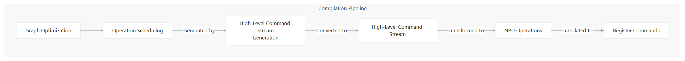
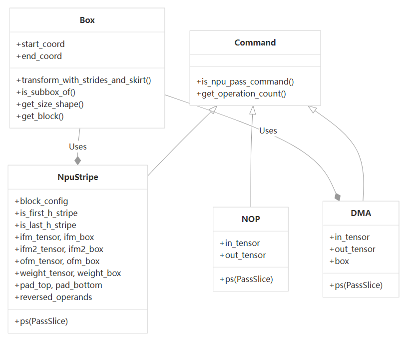
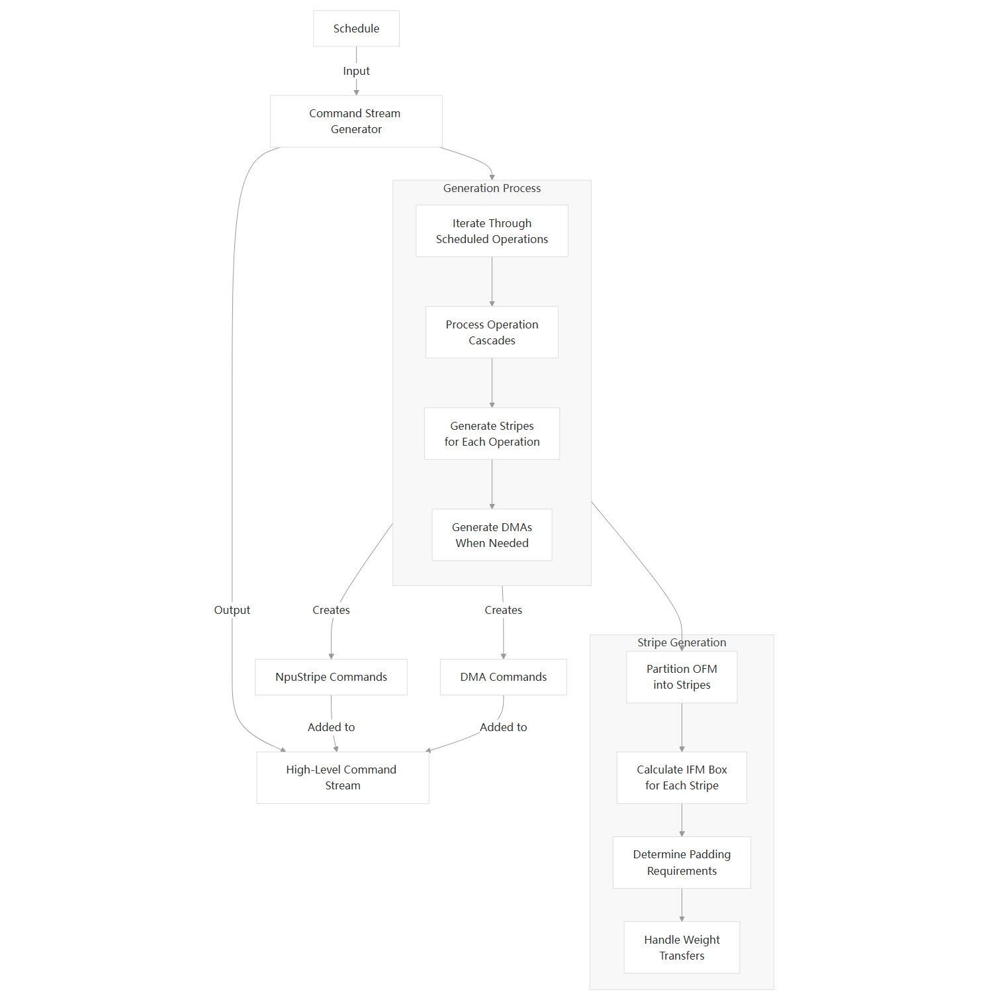
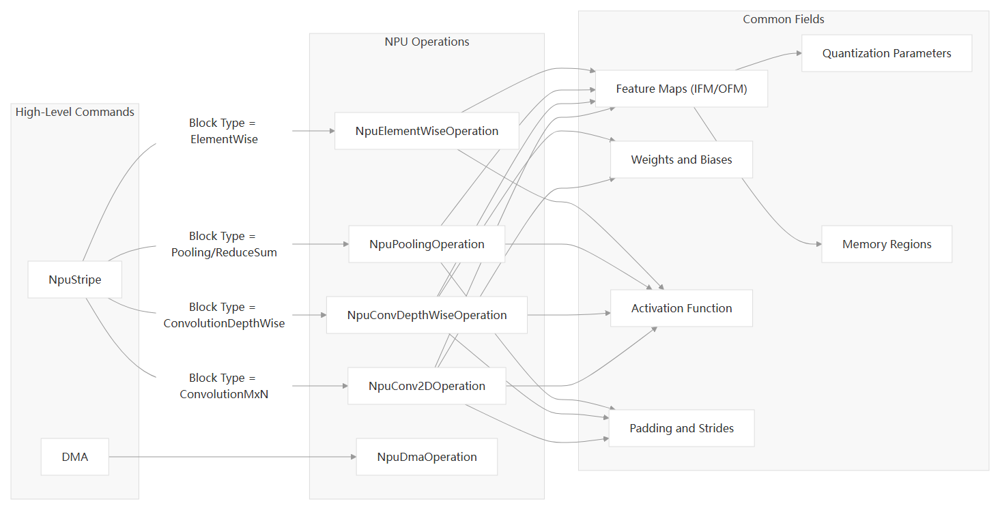

# 高层命令流

**相关源码**

- [ethosu/vela/high_level_command_stream.py](https://github.com/nxp-imx/ethos-u-vela/blob/395a5690/ethosu/vela/high_level_command_stream.py)
- [ethosu/vela/high_level_command_stream_generator.py](https://github.com/nxp-imx/ethos-u-vela/blob/395a5690/ethosu/vela/high_level_command_stream_generator.py)
- [ethosu/vela/high_level_command_to_npu_op.py](https://github.com/nxp-imx/ethos-u-vela/blob/395a5690/ethosu/vela/high_level_command_to_npu_op.py)

高端命令流是Ethos-U Vela编译器内部的中间代表,它弥合了调度器的操作排序和低端寄存器命令流之间的空隙,它代表神经网络操作作为抽象指令,可以高效地转化为Ethos-U NPU的硬件专用指令.

关于注册级命令生成的信息,参见: [Ethos-U85 命令流生成](5.3-ethos-u85-command-stream-generation.md).

## 汇编管道的目的和作用

高级指挥流服务于以下几项关键职能:

1. 将操作分区为可管理“ 条带 ” , 由 NPU 处理
2. 代表内存区域之间的数据移动操作
3. 处理填充、步长和张量坐标转换
4. 准备转换为硬件专用的操作 寄存器命令

源码 [ethosu/vela/high_level_command_stream_generator.py51-73](https://github.com/nxp-imx/ethos-u-vela/blob/395a5690/ethosu/vela/high_level_command_stream_generator.py#L51-L73) [ethosu/vela/high_level_command_to_npu_op.py692-743](https://github.com/nxp-imx/ethos-u-vela/blob/395a5690/ethosu/vela/high_level_command_to_npu_op.py#L692-L743)

## 命令结构和类型

高级命令流由三种主要指挥类型组成,它们都源于共同的 `Command` 基准类 :

源码 [ethosu/vela/high_level_command_stream.py197-321](https://github.com/nxp-imx/ethos-u-vela/blob/395a5690/ethosu/vela/high_level_command_stream.py#L197-L321)

### 命令类型

1. **NpuSTripe 函数**: 代表将在 NPU 上执行的计算切片。它定义了 :

   - 输入和输出特征图(IFM, IFM2, OFM)
   - 张量 所涉区域(由方框物体代表)
   - 重量和规模张量(如果适用)
   - 填充 信息和块配置
2. **DMA**: 代表内存区域之间数据传输的直接内存访问操作.

   - 来源和目的地张量
   - 界定要转让的区域的方框
3. **NOP**: 无操作命令,通常用于生成 DMA 但源地址和目的地址相同时.

源码 [ethosu/vela/high_level_command_stream.py206-321](https://github.com/nxp-imx/ethos-u-vela/blob/395a5690/ethosu/vela/high_level_command_stream.py#L206-L321)

### 盒类

那个... `Box` class是一个基本组成部分,它代表由起始和结束坐标定义的张量区域。它提供了下列方法:

- 基于步长和裙子(填充)值的变形坐标
- 检查一个框是否包含在另一个框中
- 计算区域的大小和形状

最复杂的方法是 `transform_with_strides_and_skirt`,它计算输出特征图坐标图到输入特征图坐标的方式,同时考虑到:

- 步长 值
- 填充 (短裙)
- 卷积核 维度
- 递增因素
- 拆分/混合操作

这种转变对于正确计算特定产出区域所需的输入区域至关重要。

源码 [ethosu/vela/high_level_command_stream.py30-194](https://github.com/nxp-imx/ethos-u-vela/blob/395a5690/ethosu/vela/high_level_command_stream.py#L30-L194)

## 命令流生成

高级命令流由操作产生的时间表调度器产生。 `generate_high_level_command_stream_for_schedule` 函数。

源码 [ethosu/vela/high_level_command_stream_generator.py51-73](https://github.com/nxp-imx/ethos-u-vela/blob/395a5690/ethosu/vela/high_level_command_stream_generator.py#L51-L73) [ethosu/vela/high_level_command_stream_generator.py76-262](https://github.com/nxp-imx/ethos-u-vela/blob/395a5690/ethosu/vela/high_level_command_stream_generator.py#L76-L262)

### 条带 代号

业务根据下列情况细分为条条:

1. **高度 条带**: 分隔输出特征图高度
2. **宽度 条带**: 将每个高度条带进一步划分为宽段
3. **深度(通道) 条带**: 将输出通道分割成可管理部分

对于每个条带,生成器:

1. 创建定义 条带 输出区域的 OFM (输出特征图) 框
2. 计算计算所需的相应的 IFM (输入特征图) 框
3. 确定 填充 要求(页_上,页_下)
4. 必要时通过DMA操作处理重量转移
5. 创建带有所有必要信息的 NpuStripe 命令

源码 [ethosu/vela/high_level_command_stream_generator.py156-262](https://github.com/nxp-imx/ethos-u-vela/blob/395a5690/ethosu/vela/high_level_command_stream_generator.py#L156-L262)

### 级联 处理

级联是可以高效一起执行的操作序列,而不将中间结果存储在内存中. 指令生成器处理级联通过:

1. 确定哪些业务是级联的一部分
2. 从 级联 中最后一个操作开始生成
3. 确保输入数据依赖性通过循环生成生产操作命令而得到满足

这种方法通过尽量减少中间结果的内存转移,可以提高执行效率.

源码 [ethosu/vela/high_level_command_stream_generator.py51-73](https://github.com/nxp-imx/ethos-u-vela/blob/395a5690/ethosu/vela/high_level_command_stream_generator.py#L51-L73)

## 命令到 NPU 操作转换

生成高级 命令流 后,每个命令都由 . `convert_command_to_npu_op` 函数。这些 NPU 操作更接近硬件,并作为 寄存器命令 生成的输入。

源码 [ethosu/vela/high_level_command_to_npu_op.py692-743](https://github.com/nxp-imx/ethos-u-vela/blob/395a5690/ethosu/vela/high_level_command_to_npu_op.py#L692-L743)

### 操作类型映射

转换时 `NpuStripe` 命令到 NPU 操作,操作类型由 `npu_block_type` 主要业务:

| NPU 块类型 | NPU 操作 |
| --- | --- |
| 革命运动 | NpuConv2D 行动 |
| 矢量生产 | NpuConv2D 行动 |
| 切换深度 | NpuConv 深度监视操作 |
| 池化 | NpuPooling 行动 |
| 缩放Sum | NpuPooling 行动 |
| 逐元素 | NpuElementWise 行动 |

DMA 命令转换为 `NpuDmaOperation` 对象。

源码 [ethosu/vela/high_level_command_to_npu_op.py561-658](https://github.com/nxp-imx/ethos-u-vela/blob/395a5690/ethosu/vela/high_level_command_to_npu_op.py#L561-L658) [ethosu/vela/high_level_command_to_npu_op.py661-689](https://github.com/nxp-imx/ethos-u-vela/blob/395a5690/ethosu/vela/high_level_command_to_npu_op.py#L661-L689)

### 特征图 创建

每一个NPU操作,特征图(IFM,IFM2,OFM)都以下列信息创建: 1.

1. **记忆区域**:基于张量的内存类型(永久,暂存,Scratch_fast)
2. **数据类型**: 从 张量 数据类型到 NPU 数据类型
3. **版式**:NHWC或NHCWB16
4. **线条**: 高度、宽度和内存地址
5. **步长**:用于导航记忆中的张量
6. **形状**: 高度、宽度和深度
7. **量化**: 缩放和 零点

那个... `create_feature_map` 函数处理这些 特征图 的创建,并带有所有必要的属性。

源码 [ethosu/vela/high_level_command_to_npu_op.py381-438](https://github.com/nxp-imx/ethos-u-vela/blob/395a5690/ethosu/vela/high_level_command_to_npu_op.py#L381-L438)

### 内存区域处理

张量可以存储在不同的内存区域中,它们被映射到基准指针指数:

| 内存类型 | 基准指针索引 |
| --- | --- |
| 永久状态(_NPU) | 重量计 (0) |
| 常设单位_CPU | 重量计 (0) |
| 暂存 | 刮伤传感器(1) |
| 刷新速度(_F) | 视溢出而定,Scratch FastTensor(2)或ScratchTensor(1) |

那个... `get_region` 函数根据 张量 的内存类型和 架构 特性进行此映射。

源码 [ethosu/vela/high_level_command_to_npu_op.py276-288](https://github.com/nxp-imx/ethos-u-vela/blob/395a5690/ethosu/vela/high_level_command_to_npu_op.py#L276-L288)

### 量化 处理

高级 命令流 处理 量化 参数用于 张量 :

1. 用于输入 特征图 (IFM, IFM2), `get_ifm_or_ifm2_quantization` 函数获取 量化 参数
2. 用于输出 特征图 (OFM), `get_ofm_quantization` 函数被使用
3. 特殊处理确保某些操作类型的零点设定为 0
4. 必要时对Add,Mul,Sub,Leaky Relu等操作采用明确的缩放.

源码 [ethosu/vela/high_level_command_to_npu_op.py353-657](https://github.com/nxp-imx/ethos-u-vela/blob/395a5690/ethosu/vela/high_level_command_to_npu_op.py#L353-L657)

## 小结

高层命令流在Ethos-U Vela编译器管道中形成了一个关键的桥梁,将预定的操作转换成能够高效转换为硬件特定命令的形式. 通过将操作分解为条带,用DMA处理内存传输,并通过Box类管理张量坐标,它使得Ethos-U NPU上的神经网络能够有效运行.

命令流的生成及其转换为NPU操作涉及复杂的转换处理张量布局,内存区域,填充,步长,以及量化参数. 这些转换确保神经网络计算被正确高效地映射到硬件能力.

源码 [ethosu/vela/high_level_command_stream_generator.py51-73](https://github.com/nxp-imx/ethos-u-vela/blob/395a5690/ethosu/vela/high_level_command_stream_generator.py#L51-L73) [ethosu/vela/high_level_command_to_npu_op.py692-743](https://github.com/nxp-imx/ethos-u-vela/blob/395a5690/ethosu/vela/high_level_command_to_npu_op.py#L692-L743)

[返回中文目录](0-Index.md)
