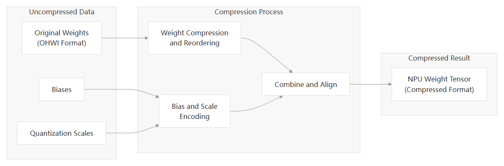
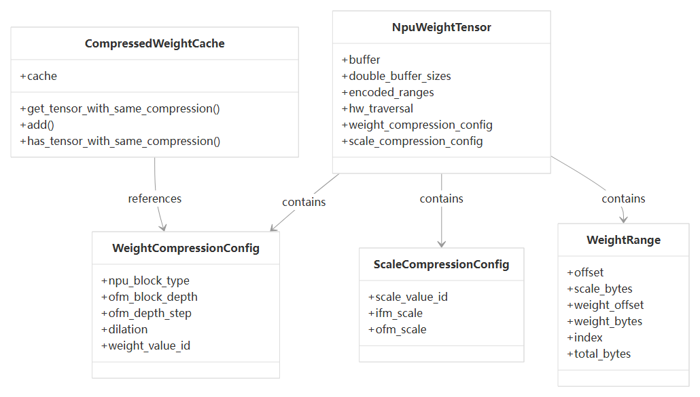
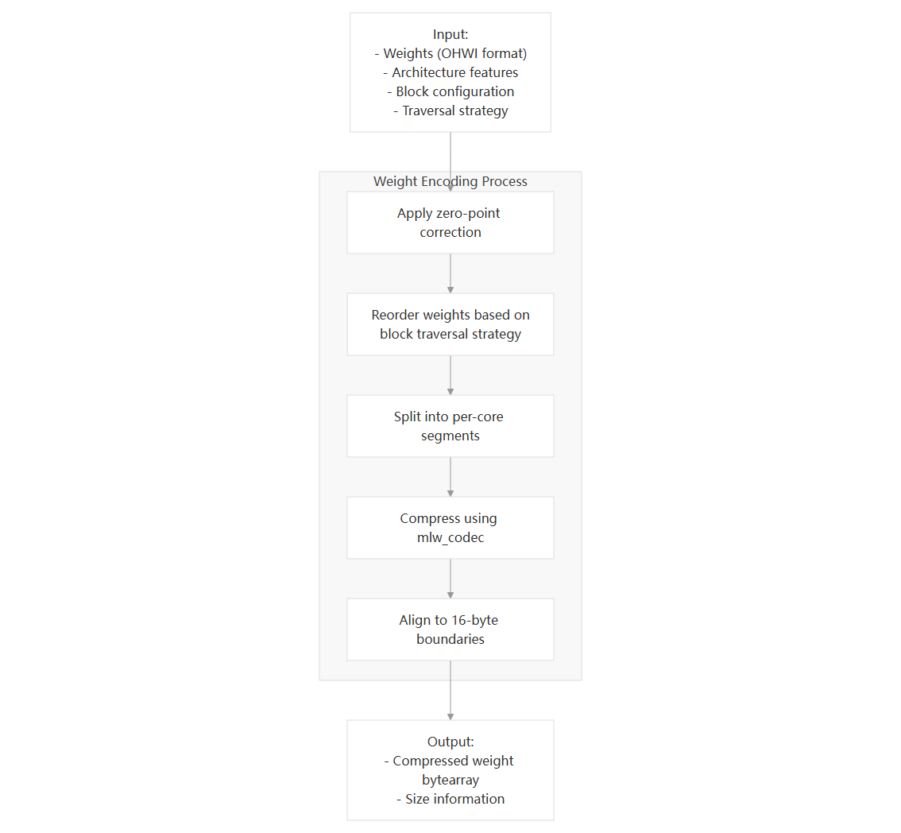
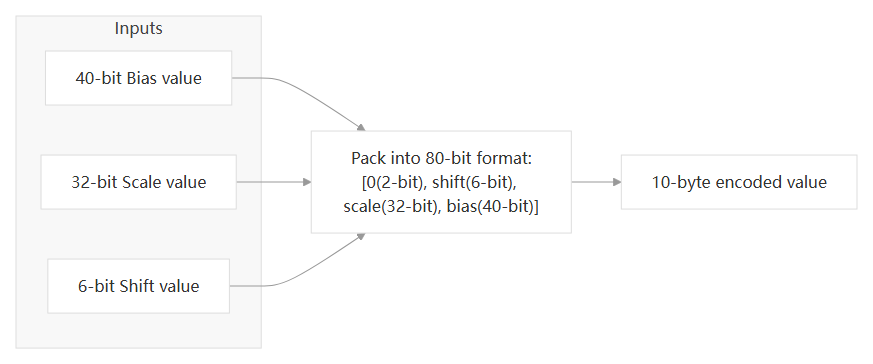
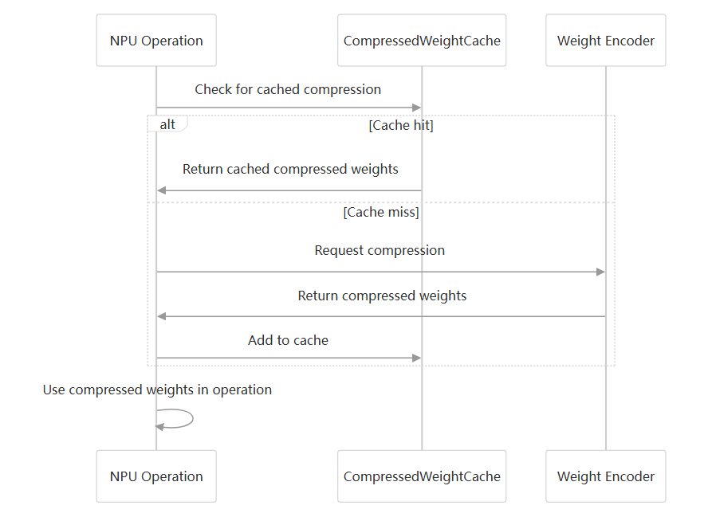
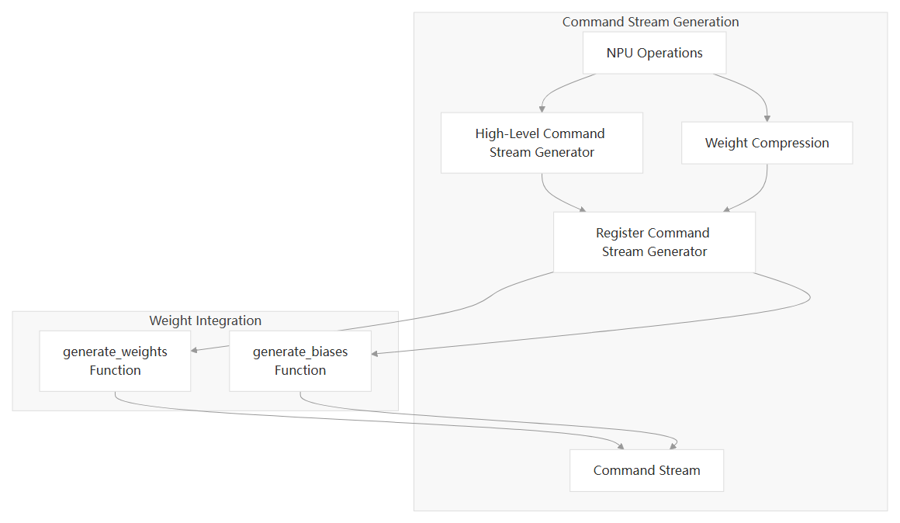

# 权重压缩

**相关源码**

- [ethosu/vela/architecture_features.py](https://github.com/nxp-imx/ethos-u-vela/blob/395a5690/ethosu/vela/architecture_features.py)
- [ethosu/vela/register_command_stream_generator.py](https://github.com/nxp-imx/ethos-u-vela/blob/395a5690/ethosu/vela/register_command_stream_generator.py)
- [ethosu/vela/weight_compressor.py](https://github.com/nxp-imx/ethos-u-vela/blob/395a5690/ethosu/vela/weight_compressor.py)

权重压缩是Ethos-U Vela编译器中用于减少神经网络内存占用权重的关键优化技术,本页解释了权重和偏置如何压缩,编码,并准备在Arm Ethos-U神经处理单元(NPU)上高效执行.

有关整个指令流生成过程的信息,参见: [命令流生成](5-command-stream-generation.md).

## 目录

- [Overview](https://github.com/nxp-imx/ethos-u-vela/blob/395a5690/Overview)
- [Compression Process](https://github.com/nxp-imx/ethos-u-vela/blob/395a5690/Compression Process)
- [Weight Encoding](https://github.com/nxp-imx/ethos-u-vela/blob/395a5690/Weight Encoding)
- [Bias and Scale Encoding](https://github.com/nxp-imx/ethos-u-vela/blob/395a5690/Bias and Scale Encoding)
- [Architecture-Specific Considerations](https://github.com/nxp-imx/ethos-u-vela/blob/395a5690/Architecture-Specific Considerations)
- [Caching Mechanism](https://github.com/nxp-imx/ethos-u-vela/blob/395a5690/Caching Mechanism)
- [Integration with Command Stream Generation](https://github.com/nxp-imx/ethos-u-vela/blob/395a5690/Integration with Command Stream Generation)

## 概览

Ethos-U Vela编译器中的权重压缩有多种用途:

1. **内存效率**: 减少权重和偏置的储存要求
2. **转移效率**: 最小化将权重传输到 NPU 所需的带宽
3. **执行优化**: 安排 权重 格式,使其与 NPU 处理它们的方式相一致

压缩过程将权重从它们的标准表示(通常为OHWI格式)转换成一个编码格式,对正在使用的特定Ethos-U硬件架构进行优化.

源码 [ethosu/vela/weight_compressor.py1-143](https://github.com/nxp-imx/ethos-u-vela/blob/395a5690/ethosu/vela/weight_compressor.py#L1-L143) [ethosu/vela/register_command_stream_generator.py443-463](https://github.com/nxp-imx/ethos-u-vela/blob/395a5690/ethosu/vela/register_command_stream_generator.py#L443-L463)

## 压缩进程

权重压缩过程涉及几个关键组件:

源码 [ethosu/vela/weight_compressor.py67-91](https://github.com/nxp-imx/ethos-u-vela/blob/395a5690/ethosu/vela/weight_compressor.py#L67-L91)

### 关键部件 :

1. **权重压缩配置**: 包含能够唯一识别权重压缩配置的元数据。 如果两个对称器具有相同的权重压缩配置, 它们将具有相同的压缩加权数 。
2. **缩放压缩配置**:包含关于尺度压缩配置的信息,包括尺度值ID和输入/输出特征图尺度.
3. **Npuight 传感器**:一个专门张量级,它持有压缩权重和相关的信息,如缓冲大小和编码范围.
4. **重量线**: 轨迹在编码缓冲区内抵消压缩重量和尺度数据.
5. **压缩了Wight 缓存**: 一个存储先前压缩 权重 的全局缓存,以避免冗余压缩操作.

源码 [ethosu/vela/weight_compressor.py66-132](https://github.com/nxp-imx/ethos-u-vela/blob/395a5690/ethosu/vela/weight_compressor.py#L66-L132)

## 权重编码

权重编码过程将神经网络权重转换为Ethos-U NPU架构优化的压缩格式:

核心编码功能由 `encode_weights` 函数,该函数:

1. 在OHWI布局中采用权重,并配有配置参数
2. 基于 Ethos- U 加速器类型的应用特定架构处理
3. 处理不同的块转动策略( DEPTH_ FIRST 或 Part_ CERNEL_ FIRST)
4. 支持不同的膨胀率因素
5. 返回编码为 权重 的字节

对于深度卷积卷积,采用了一种特殊的编码方法,为深度卷积操作的独特特性进行优化.

源码 [ethosu/vela/weight_compressor.py141-199](https://github.com/nxp-imx/ethos-u-vela/blob/395a5690/ethosu/vela/weight_compressor.py#L141-L199)

## 偏置 和缩放编码

除了权重压缩,偏置和规模编码对于维护量化的神经网络的准确性至关重要:

那个... `encode_bias` 函数 :

- 使用一个64位 有符号 偏置 值(其中使用了40位)
- 使用32 位比例值和 6 位移值
- 把它们装入80位( 10字节) 结构
- 生成的字节数组被优化为 NPU 的 偏置 处理要求

源码 [ethosu/vela/weight_compressor.py202-231](https://github.com/nxp-imx/ethos-u-vela/blob/395a5690/ethosu/vela/weight_compressor.py#L202-L231)

## 特定结构的考虑

权重压缩 适应使用中的特定Ethos-U 架构:

- **Ethos-U55/U65 (英语).**:不同的配置(32,64,128,256,512)影响:

  - 输入特性图(IFM)和输出特性图(OFM)微块大小
  - SHRAM 银行配置
  - 可供处理的核心数量
- **块状扭矩策略**:

  - **DEPTH_FIRST**: 在移动到下一个空间位置之前处理整个深度维度
  - **PART_KERNEL_FIRST**: 在移动到下一个部分之前,在每个空间位置处理卷积核 的部分
- **数据格式**:

  - 支持不同的位深( 8, 16, 32- 位)
  - 处理不同的 量化 参数

系统根据卷积核维度,特征图深度,以及目标架构,自动为每个操作类型选择最佳的转盘策略.

源码 [ethosu/vela/architecture_features.py207-283](https://github.com/nxp-imx/ethos-u-vela/blob/395a5690/ethosu/vela/architecture_features.py#L207-L283) [ethosu/vela/weight_compressor.py385-391](https://github.com/nxp-imx/ethos-u-vela/blob/395a5690/ethosu/vela/weight_compressor.py#L385-L391)

## 缓存机制

权重压缩系统执行缓存机制,以避免冗余编码操作:

缓存机制的关键方面:

1. **缓存密钥**页:1 `WeightCompressionConfig` 作为每个重量的唯一标识符 张量
2. **查询**: 检查是否已经压缩了相同的配置 权重 。
3. **储存**: 存储压缩 权重 以避免冗余压缩
4. **福利**: 当同一 权重 被多次使用时, 大大缩短了编译时间 。

源码 [ethosu/vela/weight_compressor.py109-132](https://github.com/nxp-imx/ethos-u-vela/blob/395a5690/ethosu/vela/weight_compressor.py#L109-L132)

## 与 命令流生成 合并

压缩 权重 被整合到 NPU 命令流生成 过程:

通过下列方式将压缩的权重和偏置纳入命令流:

1. `generate_weights()`: 采用压缩 权重 并生成适当的 寄存器命令 。
2. `generate_biases()`: 取编码 偏置/ 缩放值并生成 寄存器命令
3. 这些命令随后被整合到全 NPU 命令流 中

命令流 生成器检查校正和长度要求,确保压缩数据满足硬件限制:

- 重量地址必须调整为 16 字节
- 重量长度必须是 16 字节的倍数
- 规模和偏置地址必须满足对齐要求

源码 [ethosu/vela/register_command_stream_generator.py443-560](https://github.com/nxp-imx/ethos-u-vela/blob/395a5690/ethosu/vela/register_command_stream_generator.py#L443-L560)

## 主要压缩函数

将一切联系在一起的主要压缩功能是 `encode_weight_and_scale_tensor`,其中:

1. 创建适当的压缩配置
2. 检查缓存是否用于先前压缩 权重
3. 热量计的处理尺度和偏差
4. 在 权重 上执行零点校正
5. 切片 权重 成适当的加工区块
6. 使用架构特定参数编码 权重
7. 处理双重缓冲要求
8. 返回一个压缩重量张量,准备用于命令流生成

此功能高效地管理整个压缩工作流程,确保权重为Ethos-U NPU执行做好了适当的准备.

源码 [ethosu/vela/weight_compressor.py321-500](https://github.com/nxp-imx/ethos-u-vela/blob/395a5690/ethosu/vela/weight_compressor.py#L321-L500)

[返回中文目录](0-Index.md)
