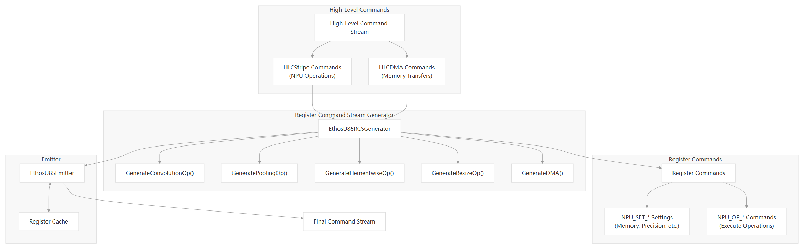
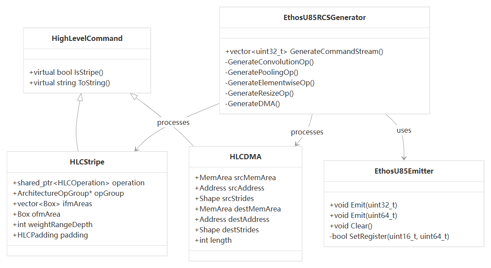
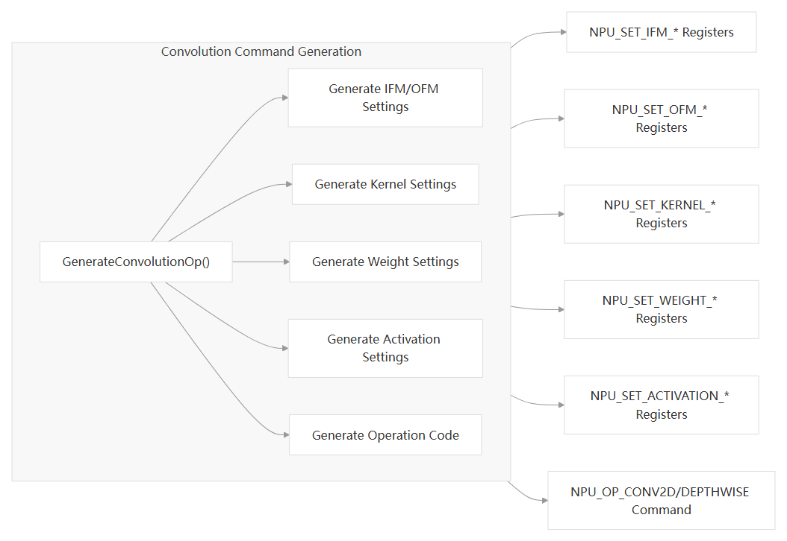
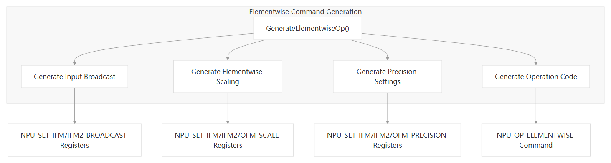
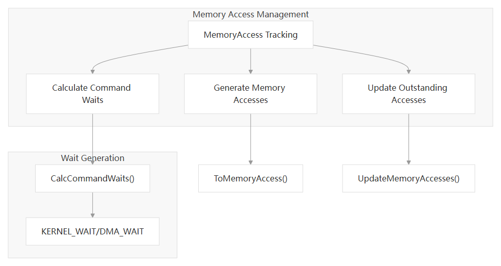
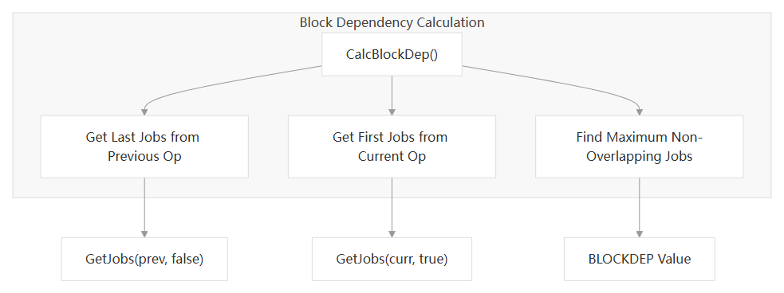
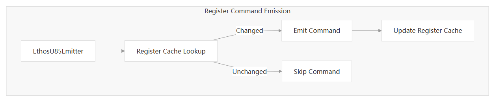

# Ethos-U85 命令流生成

**相关源码**

- [ethosu/regor/architecture/ethosu85/ethos_u85_register_cs_generator.cpp](https://github.com/nxp-imx/ethos-u-vela/blob/395a5690/ethosu/regor/architecture/ethosu85/ethos_u85_register_cs_generator.cpp)
- [ethosu/regor/architecture/ethosu85/ethos_u85_register_cs_generator.hpp](https://github.com/nxp-imx/ethos-u-vela/blob/395a5690/ethosu/regor/architecture/ethosu85/ethos_u85_register_cs_generator.hpp)
- [ethosu/regor/compiler/high_level_command_stream.hpp](https://github.com/nxp-imx/ethos-u-vela/blob/395a5690/ethosu/regor/compiler/high_level_command_stream.hpp)
- [ethosu/regor/compiler/high_level_command_stream_generator.cpp](https://github.com/nxp-imx/ethos-u-vela/blob/395a5690/ethosu/regor/compiler/high_level_command_stream_generator.cpp)

## 用途与范围

本文描述了将高层次神经网络操作转换为低层次寄存器命令的过程,具体针对Ethos-U85神经处理单元(NPU). 该文件重点介绍了Vela编译流程的最后阶段,抽象操作被转换为硬件专用命令流,可以由Ethos-U85 NPU直接执行. 有关高层次命令流代表的信息,请参见. [高层命令流](5.1-high-level-command-stream.md)。关于命令生成中使用的 权重压缩 的详情,参见 [权重压缩](5.2-weight-compression.md).

## 命令流生成概览

命令流生成 过程将抽象神经网络操作转换为配置Ethos-U85硬件来执行这些操作的混凝土寄存器设置,这个翻译可以弥合计算图表示和物理硬件执行之间的空隙.

源码

- [ethosu/regor/architecture/ethosu85/ethos_u85_register_cs_generator.cpp1-300](https://github.com/nxp-imx/ethos-u-vela/blob/395a5690/ethosu/regor/architecture/ethosu85/ethos_u85_register_cs_generator.cpp#L1-L300)
- [ethosu/regor/architecture/ethosu85/ethos_u85_register_cs_generator.hpp107-148](https://github.com/nxp-imx/ethos-u-vela/blob/395a5690/ethosu/regor/architecture/ethosu85/ethos_u85_register_cs_generator.hpp#L107-L148)

## 命令流组件

Ethos-U85的命令流由两种主要命令组成:

1. **注册设置命令** (`NPU_SET_*`——配置NPU的各个方面,如内存区域,精度,填充等.
2. **操作命令** (`NPU_OP_*`) - 触发执行特定操作,如卷积,池化等.

源码

- [ethosu/regor/compiler/high_level_command_stream.hpp197-278](https://github.com/nxp-imx/ethos-u-vela/blob/395a5690/ethosu/regor/compiler/high_level_command_stream.hpp#L197-L278)
- [ethosu/regor/architecture/ethosu85/ethos_u85_register_cs_generator.hpp34-51](https://github.com/nxp-imx/ethos-u-vela/blob/395a5690/ethosu/regor/architecture/ethosu85/ethos_u85_register_cs_generator.hpp#L34-L51)
- [ethosu/regor/architecture/ethosu85/ethos_u85_register_cs_generator.hpp108-250](https://github.com/nxp-imx/ethos-u-vela/blob/395a5690/ethosu/regor/architecture/ethosu85/ethos_u85_register_cs_generator.hpp#L108-L250)

## 从高层命令到寄存器命令的转换过程

从高级命令转换为寄存器命令是一个系统的过程:

1. **高级指挥口译**: 每一个 `HLCStripe` 或 减 减 `HLCDMA` 命令按其操作类型处理。
2. **内存访问分析**: 内存区域 每一个操作访问时都会被跟踪管理依赖性.
3. **寄存器命令 生成**:针对每个操作类型生成特定的寄存器设置.
4. **命令发射**: 生成命令被发布,同时进行优化以避免冗余设置.

### 关键类别及其作用

| 类 | 作用 |
| --- | --- |
| `EthosU85RCSGenerator` | 将高级命令转换为 寄存器命令 的主类 |
| `EthosU85Emitter` | 处理 寄存器命令 的排放量,用寄存器缓存 |
| `HLCStripe` | 代表神经网络业务的一部分 |
| `HLCDMA` | 代表内存传输操作 |
| `MemoryAccess` | 操作访问的音轨 内存区域 |
| `TileBox` | 管理 特征图 牌的地址和尺寸 |

源码

- [ethosu/regor/architecture/ethosu85/ethos_u85_register_cs_generator.hpp108-250](https://github.com/nxp-imx/ethos-u-vela/blob/395a5690/ethosu/regor/architecture/ethosu85/ethos_u85_register_cs_generator.hpp#L108-L250)
- [ethosu/regor/architecture/ethosu85/ethos_u85_register_cs_generator.hpp54-105](https://github.com/nxp-imx/ethos-u-vela/blob/395a5690/ethosu/regor/architecture/ethosu85/ethos_u85_register_cs_generator.hpp#L54-L105)

## 不同操作类型的命令生成

Ethos-U85 命令流 生成器处理各种类型的神经网络操作,每个操作都需要特定的寄存器设置.

### 卷积运算

对于卷积操作(包括标准操作和深度卷积卷积),生成器:

1. 设置输入/ 输出特征图 配置
2. 配置 卷积核 参数
3. 设置重量和 偏置 数据
4. 管理内存依赖性

源码

- [ethosu/regor/architecture/ethosu85/ethos_u85_register_cs_generator.cpp1000-1100](https://github.com/nxp-imx/ethos-u-vela/blob/395a5690/ethosu/regor/architecture/ethosu85/ethos_u85_register_cs_generator.cpp#L1000-L1100)
- [ethosu/regor/architecture/ethosu85/ethos_u85_register_cs_generator.cpp1100-1200](https://github.com/nxp-imx/ethos-u-vela/blob/395a5690/ethosu/regor/architecture/ethosu85/ethos_u85_register_cs_generator.cpp#L1100-L1200)

### 池化运算

对于池化操作(最大池化,平均池化等),生成器:

1. 配置 池化 模式(最大、平均等)
2. 设置 卷积核 参数
3. 处理平均特殊缩放 池化

生成器支持这些 池化 模式 :

- 平均值 池化 (内核 > 8x8的标准或总和)
- 马克斯 池化
- argMax( 查找最大值的位置)
- 削减行动(单位、最大、总和)

源码

- [ethosu/regor/architecture/ethosu85/ethos_u85_register_cs_generator.cpp320-351](https://github.com/nxp-imx/ethos-u-vela/blob/395a5690/ethosu/regor/architecture/ethosu85/ethos_u85_register_cs_generator.cpp#L320-L351)
- [ethosu/regor/architecture/ethosu85/ethos_u85_register_cs_generator.cpp700-728](https://github.com/nxp-imx/ethos-u-vela/blob/395a5690/ethosu/regor/architecture/ethosu85/ethos_u85_register_cs_generator.cpp#L700-L728)

### 逐元素运算

对于 逐元素 操作(加、减、乘等),生成器:

1. 配置处理不同形状的 张量 输入广播
2. 为保持量化正确性建立适当的规模
3. 处理像Leaky Relu这样的特殊案件

得到支持的逐元素业务包括:

- 算术操作(Add, Sub, Mul, Div)
- 比较操作( 等、 大、 大等 、 非等)
- 逻辑操作( 或 Xor, 不)
- 特别行动(最低、最大、LeakyRelu、CLZ、SHL、SHR)

源码

- [ethosu/regor/architecture/ethosu85/ethos_u85_register_cs_generator.cpp157-183](https://github.com/nxp-imx/ethos-u-vela/blob/395a5690/ethosu/regor/architecture/ethosu85/ethos_u85_register_cs_generator.cpp#L157-L183)
- [ethosu/regor/architecture/ethosu85/ethos_u85_register_cs_generator.cpp730-783](https://github.com/nxp-imx/ethos-u-vela/blob/395a5690/ethosu/regor/architecture/ethosu85/ethos_u85_register_cs_generator.cpp#L730-L783)
- [ethosu/regor/architecture/ethosu85/ethos_u85_register_cs_generator.cpp1087-1117](https://github.com/nxp-imx/ethos-u-vela/blob/395a5690/ethosu/regor/architecture/ethosu85/ethos_u85_register_cs_generator.cpp#L1087-L1117)

### Resize 运算

对于调整操作大小( 线性, 最近的邻居) , 生成器 :

1. 配置调整大小模式( 线性、 最近的, 或复制)
2. 设置升级因素
3. 处理1x1 输入等特殊案件 特征图

源码

- [ethosu/regor/architecture/ethosu85/ethos_u85_register_cs_generator.cpp284-295](https://github.com/nxp-imx/ethos-u-vela/blob/395a5690/ethosu/regor/architecture/ethosu85/ethos_u85_register_cs_generator.cpp#L284-L295)
- [ethosu/regor/compiler/high_level_command_stream_generator.cpp387-408](https://github.com/nxp-imx/ethos-u-vela/blob/395a5690/ethosu/regor/compiler/high_level_command_stream_generator.cpp#L387-L408)

### DMA 操作

对于DMA(Direct内存访问)操作,生成器:

1. 配置源和目的地 内存区域
2. 设置内存 步长
3. 处理诸如散/加太操作等特殊情况

源码

- [ethosu/regor/compiler/high_level_command_stream_generator.cpp476-555](https://github.com/nxp-imx/ethos-u-vela/blob/395a5690/ethosu/regor/compiler/high_level_command_stream_generator.cpp#L476-L555)
- [ethosu/regor/compiler/high_level_command_stream_generator.cpp558-589](https://github.com/nxp-imx/ethos-u-vela/blob/395a5690/ethosu/regor/compiler/high_level_command_stream_generator.cpp#L558-L589)

## 内存访问管理

命令流生成器仔细管理内存访问,以确保正确的操作执行命令,并防止冲突.

### 内存区域

Ethos-U85 架构使用了几种内存区域:

1. **特征图 记忆** - 存储输入和输出特征图
2. **重量内存** - 权重用于卷积业务的储存
3. **刻录内存** - 提供快速临时储存
4. **LUT 内存** - 存储激活功能的查询表

### 内存访问跟踪

生成器使用 `MemoryAccess` 结构,记录:

- 访问方向( 读或写)
- 内存区域 正在访问中
- 开始和结束地址

这种跟踪可实现:

1. 侦查行动之间的冲突
2. 计算等待的依赖性
3. 优化内存使用

源码

- [ethosu/regor/architecture/ethosu85/ethos_u85_register_cs_generator.hpp77-97](https://github.com/nxp-imx/ethos-u-vela/blob/395a5690/ethosu/regor/architecture/ethosu85/ethos_u85_register_cs_generator.hpp#L77-L97)
- [ethosu/regor/architecture/ethosu85/ethos_u85_register_cs_generator.cpp526-563](https://github.com/nxp-imx/ethos-u-vela/blob/395a5690/ethosu/regor/architecture/ethosu85/ethos_u85_register_cs_generator.cpp#L526-L563)
- [ethosu/regor/architecture/ethosu85/ethos_u85_register_cs_generator.cpp622-644](https://github.com/nxp-imx/ethos-u-vela/blob/395a5690/ethosu/regor/architecture/ethosu85/ethos_u85_register_cs_generator.cpp#L622-L644)

## 算子依赖和块依赖

生成器通过下列方式处理操作之间的依赖性:

1. **内存访问依赖性** - 利用内存访问分析跟踪
2. **块依赖关系** - 为共享数据的连续操作计算

区块依赖机制`BLOCKDEP`)优化执行,允许在安全时重复执行连续操作.

源码

- [ethosu/regor/architecture/ethosu85/ethos_u85_register_cs_generator.cpp789-921](https://github.com/nxp-imx/ethos-u-vela/blob/395a5690/ethosu/regor/architecture/ethosu85/ethos_u85_register_cs_generator.cpp#L789-L921)
- [ethosu/regor/architecture/ethosu85/ethos_u85_register_cs_generator.cpp803-821](https://github.com/nxp-imx/ethos-u-vela/blob/395a5690/ethosu/regor/architecture/ethosu85/ethos_u85_register_cs_generator.cpp#L803-L821)

## 寄存器命令发射与优化

那个... `EthosU85Emitter` 类别优化 寄存器命令 排放量:

1. 跟踪登记册的现状
2. 避免冗余 寄存器设置
3. 管理连锁业务等特殊情况.

源码

- [ethosu/regor/architecture/ethosu85/ethos_u85_register_cs_generator.cpp58-149](https://github.com/nxp-imx/ethos-u-vela/blob/395a5690/ethosu/regor/architecture/ethosu85/ethos_u85_register_cs_generator.cpp#L58-L149)
- [ethosu/regor/architecture/ethosu85/ethos_u85_register_cs_generator.cpp96-105](https://github.com/nxp-imx/ethos-u-vela/blob/395a5690/ethosu/regor/architecture/ethosu85/ethos_u85_register_cs_generator.cpp#L96-L105)
- [ethosu/regor/architecture/ethosu85/ethos_u85_register_cs_generator.cpp125-134](https://github.com/nxp-imx/ethos-u-vela/blob/395a5690/ethosu/regor/architecture/ethosu85/ethos_u85_register_cs_generator.cpp#L125-L134)

## 特殊特征和优化

### 链式执行

Ethos-U85支持操作链,其中一个操作的输出直接反馈到下一个操作而不写入内存. 生成器处理此操作的方法是:

1. 设置适当的存储模式( E)`activation_storage::CHAINED`)
2. 管理整个业务的登记状态
3. 必要时清理链条登记册

源码

- [ethosu/regor/architecture/ethosu85/ethos_u85_register_cs_generator.cpp58-94](https://github.com/nxp-imx/ethos-u-vela/blob/395a5690/ethosu/regor/architecture/ethosu85/ethos_u85_register_cs_generator.cpp#L58-L94)
- [ethosu/regor/architecture/ethosu85/ethos_u85_register_cs_generator.cpp1136-1172](https://github.com/nxp-imx/ethos-u-vela/blob/395a5690/ethosu/regor/architecture/ethosu85/ethos_u85_register_cs_generator.cpp#L1136-L1172)

### LUT 管理系统

对于使用搜索表(LUT)的操作,如激活函数,生成器:

1. 在 LUT 内存中分配 LUT 位置
2. 管理来自恒定内存的 LUT 传输
3. 设置适当的 LUT 配置

源码

- [ethosu/regor/architecture/ethosu85/ethos_u85_register_cs_generator.cpp649-681](https://github.com/nxp-imx/ethos-u-vela/blob/395a5690/ethosu/regor/architecture/ethosu85/ethos_u85_register_cs_generator.cpp#L649-L681)
- [ethosu/regor/architecture/ethosu85/ethos_u85_register_cs_generator.cpp984-1056](https://github.com/nxp-imx/ethos-u-vela/blob/395a5690/ethosu/regor/architecture/ethosu85/ethos_u85_register_cs_generator.cpp#L984-L1056)

### 权重缓冲

对于使用权重(卷积)的操作,生成器支持:

1. 单一缓冲(基本使用)
2. 双重缓冲(通过计算重叠重量转移)
3. 不同深度切片的重量范围选择

源码

- [ethosu/regor/architecture/ethosu85/ethos_u85_register_cs_generator.cpp390-403](https://github.com/nxp-imx/ethos-u-vela/blob/395a5690/ethosu/regor/architecture/ethosu85/ethos_u85_register_cs_generator.cpp#L390-L403)
- [ethosu/regor/compiler/high_level_command_stream_generator.cpp674-707](https://github.com/nxp-imx/ethos-u-vela/blob/395a5690/ethosu/regor/compiler/high_level_command_stream_generator.cpp#L674-L707)

## 总结

Ethos-U85 命令流生成系统高效地将高级神经网络操作转换为低级硬件指令,通过对内存访问,操作依赖性,以及硬件特异性优化的认真管理,它使得Ethos-U85 NPU上的神经网络模型能够有效运行.

[返回中文目录](0-Index.md)
