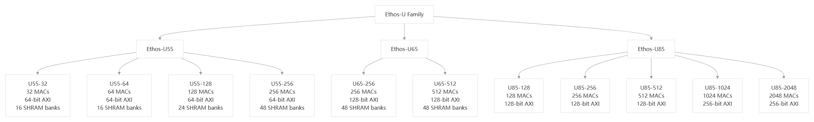
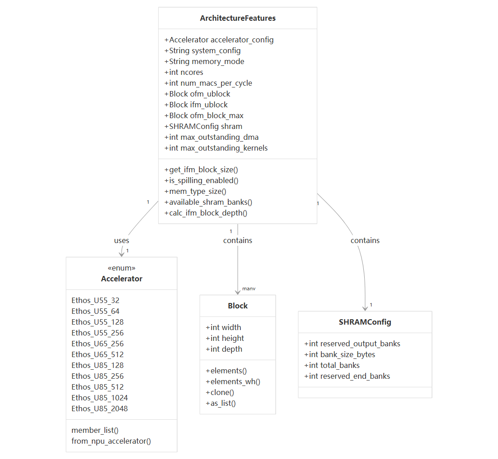
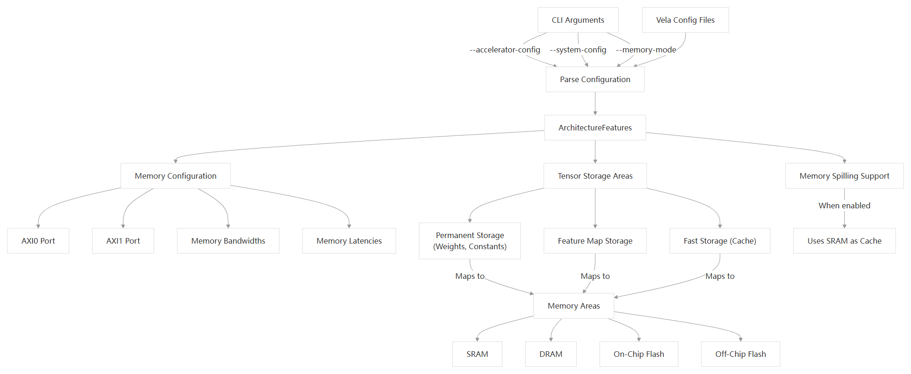
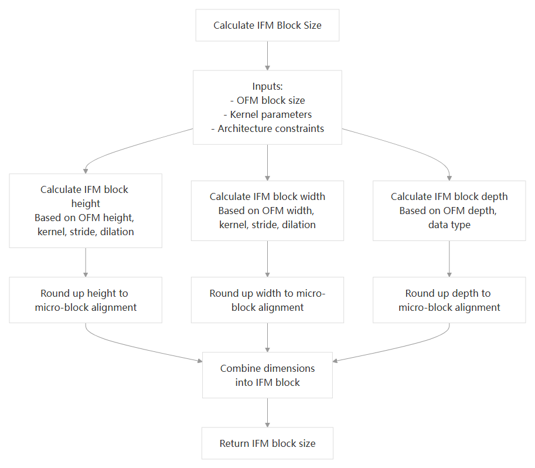
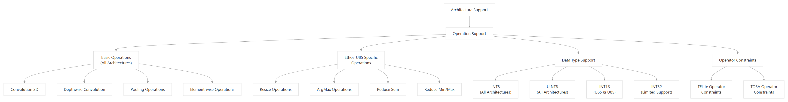
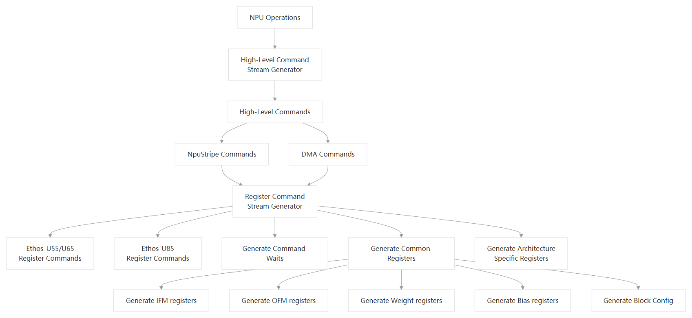
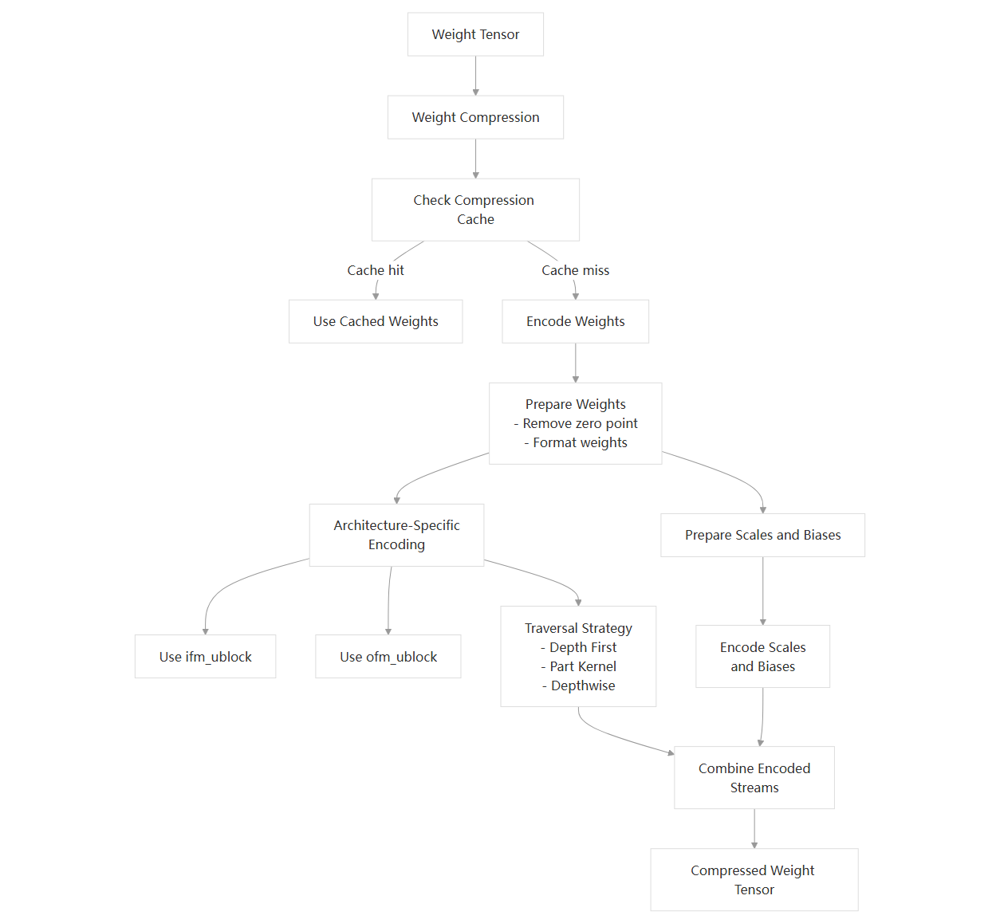

# 架构支持

**相关源码**

- [ethosu/regor/architecture/ethosu85/ethos_u85.cpp](https://github.com/nxp-imx/ethos-u-vela/blob/395a5690/ethosu/regor/architecture/ethosu85/ethos_u85.cpp)
- [ethosu/regor/architecture/ethosu85/ethos_u85.hpp](https://github.com/nxp-imx/ethos-u-vela/blob/395a5690/ethosu/regor/architecture/ethosu85/ethos_u85.hpp)
- [ethosu/regor/common/shape.hpp](https://github.com/nxp-imx/ethos-u-vela/blob/395a5690/ethosu/regor/common/shape.hpp)
- [ethosu/regor/common/transpose_type.hpp](https://github.com/nxp-imx/ethos-u-vela/blob/395a5690/ethosu/regor/common/transpose_type.hpp)
- [ethosu/regor/test/test_shape.cpp](https://github.com/nxp-imx/ethos-u-vela/blob/395a5690/ethosu/regor/test/test_shape.cpp)
- [ethosu/vela/architecture_features.py](https://github.com/nxp-imx/ethos-u-vela/blob/395a5690/ethosu/vela/architecture_features.py)
- [ethosu/vela/register_command_stream_generator.py](https://github.com/nxp-imx/ethos-u-vela/blob/395a5690/ethosu/vela/register_command_stream_generator.py)
- [ethosu/vela/weight_compressor.py](https://github.com/nxp-imx/ethos-u-vela/blob/395a5690/ethosu/vela/weight_compressor.py)

本页面概述了由 Vela 编译器支持的不同 Arm Ethos-U 神经处理单元(NPU)架构及其关键功能。关于架构 制约的更具体信息,请参见 [架构约束](6.1-architecture-constraints.md),关于Ethos-U85的详细信息,见Ethos-U85 架构, [Ethos-U85 架构](6.2-ethos-u85-architecture.md).

## 受支助家庭架构

Vela编译器支持三个主要的Ethos-U NPU 架构 家族,每个家族根据MAC(乘积操作)能力有不同的变体: .

1. **Ethos-U55 (英语).**: 为低功率嵌入式ML应用程序设计
2. **Ethos-U65号卫星**: 对于更高的性能嵌入式ML应用程序
3. **Ethos-U85 (英语).**: 最新一代高性能ML,业务支助扩大

### 架构 变式等级

源码 [ethosu/vela/architecture_features.py214-276](https://github.com/nxp-imx/ethos-u-vela/blob/395a5690/ethosu/vela/architecture_features.py#L214-L276) [ethosu/regor/architecture/ethosu85/ethos_u85.cpp65-78](https://github.com/nxp-imx/ethos-u-vela/blob/395a5690/ethosu/regor/architecture/ethosu85/ethos_u85.cpp#L65-L78)

## 架构 特性管理

Vela 编译器管理不同的 架构 配置,通过 `ArchitectureFeatures` 类。该类充当所有影响编译和优化的架构特定参数的容器。

源码 [ethosu/vela/architecture_features.py207-449](https://github.com/nxp-imx/ethos-u-vela/blob/395a5690/ethosu/vela/architecture_features.py#L207-L449)

### 密钥 架构 配置参数

每个架构变体由几个关键参数定义:

| 参数 | 说明 | 示例数值 |
| --- | --- | --- |
| `accelerator_config` | 目标Ethos-U加速器 | `Ethos_U55_128`, `Ethos_U85_512` |
| `ncores` | 加速器中的核数 | 1, 2, 4 |
| `num_macs_per_cycle` | 每个周期的MAC操作 | 32, 64, 128, 256, 512, 1024, 2048 |
| `ofm_ublock`/`ifm_ublock` | 输出/ 输入特征图 微块大小 | `Block(2, 2, 8)`, `Block(1, 1, 8)` |
| `shram` | SHRAM( 共享内存) 配置 | 银行盘点、规模、预订 |
| `max_outstanding_dma` | 最大未完成的 DMA 操作 | 1, 2, 4 |
| `max_address_offset` | 最大内存地址偏移 | 2^32, 2^40 |

源码 [ethosu/vela/architecture_features.py282-377](https://github.com/nxp-imx/ethos-u-vela/blob/395a5690/ethosu/vela/architecture_features.py#L282-L377) [ethosu/regor/architecture/ethosu85/ethos_u85.cpp65-78](https://github.com/nxp-imx/ethos-u-vela/blob/395a5690/ethosu/regor/architecture/ethosu85/ethos_u85.cpp#L65-L78)

## 内存配置

不同的Ethos-U架构具有不同的内存能力和配置,对性能和优化策略产生了显著影响.

源码 [ethosu/vela/architecture_features.py570-736](https://github.com/nxp-imx/ethos-u-vela/blob/395a5690/ethosu/vela/architecture_features.py#L570-L736)

### 内存区域 配置

每个架构将不同类型的张量映射到不同的内存区域:

| 张量用途 | 内存区域 | 内存类型 |
| --- | --- | --- |
| 权重 | DRAM、 OnChipFlash 或 OffChipFlash 软件 | 永久状态(_NPU) |
| 特征图 | SRAM 或 DRAM 数据存储 | 暂存 |
| 查看表格 | DRAM、 OnChipFlash 或 OffChipFlash 软件 | 暂存 |
| 暂存 | SRAM 或 DRAM 数据存储 | 暂存 |
| 刷新快报 | SRAM | 刷新速度(_F) |

源码 [ethosu/vela/architecture_features.py313-330](https://github.com/nxp-imx/ethos-u-vela/blob/395a5690/ethosu/vela/architecture_features.py#L313-L330)

### 内存 溢出

内存 溢出 是允许 Ethos- U NPU 使用专用的SRAM作为各类数据的缓存的一种特性。 当 :

1. 缓存 内存区域 是 SRAM
2. 缓存内存区域与竞技场内存区域不同.

那个... `is_spilling_enabled()` 输入方法 `ArchitectureFeatures` 确定是否为给定配置提供此特性。

源码 [ethosu/vela/architecture_features.py532-538](https://github.com/nxp-imx/ethos-u-vela/blob/395a5690/ethosu/vela/architecture_features.py#L532-L538)

## 微古建筑特征

每个Ethos-U 架构都有特定的微结构特征,影响块大小,操作支持,以及性能.

### 微块 配置

微块是Ethos-U NPU的基本处理单元,每个架构变体支持不同的微块配置:

| 架构 | OFM 微块 选项 | IFM 微块 |
| --- | --- | --- |
| Ethos-U55-32 (英语). | `Block(1, 1, 4)` | `Block(1, 1, 8)` |
| Ethos-U55-64 (英语). | `Block(1, 1, 8)` | `Block(1, 1, 8)` |
| Ethos-U55-128 (英语). | `Block(2, 1, 8)` | `Block(2, 1, 8)` |
| Ethos-U55-256/U65-256 (英语). | `Block(2, 2, 8)` | `Block(2, 2, 8)` |
| Ethos-U65-512 (英语). | `Block(2, 2, 8)` | `Block(2, 2, 8)` |
| Ethos-U85-128 (英语). | `Block(1, 2, 8)`, `Block(1, 1, 16)` | `Block(1, 2, 8)` |
| Ethos-U85-256 (英语). | 多个选项 | 变数 |
| Ethos-U85-512+ (英语). | 多个选项 | 变数 |

源码 [ethosu/vela/architecture_features.py222-240](https://github.com/nxp-imx/ethos-u-vela/blob/395a5690/ethosu/vela/architecture_features.py#L222-L240) [ethosu/regor/architecture/ethosu85/ethos_u85.cpp65-78](https://github.com/nxp-imx/ethos-u-vela/blob/395a5690/ethosu/regor/architecture/ethosu85/ethos_u85.cpp#L65-L78)

### IFM 块大小计算

编译器根据 输出特征图 (OFM) 块大小、 卷积核 参数和 架构 限制,计算出适当的 输入特征图 (IFM) 块大小 :

源码 [ethosu/vela/architecture_features.py504-530](https://github.com/nxp-imx/ethos-u-vela/blob/395a5690/ethosu/vela/architecture_features.py#L504-L530) [ethosu/regor/architecture/ethosu85/ethos_u85.cpp263-277](https://github.com/nxp-imx/ethos-u-vela/blob/395a5690/ethosu/regor/architecture/ethosu85/ethos_u85.cpp#L263-L277)

## 行动支助

不同的Ethos-U架构支持不同的操作,对这些操作有不同的限制.

源码 [ethosu/vela/architecture_features.py400-418](https://github.com/nxp-imx/ethos-u-vela/blob/395a5690/ethosu/vela/architecture_features.py#L400-L418) [ethosu/regor/architecture/ethosu85/ethos_u85.cpp360-456](https://github.com/nxp-imx/ethos-u-vela/blob/395a5690/ethosu/regor/architecture/ethosu85/ethos_u85.cpp#L360-L456)

### 用于块绘图的操作

Ethos-U85架构根据输入数据位深度将不同的操作映射到特定的微块配置:

| 算子 | 位深 | 支助 微块 |
| --- | --- | --- |
| 卷积 | 8 位数 | 各种, 基于 MAC 计数 |
| 卷积 | 16 位数 | 更有限制的选项 |
| 深度卷积 | 8/16 位点 | 具体微块 每架构 |
| 池化 | 8/16 位点 | 多个选项 |
| 逐元素 | 8/16/32 位点 | 最灵活 |
| 减少业务 | 8/16 位点 | 特定块配置 |

源码 [ethosu/regor/architecture/ethosu85/ethos_u85.cpp360-456](https://github.com/nxp-imx/ethos-u-vela/blob/395a5690/ethosu/regor/architecture/ethosu85/ethos_u85.cpp#L360-L456)

## 命令流生成

Vela编译器基于目标Ethos-U架构生成特定架构的寄存层命令流.

源码 [ethosu/vela/register_command_stream_generator.py17-226](https://github.com/nxp-imx/ethos-u-vela/blob/395a5690/ethosu/vela/register_command_stream_generator.py#L17-L226)

### 寄存器命令 类型

那个... `CommandStreamEmitter` 类处理不同架构的 寄存器命令 排放。它支持:

1. 无有效载荷的命令( X)`cmd0`)
2. 带有32位有效载荷的指令(`cmd1`)
3. 等待命令同步
4. 操作执行命令

每个架构都需要不同的寄存器设置来正确配置操作.

源码 [ethosu/vela/register_command_stream_generator.py99-226](https://github.com/nxp-imx/ethos-u-vela/blob/395a5690/ethosu/vela/register_command_stream_generator.py#L99-L226)

## 权重压缩

权重压缩是Ethos-U架构中的一个重要优化,压缩策略基于架构参数而有所不同.

源码 [ethosu/vela/weight_compressor.py141-500](https://github.com/nxp-imx/ethos-u-vela/blob/395a5690/ethosu/vela/weight_compressor.py#L141-L500)

### 权重编码 参数

那个... `encode_weights` 函数根据若干特定架构参数调整压缩:

| 参数 | 说明 | 影响 |
| --- | --- | --- |
| `accelerator` | 目标Ethos-U加速器 | 确定基本的编码策略 |
| `dilation_xy` | 膨胀率在x,y维度中 | 影响卷积核布局 |
| `ifm_bitdepth` | 输入特征图 的位深 | 更改编码效率 |
| `ofm_block_depth` | OFM 区块的深度 | 影响压缩颗粒性 |
| `is_depthwise` | 操作是否为 深度卷积 | 变化的横向图案 |
| `block_traversal` | 卷积核是如何经过的 | 影响压缩模式 |

源码 [ethosu/vela/weight_compressor.py141-198](https://github.com/nxp-imx/ethos-u-vela/blob/395a5690/ethosu/vela/weight_compressor.py#L141-L198) [ethosu/regor/architecture/ethosu85/ethos_u85.cpp252-261](https://github.com/nxp-imx/ethos-u-vela/blob/395a5690/ethosu/regor/architecture/ethosu85/ethos_u85.cpp#L252-L261)

## 建筑- 特定形状处理

Vela 编译器及其更新的组件使用专门的 `Shape` 分类来管理多维张量 形状,跨越不同的架构 :

1. 基于 Python 的 `Block` 在Vela核心的类
2. C++ 键 `Shape` 新建建筑特定组件中的类

这些班级为:

- 创建和操纵 N 维形状
- 诸如四舍五入、填充和转换等业务
- 计算 步长 和元素计数
- 优化特定架构的张量布局

源码 [ethosu/vela/architecture_features.py48-107](https://github.com/nxp-imx/ethos-u-vela/blob/395a5690/ethosu/vela/architecture_features.py#L48-L107) [ethosu/regor/common/shape.hpp34-764](https://github.com/nxp-imx/ethos-u-vela/blob/395a5690/ethosu/regor/common/shape.hpp#L34-L764)

## 小结

Ethos-U Vela编译器支持多个具有不同能力和约束的Arm Ethos-U NPU架构. 架构 支持包括:

1. 建筑特定参数的配置
2. 适合每个人的内存管理架构
3. 基于架构能力的行动支助
4. 高效的块大小计算和分配
5. 特定建筑命令流生成
6. 优化 权重压缩

了解这些建筑差异对于优化特定Ethos-U硬件目标的神经网络至关重要.

[返回中文目录](0-Index.md)
