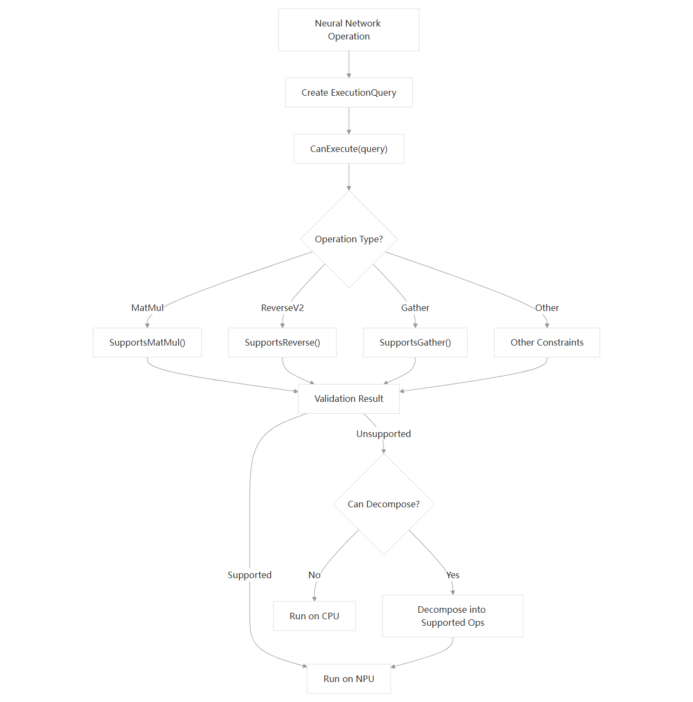
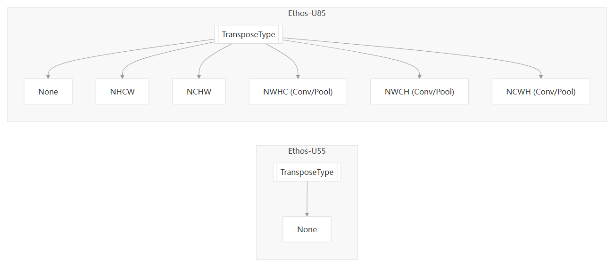
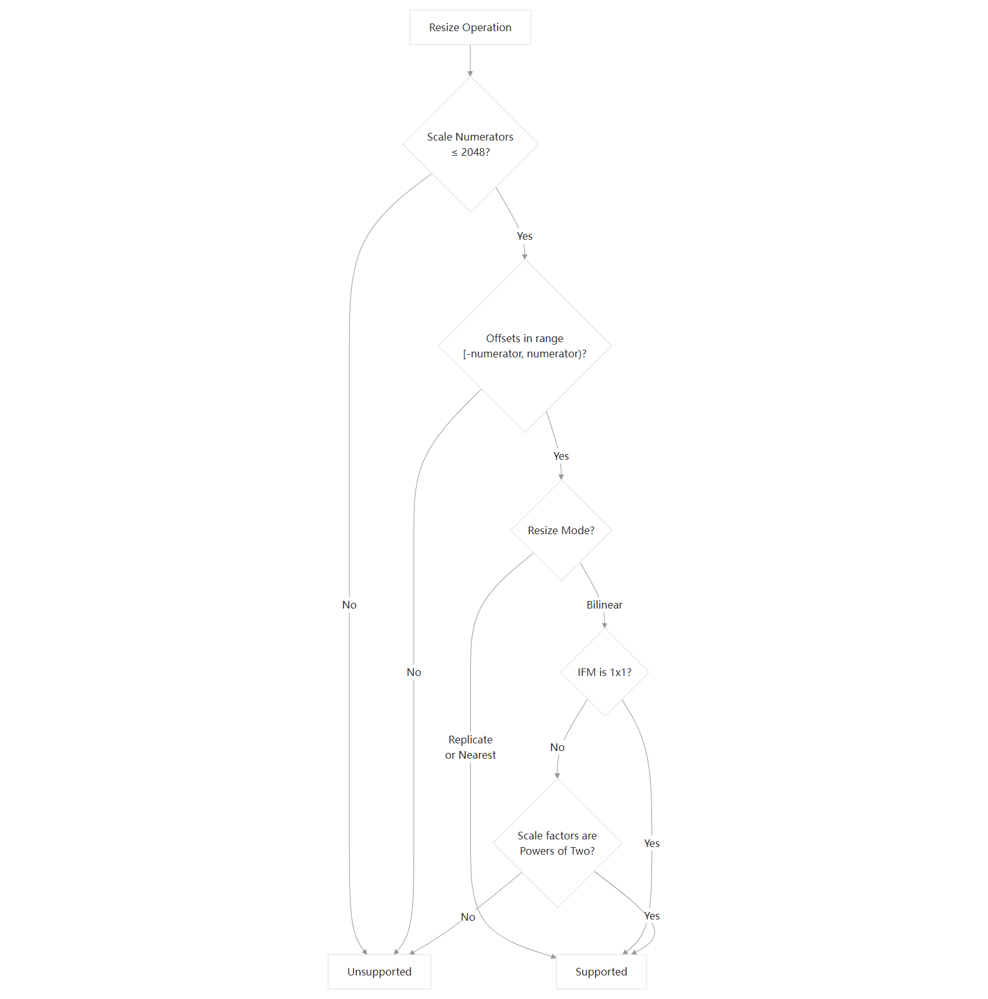

# 架构约束

**相关源码**

- [ethosu/regor/architecture/architecture_constraints.hpp](https://github.com/nxp-imx/ethos-u-vela/blob/395a5690/ethosu/regor/architecture/architecture_constraints.hpp)
- [ethosu/regor/architecture/ethosu55/ethos_u55_constraints.cpp](https://github.com/nxp-imx/ethos-u-vela/blob/395a5690/ethosu/regor/architecture/ethosu55/ethos_u55_constraints.cpp)
- [ethosu/regor/architecture/ethosu55/ethos_u55_constraints.hpp](https://github.com/nxp-imx/ethos-u-vela/blob/395a5690/ethosu/regor/architecture/ethosu55/ethos_u55_constraints.hpp)
- [ethosu/regor/architecture/ethosu85/ethos_u85_constraints.cpp](https://github.com/nxp-imx/ethos-u-vela/blob/395a5690/ethosu/regor/architecture/ethosu85/ethos_u85_constraints.cpp)
- [ethosu/regor/architecture/ethosu85/ethos_u85_constraints.hpp](https://github.com/nxp-imx/ethos-u-vela/blob/395a5690/ethosu/regor/architecture/ethosu85/ethos_u85_constraints.hpp)
- [ethosu/regor/compiler/quantization.hpp](https://github.com/nxp-imx/ethos-u-vela/blob/395a5690/ethosu/regor/compiler/quantization.hpp)
- [ethosu/regor/compiler/scheduler_decompose.hpp](https://github.com/nxp-imx/ethos-u-vela/blob/395a5690/ethosu/regor/compiler/scheduler_decompose.hpp)

本页面记录了Ethos-U Vela编译器中的硬件架构限制,这些限制决定了哪些神经网络操作可以在Arm Ethos-U神经处理单元(NPU)上执行,以及这些操作的结构必须如何与硬件兼容。关于Ethos-U架构 特定能力的信息,请参见 [架构支持](6-architecture-support.md) 财务报告和财务报告 [Ethos-U85 架构](6.2-ethos-u85-architecture.md).

## 约束系统概览

Ethos-U Vela编译器使用架构的制约来确定:

1. 哪些操作可以直接运行在 NPU 上
2. 哪些操作需要分解为更简单的操作
3. 哪些业务必须委托给CPU

这些限制作为提供建筑特定验证的等级结构来实施.

```

```

源码 [ethosu/regor/architecture/architecture_constraints.hpp90-149](https://github.com/nxp-imx/ethos-u-vela/blob/395a5690/ethosu/regor/architecture/architecture_constraints.hpp#L90-L149) [ethosu/regor/architecture/ethosu55/ethos_u55_constraints.hpp25-46](https://github.com/nxp-imx/ethos-u-vela/blob/395a5690/ethosu/regor/architecture/ethosu55/ethos_u55_constraints.hpp#L25-L46) [ethosu/regor/architecture/ethosu85/ethos_u85_constraints.hpp25-46](https://github.com/nxp-imx/ethos-u-vela/blob/395a5690/ethosu/regor/architecture/ethosu85/ethos_u85_constraints.hpp#L25-L46)

## 约束验证流

在编译神经网络时,每个操作都会在硬件限制下进行验证. 以下的图显示了验证过程: 1.



源码 [ethosu/regor/architecture/architecture_constraints.hpp101-137](https://github.com/nxp-imx/ethos-u-vela/blob/395a5690/ethosu/regor/architecture/architecture_constraints.hpp#L101-L137) [ethosu/regor/compiler/scheduler_decompose.hpp35-46](https://github.com/nxp-imx/ethos-u-vela/blob/395a5690/ethosu/regor/compiler/scheduler_decompose.hpp#L35-L46)

## 关键建筑差异

下表突出Ethos-U55和Ethos-U85建筑在制约方面的主要差异: 建筑结构 建筑结构 建筑结构 建筑结构 建筑结构 建筑结构 建筑结构 建筑结构

| 特性 | Ethos-U55 (英语). | Ethos-U85 (英语). |
| --- | --- | --- |
| MatMul 行动 | 不予支持 | 获得支持 |
| 莱基雷卢 | 有限(仅限量使用) | 已完全支持 |
| 转置 | 有限(无) | 支持多种模式(NHCW、NCHW等) |
| 反向操作 | 有限(无) | 获得支持 |
| 调整业务规模 | 不予支持 | 受到制约的支持 |
| argMax 操作 | 不予支持 | 获得支持 |
| 铸币业务 | 不予支持 | 支持( 非浮动类型) |
| 非匹配形状 | 有限 | 已完全支持 |
| 累加器 保存/恢复 | 不予支持 | 获得支持 |

源码 [ethosu/regor/architecture/ethosu55/ethos_u55_constraints.cpp26-151](https://github.com/nxp-imx/ethos-u-vela/blob/395a5690/ethosu/regor/architecture/ethosu55/ethos_u55_constraints.cpp#L26-L151) [ethosu/regor/architecture/ethosu85/ethos_u85_constraints.cpp26-276](https://github.com/nxp-imx/ethos-u-vela/blob/395a5690/ethosu/regor/architecture/ethosu85/ethos_u85_constraints.cpp#L26-L276)

## 转换限制

转置操作重排张量的维度. 支持的转置模式因架构而异:



源码 [ethosu/regor/architecture/ethosu55/ethos_u55_constraints.cpp37-41](https://github.com/nxp-imx/ethos-u-vela/blob/395a5690/ethosu/regor/architecture/ethosu55/ethos_u55_constraints.cpp#L37-L41) [ethosu/regor/architecture/ethosu85/ethos_u85_constraints.cpp42-58](https://github.com/nxp-imx/ethos-u-vela/blob/395a5690/ethosu/regor/architecture/ethosu85/ethos_u85_constraints.cpp#L42-L58)

## Fused 缩放支持

Fused rescale 允许在执行操作时调整 量化 参数,避免了单独 重缩放 操作的需要. 两个架构都支持熔化的 rescale,但有不同的限制:

### 输入特征图 (IFM) 缩放

对于Ethos-U55:

- 逐元素 操作:仅以8/16位类型进行简单的调整,不进行剪切
- 有限业务支助(Add, Sub, 不剪辑)
- 其他行动:仅单位规模,不剪辑

对于Ethos-U85:

- 扩大对逐元素业务的支持
- Div和Mul业务需要单位规模

### 输出特征图 (OFM) 缩放

对于Ethos-U55:

- 支持卷积、深度卷积、池化和矢量产品
- 有限支助逐元素

对于Ethos-U85:

- 支持卷积、深度卷积、池化和矢量产品
- 调整业务规模,规模=1,班次= 16
- 扩大 逐元素 支持

源码 [ethosu/regor/architecture/ethosu55/ethos_u55_constraints.cpp49-114](https://github.com/nxp-imx/ethos-u-vela/blob/395a5690/ethosu/regor/architecture/ethosu55/ethos_u55_constraints.cpp#L49-L114) [ethosu/regor/architecture/ethosu85/ethos_u85_constraints.cpp78-147](https://github.com/nxp-imx/ethos-u-vela/blob/395a5690/ethosu/regor/architecture/ethosu85/ethos_u85_constraints.cpp#L78-L147)

## 调整行动限制(仅Ethos-U85)

Ethos-U85支持有特定限制的调整操作大小:



源码 [ethosu/regor/architecture/ethosu85/ethos_u85_constraints.cpp187-267](https://github.com/nxp-imx/ethos-u-vela/blob/395a5690/ethosu/regor/architecture/ethosu85/ethos_u85_constraints.cpp#L187-L267)

## 制约因素如何影响汇编

结构方面的制约因素影响到编纂过程的几个方面:

1. **算子分解**:没有硬件支持的复杂操作被细分为更简单的操作.

   - 例如,可分解转动操作为标准操作,然后是转置.
   - 具有反向模式的操作可能被分解
2. **CPU 后退**: 无法运行于 NPU 或无法分解的操作在 CPU 上执行
3. **时间安排决定**: 制约影响NPU的运行安排

   - 形状限制影响内存分配
   - 量化 制约了操作聚变
4. **优化**:根据架构能力应用不同的优化.

   - 当瞄准Ethos-U85时,可以直接进行更多的操作并直接执行.

源码 [ethosu/regor/compiler/scheduler_decompose.hpp35-46](https://github.com/nxp-imx/ethos-u-vela/blob/395a5690/ethosu/regor/compiler/scheduler_decompose.hpp#L35-L46)

## 约束验证示例

当操作被处理时, Vela 编译器检查它是否能够执行目标硬件:

1. 对操作进行分析,以创建 `ExecutionQuery` 结构
2. 那个... `CanExecute` 在硬件限制下验证操作的方法
3. 如果操作无法直接执行, 编译器会检查它能否分解
4. 如果有可能分解, 操作会被分割为辅助操作
5. 如果无法分解,则将操作委托给CPU

这个过程确保了NPU的高效利用,同时保持与它不直接支持的操作的兼容性.

源码 [ethosu/regor/architecture/architecture_constraints.hpp101-137](https://github.com/nxp-imx/ethos-u-vela/blob/395a5690/ethosu/regor/architecture/architecture_constraints.hpp#L101-L137) [ethosu/regor/compiler/scheduler_decompose.hpp35-46](https://github.com/nxp-imx/ethos-u-vela/blob/395a5690/ethosu/regor/compiler/scheduler_decompose.hpp#L35-L46)

[返回中文目录](0-Index.md)
