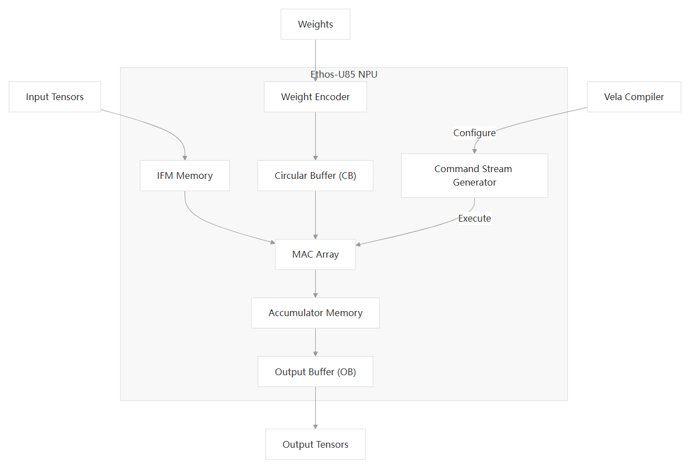
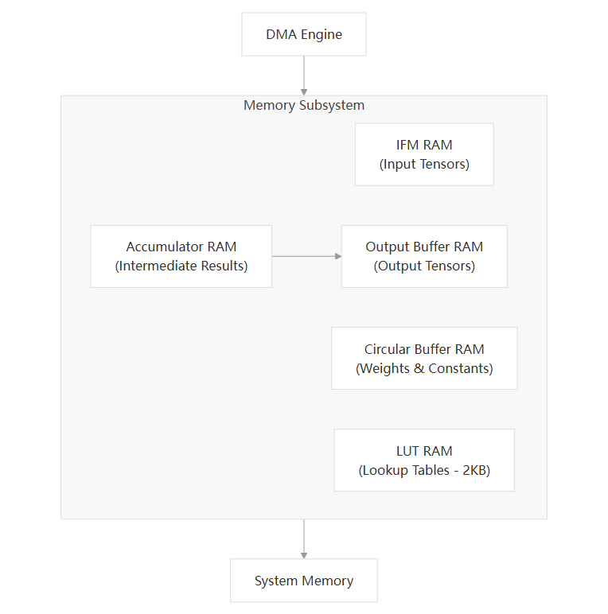
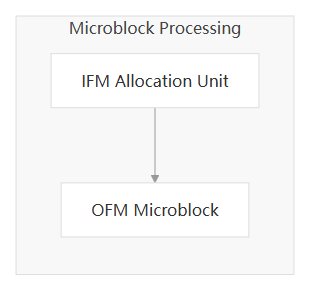
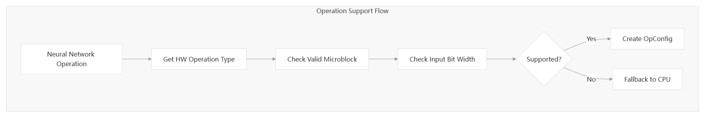
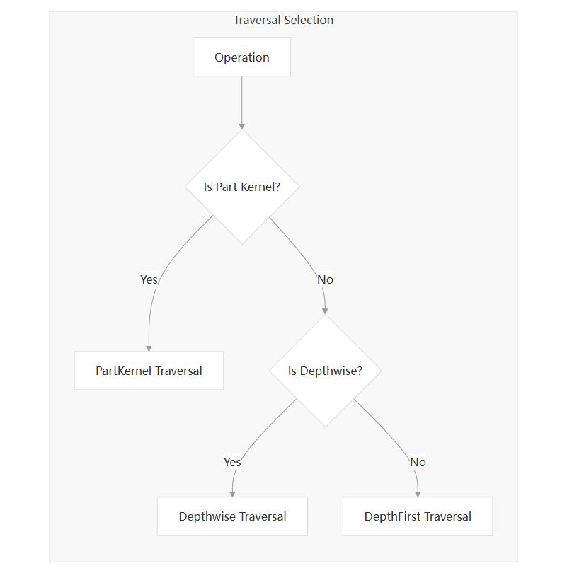
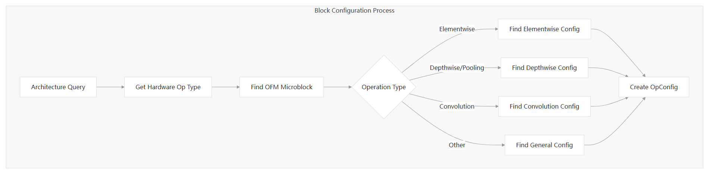
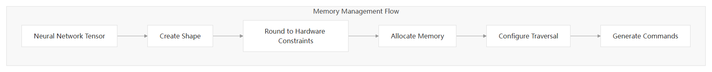

# Ethos-U85 架构

**相关源码**

- [ethosu/regor/architecture/ethosu85/ethos_u85.cpp](https://github.com/nxp-imx/ethos-u-vela/blob/395a5690/ethosu/regor/architecture/ethosu85/ethos_u85.cpp)
- [ethosu/regor/architecture/ethosu85/ethos_u85.hpp](https://github.com/nxp-imx/ethos-u-vela/blob/395a5690/ethosu/regor/architecture/ethosu85/ethos_u85.hpp)
- [ethosu/regor/common/shape.hpp](https://github.com/nxp-imx/ethos-u-vela/blob/395a5690/ethosu/regor/common/shape.hpp)
- [ethosu/regor/common/transpose_type.hpp](https://github.com/nxp-imx/ethos-u-vela/blob/395a5690/ethosu/regor/common/transpose_type.hpp)
- [ethosu/regor/test/test_shape.cpp](https://github.com/nxp-imx/ethos-u-vela/blob/395a5690/ethosu/regor/test/test_shape.cpp)

本页详细概述了在Vela编译器中实施的Arm Ethos-U85神经处理单元(NPU)架构,涵盖了硬件配置,内存子系统,操作支持,以及影响神经网络编译和执行的关键建筑特征. 有关架构限制的信息,参见: [架构约束](6.1-architecture-constraints.md).

## Ethos-U85 NPU概览

Ethos-U85是Arm公司为高效执行神经网络工作量而设计的一种高级的NPU,它以多个具有不同计算能力的配置提供,以每个周期(MAC)的乘积操作(Multiply-Acumlaulate computing operations)进行测量.

### 硬件变体

Ethos-U85有五个不同的配置:

| 配置 | 排雷行动中心 | 核心 | IFM 内存( 字节) | 累加器 内存(字节) | CB 内存( 字节) | OB 内存( 字节) |
| --- | --- | --- | --- | --- | --- | --- |
| Ethos-U85-128 (英语). | 128 | 1 | 8,192 | 8,192 | 2,048 | 768 |
| Ethos-U85-256 (英语). | 256 | 1 | 16,384 | 16,384 | 2,048 | 1,536 |
| Ethos-U85-512 (英语). | 512 | 2 | 16,384 | 32,768 | 4,096 | 3,072 |
| Ethos-U85-1024 (英语). | 1024 | 4 | 16,384 | 65,536 | 4,096 | 6,144 |
| Ethos-U85-2048 (英语). | 2048 | 4 | 32,768 | 131,072 | 8,192 | 12,288 |

源码 [ethosu/regor/architecture/ethosu85/ethos_u85.cpp65-79](https://github.com/nxp-imx/ethos-u-vela/blob/395a5690/ethosu/regor/architecture/ethosu85/ethos_u85.cpp#L65-L79)

## 建筑构件

Ethos-U85 架构由几个关键组件组成,它们共同致力于高效处理神经网络操作.

源码 [ethosu/regor/architecture/ethosu85/ethos_u85.hpp152-271](https://github.com/nxp-imx/ethos-u-vela/blob/395a5690/ethosu/regor/architecture/ethosu85/ethos_u85.hpp#L152-L271) [ethosu/regor/architecture/ethosu85/ethos_u85.cpp113-117](https://github.com/nxp-imx/ethos-u-vela/blob/395a5690/ethosu/regor/architecture/ethosu85/ethos_u85.cpp#L113-L117)

## 内存子系统

Ethos-U85包含一个为神经网络操作优化的层次内存系统:

1. **输入特征图 (IFM) 内存**: 存储输入 张量
2. **累加器 (ACC)内存**: 存储中间结果
3. **循环缓冲( CB) RAM**: 存储 权重 和常数
4. **输出缓冲( OB) 内存**: 存储输出 张量

每个内存组件的大小根据上表所示的具体Ethos-U85配置而有所不同.

源码 [ethosu/regor/architecture/ethosu85/ethos_u85.cpp163-174](https://github.com/nxp-imx/ethos-u-vela/blob/395a5690/ethosu/regor/architecture/ethosu85/ethos_u85.cpp#L163-L174) [ethosu/regor/architecture/ethosu85/ethos_u85.hpp193-199](https://github.com/nxp-imx/ethos-u-vela/blob/395a5690/ethosu/regor/architecture/ethosu85/ethos_u85.hpp#L193-L199)

## 微块 结构和处理

Ethos-U85在小块中处理数据,称为"微块",是操作的构件,每个配置支持不同的微块形状来优化不同的操作类型.

### OFM 微块

输出特征图 (OFM) 微块是Ethos-U85中的基本处理单元. 不同的配置支持不同的微块形状:

| 配置 | 支持 OFM 微块 形状 |
| --- | --- |
| Ethos-U85-128 (英语). | 1×2×8, 1×1×16 |
| Ethos-U85-256 (英语). | 1×2×16, 1×4×8, 2×2×8 |
| Ethos-U85-512 (英语). | 2×2×16, 1×4×16 |
| Ethos-U85-1024 (英语). | 2×2×32, 1×4×32, 2×4×16 |
| Ethos-U85-2048 (英语). | 2×2×64, 1×4×64, 4×4×16 |

源码 [ethosu/regor/architecture/ethosu85/ethos_u85.cpp67-78](https://github.com/nxp-imx/ethos-u-vela/blob/395a5690/ethosu/regor/architecture/ethosu85/ethos_u85.cpp#L67-L78)

### IFM 分配股

对于每个 OFM 微块,有一个相应的 输入特征图 (IFM) 分配单位,决定如何处理输入数据:

源码 [ethosu/regor/architecture/ethosu85/ethos_u85.cpp302-344](https://github.com/nxp-imx/ethos-u-vela/blob/395a5690/ethosu/regor/architecture/ethosu85/ethos_u85.cpp#L302-L344)

## 操作类型与支持

Ethos-U85通过它的硬件支持各种神经网络操作。这些操作由Ethos-U85代表 `EthosU85NpuOp` 计数 :

| 算子 | 说明 |
| --- | --- |
| 卷积 | 标准 卷积 操作 |
| 深度卷积 | 深度卷积卷积业务 |
| 矢量生产 | 矢量产品操作(包括全连接). |
| 池化 | 平均和最大池化业务 |
| 缩放Sum | 减少总和业务 |
| 降低最小值( MinMax) | 减少分钟/最大作业 |
| 阿尔格马克斯语Name | argmax 操作 |
| 逐元素 | 逐元素 操作(加法、乘法等) |
| 调整大小 | 调整业务规模 |
| 德马 | 直接内存访问操作 |

源码 [ethosu/regor/architecture/ethosu85/ethos_u85.hpp52-65](https://github.com/nxp-imx/ethos-u-vela/blob/395a5690/ethosu/regor/architecture/ethosu85/ethos_u85.hpp#L52-L65)

### 行动支助矩阵

并非所有的操作都支持在所有配置中,并包含所有输入/输出位宽度。支持矩阵由一个表格定义,该表格将 OFM 微块 和 IFM 位宽映射到支持的操作中。

源码 [ethosu/regor/architecture/ethosu85/ethos_u85.cpp460-510](https://github.com/nxp-imx/ethos-u-vela/blob/395a5690/ethosu/regor/architecture/ethosu85/ethos_u85.cpp#L460-L510)

## 倾斜战略

Ethos-U85支持不同的曲面策略,以优化不同操作类型的处理:

| 倾斜类型 | 说明 |
| --- | --- |
| 深度第一层 | 处理每个空间位置的所有深度通道 |
| 部分文件夹 | 拆分 卷积核 处理以优化某些操作 |
| 深度卷积 | 深度卷积卷积专用转弯 |

Traversal策略是根据操作类型和张量特性来选择的,以优化性能.

源码 [ethosu/regor/architecture/ethosu85/ethos_u85.hpp43-48](https://github.com/nxp-imx/ethos-u-vela/blob/395a5690/ethosu/regor/architecture/ethosu85/ethos_u85.hpp#L43-L48) [ethosu/regor/architecture/ethosu85/ethos_u85.cpp252-261](https://github.com/nxp-imx/ethos-u-vela/blob/395a5690/ethosu/regor/architecture/ethosu85/ethos_u85.cpp#L252-L261)

## 块配置和优化

Ethos-U85 NPU需要仔细配置处理块以优化性能. 编译器需要确定:

1. 每项行动的最佳 OFM 微块
2. 相应的 IFM 块大小
3. 累加器 类型和来源

这一过程由 `FindBlockConfig` 考虑:

- 操作类型
- 输入和输出形状
- 卷积核 大小
- 重量格式(包括稀疏的权重)
- 内存限制

源码 [ethosu/regor/architecture/ethosu85/ethos_u85.cpp879-977](https://github.com/nxp-imx/ethos-u-vela/blob/395a5690/ethosu/regor/architecture/ethosu85/ethos_u85.cpp#L879-L977)

## 形状处理和内存管理

Ethos-U85架构执行的一个基本方面是处理多维形状和内存分配。 `Shape` class 是一个核心组件,它代表张量维度,并允许操作,例如:

- 尺寸操纵(填充,提取,穿透)
- 形状算术(加、减、乘)
- 四舍五入并调整到内存边界
- 张量 版式转换

源码 [ethosu/regor/common/shape.hpp34-771](https://github.com/nxp-imx/ethos-u-vela/blob/395a5690/ethosu/regor/common/shape.hpp#L34-L771)

## 累加器 类型

Ethos-U85支持两种累加器类型:

1. **第32页**: 32 位 累加器 用于8 位操作
2. **第48页**: 48 位 累加器 用于16 位操作和某些缩放操作

累加器类型是根据输入比特宽度和操作类型选择的.

源码 [ethosu/regor/architecture/ethosu85/ethos_u85.cpp94-111](https://github.com/nxp-imx/ethos-u-vela/blob/395a5690/ethosu/regor/architecture/ethosu85/ethos_u85.cpp#L94-L111) [ethosu/regor/architecture/ethosu85/ethos_u85.hpp36-41](https://github.com/nxp-imx/ethos-u-vela/blob/395a5690/ethosu/regor/architecture/ethosu85/ethos_u85.hpp#L36-L41)

## 权重压缩和编码

Ethos-U85 架构 支持各种权重格式,以优化内存使用和计算:

| 重量格式 | 说明 |
| --- | --- |
| 默认 | 标准重量格式 |
| 快点 | 优化权重格式以加快执行速度 |
| Sparse2_4 (中文(简体) ). | 带2: 4 条纹图案的 Sparse 重量格式 |

重量编码器组件( Q)`EthosU85WeightEncoder`)负责将权重转换成合适的格式,用于在NPU上执行.

源码 [ethosu/regor/architecture/ethosu85/ethos_u85.cpp235-239](https://github.com/nxp-imx/ethos-u-vela/blob/395a5690/ethosu/regor/architecture/ethosu85/ethos_u85.cpp#L235-L239)

## 命令流生成

Ethos-U85 编译的最后阶段是生成一个命令流,指示硬件如何执行操作。 `EthosU85RCSGenerator` (寄存器命令流发电机)班级.

命令生成会考虑操作配置的所有方面 :

- 微块配置
- 过渡战略
- 累加器 类型
- 内存分配

源码 [ethosu/regor/architecture/ethosu85/ethos_u85.cpp115-116](https://github.com/nxp-imx/ethos-u-vela/blob/395a5690/ethosu/regor/architecture/ethosu85/ethos_u85.cpp#L115-L116) [ethosu/regor/architecture/ethosu85/ethos_u85.hpp217](https://github.com/nxp-imx/ethos-u-vela/blob/395a5690/ethosu/regor/architecture/ethosu85/ethos_u85.hpp#L217-L217)

## 小结

Ethos-U85 架构 为神经网络加速提供了灵活而强大的平台. Vela编译器通过仔细选择微块配置,转录策略,以及内存布局,可以高效地将神经网络操作映射到Ethos-U85的硬件能力.

[返回中文目录](0-Index.md)
