# 数据表示

**相关源码**

- [ethosu/vela/mark_tensors.py](https://github.com/nxp-imx/ethos-u-vela/blob/395a5690/ethosu/vela/mark_tensors.py)
- [ethosu/vela/npu_serialisation.py](https://github.com/nxp-imx/ethos-u-vela/blob/395a5690/ethosu/vela/npu_serialisation.py)
- [ethosu/vela/tensor.py](https://github.com/nxp-imx/ethos-u-vela/blob/395a5690/ethosu/vela/tensor.py)
- [ethosu/vela/test/test_tflite_reader.py](https://github.com/nxp-imx/ethos-u-vela/blob/395a5690/ethosu/vela/test/test_tflite_reader.py)
- [ethosu/vela/tflite_reader.py](https://github.com/nxp-imx/ethos-u-vela/blob/395a5690/ethosu/vela/tflite_reader.py)
- [ethosu/vela/tflite_writer.py](https://github.com/nxp-imx/ethos-u-vela/blob/395a5690/ethosu/vela/tflite_writer.py)

本页介绍神经网络数据如何在Ethos-U Vela编译器中体现,侧重于张量表示,内存管理,以及数据序列化。关于内存中如何分配张量的信息,参见: [内存管理与张量分配](4.1-memory-management-and-tensor-allocation.md).

## 张量 类概览

那个... `Tensor` class 是 Vela 中代表神经网络张量的基本数据结构。编译器中的所有数据都通过这些张量对象流动,这些对象在通过编译流程推进的过程中保持了张量的形状,数据类型,值和其他属性.

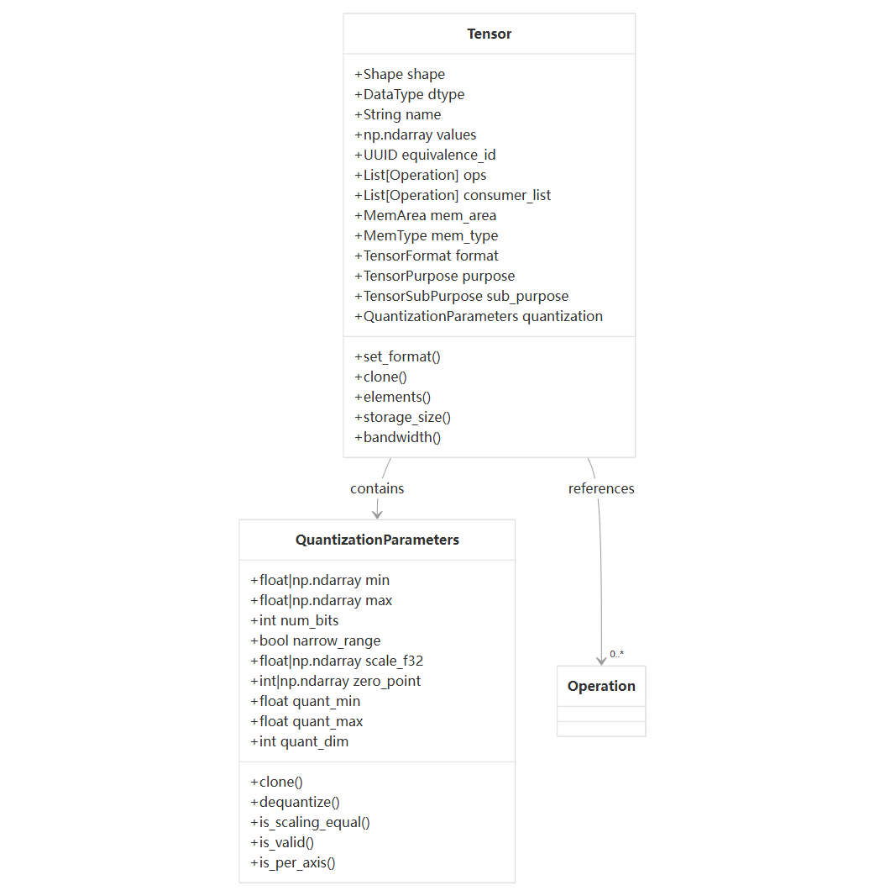

源码 [ethosu/vela/tensor.py362-937](https://github.com/nxp-imx/ethos-u-vela/blob/395a5690/ethosu/vela/tensor.py#L362-L937) [ethosu/vela/tensor.py212-295](https://github.com/nxp-imx/ethos-u-vela/blob/395a5690/ethosu/vela/tensor.py#L212-L295)

## 张量 属性

### 核心属性

a 的基本属性 `Tensor` 包括:

- **形状**: 张量 的维度(存储为整数列表)
- **数据类型**: 每一要素的数据类型(由 `DataType` 类)
- **名称**: 张量 唯一的标识符
- **数值**: 张量 (存储为 NumPy 阵列) 的实际数据

每个张量还保留了生产该物质的操作的参考文献(`ops`和消耗该物质的操作(`consumer_list`),创建图表结构。

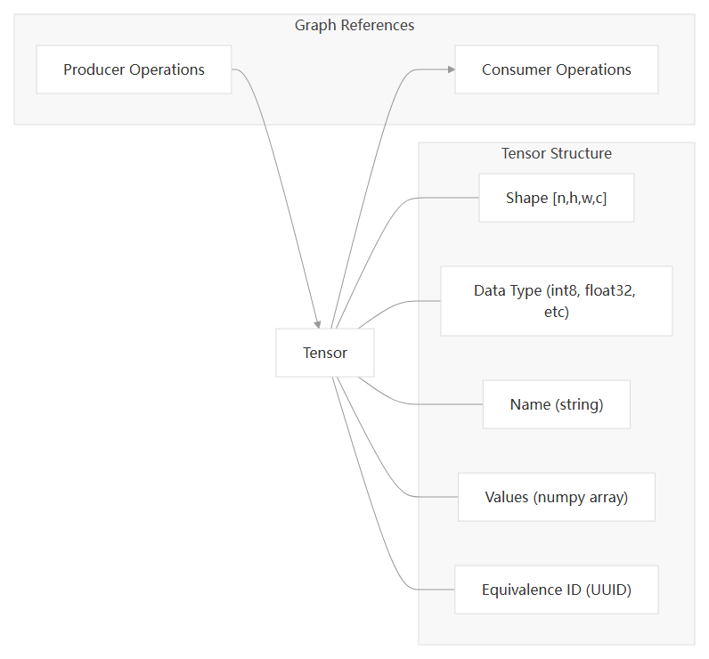

源码 [ethosu/vela/tensor.py404-452](https://github.com/nxp-imx/ethos-u-vela/blob/395a5690/ethosu/vela/tensor.py#L404-L452)

### 内存管理

Vela的张量被分配到不同的内存领域和类型:

- **内存区域 (中文(简体) ).`mem_area`)**: 定义存储 张量 的物理内存(SRAM, DRAM, Flash 等)
- **内存类型( E)`mem_type`)**:定义内存中如何使用张量(永久,暂存等)
- **地址**: 张量 在内存中的位置

内存地址使用 `TensorAddressMap` 类,它维持张量等效ID和内存地址之间的映射。

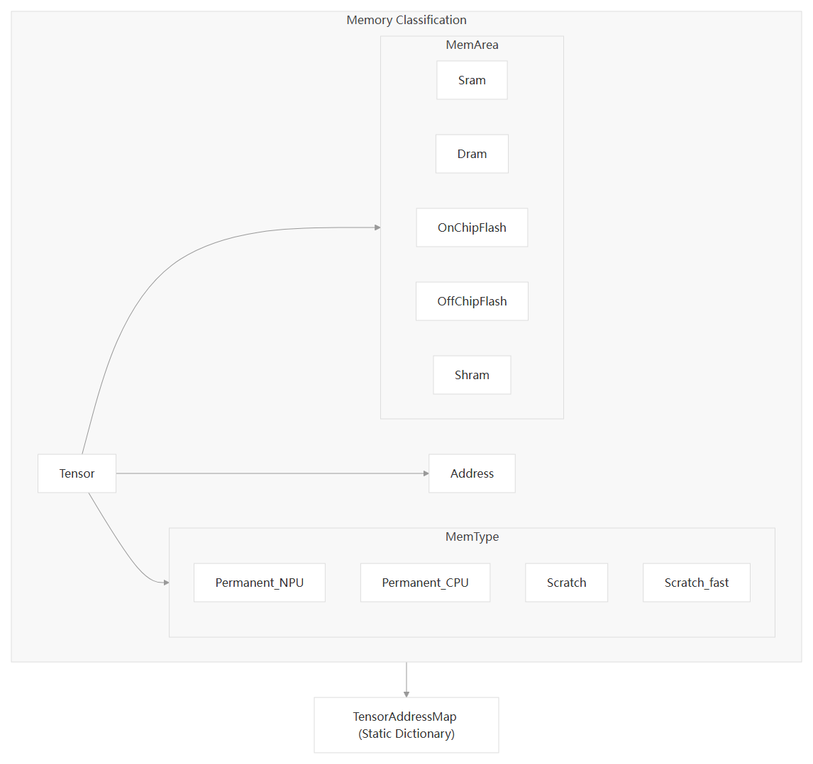

源码 [ethosu/vela/tensor.py48-106](https://github.com/nxp-imx/ethos-u-vela/blob/395a5690/ethosu/vela/tensor.py#L48-L106) [ethosu/vela/tensor.py341-360](https://github.com/nxp-imx/ethos-u-vela/blob/395a5690/ethosu/vela/tensor.py#L341-L360)

## 日数分类

### 目的和副目的

张量根据其目的和次目的分类:

- **目标(`purpose`)**: 张量 (权重, FeatureMap, 暂存 等的主要功能.
- **子目标( Q)`sub_purpose`)**:特殊处理附加分类(标准,双冲压,滚动冲压等).

这种分类影响张量的处理,优化,以及内存中的分配方式.

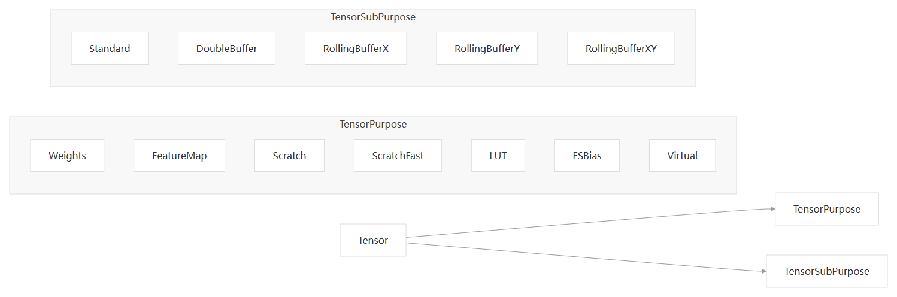

源码 [ethosu/vela/tensor.py109-156](https://github.com/nxp-imx/ethos-u-vela/blob/395a5690/ethosu/vela/tensor.py#L109-L156) [ethosu/vela/mark_tensors.py28-102](https://github.com/nxp-imx/ethos-u-vela/blob/395a5690/ethosu/vela/mark_tensors.py#L28-L102)

### 格式

张量格式定义了数据如何在内存中排列:

- **NHWC**:带有尺寸的标准格式[批量,高度,宽度,通道]
- **NHCWB16**: Ethos-U NPU 专用的块格式
- **权重压缩**: 压缩重量的格式 张量

该格式是根据张量的目的和架构的制约设置的。 `set_format` 方法 。

源码 [ethosu/vela/tensor.py159-166](https://github.com/nxp-imx/ethos-u-vela/blob/395a5690/ethosu/vela/tensor.py#L159-L166) [ethosu/vela/tensor.py544-570](https://github.com/nxp-imx/ethos-u-vela/blob/395a5690/ethosu/vela/tensor.py#L544-L570)

## 量化

量化 参数对于Ethos-U NPU的高效执行至关重要。 `QuantizationParameters` 类商店 :

- **缩放**: 量化的 值乘以获得实际值的系数
- **零点**: 量化的 值对应实际值 0
- **最小/最大值**: 量化 前面的原始值的界限
- **位数**: 用于 量化 的位宽

这些参数可以在量化的整数值和真实的浮点值之间进行转换.

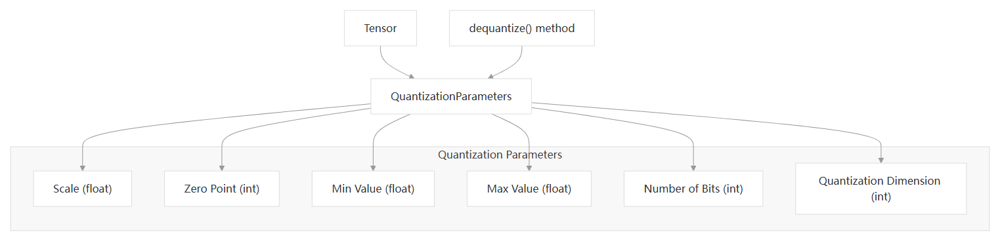

源码 [ethosu/vela/tensor.py212-295](https://github.com/nxp-imx/ethos-u-vela/blob/395a5690/ethosu/vela/tensor.py#L212-L295)

## 张量 创造和操纵

Vela为创建和操纵提供了几种功能张量:

- **`create_const_tensor`**: 创建带有给定值的常数 张量
- **`create_virtual_tensor`**: 为内部代表创建虚拟 张量 。
- **`clone`**: 创建现有 张量 的副本,可选择使用独有的ID
- **`transpose`**: 重排 张量 的尺寸

这些功能有助于在优化期间构建和转换神经网络图.

源码 [ethosu/vela/tensor.py297-337](https://github.com/nxp-imx/ethos-u-vela/blob/395a5690/ethosu/vela/tensor.py#L297-L337) [ethosu/vela/tensor.py494-526](https://github.com/nxp-imx/ethos-u-vela/blob/395a5690/ethosu/vela/tensor.py#L494-L526)

## 内存布局和地址

张量在Vela有三种形状的表示:

- **形状**: 模型中定义的 张量 逻辑形状
- **存储形状(_S)**: 舍入到存储量子大小后的内存形状
- **带宽_形状**: 带宽 计算所用的形状

由于内存对齐的要求和优化,存储形状可以与逻辑形状不同.

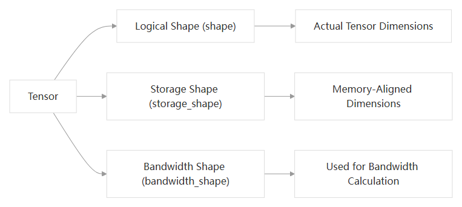

源码 [ethosu/vela/tensor.py566-584](https://github.com/nxp-imx/ethos-u-vela/blob/395a5690/ethosu/vela/tensor.py#L566-L584) [ethosu/vela/tensor.py177-203](https://github.com/nxp-imx/ethos-u-vela/blob/395a5690/ethosu/vela/tensor.py#L177-L203)

对于像NHCWB16这样的特定格式的张量,处理需要从逻辑坐标翻译为物理内存地址. `address_for_coordinate` 方法处理此转换。

源码 [ethosu/vela/tensor.py808-851](https://github.com/nxp-imx/ethos-u-vela/blob/395a5690/ethosu/vela/tensor.py#L808-L851)

## TFLite 序列化 和 反序列化 (中文(简体) ).

### 读取 TFLite 模型

TFLite的读者解析 TensorFlow Lite 模型并将其转换为 Vela 的内部代表:

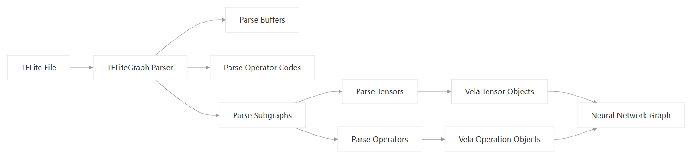

源码 [ethosu/vela/tflite_reader.py47-368](https://github.com/nxp-imx/ethos-u-vela/blob/395a5690/ethosu/vela/tflite_reader.py#L47-L368)

解析时 :

1. 张量 形状、类型和量化参数被提取
2. 张量 值(恒定值)从缓冲器中加载
3. 创建操作并与其输入和输出链接 张量

### 写入 TFLite 模型

TFLite编剧将Vela的优化图回溯到TensorFlow Lite格式:

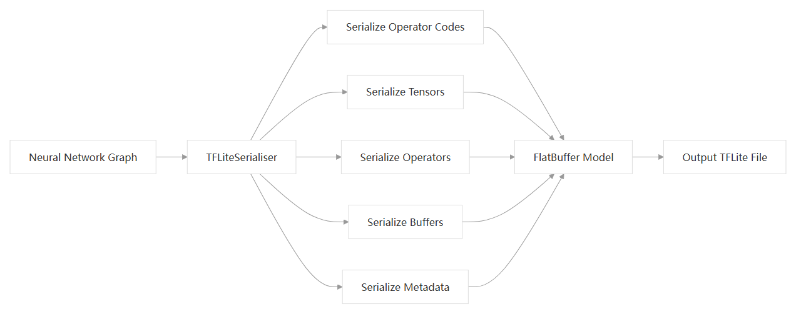

源码 [ethosu/vela/tflite_writer.py77-554](https://github.com/nxp-imx/ethos-u-vela/blob/395a5690/ethosu/vela/tflite_writer.py#L77-L554)

序列化期间:

1. 张量 被分配到缓冲器
2. 量化 参数序列化
3. 算子 及其属性转换为 TFLite 格式
4. 内存分配信息作为元数据添加

## NPU 子图 序列化 (英语).

对于 NPU 执行, 子图 需要被序列化为一种可以由 Ethos-U NPU 处理的格式 :

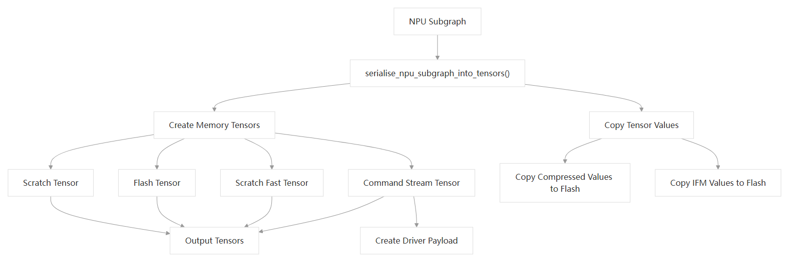

源码 [ethosu/vela/npu_serialisation.py33-118](https://github.com/nxp-imx/ethos-u-vela/blob/395a5690/ethosu/vela/npu_serialisation.py#L33-L118)

序列化过程包括:

1. 为不同目的创建内存 张量 (暂存, flash, 命令流)
2. 将压缩重量值和输入特征图值复制到适当的张量
3. 生成一个 命令流, 由 Ethos- U NPU 驱动程序执行

## 张量用途标记

那个... `mark_tensors.py` 模块确定图中每个 张量 的目的 :

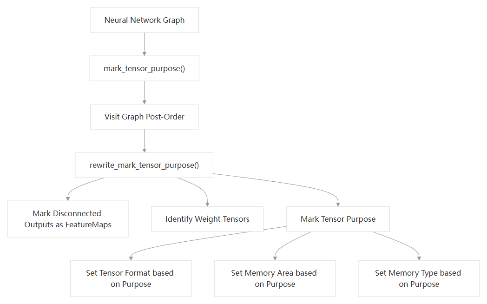

源码 [ethosu/vela/mark_tensors.py27-114](https://github.com/nxp-imx/ethos-u-vela/blob/395a5690/ethosu/vela/mark_tensors.py#L27-L114)

目的标记过程:

1. 确定断开的输出并将其标记为 特征图
2. 根据其与业务的关联确定权重张量
3. 指定张量(权重,FeatureMap,暂存等)的目的
4. 设置适当的格式, 内存区域, 以及基于目的的内存类型

## 通过 Vela 的数据流

以下图表说明了数据如何通过 Vela 编译器流动:

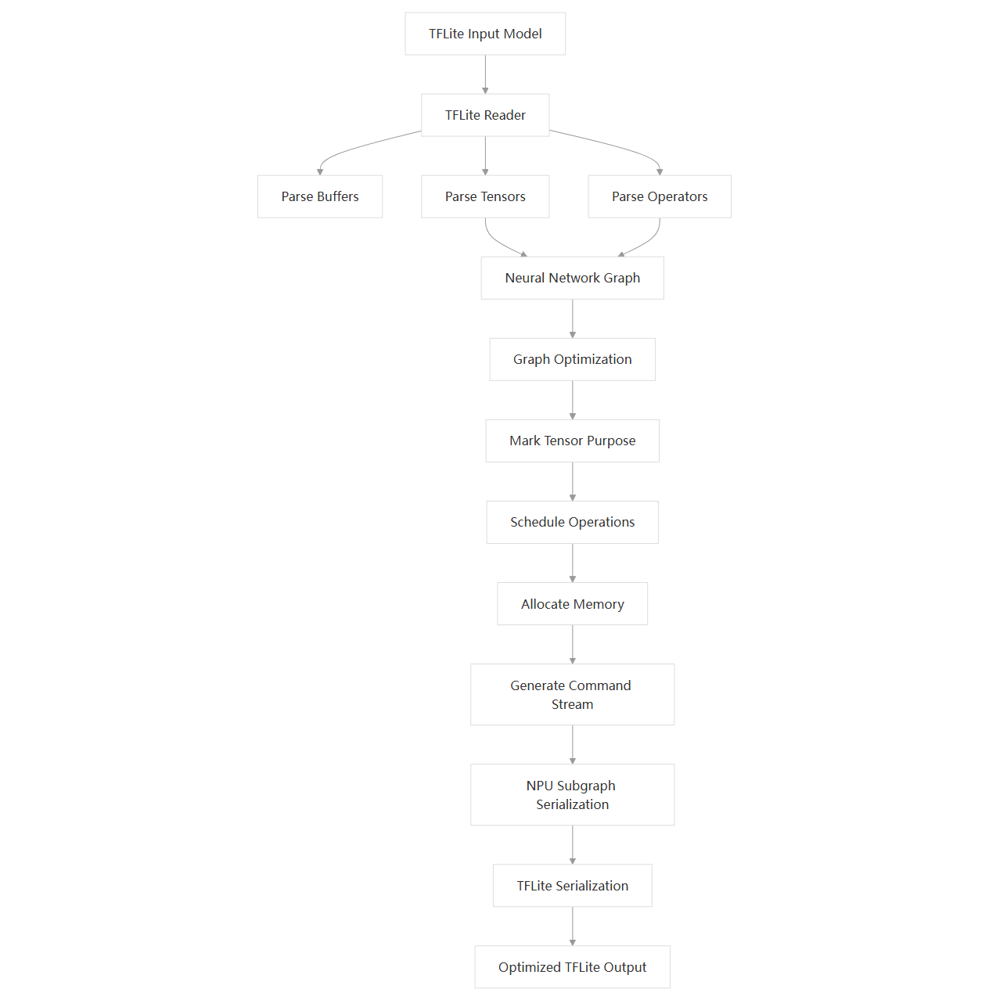

源码 [ethosu/vela/tflite_reader.py47-368](https://github.com/nxp-imx/ethos-u-vela/blob/395a5690/ethosu/vela/tflite_reader.py#L47-L368) [ethosu/vela/mark_tensors.py27-114](https://github.com/nxp-imx/ethos-u-vela/blob/395a5690/ethosu/vela/mark_tensors.py#L27-L114) [ethosu/vela/npu_serialisation.py33-118](https://github.com/nxp-imx/ethos-u-vela/blob/395a5690/ethosu/vela/npu_serialisation.py#L33-L118) [ethosu/vela/tflite_writer.py77-554](https://github.com/nxp-imx/ethos-u-vela/blob/395a5690/ethosu/vela/tflite_writer.py#L77-L554)

## 总结

Ethos-U Vela编译中心的数据显示 `Tensor` class,它为表达神经网络数据提供了灵活和可扩展的方式. 张量按目的,格式和内存位置分类,它们包括量化参数,以便在Ethos-U NPU上高效执行.

编译器从TFLite模型读取张量,优化了它们,并将其序列化回TFLite格式,并附有适当的内存分配信息. NPU 子图被序列化为一种格式,可以由Ethos-U NPU驱动程序执行.

[返回中文目录](0-Index.md)
