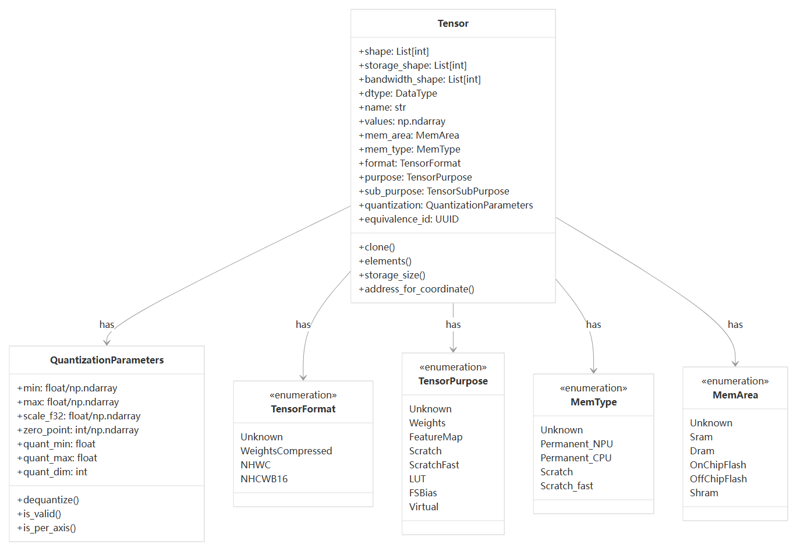
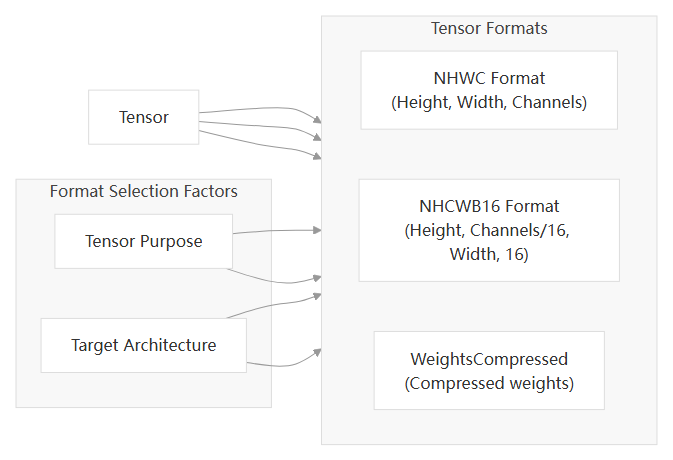
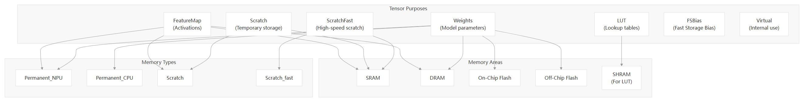
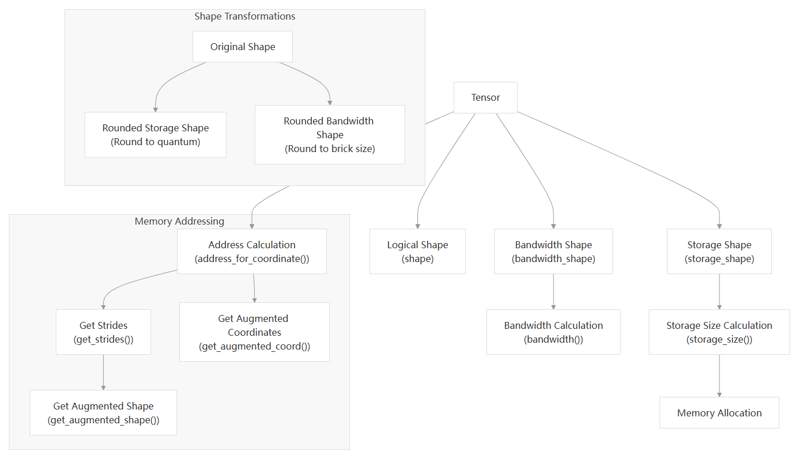
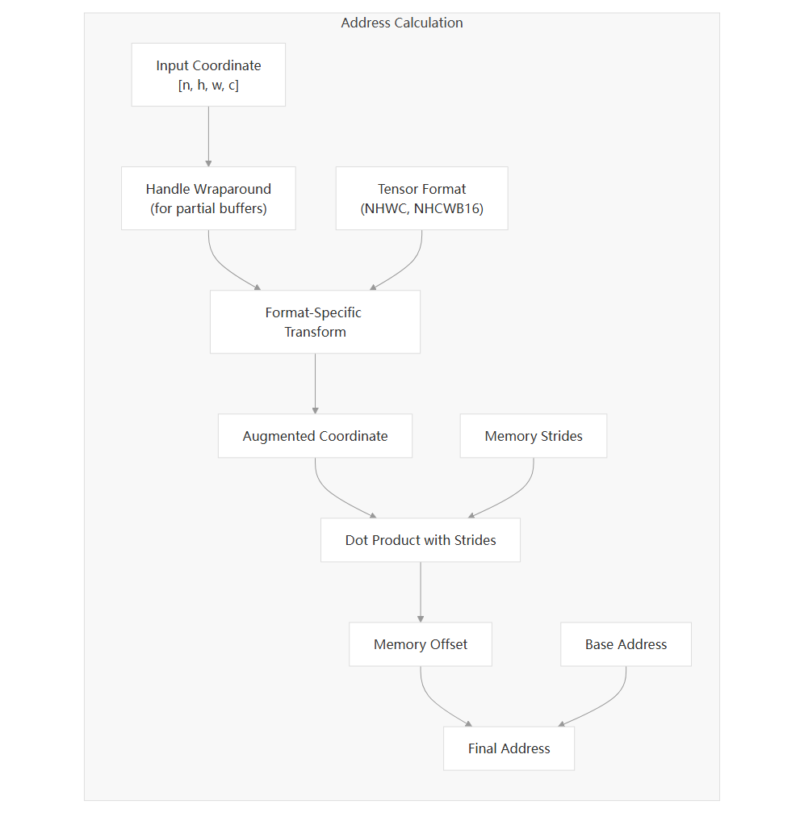
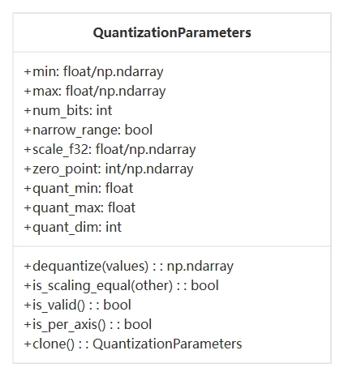
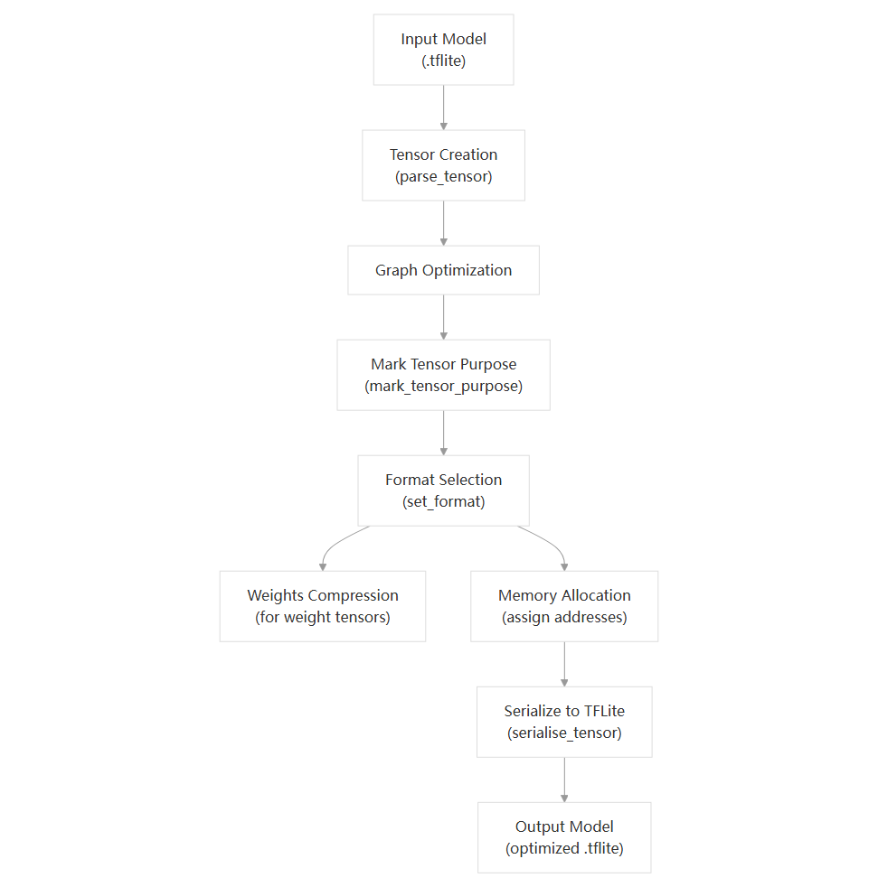

# 张量表示

**相关源码**

- [ethosu/vela/mark_tensors.py](https://github.com/nxp-imx/ethos-u-vela/blob/395a5690/ethosu/vela/mark_tensors.py)
- [ethosu/vela/npu_serialisation.py](https://github.com/nxp-imx/ethos-u-vela/blob/395a5690/ethosu/vela/npu_serialisation.py)
- [ethosu/vela/tensor.py](https://github.com/nxp-imx/ethos-u-vela/blob/395a5690/ethosu/vela/tensor.py)
- [ethosu/vela/test/test_tflite_reader.py](https://github.com/nxp-imx/ethos-u-vela/blob/395a5690/ethosu/vela/test/test_tflite_reader.py)
- [ethosu/vela/tflite_reader.py](https://github.com/nxp-imx/ethos-u-vela/blob/395a5690/ethosu/vela/tflite_reader.py)
- [ethosu/vela/tflite_writer.py](https://github.com/nxp-imx/ethos-u-vela/blob/395a5690/ethosu/vela/tflite_writer.py)

本页面记录了神经网络张量是如何在Ethos-U Vela编译器内部代表的. 理解张量表示对于与编译器合作至关重要,因为张量是用来代表输入,输出,权重,以及神经网络中间激活的基本数据结构.

关于如何将张量 序列化为 TensorFlow Lite 格式的信息,请参见 [TFLite 序列化](7.2-tflite-serialization.md).

## 核心张量表示

在Vela, 代表居民的有: `Tensor` class,它持有关于一个张量的数据,形状,内存要求,以及其他属性的所有信息.



源码 [ethosu/vela/tensor.py363-921](https://github.com/nxp-imx/ethos-u-vela/blob/395a5690/ethosu/vela/tensor.py#L363-L921)

### 张量 的关键属性

Vela的张量有几种属性来定义他们的行为:

| 属性 | 说明 |
| --- | --- |
| `shape` | 张量 数据的逻辑形状(dimensions) |
| `storage_shape` | 内存中的实际形状( 可能添加) |
| `bandwidth_shape` | 带宽 计算所用的形状 |
| `dtype` | 数据类型 (int8, uint8, 浮点32等). |
| `values` | 实际 张量 数据为 NumPy 阵列 |
| `mem_area` | 内存区域 (SRAM,DRAM等). |
| `mem_type` | 内存类型( 永久, 暂存) |
| `format` | 张量格式(NHWC,NHCWB16) |
| `purpose` | 张量用途 (权重, FeatureMap 等). |
| `sub_purpose` | 张量子用途(DoubleBuffer,RollingBuffer等). |
| `quantization` | 量化 参数 |

源码 [ethosu/vela/tensor.py363-453](https://github.com/nxp-imx/ethos-u-vela/blob/395a5690/ethosu/vela/tensor.py#L363-L453)

## 张量格式

张量可以用不同的内存布局来表示:



张量的格式由它的目的和目标架构决定:

```
def get_format(purpose, arch):
    if purpose in (TensorPurpose.FeatureMap, TensorPurpose.LUT, TensorPurpose.Scratch, TensorPurpose.ScratchFast):
        fmt = arch.default_feature_map_format
    elif purpose == TensorPurpose.Weights:
        fmt = arch.default_weight_format
    # ...
```

张量格式影响:

- 内存布局
- 地址计算
- 储存要求
- 带宽计算

源码 [ethosu/vela/tensor.py159-166](https://github.com/nxp-imx/ethos-u-vela/blob/395a5690/ethosu/vela/tensor.py#L159-L166) [ethosu/vela/mark_tensors.py28-37](https://github.com/nxp-imx/ethos-u-vela/blob/395a5690/ethosu/vela/mark_tensors.py#L28-L37)

## 张量用途和内存管理

每一个张量都有特定的目的,决定它如何在内存中处理:



张量用途是在图优化过程中通过下列程序设定的: `mark_tensor_purpose` 函数 :

```
def mark_purpose(tens, arch, purpose):
    # Sets tensor's purpose, format, mem_area and mem_type
    if tens.purpose == TensorPurpose.Unknown:
        tens.purpose = purpose
    # ...
    fmt = get_format(purpose, arch)
    tens.set_format(fmt, arch)
    tens.mem_area = arch.tensor_storage_mem_area[tens.purpose]
    tens.mem_type = arch.tensor_storage_mem_type[tens.purpose]
    # ...
```

源码 [ethosu/vela/tensor.py109-128](https://github.com/nxp-imx/ethos-u-vela/blob/395a5690/ethosu/vela/tensor.py#L109-L128) [ethosu/vela/mark_tensors.py40-61](https://github.com/nxp-imx/ethos-u-vela/blob/395a5690/ethosu/vela/mark_tensors.py#L40-L61)

## 张量的内存表示

张量可以为不同的目的有不同的内存表示:

1. **逻辑形状**:神经网络操作所看到的实际张量维度
2. **存储形状**: 内存中的形状, 可能包括 填充 以满足对齐要求
3. **带宽 形状**: 用于 带宽 计算,可能不同于存储形状



张量的内存表示取决于:

- 张量格式(NHWC,NHCWB16等).
- 储存四舍五入量子(特定建筑)
- 砖块大小( 格式特定布局参数)
- 调整所需经费

源码 [ethosu/vela/tensor.py544-570](https://github.com/nxp-imx/ethos-u-vela/blob/395a5690/ethosu/vela/tensor.py#L544-L570) [ethosu/vela/tensor.py584-601](https://github.com/nxp-imx/ethos-u-vela/blob/395a5690/ethosu/vela/tensor.py#L584-L601)

## 张量 存储大小和内存分配

张量的存储大小根据下列因素计算:

```
def storage_size(self, scale: float = 1.0) -> int:
    raw_size = self.storage_elements() * self.element_size() * scale
    if raw_size == 0:
        raw_size = 1  # force it to take up space
    rounded_size = numeric_util.round_up(numeric_util.round_up_to_int(raw_size), self.alignment)
    return rounded_size
```

关键因素:

- 存储形状中的元素数量
- 元素大小, 以字节计
- 压缩尺度(如果适用)
- 调整所需经费

实际内存分配由:

1. 计算 张量 存储大小
2. 根据张量分配战略在记忆中指定地址
3. 将地址存放在 `TensorAddressMap` (追踪张量地址的类)

源码 [ethosu/vela/tensor.py341-360](https://github.com/nxp-imx/ethos-u-vela/blob/395a5690/ethosu/vela/tensor.py#L341-L360) [ethosu/vela/tensor.py584-601](https://github.com/nxp-imx/ethos-u-vela/blob/395a5690/ethosu/vela/tensor.py#L584-L601)

## 张量内存寻址

张量 使用坐标系统访问内存中的元素。 `address_for_coordinate` 方法计算内存地址时基于:

- 张量 (N、H、W、C)中的逻辑坐标
- 存储形状和格式
- 步长在记忆中
- 内存分配时指定的基本地址



基于张量格式的计算不同:

- **NHWC**: 标准布局,以频道为最内维
- **NHCWB16**: 基于块的布局,并带有大小为 16 的信道块
- **权重压缩**: 压缩的特殊格式 权重

源码 [ethosu/vela/tensor.py722-765](https://github.com/nxp-imx/ethos-u-vela/blob/395a5690/ethosu/vela/tensor.py#L722-L765) [ethosu/vela/tensor.py808-852](https://github.com/nxp-imx/ethos-u-vela/blob/395a5690/ethosu/vela/tensor.py#L808-L852)

## 张量量化

张量 常使用量化的表示法来减少内存和计算要求. 量化 参数被存储在其中. `QuantizationParameters` 类 :



量化 过程将真实值映射为整数,使用:

- 缩放因数 (% 1)`scale_f32`)
- 零点 (中文(简体) ).`zero_point`)
- 量化的范围 (中文(简体) ).`quant_min`, `quant_max`)

每轴量化, `scale_f32` 财务报告和财务报告 `zero_point` 是数组而不是平面值。

那个... `dequantize` 方法进行反向映射以回收大致真实值:

```
def dequantize(self, values) -> np.ndarray:
    return np.subtract(values, self.zero_point) * self.scale_f32
```

源码 [ethosu/vela/tensor.py212-286](https://github.com/nxp-imx/ethos-u-vela/blob/395a5690/ethosu/vela/tensor.py#L212-L286)

## 张量生命周期

在汇编过程中,Vela的张量经历了几个阶段:



1. **创建**: 张量 由 TFLite 模型输入创建

   ```
   def parse_tensor(self, tens_data):
       np_shape = tens_data.ShapeAsNumpy()
       shape = list(np_shape) if isinstance(np_shape, np.ndarray) else []
       name = decode_str(tens_data.Name())
       tens_dtype = tens_data.Type()
       dtype = datatype_map[tens_dtype]
       tens = Tensor(shape, dtype, name)
       # ...
   ```
2. **标 题**: 张量 获得指定用途(权重,特征图等)

   ```
   def mark_tensor_purpose(nng, arch, verbose_tensor_purpose=False):
       # Sets purpose, format, mem_area and mem_type for all tensors in the graph
       for sg in nng.subgraphs:
           visit_graph_post_order(sg.output_tensors, arch, [], [rewrite_mark_tensor_purpose])
           for tens in sg.output_tensors:
               mark_purpose(tens, arch, TensorPurpose.FeatureMap)
       # ...
   ```
3. **格式选择**:基于宗旨和架构

   ```
   def set_format(self, fmt: TensorFormat, arch):
       self.format = fmt
       # ...
       self.storage_rounding_quantum = arch.storage_rounding_quantums[self.format]
       self.brick_size = arch.brick_sizes[self.format]
       # ...
       self.bandwidth_shape = shape_round_to_quantum(self.shape, self.brick_size)
       self.storage_shape = shape_round_to_quantum(self.shape, self.storage_rounding_quantum)
       # ...
   ```
4. **内存分配**: 张量 在内存中获得指定地址
5. **序列化**: 张量 序列化为 TFLite 格式

   ```
   def serialise_tensor(self, tens):
       builder = self.builder
       # ...
       shape = self.write_int_vector(tens_shape)
       name = builder.CreateString(tens.name)
       quant = self.serialise_quantization_parameters(tens.quantization)
       
       Tensor.TensorStart(builder)
       Tensor.TensorAddShape(builder, shape)
       Tensor.TensorAddType(builder, datatype_inv_map[tens.dtype])
       # ...
   ```

源码 [ethosu/vela/tflite_reader.py85-121](https://github.com/nxp-imx/ethos-u-vela/blob/395a5690/ethosu/vela/tflite_reader.py#L85-L121) [ethosu/vela/mark_tensors.py104-114](https://github.com/nxp-imx/ethos-u-vela/blob/395a5690/ethosu/vela/mark_tensors.py#L104-L114) [ethosu/vela/tensor.py544-570](https://github.com/nxp-imx/ethos-u-vela/blob/395a5690/ethosu/vela/tensor.py#L544-L570) [ethosu/vela/tflite_writer.py252-284](https://github.com/nxp-imx/ethos-u-vela/blob/395a5690/ethosu/vela/tflite_writer.py#L252-L284)

## 特殊张量类型

### 常数 张量

使用 `create_const_tensor` 表示常数:

```
def create_const_tensor(name, shape, dtype, values, purpose=TensorPurpose.Unknown, quantization=None):
    const_tensor = Tensor(shape, dtype, name + "_0")
    const_tensor.purpose = purpose
    const_tensor.quantization = quantization
    const_tensor.values = np.array(values).astype(dtype.as_numpy_type())
    
    # Create a Const operation 
    const_op = Operation(Op.Const, name)
    const_op.set_output_tensor(const_tensor)
    const_op.set_ifm_ofm_shapes()
    return const_tensor
```

### 虚拟张量

用于特殊目的的内部用途:

```
def create_virtual_tensor(name):
    virtual_tensor = Tensor([], DataType.int8, name)
    virtual_tensor.purpose = TensorPurpose.Virtual
    return virtual_tensor
```

源码 [ethosu/vela/tensor.py297-337](https://github.com/nxp-imx/ethos-u-vela/blob/395a5690/ethosu/vela/tensor.py#L297-L337)

## 权重压缩

重量 张量 可压缩以减少 内存占用. 当一个张量使用时, `WeightsCompressed` 格式 :

```
if fmt == TensorFormat.WeightsCompressed:
    compression_ratio = 5 / 8
    self.storage_compression_scale = compression_ratio
    self.bandwidth_compression_scale = compression_ratio
    self.compression_scale_for_worst_weight_stream = compression_ratio
```

压缩的 权重 存储于 `compressed_values` 和相关信息:

- `compressed_values_substream_offsets`
- `weight_compressed_offsets`
- `weight_compression_scales`

压缩的权重通过特殊方法访问:

- `compressed_stream_index_from_coord`
- `size_of_compressed_stream`
- `is_last_index_in_compressed_stream`

源码 [ethosu/vela/tensor.py565-569](https://github.com/nxp-imx/ethos-u-vela/blob/395a5690/ethosu/vela/tensor.py#L565-L569) [ethosu/vela/tensor.py774-806](https://github.com/nxp-imx/ethos-u-vela/blob/395a5690/ethosu/vela/tensor.py#L774-L806)

## 总结

Vela的张量表示提供了处理各种类型神经网络数据的灵活系统,具有不同的内存布局,存储要求,以及量化参数. 该设计支持Ethos-U NPU的具体需要,同时提供高效的内存管理和处理方案.

了解显示、储存和访问的百分位数对下列方面至关重要:

- 修改编译器以支持新的操作
- 优化神经网络的内存使用
- 调试内存相关问题
- 添加对新张量格式或量化方案的支持

[返回中文目录](0-Index.md)
