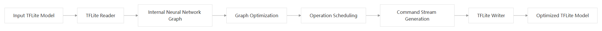
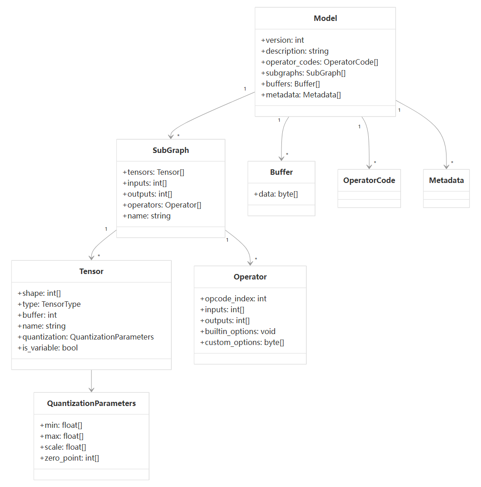
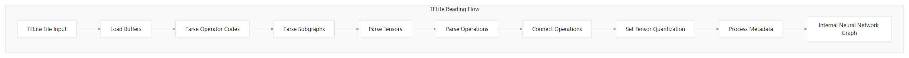
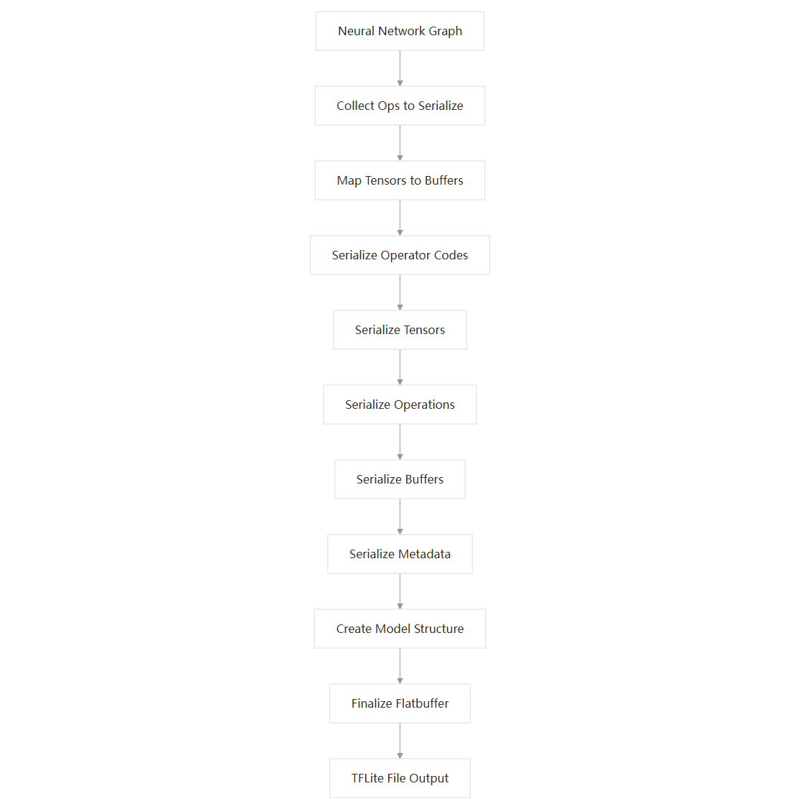
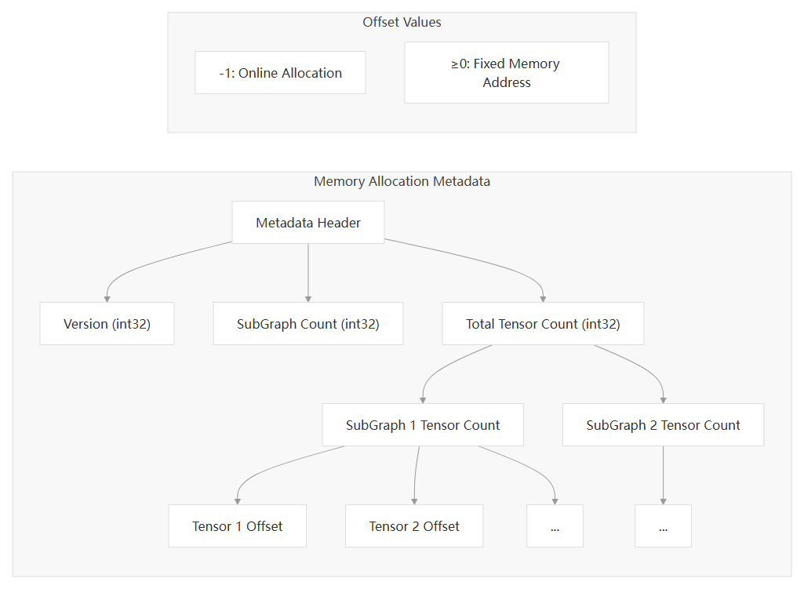
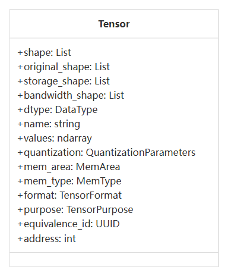
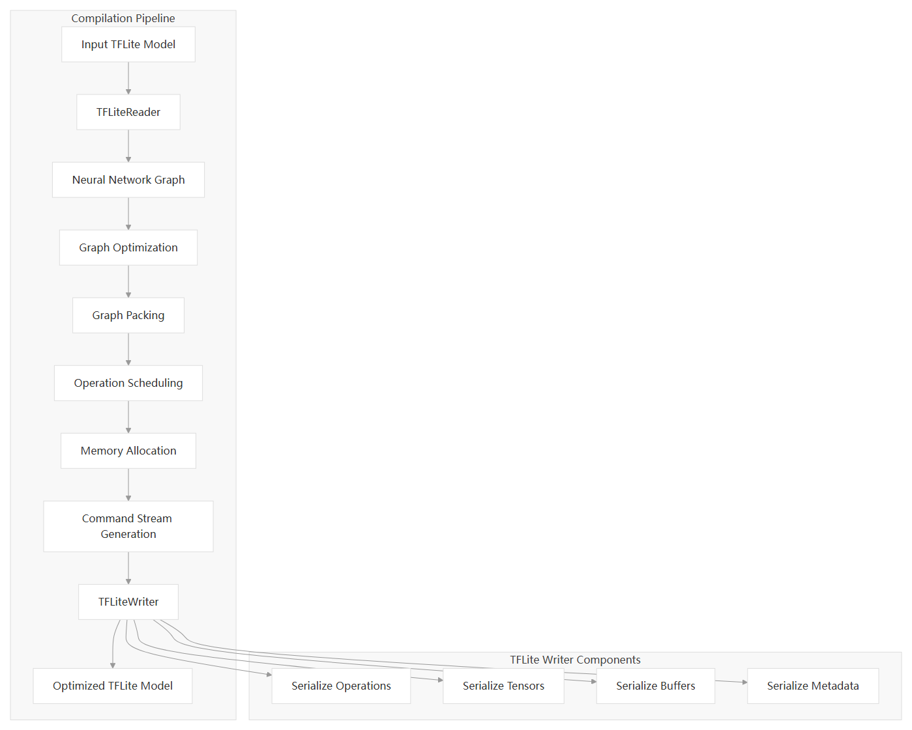

# TFLite 序列化

**相关源码**

- [ethosu/regor/compiler/compiler.cpp](https://github.com/nxp-imx/ethos-u-vela/blob/395a5690/ethosu/regor/compiler/compiler.cpp)
- [ethosu/regor/compiler/graph.hpp](https://github.com/nxp-imx/ethos-u-vela/blob/395a5690/ethosu/regor/compiler/graph.hpp)
- [ethosu/regor/compiler/graph_packing.cpp](https://github.com/nxp-imx/ethos-u-vela/blob/395a5690/ethosu/regor/compiler/graph_packing.cpp)
- [ethosu/regor/tflite/tflite_reader.cpp](https://github.com/nxp-imx/ethos-u-vela/blob/395a5690/ethosu/regor/tflite/tflite_reader.cpp)
- [ethosu/regor/tflite/tflite_writer.cpp](https://github.com/nxp-imx/ethos-u-vela/blob/395a5690/ethosu/regor/tflite/tflite_writer.cpp)
- [ethosu/vela/mark_tensors.py](https://github.com/nxp-imx/ethos-u-vela/blob/395a5690/ethosu/vela/mark_tensors.py)
- [ethosu/vela/npu_serialisation.py](https://github.com/nxp-imx/ethos-u-vela/blob/395a5690/ethosu/vela/npu_serialisation.py)
- [ethosu/vela/tensor.py](https://github.com/nxp-imx/ethos-u-vela/blob/395a5690/ethosu/vela/tensor.py)
- [ethosu/vela/test/test_tflite_reader.py](https://github.com/nxp-imx/ethos-u-vela/blob/395a5690/ethosu/vela/test/test_tflite_reader.py)
- [ethosu/vela/tflite_reader.py](https://github.com/nxp-imx/ethos-u-vela/blob/395a5690/ethosu/vela/tflite_reader.py)
- [ethosu/vela/tflite_writer.py](https://github.com/nxp-imx/ethos-u-vela/blob/395a5690/ethosu/vela/tflite_writer.py)

该文件详细介绍了Ethos-U Vela编译器如何将 TensorFlow Lite(TFLite)模型数据序列化和解列化,涵盖了将TFLite模型读入内部代表的过程,并将优化的模型写回TFLite格式,包括在Ethos-U NPU上高效执行所需的内存分配信息.

## 概览

TFLite序列化是Vela编译流程的关键组成部分,形成外部模型格式和内部编译器代表的接口,由两个主要部分组成:

1. **TFLite 读取器** - 将 TFLite 扁缓冲器文件分析成内部神经网络图示
2. **TFLite 写手** - 序列化优化神经网络图表,以回到TFLite格式



源码 [ethosu/vela/tflite_reader.py30-368](https://github.com/nxp-imx/ethos-u-vela/blob/395a5690/ethosu/vela/tflite_reader.py#L30-L368) [ethosu/vela/tflite_writer.py70-550](https://github.com/nxp-imx/ethos-u-vela/blob/395a5690/ethosu/vela/tflite_writer.py#L70-L550)

## TFLite 模型结构

TensorFlow Lite格式使用FlatBuffers,一种二进制序列化格式,允许高效的内存访问而无需解析间接费用. 了解这个结构对于读写操作都是至关重要的.



源码 [ethosu/vela/tflite_writer.py215-536](https://github.com/nxp-imx/ethos-u-vela/blob/395a5690/ethosu/vela/tflite_writer.py#L215-L536) [ethosu/vela/tflite_reader.py256-364](https://github.com/nxp-imx/ethos-u-vela/blob/395a5690/ethosu/vela/tflite_reader.py#L256-L364)

## 读取 TFLite 模型

TFLite阅读器剖析了一个TFLite模型文件,并将其转换为Vela的内部神经网络图示.

### 读取过程



源码 [ethosu/vela/tflite_reader.py255-336](https://github.com/nxp-imx/ethos-u-vela/blob/395a5690/ethosu/vela/tflite_reader.py#L255-L336)

### 主要组件

#### TFLite 图形

主类处理读取和解析 TFLite 模型文件。它管理从加载缓冲器到构建神经网络图的整个过程。

#### TFLite 子图

代表 TFLite 模型中的 子图 。 负责解析 张量 和 子图 内部的操作并正确连接它们 。

#### 解析方法

读者包括分析不同组成部分的专门方法:

- `parse_buffer` - 从缓冲器提取原始数据
- `parse_tensor` - 创建有形状、类型和量化信息 张量 对象
- `parse_operator` - 创建操作对象并将其连接到张量
- `parse_operator_code` - 将 TFLite 算子 代码映射到内部操作类型

源码 [ethosu/vela/tflite_reader.py47-254](https://github.com/nxp-imx/ethos-u-vela/blob/395a5690/ethosu/vela/tflite_reader.py#L47-L254) [ethosu/vela/tflite_reader.py368](https://github.com/nxp-imx/ethos-u-vela/blob/395a5690/ethosu/vela/tflite_reader.py#L368-L368)

## 写入 TFLite 模型

在优化和调度后,修改后的神经网络图需要序列化回TFLite格式进行部署.

### 写入进程



源码 [ethosu/vela/tflite_writer.py77-542](https://github.com/nxp-imx/ethos-u-vela/blob/395a5690/ethosu/vela/tflite_writer.py#L77-L542)

### 主要组件

#### TFLite 序列器

负责将神经网络图写回 TFLite 格式的主要类。它处理所有模型组件的序列化,并以适当的格式组装它们。

```
# Primary methods of TFLiteSerialiser
- __init__(self, nng)  # Initialize with neural network graph
- serialise_tensor(self, tens)  # Convert tensor to flatbuffer
- serialise_operator(self, op)  # Convert operation to flatbuffer
- serialise_buffer(self, buf)  # Convert buffer data to flatbuffer
- serialise_model(self)  # Create full model structure
- serialise(self)  # Main method to serialize the entire graph
```

源码 [ethosu/vela/tflite_writer.py77-537](https://github.com/nxp-imx/ethos-u-vela/blob/395a5690/ethosu/vela/tflite_writer.py#L77-L537)

#### 缓冲处理

特别注意缓冲管理,因为其中包含张量的实际数据:

- 缓冲 0 总是空的, 用于中间 张量
- 常数 张量 (权重) 被指定为独特的缓冲器
- 压缩重量值的顺序正确

源码 [ethosu/vela/tflite_writer.py455-463](https://github.com/nxp-imx/ethos-u-vela/blob/395a5690/ethosu/vela/tflite_writer.py#L455-L463) [ethosu/vela/tflite_writer.py158-179](https://github.com/nxp-imx/ethos-u-vela/blob/395a5690/ethosu/vela/tflite_writer.py#L158-L179)

## 张量寻址和内存分配

Ethos-U的TFLite序列化的一个关键部分是处理张量内存分配信息,这使得运行时间能够有效地将张量放置在内存中.

### 离线内存分配元数据

TFLite 写入器在模式中添加自定义元数据, 指定 张量 应放置在内存中 :



源码 [ethosu/vela/tflite_writer.py491-512](https://github.com/nxp-imx/ethos-u-vela/blob/395a5690/ethosu/vela/tflite_writer.py#L491-L512)

### 日记地址映射

那个... `TensorAddressMap` class 维护对不同内存类型内存地址的 张量 等效ID的映射 :

```
# Maps tensor equivalence_id -> dict (mem_type -> address)
address_map: Dict = defaultdict(dict)
 
@classmethod
def get_address_for_tens(cls, tens_id: UUID, mem_type: MemType) -> int:
    return cls.address_map[tens_id].get(mem_type)
 
@classmethod
def set_address_for_tens(cls, tens_id: UUID, mem_type: MemType, address: int):
    # Check previous address and update map
```

这使得张量可以对不同的内存类型(暂存,永久等)有不同的地址,并确保整个汇编过程中的处理一致.

源码 [ethosu/vela/tensor.py341-360](https://github.com/nxp-imx/ethos-u-vela/blob/395a5690/ethosu/vela/tensor.py#L341-L360)

## 张量表示与序列化

在读或写TFLite模型时,张量必须在TFLite格式和Vela内部代表之间转换.

### 张量 属性

内部 `Tensor` 类包括 序列化 所必需的属性 :



源码 [ethosu/vela/tensor.py362-911](https://github.com/nxp-imx/ethos-u-vela/blob/395a5690/ethosu/vela/tensor.py#L362-L911)

### 量化 处理

TFLite 张量 经常包括量化在序列化期间必须保存的信息:

```
class QuantizationParameters:
    min: Union[float, np.ndarray, None]
    max: Union[float, np.ndarray, None]
    num_bits: int
    scale_f32: Union[float, np.ndarray, None]
    zero_point: Union[int, np.ndarray, None]
    quant_min: Optional[float]
    quant_max: Optional[float]
    quant_dim: Optional[int]
```

序列化过程处理每分压和每轴量化,保存所有尺度和零点信息.

源码 [ethosu/vela/tensor.py212-296](https://github.com/nxp-imx/ethos-u-vela/blob/395a5690/ethosu/vela/tensor.py#L212-L296) [ethosu/vela/tflite_writer.py219-250](https://github.com/nxp-imx/ethos-u-vela/blob/395a5690/ethosu/vela/tflite_writer.py#L219-L250)

## C++ 执行

除了Python执行外,Ethos-U编译器还在ragor模块中包含一个C++执行TFLite 序列化,它遵循了类似的原理,但对性能进行了优化.

### TfLite Reader 读取器

C++ 读取器解析 TFLite 模型, 并创建一个 Graph 对象, 并带有适当的 张量 和操作 :

```
// Load model from memory buffer
const tflite::Model *LoadModel(const void *input, size_t size);
 
// Create Graph objects from model
void LoadGraphs(const tflite::Model *model, 
                std::vector<std::unique_ptr<Graph>> &graphs,
                OptimiserDatabase *optDb = nullptr, 
                IArchitectureConstraints *constraints = nullptr);
```

源码 [ethosu/regor/tflite/tflite_reader.cpp120-366](https://github.com/nxp-imx/ethos-u-vela/blob/395a5690/ethosu/regor/tflite/tflite_reader.cpp#L120-L366)

### TfLiteWriter 读取器

C++ 作者将 Graph 对象序列化回 TFLite 格式 :

```
// Main serialization method
std::unique_ptr<const uint8_t[]> Serialise(
    const std::vector<std::unique_ptr<Graph>> &graphs,
    const std::vector<std::unordered_map<const Tensor *, Address>> &tensorAddressMaps,
    int64_t &output_buffer_offset, 
    size_t &output_buffer_size);
```

源码 [ethosu/regor/tflite/tflite_writer.cpp49-233](https://github.com/nxp-imx/ethos-u-vela/blob/395a5690/ethosu/regor/tflite/tflite_writer.cpp#L49-L233)

## 与 编译流程 合并

TFLite 序列化与整体编译流程集成,同时处理输入模型读取和输出模型生成.



源码 [ethosu/regor/compiler/compiler.cpp252-345](https://github.com/nxp-imx/ethos-u-vela/blob/395a5690/ethosu/regor/compiler/compiler.cpp#L252-L345) [ethosu/regor/compiler/graph_packing.cpp40-277](https://github.com/nxp-imx/ethos-u-vela/blob/395a5690/ethosu/regor/compiler/graph_packing.cpp#L40-L277)

## 实际使用

### 读取 TFLite 模型

```
def read_tflite(filename, batch_size, feed_dict, output_node_names, initialisation_nodes):
    tflite_graph = TFLiteGraph(filename, batch_size, feed_dict, output_node_names, initialisation_nodes)
    nng = tflite_graph.nng
    nng.refresh_after_modification()
    return nng
```

源码 [ethosu/vela/tflite_reader.py364-368](https://github.com/nxp-imx/ethos-u-vela/blob/395a5690/ethosu/vela/tflite_reader.py#L364-L368)

### 写入 TFLite 模型

```
def write_tflite(nng, filename):
    writer = TFLiteSerialiser(nng)
    buf = writer.serialise()
 
    with open(filename, "wb") as f:
        f.write(buf)
        
def write_tflite_buffer(nng):
    writer = TFLiteSerialiser(nng)
    buf = writer.serialise()
    return buf
```

源码 [ethosu/vela/tflite_writer.py544-554](https://github.com/nxp-imx/ethos-u-vela/blob/395a5690/ethosu/vela/tflite_writer.py#L544-L554)

## 小结

Ethos-U Vela编译器中的TFLite 序列化 负责:

1. 读取 TFLite 模型文件并将其转换为内部神经网络图示
2. 将优化的神经网络图写回 TFLite 格式
3. 包含内存分配信息以优化 Ethos-U NPU 上的运行时间 性能
4. 保存 张量 属性,包括形状、数据类型和 量化 参数

序列化进程处理所有标准的TFLite组件,如操作,张量,以及缓冲器,以及Ethos-U特定优化和元数据.

[返回中文目录](0-Index.md)
