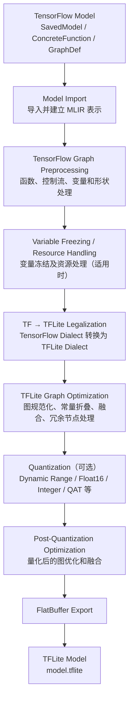

# TensorFlow Lite Converter 分析

> 本文只研究 **TensorFlow Lite Converter**：它在模型生成三阶段中的位置、存在原因、内部转换架构、图优化与算子融合、算子转换范围，以及最终 `.tflite` 模型格式。  
> 不讨论 Vela、NPU 专用图编译器、目标平台优化模型的生成，也不讨论芯片端 TFLM Runtime 的执行实现。  
>
> **三阶段定义（本文采用）：**
>
> 1. 原始模型（Original Model）：TensorFlow 等训练框架导出的模型。
> 2. TFLite 模型（TFLite Model）：由 TFLite Converter 转换得到的通用 `.tflite` 模型。
> 3. Target 优化模型（Target-optimized Model）：后续针对特定目标平台进一步优化得到的模型。第三阶段仅用于说明边界，不属于本文研究对象。

---

## 1. TFLite Converter 在模型生成三阶段中的位置

模型从训练框架走向部署，通常可以抽象成三个模型形态：

```mermaid
flowchart TD
    A["阶段一：原始模型<br/>TensorFlow SavedModel / ConcreteFunction / GraphDef"] 
    -->|"TFLite Converter"|
    B["阶段二：TFLite 模型<br/>FlatBuffer / .tflite"]
    -->|"Target-specific transformation（本文不展开）"|
    C["阶段三：Target 优化模型<br/>目标平台专用模型表示"]
```

TFLite Converter 位于第一阶段和第二阶段之间。它接收 TensorFlow 模型及转换配置，将 TensorFlow 计算图转换成 TFLite 能表达的计算图，并将模型序列化为 FlatBuffer 格式的 `.tflite` 文件。

### 1.1 三阶段的输入和输出

| 阶段 | 模型形态 | 主要内容 | 本文范围 |
|---|---|---|---|
| 阶段一：原始模型 | TensorFlow SavedModel、ConcreteFunction 等 | TensorFlow 算子、函数、变量、权重、控制流、Tensor 形状和数据类型 | 输入 |
| 阶段二：TFLite 模型 | `.tflite` FlatBuffer | TFLite Operator、Tensor、OperatorOptions、权重 Buffer、量化参数、子图 | **Converter 输出，本文重点** |
| 阶段三：Target 优化模型 | 由目标平台工具链定义 | 目标平台专用算子表示、布局、内存/执行信息或专用模型数据 | 仅作为边界 |

需要强调：TFLite Converter 的输出就是 TFLite 模型。它不会因为目标芯片是某款 NPU，就自动生成该 NPU 的专用指令或硬件调度数据。

### 1.2 一个重要区分

```text
TensorFlow Model
       |
       | TFLite Converter
       v
TFLite Model (.tflite)
       |
       | 后续 Target-specific 优化（不属于本文）
       v
Target-optimized Model
```

因此，本文提到的图优化和算子融合，均指 **TFLite Converter 为生成 TFLite 模型而进行的转换和优化**，不代表目标平台专用融合。

---

## 2. 为什么需要 TFLite Converter？

不能简单地把 TensorFlow 原始模型直接当作 TFLite 模型使用。两者的模型表示、算子集合、运行时依赖和部署目标不同。

### 2.1 原始 TensorFlow 模型包含训练框架语义

TensorFlow 模型可能包含：

- TensorFlow 原生算子及其属性；
- FunctionDef、函数调用和函数控制流；
- Variable、Resource 等资源对象；
- 动态形状和运行时形状计算；
- 训练相关节点或训练遗留结构；
- TensorFlow 特有的数据类型、布局和操作语义。

这些结构并不都适合直接放进一个轻量级、可静态解析的嵌入式模型文件。

### 2.2 TFLite 希望得到更适合部署的表示

TFLite Converter 主要解决以下问题：

| 问题 | Converter 的工作 |
|---|---|
| 原始模型包含 TensorFlow 特有结构 | 将可支持的 TensorFlow 图转换成 TFLite 图 |
| 变量在推理时不再更新 | 在适用条件下冻结变量、将权重转为常量 |
| 图中存在冗余计算 | 常量折叠、冗余节点消除、规范化 |
| 多个节点可表达成一个 TFLite 算子 | 执行图模式识别和算子融合 |
| TensorFlow 算子与 TFLite 算子表示不同 | Legalization，将 TF Dialect 转成 TFLite Dialect |
| 模型需要更小或更适合整数推理 | 按配置执行量化 |
| 模型需要轻量级存储和访问 | 导出为 FlatBuffer `.tflite` |

### 2.3 Converter 的目标不是生成硬件指令

TFLite Converter 生成的是通用 TFLite 模型格式。其工作重点是模型转换、通用图优化、可选量化和序列化。

它不会仅凭 `.tflite` 的生成就确定某个算子一定运行在 CPU 或某个 NPU 上，也不会自动生成特定 NPU 的 DMA 描述符、SRAM 地址规划或硬件命令。

---

## 3. TFLite Converter 的整体架构

现代 TensorFlow Lite Converter 的主要转换实现基于 MLIR。MLIR 是一种可定义多种 Dialect 的中间表示框架。Converter 使用 TensorFlow Dialect、TFLite Dialect 等表示模型在不同转换阶段的状态。

### 3.1 逻辑架构



这是一张用于理解职责的逻辑图，不代表源码中每个框只对应一个 Pass，也不意味着每种转换配置都会执行完全相同的 Pass 序列。实际 pipeline 会根据模型类型、转换选项、量化模式和 TensorFlow 版本发生变化。

### 3.2 主要源码目录

TensorFlow 官方源码：

- Converter MLIR 目录：<https://github.com/tensorflow/tensorflow/tree/master/tensorflow/compiler/mlir/lite>
- Pass Pipeline：<https://github.com/tensorflow/tensorflow/blob/master/tensorflow/compiler/mlir/lite/tf_tfl_passes.cc>
- TF Legalization：<https://github.com/tensorflow/tensorflow/blob/master/tensorflow/compiler/mlir/lite/transforms/legalize_tf.cc>
- Legalization Patterns：<https://github.com/tensorflow/tensorflow/blob/master/tensorflow/compiler/mlir/lite/transforms/legalize_patterns.td>
- TFLite Optimization Patterns：<https://github.com/tensorflow/tensorflow/blob/master/tensorflow/compiler/mlir/lite/transforms/optimize_patterns.td>
- TFLite Optimization Pass：<https://github.com/tensorflow/tensorflow/blob/master/tensorflow/compiler/mlir/lite/transforms/optimize_pass.cc>
- TFLite Schema：<https://github.com/tensorflow/tensorflow/blob/master/tensorflow/lite/schema/schema.fbs>

> 代码基线提示：以上链接指向 TensorFlow `master` 滚动分支。研究报告或产品兼容性承诺应固定到具体 TensorFlow tag/commit，并以该版本源码复核。

---

## 4. Converter 的主要转换阶段

### 4.1 Model Import：导入原始模型

Converter 接收 TensorFlow 模型，导入 TensorFlow 计算图及其函数、常量、变量和相关信息，建立 MLIR 内部表示。

原始 TensorFlow 模型并不一定是简单的静态 DAG。它可能包含：

- 函数调用；
- If / While 等控制流；
- Variable / Resource；
- 动态形状；
- TensorList 等结构。

导入阶段需要把模型转换为编译器能够分析和变换的内部表示。

### 4.2 Graph Preprocessing：图预处理

预处理阶段对原始 TensorFlow 图进行整理，为后续 TF → TFLite 转换做准备。可能涉及：

- TensorFlow 图标准化；
- Shape Inference；
- 函数内联或函数结构处理；
- 控制流表示转换；
- Resource 操作处理；
- TensorList 等结构处理。

具体执行哪些 Pass，取决于模型和转换配置。

### 4.3 Variable Freezing：变量冻结

训练结束后，模型中的权重和 Bias 通常不再更新。对于适合冻结的变量，Converter 可以将变量值固化为常量。

示意：

**冻结前**

```text
Variable: kernel
Variable: bias

Conv2D(input, kernel)
BiasAdd(conv_output, bias)
```

**冻结后**

```text
Const: kernel
Const: bias

Conv2D(input, kernel)
BiasAdd(conv_output, bias)
```

变量冻结的价值：

- 权重可以直接写入模型 Buffer；
- 后续优化能够利用常量值；
- 推理模型不需要保留训练变量更新语义。

并非所有变量都无条件冻结；是否冻结取决于模型结构、变量是否可确定以及转换配置。

### 4.4 Legalization：TensorFlow Dialect → TFLite Dialect

这是 Converter 的核心工作之一。

TensorFlow 算子和 TFLite 算子并非完全相同。Legalization 将 TensorFlow 表示转换成 TFLite 能表达的算子和属性。

例如：

```text
TensorFlow Dialect             TFLite Dialect

tf.Conv2D          ────────>   tfl.conv_2d
tf.MaxPool         ────────>   tfl.max_pool_2d
tf.Add             ────────>   tfl.add
tf.Mul             ────────>   tfl.mul
tf.Reshape         ────────>   tfl.reshape
```

实际转换可能涉及属性重编码、形状约束、数据布局处理和额外算子插入，不一定是简单的一对一改名。

#### 示例：MaxPool

TensorFlow：

```python
y = tf.nn.max_pool2d(
    x,
    ksize=2,
    strides=2,
    padding="SAME",
    data_format="NHWC"
)
```

TF 图中的属性：

```text
ksize   = [1, 2, 2, 1]
strides = [1, 2, 2, 1]
padding = SAME
data_format = NHWC
```

转换到 TFLite 表示后，属性可能被表达为：

```text
TFL.MaxPool2D
    filter_height = 2
    filter_width  = 2
    stride_h      = 2
    stride_w      = 2
    padding       = SAME
    fused_activation_function = NONE
```

转换器需要验证数据格式和属性是否满足对应规则。并非任意 TensorFlow 算子配置都能无条件转换。

#### 转换可能改变图结构

例如，为适配 TFLite 的布局约束，某些输入图可能需要插入 Transpose；某些 TensorFlow 算子可能被分解成多个 TFLite 算子；无法转换成 Builtin 的算子可能需要 Select TF Ops 或 Custom Op 路径。

因此：

**TensorFlow Graph 和 TFLite Graph 的节点数量、算子种类和拓扑结构都可能不同。**

### 4.5 TFLite Graph Optimization：图优化

Legalization 后，Converter 继续优化 TFLite 图，主要包括：

- Canonicalization；
- Constant Folding；
- Common Subexpression Elimination（CSE）；
- Dead Code Elimination（DCE）；
- 算子融合和模式识别；
- 广播与 Transpose 相关优化；
- 特定算子转换。

并非所有优化都属于 Fusion。第 5 节专门区分这些概念。

### 4.6 Quantization：可选量化

量化是 Converter 可配置的模型转换步骤，不等于算子融合。

常见模式：

| 量化方式 | 主要特点 |
|---|---|
| Dynamic Range Quantization | 通常量化权重，激活在运行时处理 |
| Float16 Quantization | 将适用权重转换为 Float16 |
| Full Integer Quantization | 将权重和激活转换为整数表示，通常需要 Representative Dataset 校准 |
| Quantization Aware Training（QAT）模型转换 | 利用训练阶段插入的 FakeQuant 等信息生成量化模型 |

量化会影响 Tensor 的数据类型、Scale、Zero Point、量化轴和算子输入输出类型。

### 4.7 Post-Quantization Optimization：量化后优化

Converter 不一定在量化前完成所有优化。量化过程可能产生新的 Q/DQ 或 FakeQuant 结构，也可能让某些优化条件成立或失效。

因此 pipeline 可能在量化后再次执行优化，以处理量化图中的冗余结构、算子顺序和可融合模式。

### 4.8 FlatBuffer Export：模型序列化

最后，Converter 将优化后的 TFLite 图及其 Tensor、Operator、Options、Buffer、Metadata 等信息序列化为 FlatBuffer 文件：

```text
model.tflite
```

---

## 5. TFLite Converter 是否做算子融合？

**是。TFLite Converter 有图模式识别和算子融合能力。**

但必须明确：Converter 的融合是为了生成 TFLite 表示，不是针对某个 NPU 的硬件指令融合。

### 5.1 融合的含义

原始图：

```text
Conv2D
   |
BiasAdd
   |
ReLU
```

一种可能的 TFLite 表示：

```text
CONV_2D
    inputs = [input, filter, bias]
    fused_activation_function = RELU
```

这里发生了两件不同的事情：

1. BiasAdd 不再作为独立计算节点，Bias 作为 Conv2D 的输入；
2. ReLU 不再作为独立 Operator，而是通过 Conv2D 的 `fused_activation_function` 属性表达。

因此，“融合”并不一定意味着产生一个名字叫 `CONV_RELU` 的新算子。

### 5.2 四种容易混淆的优化

| 类型 | 含义 | 示例 |
|---|---|---|
| 属性融合（Fused Activation） | 后置激活写入前置算子的属性 | Conv2D + ReLU → Conv2D(fused_activation=RELU) |
| 常量折叠进参数 | 把常量运算提前计算并改写权重/Bias | Conv2D + Add(Constant) → 修改 Bias |
| 复合模式识别 | 多个基础算子识别为一个 Builtin Operator | HardSwish 分解图 → HARD_SWISH |
| 冗余节点消除/规范化 | 删除无用节点或改写等价算子 | Identity 删除、Transpose 简化 |

只有前三类通常会被宽泛地称为融合；第四类应单独统计，避免把所有节点减少都算作 Fusion。

---

## 6. Converter 源码中可确认的主要融合模式

本节重点依据 `optimize_patterns.td` 中的 Pattern，并结合 `tf_tfl_passes.cc` 确认优化 Pass 的执行路径。

源码：
- <https://github.com/tensorflow/tensorflow/blob/master/tensorflow/compiler/mlir/lite/transforms/optimize_patterns.td>
- <https://github.com/tensorflow/tensorflow/blob/master/tensorflow/compiler/mlir/lite/transforms/optimize_pass.cc>
- <https://github.com/tensorflow/tensorflow/blob/master/tensorflow/compiler/mlir/lite/tf_tfl_passes.cc>

> 注意：Pattern 存在不等于每个模型都会触发。实际是否融合还取决于图结构、常量性、形状、数据类型、输出使用者数量、量化模式和 Pass 是否启用。

### 6.1 Activation 融入 Conv2D / DepthwiseConv2D

源码 Pattern：
- `FuseActFnIntoConvOpPat`

前置算子：
- Conv2D
- DepthwiseConv2D

可融合激活：
- ReLU
- ReLU6
- ReLU1

支持组合：

| 原始图 | 优化后 |
|---|---|
| Conv2D → ReLU | Conv2D(fused_activation=RELU) |
| Conv2D → ReLU6 | Conv2D(fused_activation=RELU6) |
| Conv2D → ReLU1 | Conv2D(fused_activation=RELU1) |
| DepthwiseConv2D → ReLU | DepthwiseConv2D(fused_activation=RELU) |
| DepthwiseConv2D → ReLU6 | DepthwiseConv2D(fused_activation=RELU6) |
| DepthwiseConv2D → ReLU1 | DepthwiseConv2D(fused_activation=RELU1) |

关键限制：前置算子输出必须只有一个使用者（`HasOneUse`）。否则将激活融合进前置算子会改变其他分支看到的数据。

源码注释还说明，Tanh、Sigmoid、HardSwish 等不能简单表示为该类 clamping fused activation 的激活不在这组 Pattern 中。

### 6.2 Activation 融入 Pooling

源码 Pattern：
- `FuseActFnIntoPoolOpPat`

前置算子：
- AveragePool2D
- MaxPool2D

可融合激活：
- ReLU
- ReLU6
- ReLU1

| 原始图 | 优化后 |
|---|---|
| AveragePool2D → ReLU/ReLU6/ReLU1 | AveragePool2D(fused_activation=...) |
| MaxPool2D → ReLU/ReLU6/ReLU1 | MaxPool2D(fused_activation=...) |

同样要求 Pool 输出满足单一使用者等 Pattern 条件。

### 6.3 Add/Sub 常量折叠进卷积 Bias

源码 Pattern：
- `FuseBinaryOpToPrecedingAffine`

前置算子：
- Conv2D
- DepthwiseConv2D
- TransposeConv

后置算子：
- Add
- Sub

典型图：

```text
Conv2D(input, weight, bias)
             |
             v
       Add(Constant)
             |
             v
           output
```

转换时可以提前计算：

```text
new_bias = old_bias + constant
```

或对应的减法形式。随后删除 Add/Sub 节点。

支持组合：

| 原始图 | 处理方式 |
|---|---|
| Conv2D → Add(Constant) | 折叠进 Conv2D Bias |
| Conv2D → Sub(Constant) | 折叠进 Conv2D Bias |
| DepthwiseConv2D → Add/Sub(Constant) | 折叠进 Depthwise Bias |
| TransposeConv → Add/Sub(Constant) | 折叠进 TransposeConv Bias |

限制包括常量值、Bias/通道形状匹配和前置算子输出使用者等。源码注释对该规则的常量类型有约束；应以具体版本中的 `CanFuseConvOrDepthwiseConv` 等检查为准。TransposeConv 还存在无 Bias 时构造 Bias 的专门路径。

### 6.4 Mul/Div 常量折叠进卷积参数

源码 Pattern：
- `FuseMulOrDivWithConv2dOrDepthwiseConv2d`

前置算子：
- Conv2D
- DepthwiseConv2D
- TransposeConv

后置算子：
- Mul
- Div

对于适用的常量乘法，可以利用卷积的线性性质，将常量提前作用到 Filter 和 Bias：

```text
new_weight = old_weight * constant
new_bias   = old_bias   * constant
```

然后删除后置 Mul。

源码也实现 Div 对应规则，但必须按 Pattern 实际操作数方向和常量约束判断，不能泛化为任意 `Conv / constant` 都一定能折叠。

| 原始图 | 处理方式 |
|---|---|
| Conv2D → Mul(Constant) | 修改 Filter 和 Bias |
| Conv2D → Div(Constant) | 按规则修改参数 |
| DepthwiseConv2D → Mul/Div(Constant) | 修改 Filter 和 Bias |
| TransposeConv → Mul/Div(Constant) | 修改 Weights 和 Bias |

常量类型、权重和 Bias 是否为常量、广播/形状条件、单一使用者等都会影响是否命中。

### 6.5 Add/Sub/Mul/Div 后接 Activation

源码 Pattern：
- `FusedBinaryActivationFuncOpPat`

二元算子：
- Add
- Sub
- Mul
- Div

激活：
- ReLU
- ReLU6
- ReLU1

| 原始图 | 优化后 |
|---|---|
| Add → ReLU/ReLU6/ReLU1 | Add(fused_activation=...) |
| Sub → ReLU/ReLU6/ReLU1 | Sub(fused_activation=...) |
| Mul → ReLU/ReLU6/ReLU1 | Mul(fused_activation=...) |
| Div → ReLU/ReLU6/ReLU1 | Div(fused_activation=...) |

关键条件：二元算子的输出需要满足单一使用者等匹配要求。

### 6.6 HardSwish 分解图 → HARD_SWISH

HardSwish 数学表达式：

$$
h(x)=x\cdot\frac{\operatorname{ReLU6}(x+3)}{6}
$$

模型中它可能被表达为多个基础算子：

```text
x ── Add(3) ── ReLU6 ── Mul(1/6) ──┐
|                                   Mul ── output
└───────────────────────────────────┘
```

源码包含多个 `MatchHardSwishPattern*` Pattern，用于匹配不同但等价的图表达，转换成：

```text
TFL_HardSwishOp(x)
```

其中还存在针对特定量化/FakeQuant 图形态的 Pattern。

注意：HardSwish 可以被识别成独立 `HARD_SWISH` 算子，不等于它能被融合进 Conv2D 的 `fused_activation_function` 属性。

### 6.7 LeakyReLU 分解图 → LEAKY_RELU

一种常见表达：

$$
f(x)=\max(x,\alpha x)
$$

原始图：

```text
x ────────────────┐
|                 Maximum ── output
Mul(x, alpha) ────┘
```

优化为：

```text
TFL_LeakyReluOp(x, alpha)
```

源码 Pattern 对 alpha 有约束，例如 alpha 是浮点常量且小于 1，并要求中间结果满足使用者数量等条件。

### 6.8 PReLU 分解图 → PRELU

一种常见表达：

$$
f(x)=\operatorname{ReLU}(x)-\alpha\operatorname{ReLU}(-x)
$$

原始图：

```text
                 x
                / \
             ReLU  Neg
              |     |
              |    ReLU
              |     |
              |   Mul(-alpha)
              |     |
               \   /
                 Add
                  |
                output
```

优化为：

```text
TFL_PReluOp(x, alpha)
```

Pattern 对 alpha 的 Rank、输入形状以及中间节点使用者数量有约束。

### 6.9 主要融合能力汇总

| 类别 | 原始算子组合 | 转换结果 | 主要约束 |
|---|---|---|---|
| Activation 属性融合 | Conv2D + ReLU/ReLU6/ReLU1 | Conv2D + fused activation | 单一使用者 |
| Activation 属性融合 | DepthwiseConv2D + ReLU/ReLU6/ReLU1 | DepthwiseConv2D + fused activation | 单一使用者 |
| Activation 属性融合 | AveragePool2D + ReLU/ReLU6/ReLU1 | AveragePool2D + fused activation | 单一使用者 |
| Activation 属性融合 | MaxPool2D + ReLU/ReLU6/ReLU1 | MaxPool2D + fused activation | 单一使用者 |
| Bias 常量折叠 | Conv2D / DepthwiseConv2D / TransposeConv + Add/Sub(Constant) | 修改或创建 Bias | 常量、形状、使用者约束 |
| 参数常量折叠 | Conv2D / DepthwiseConv2D / TransposeConv + Mul/Div(Constant) | 修改 Weight 和 Bias | 常量、形状、操作数方向约束 |
| Binary Activation | Add/Sub/Mul/Div + ReLU/ReLU6/ReLU1 | BinaryOp + fused activation | 单一使用者 |
| 模式识别 | HardSwish 分解图 | HARD_SWISH | Pattern 形态及常量约束 |
| 模式识别 | LeakyReLU 分解图 | LEAKY_RELU | alpha 常量及图结构约束 |
| 模式识别 | PReLU 分解图 | PRELU | alpha Rank 及图结构约束 |

---

## 7. 哪些图优化不应直接称为算子融合？

Converter 中有不少优化会删除节点、改变节点类型或调整拓扑，但它们不一定属于严格的多算子融合。

| 优化 | 处理结果 | 更准确的分类 |
|---|---|---|
| Identity 删除 | 删除不产生实际效果的节点 | 冗余节点消除 |
| Constant Folding | 编译期计算常量表达式 | 常量折叠 |
| CSE | 相同表达式复用计算结果 | 公共子表达式消除 |
| DCE | 删除不可达或无用计算 | 死代码消除 |
| Transpose 简化/合并 | 合并或消除不必要的转置 | 图规范化 |
| ExpandDims → Reshape | 等价算子替换 | 算子规范化 |
| Tile 被后续广播算子吸收 | 删除显式复制 | 广播优化 |
| BroadcastTo 与后续算子优化 | 利用算子自身广播能力 | 广播优化 |
| BatchMatMul → FullyConnected | 在满足条件时转换算子类型 | 算子转换 |
| Push Transpose Through Ewise | 将 Transpose 穿过逐元素算子移动 | 图重排 |

这些优化对最终模型的大小、执行开销和算子结构可能有影响，但不应全部计入“支持的融合算子组合”。

---

## 8. Converter 支持哪些标准算子？

必须区分两个问题：

1. TensorFlow 算子能否被 Converter 转换成 TFLite Builtin Operator？
2. TFLite Runtime 是否实现了某个 Builtin Operator？

二者相关，但并不等价。

- Converter 负责把源图转换为 TFLite 图。
- TFLite Schema 定义 Builtin Operator 的编号、Options 和数据结构。
- TFLite Runtime 提供对应算子的执行实现。
- 某个 TensorFlow 算子可能需要分解为多个 TFLite 算子，也可能需要 Select TF Ops 或 Custom Op。

### 8.1 常见 TFLite Builtin Operator 分类

下表列出常见内置算子，不是完整枚举：

| 类别 | TFLite Builtin Operator | 说明 |
|---|---|---|
| 卷积 | CONV_2D | 二维卷积 |
| 卷积 | DEPTHWISE_CONV_2D | 深度卷积 |
| 卷积 | TRANSPOSE_CONV | 转置卷积 |
| 全连接 | FULLY_CONNECTED | 全连接 |
| 池化 | MAX_POOL_2D | 最大池化 |
| 池化 | AVERAGE_POOL_2D | 平均池化 |
| 池化 | L2_POOL_2D | L2 池化 |
| 激活 | RELU | ReLU |
| 激活 | RELU6 | ReLU6 |
| 激活 | LOGISTIC | Sigmoid |
| 激活 | TANH | Tanh |
| 激活 | SOFTMAX | Softmax |
| 激活 | HARD_SWISH | HardSwish |
| 算术 | ADD | 加法 |
| 算术 | SUB | 减法 |
| 算术 | MUL | 乘法 |
| 算术 | DIV | 除法 |
| 算术 | MAXIMUM | 逐元素最大值 |
| 算术 | MINIMUM | 逐元素最小值 |
| 张量操作 | RESHAPE | 改变形状 |
| 张量操作 | TRANSPOSE | 转置 |
| 张量操作 | CONCATENATION | 拼接 |
| 张量操作 | SPLIT | 切分 |
| 张量操作 | PAD | 填充 |
| 张量操作 | SLICE | 切片 |
| 张量操作 | GATHER | 索引读取 |
| 张量操作 | STRIDED_SLICE | 步长切片 |
| 尺寸变换 | RESIZE_BILINEAR | 双线性缩放 |
| 尺寸变换 | RESIZE_NEAREST_NEIGHBOR | 最近邻缩放 |
| 归约 | MEAN | 均值 |
| 归约 | SUM | 求和 |
| 归约 | REDUCE_MAX | 最大值归约 |
| 归约 | REDUCE_MIN | 最小值归约 |
| 归一化 | L2_NORMALIZATION | L2 归一化 |
| 矩阵 | BATCH_MATMUL | 批量矩阵乘法 |
| 量化 | QUANTIZE | 量化 |
| 量化 | DEQUANTIZE | 反量化 |
| 索引 | ARG_MAX | 最大值索引 |

完整列表应以指定 TensorFlow 版本的 `tensorflow/lite/builtin_ops.h` 和 `schema.fbs` 为准。

### 8.2 如何理解算子支持范围？

不能因为 TFLite 有 `CONV_2D`，就认为任意 TensorFlow Conv2D 都一定能转换。转换还受以下因素影响：

- 数据类型；
- Tensor 形状；
- stride、dilation、padding；
- data_format；
- 是否为动态形状；
- 是否涉及不支持的属性；
- 量化模式；
- 转换配置和版本。

建议将算子支持能力拆成三张表维护：

1. TensorFlow 算子 → TFLite Builtin 的转换映射表；
2. TFLite Builtin 的 Schema/Options 表；
3. TFLite Runtime 的算子实现与类型支持表。

不要把三者合并成一张“支持算子表”。

---

## 9. TFLite Converter 输出的模型格式

TFLite Converter 输出：

```text
model.tflite
```

其格式是 **FlatBuffers 二进制序列化格式**，不是 TensorFlow SavedModel，也不是 C++ 源码、LLVM IR 或 NPU 指令文件。

### 9.1 为什么使用 FlatBuffers？

FlatBuffers 是 Google 开发的二进制序列化格式，适合资源受限设备。其特点包括：

- 二进制存储；
- 通过偏移和索引访问对象；
- 可避免传统方式中完整反序列化到大量对象；
- 支持多语言；
- 适合模型结构和常量数据的打包。

TFLite 使用 FlatBuffer Schema 描述模型对象。

官方 Schema：
<https://github.com/tensorflow/tensorflow/blob/master/tensorflow/lite/schema/schema.fbs>

### 9.2 Model 顶层结构

核心结构可以简化理解为：

```text
Model
 ├── version
 ├── operator_codes
 ├── subgraphs
 │    └── SubGraph
 │         ├── tensors
 │         ├── inputs
 │         ├── outputs
 │         └── operators
 ├── description
 ├── buffers
 └── metadata
```

各部分职责：

| 结构 | 保存内容 | 用途 |
|---|---|---|
| Model | 整个模型的根对象 | 组织模型数据 |
| OperatorCodes | 算子类型及版本信息 | 确定 Operator 的类型 |
| SubGraphs | 一个或多个子图 | 表示模型计算图 |
| Tensor | 形状、类型、Buffer 索引、量化信息等 | 描述数据 |
| Operator | 输入输出 Tensor 索引、opcode_index、算子选项 | 描述计算 |
| Buffer | 权重、Bias 和其他常量数据 | 保存模型常量 |
| Metadata | 可选元数据 | 保存模型相关附加信息 |

### 9.3 Tensor 保存什么？

Tensor 是数据对象，不是计算操作。

典型字段：

```text
Tensor
 ├── shape
 ├── type
 ├── buffer
 ├── name
 ├── quantization
 └── 其他可选属性
```

含义：

| 字段 | 含义 |
|---|---|
| shape | Tensor 的维度，例如 `[1, 8, 8, 3]` |
| type | 元素数据类型，例如 FLOAT32、INT8 |
| buffer | 指向 Model.buffers 中的数据 |
| name | Tensor 名称 |
| quantization | Scale、Zero Point、量化轴等 |

### 9.4 Operator 保存什么？

Operator 描述一次计算：

```text
Operator
 ├── opcode_index
 ├── inputs
 ├── outputs
 ├── builtin_options
 ├── custom_options
 └── 其他可选属性
```

| 字段 | 含义 |
|---|---|
| opcode_index | 指向 Model.operator_codes 中的算子类型 |
| inputs | 输入 Tensor 索引 |
| outputs | 输出 Tensor 索引 |
| builtin_options | 内置算子的参数，例如 Conv2DOptions |
| custom_options | 自定义算子的参数数据 |

### 9.5 用 Conv2D + BiasAdd + ReLU 举例

TensorFlow 原始程序：

```python
z = tf.nn.conv2d(
    input=x,
    filters=kernel,
    strides=[1, 1, 1, 1],
    padding="SAME"
)

z = tf.nn.bias_add(z, bias)
y = tf.nn.relu(z)
```

假设：

```text
Input:
    shape = [1, 8, 8, 3]
    dtype = FLOAT32

Kernel:
    shape = [3, 3, 3, 4]
    dtype = FLOAT32

Bias:
    shape = [4]
    dtype = FLOAT32

Output:
    shape = [1, 8, 8, 4]
    dtype = FLOAT32
```

在一种典型的转换结果中，TFLite Graph 可以只包含一个 `CONV_2D` Operator。

#### OperatorCodes

```text
OperatorCodes[0]:
    builtin_code = CONV_2D
```

#### SubGraph.Tensors

```text
Tensor 0:
    name = input
    shape = [1, 8, 8, 3]
    type = FLOAT32
    buffer = 0

Tensor 1:
    name = kernel
    shape = [3, 3, 3, 4]
    type = FLOAT32
    buffer = 1

Tensor 2:
    name = bias
    shape = [4]
    type = FLOAT32
    buffer = 2

Tensor 3:
    name = output
    shape = [1, 8, 8, 4]
    type = FLOAT32
    buffer = 0
```

#### SubGraph.Operators

```text
Operator 0:
    opcode_index = 0
    inputs = [0, 1, 2]
    outputs = [3]

    builtin_options:
        padding = SAME
        stride_w = 1
        stride_h = 1
        fused_activation_function = RELU
```

#### SubGraph 输入输出

```text
inputs = [0]
outputs = [3]
```

#### Buffers

```text
Buffer 0:
    空 Buffer，常用于运行时输入或中间 Tensor

Buffer 1:
    Kernel 的二进制数据

Buffer 2:
    Bias 的二进制数据
```

这只是便于理解的逻辑结构示意，不是实际 FlatBuffer 文件中的完整字节布局。实际字段、默认值和序列化偏移以对应版本的 `schema.fbs` 为准。

### 9.6 `.tflite` 中保存了什么？

| 内容 | 是否保存 | 位置 |
|---|---|---|
| 计算图 | 是 | SubGraphs |
| 算子类型 | 是 | OperatorCodes |
| 算子输入输出关系 | 是 | Operators |
| Tensor 形状 | 是 | Tensor.shape |
| Tensor 数据类型 | 是 | Tensor.type |
| 卷积参数 | 是 | Conv2DOptions |
| 权重和 Bias | 是 | Buffers |
| 量化参数 | 量化模型中保存 | Tensor.quantization |
| 模型输入输出 | 是 | SubGraph.inputs / outputs |
| 特定 NPU 的硬件指令 | 通常不是 | 不属于通用 TFLite Schema 的目标 |

---

## 10. 重要结论

1. TFLite Converter 位于模型生成三阶段中的第一阶段和第二阶段之间：TensorFlow 原始模型 → TFLite 模型。
2. 它的主要目的，是将 TensorFlow 模型转换成更适合轻量级部署的通用 TFLite 表示，并执行通用图优化和可选量化。
3. Converter 的主要实现基于 MLIR，核心过程包括模型导入、图预处理、变量处理、TF → TFLite Legalization、图优化、可选量化、量化后优化和 FlatBuffer 导出。
4. Converter 确实支持算子融合，包括激活属性融合、常量折叠进卷积参数、HardSwish/LeakyReLU/PReLU 模式识别，以及逐元素算子与激活融合。
5. 融合能否触发取决于 Pattern 的匹配条件，不是看到某两个算子相邻就一定融合。
6. TFLite Builtin Operator 列表不等于所有 TensorFlow 算子都能转换；转换支持、Schema 定义和 Runtime 实现是三个不同维度。
7. Converter 输出 `.tflite`，其格式为 FlatBuffers，保存模型计算图、Tensor、Operator、算子选项、权重 Buffer 和量化参数等信息。
8. TFLite 模型不是目标 NPU 的硬件指令模型；第三阶段的 Target 优化模型属于后续工具链的职责，不在本文范围内。

---

## 11. 官方资料与源码索引

### Converter 与 MLIR

- [TensorFlow MLIR Lite Converter 源码目录](https://github.com/tensorflow/tensorflow/tree/master/tensorflow/compiler/mlir/lite)
- [tf_tfl_passes.cc](https://github.com/tensorflow/tensorflow/blob/master/tensorflow/compiler/mlir/lite/tf_tfl_passes.cc)
- [legalize_tf.cc](https://github.com/tensorflow/tensorflow/blob/master/tensorflow/compiler/mlir/lite/transforms/legalize_tf.cc)
- [legalize_patterns.td](https://github.com/tensorflow/tensorflow/blob/master/tensorflow/compiler/mlir/lite/transforms/legalize_patterns.td)
- [optimize_pass.cc](https://github.com/tensorflow/tensorflow/blob/master/tensorflow/compiler/mlir/lite/transforms/optimize_pass.cc)
- [optimize_patterns.td](https://github.com/tensorflow/tensorflow/blob/master/tensorflow/compiler/mlir/lite/transforms/optimize_patterns.td)

### 算子融合与兼容性

- [TensorFlow Lite Operation Fusion 官方博客](https://blog.tensorflow.org/2020/07/operation-fusion-in-tensorflow-lite-converter.html)
- [TFLite Operator Compatibility](https://www.tensorflow.org/lite/guide/ops_compatibility)

### TFLite 模型格式

- [schema.fbs](https://github.com/tensorflow/tensorflow/blob/master/tensorflow/lite/schema/schema.fbs)
- [builtin_ops.h](https://github.com/tensorflow/tensorflow/blob/master/tensorflow/lite/builtin_ops.h)
- [TensorFlow Lite 官方文档](https://www.tensorflow.org/lite)

---

## 12. 后续源码验证建议

如果要把本文从架构分析升级为指定版本的源码审计，建议按以下顺序执行：

1. 固定 TensorFlow tag 或 commit SHA，记录版本基线。
2. 阅读 `tf_tfl_passes.cc`，完整记录该版本各转换配置对应的 Pass pipeline。
3. 阅读 `legalize_patterns.td`，整理 TF Operator → TFLite Operator 的转换映射。
4. 阅读 `optimize_patterns.td`，枚举所有图重写 Pattern，而不只搜索名字中含 Fuse 的规则。
5. 追踪 composite function 的匹配与转换实现，确认 LSTM/RNN 等具体支持条件。
6. 为每个重要 Pattern 编写最小 TensorFlow 测试程序。
7. 执行 Converter，解析输出 `.tflite`，对比 Operator 数量、Builtin Code、Options、Tensor 和 Buffer。
8. 分别测试 Float、Dynamic Range、Float16、Full Integer 和 QAT 等模式，确认量化配置对图结构的影响。

最终应以如下四项共同确认一条融合能力：

- 源码中存在对应 Pattern；
- 该 Pattern 被当前转换 pipeline 启用；
- 输入模型满足 Pattern 的全部约束；
- 实际输出 `.tflite` 中观察到预期的图结构变化。
